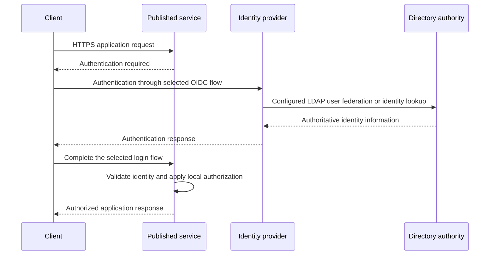
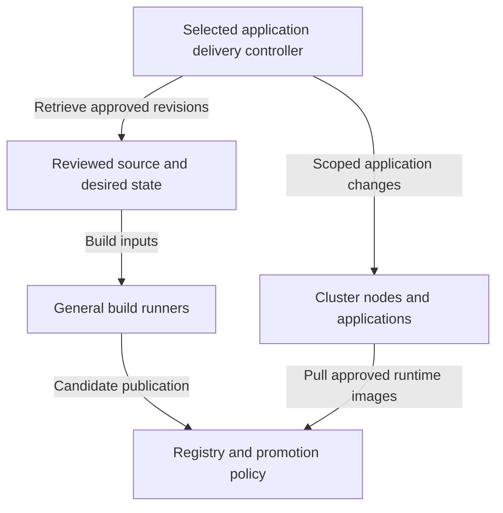
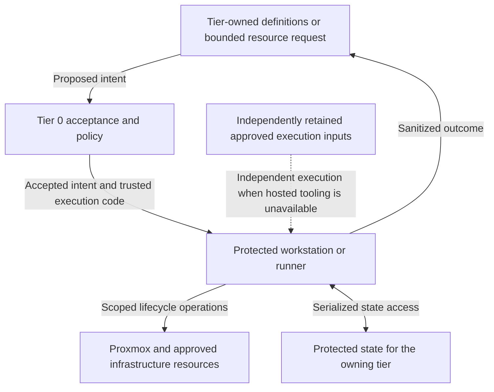
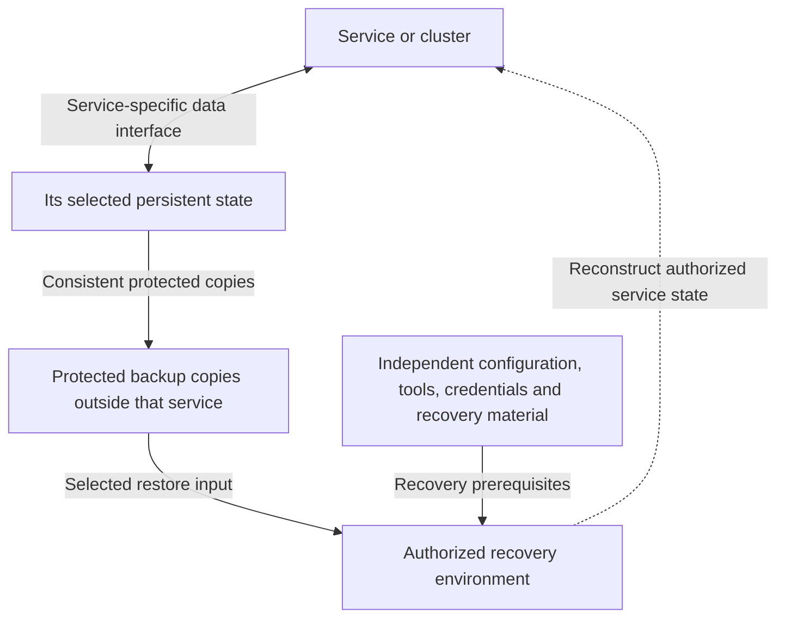
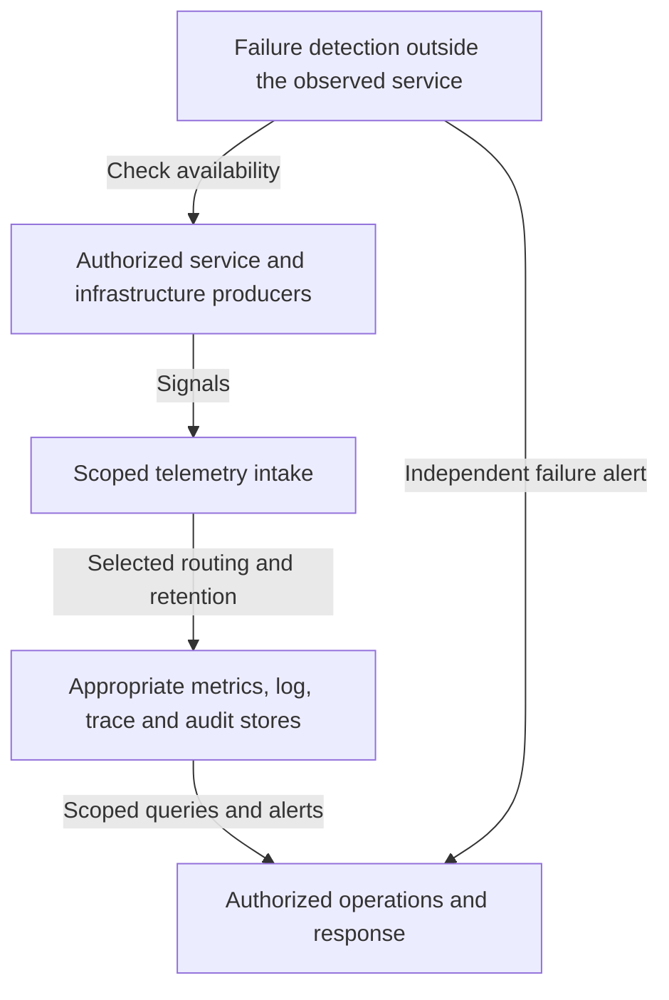

# Runtime relationships

These views explain how the completed [platform](README.md) works across domain
boundaries. Component placement belongs to the [integrated reference](reference-platform.md);
the diagrams here show service interactions and ongoing change, not installation order.
Each arrow names a purpose. Exact listeners and network enforcement belong to
the [firewall policy](networking/firewall-policy.md).

## Table of contents

- [Service access](#service-access)
- [Application delivery](#application-delivery)
- [Infrastructure changes](#infrastructure-changes)
- [Certificate and secret consumption](#certificate-and-secret-consumption)
- [Data, visibility and recovery](#data-visibility-and-recovery)
- [Failure boundaries](#failure-boundaries)

## Service access

Published services expose named application endpoints. For an OIDC-capable
service, the IdP uses directory authority and the service applies
its own authorization. This is a logical authentication scenario; exact token
exchanges depend on the selected application integration.

The service endpoint may be reached through the shared edge proxy and application
ingress. This does not publish its administrative interfaces. Direct directory
protocols, machine credentials and non-OIDC services use their own explicit
integration contracts.

| Access path | Authority retained at the boundary |
| --- | --- |
| Application user | Application or project permissions granted by the service |
| Workload delivery identity | Scoped source, registry and owning-runtime permissions |
| Platform administrator | Separately authorized access to the target control API |
| Recovery operator | Protected credentials available independently of normal IdP login |

The dedicated directory pair remains outside the reference control cluster.
The IdP, its database and each consumer's authorization configuration have
their own availability and recovery requirements. Detail:
[identity and access](identity/README.md).

## Application delivery

This path supplies applications to an existing approved runtime. Source control
owns reviewed definitions; general runners produce candidate artifacts; the
selected promotion policy determines approved releases. The selected delivery
controller changes only application resources within its granted authority.

Tier 0 uses Flux. Tier 1 leaves Argo CD and Spinnaker as alternatives: GitOps
reconciliation and release-pipeline orchestration are different delivery models.
[Controller patterns](delivery/controllers.md) owns that selection and the scoped
Tier 2 application boundary. Neither option grants infrastructure authority.

Application delivery and runtime image retrieval are separate consumers.
An OCI-based desired-state source is a supported design alternative only where
the selected controller and artifact contract provide it.

Tier 0 GitOps consumes approved revisions and artifacts under Tier 0-controlled
authorization. Tier 1 workload management is scoped to approved workload
clusters, with no authority over Tier 0. Approved base-template publication is
a separate Tier 0 lifecycle even when general builders prepare candidate images.

Linux VM application delivery uses workload-scoped configuration rather than
cluster reconciliation. Both realizations preserve the separation between
application changes and hardware-facing infrastructure changes. Detail:
[delivery](delivery/README.md), [artifact variants](delivery/artifact-supply.md).

## Infrastructure changes

Tier-owned resource definitions describe intended resources. A protected
workstation or runner executes accepted changes using the owning tier's state.
The bounded request interface is a design goal; the current operator workflows
do not constitute an implemented self-service API.

Tier 0 controls the acceptance policy, execution code and privileged credentials.
A workload request cannot provide arbitrary scripts, providers or manifests for
execution with those credentials. Executor placement does not transfer ownership
of a workload's definitions, inventory or state; one writer controls each state root.

Source-control loss can pause new requests. It must not remove accepted resource
records, trigger workload deletion, or prevent independent Tier 0 administration
and recovery. Detail: [infrastructure control](compute/provisioning.md).

## Certificate and secret consumption

The [certificate hierarchy](reference-platform.md#certificate-trust) is the
authoritative cross-tier trust view. It distinguishes offline authorization of
intermediates from routine online issuance. The
[cryptography domain](cryptography/README.md) expands signing, key custody,
secret storage and seal/unseal as separate components.

| Consumer interaction | Required boundary |
| --- | --- |
| Certificate consumer to online issuer | Approved certificate policy and authenticated issuance or renewal |
| Issuer to signing provider | Explicitly supported provider integration and permitted key operations |
| Workload to secret service | Scoped credential delivery and audit; no implied access to other tenants or administration |
| Secret service to seal mechanism | Selected startup/key-protection contract, independent of certificate signing |
| Root ceremony to issuing authority | Authorized transfer of signed intermediate certificates and trust material; no normal network route |

Software, USB and network-HSM realizations retain these roles while changing
custody, availability and recovery properties. Root keys and online keys can use
different providers. A reachable gateway alone does not establish integration.

## Data, visibility and recovery

Service persistence, telemetry and backup are separate relationships. Each has
an explicit owner, approved interface and failure boundary. A selected storage
backend may host several kinds of data, but that does not merge their ownership
or restoration requirements.

### Persistent state and restoration

The arrow from data to copies denotes the required backup result; the backup
mechanism may be application-native, storage-native or a protected backup service.
The complete restoration set includes application data and configuration, not
only VM disks. The [reference data table](reference-platform.md#data-and-recovery)
maps the directory, clusters, database consumers, Vault, artifacts and keys to
their separate contracts.

### Visibility during normal operation and failure

General shared telemetry may belong to Tier 1. All tiers submit security/audit
records to [protected Tier 0 logging](operations/security-logging.md); Tier 1
searches approved projections with segmented reader scopes. Tier 0 retains the detection and
evidence required to operate and recover without that service. Intake permission
does not grant backend administration or access to every producer's records.
NetBox documents the environment; tier-local bootstrap inventory remains
independently available. Detail: [telemetry](operations/telemetry.md) and
[operations](operations/README.md).

## Failure boundaries

These are architectural obligations. Actual restore commands, outage exercises
and acceptance evidence belong in [administration](../administration/recovery.md)
and [deployment readiness](../deployment/readiness.md).

| Unavailable component | Expected limitation | Capability that remains independently recoverable |
| --- | --- | --- |
| Tier 2 public edge or outbound cache | Published user access or ordinary proxied downloads can pause | Tier 0 control and Tier 1 recovery through protected internal access and retained software inputs |
| Tier 1 source or registry | New revision/artifact retrieval can pause; affected workload restarts may need retained images | Tier 0 control, approved execution inputs and required recovery artifacts |
| Identity provider | Normal federated login can fail | Protected recovery access and dedicated directory recovery |
| Control cluster | Hosted IdP, secrets and operational services may be unavailable together | Host access, cluster bootstrap material, unseal/recovery inputs and required external failure detection |
| Online issuer or key provider | New issuance/renewal is interrupted according to the chosen resilience design | Authorized provider recovery and separately held offline root custody |
| Primary state or storage | Stateful service availability depends on its selected replication/failure design | Protected copies and the complete authorized restoration inputs |

Return to the [integrated reference](reference-platform.md), or continue into
the [domain designs](README.md#technical-domains) and [local variants](variants.md).
