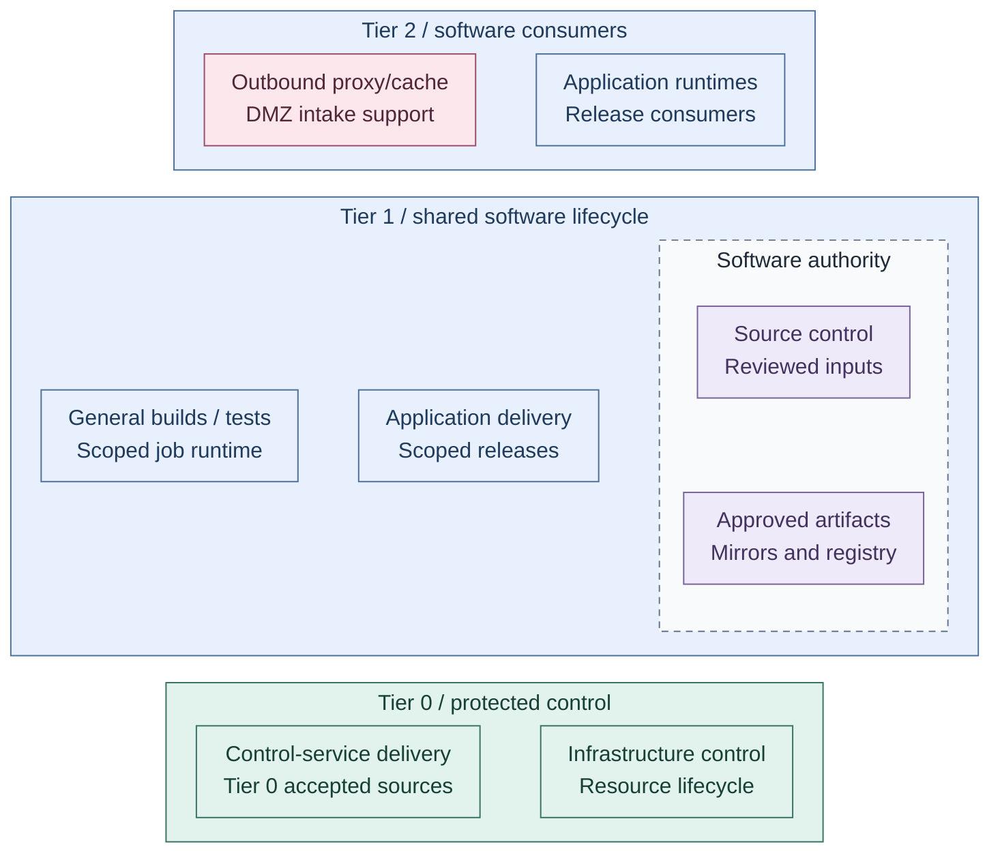

# Software lifecycle

Software lifecycle controls how external software and reviewed code become tested,
approved artifacts and running releases, and how those releases are updated,
rolled back and retired. The capability applies across homelab and cloud runtimes;
the selected site determines its tools and hosting. It expands the
[foundational capability](../README.md#foundational-capabilities) of the platform.

Tier 1 owns shared source, artifact and general build services. An ordinary Tier 2
proxy/cache supports controlled intake without becoming an approval authority.
Tier 0 retains independent control-service delivery and recovery inputs. Hardware,
VM and cluster lifecycle remain under [Hosting](../hosting/README.md); published
application traffic belongs to [Networking](../networking/README.md#service-reachability-and-publication).
The [runtime relationships](../runtime-flows.md#application-delivery) connect software
authority, runtime consumers and protected infrastructure changes.

## Table of contents

- [Completed design](#completed-design)
- [Components and interfaces](#components-and-interfaces)
- [Domain boundaries](#domain-boundaries)
- [Design choices](#design-choices)
- [Design constraints](#design-constraints)
- [Detailed views](#detailed-views)
- [Reference realization](#realization)

## Completed design

The view places lifecycle functions by ownership. Source authority and approved
artifact supply sit to the right of their build/deployment consumers. These are
stable capabilities, not a pipeline execution order or an installed-service inventory.

**Architecture:** this view shows placement and authority. The
[controller design](controllers.md) shows approved-input and scoped-change flows.
Tier 0 separately accepts sources; source access does not transfer control authority.
Retained code, artifacts, keys and recovery remain usable without hosted Tier 1 services.

The cache is an intake support function. Its actual request/response paths are in
[software intake](software-intake.md); public edge load balancing is not a software
lifecycle component. Infrastructure control marks the separate protected authority for
infrastructure changes, not an installed self-service request API.

## Components and interfaces

| Capability | Function and authority |
| --- | --- |
| Controlled intake | Admit selected external repositories/images/updates; distinguish source access, cached responses and retained approval |
| Source control | Retain definitions, change history, review and proposed revisions |
| Build and test | Execute scoped jobs and produce candidates plus test results; ordinary jobs hold no Tier 0 credentials |
| Artifact and mirror supply | Retain identified versions and approved external content; enforce publisher/consumer scope and retention |
| Promotion | Select an accepted revision/artifact for a target under its release policy; download or successful build alone is not approval |
| Application deployment | Apply the accepted release through one scoped pipeline/reconciler per object; preserve target ownership |
| Maintenance and retirement | Track supported versions, updates, rollback compatibility and release retirement; preserve required data/recovery records |

| Interface | Connected function | Contract |
| --- | --- | --- |
| Approved versions and release intent | Application runtimes | Scoped changes, accepted artifacts/configuration and a selected recovery path |
| Proposed infrastructure code and image candidates | [Hosting lifecycle](../hosting/provisioning.md) | Tier 0 authorization, credentials, state and template publication remain outside ordinary build/delivery authority |
| Listener and backend requirements | [Networking](../networking/README.md#service-reachability-and-publication) | Publication, routing, DNS and ingress policy are separate from release acceptance |
| Build/runtime capacity | [Hosting](../hosting/runtime.md) | Explicit resource owner, isolation and authorized placement/lifecycle |
| Source, artifact and service datasets | [Data and storage](../data/README.md) | Qualified persistent interfaces, dataset access and compatible state; software services do not administer underlying storage |
| Human/workload identity and trust | Identity and cryptography | Scoped access, service credentials and independently recoverable bootstrap inputs |
| Test, rollout and operating evidence | [Operations](../operations/README.md) | Findings inform updates and rollback decisions; operational visibility does not authorize a release |

The Kubernetes reference runs general build pods in the Tier 1 Services cluster.
An external VM runner or authoritative mirror uses its selected DMZ attachment;
deploying a runner namespace does not place its jobs in that VLAN.
Source control and artifact services use their approved Services attachments.
The diagram aggregates artifact/mirror supply by function, not by a shared subnet
or one product. Dataset custody and independent backup/recovery policy remain
under the Data and Operations contracts.

## Domain boundaries

Software lifecycle owns the accepted software/configuration revision and its
application release policy. Networking owns whether a listener is reachable and
which client/backend paths are permitted. Deploying software does not publish it;
a traffic endpoint does not approve or promote its backend release.

Hosting owns privileged host, network, storage, VM, cluster and template lifecycle.
Software services supply inputs to that boundary, not infrastructure permissions.
The [protected execution contract](../hosting/provisioning.md) owns acceptance and
state access. The [direct trusted-CI variant](development-platform.md#privileged-ci)
explicitly classifies its privileged execution authorities as Tier 0 trusted
principals; Tier 1 hosting is not a grant of that authority to ordinary jobs or users.

## Design choices

| Decision | Alternatives | Consequence |
| --- | --- | --- |
| External supply | Accepted existing supply, policy proxy/cache, retained mirrors or offline content | [Intake design](software-intake.md) separates connectivity, caching, approval and recovery |
| Source-control runtime | Existing service, dedicated VM or cluster service | The review/change interface remains; hosting and data recovery differ |
| Build environment | Scoped general jobs or selected image-building jobs | Candidate creation does not authorize trusted template publication |
| Artifact service | Integrated registry, independent registry or distribution acceleration | [Artifact design](artifact-supply.md) separates version authority from transfer capacity |
| Application delivery | Reconciliation or release-pipeline orchestration | [Controller design](controllers.md) defines sources, destinations, approvals and ownership |
| Release/update policy | Target-specific promotion, maintenance and rollback policy | Image/definition changes do not themselves update every running consumer |

These choices do not form a mandatory product progression. An existing service
can satisfy an interface; isolated projects may select their own scoped instance.
Lifecycle controls apply to external dependencies and host updates as well as
locally built applications, without transferring host administration to build users.

## Design constraints

| Concern | Required property |
| --- | --- |
| Provenance and promotion | Identify the reviewed source and accepted artifact; cache hits or successful jobs are not promotion evidence |
| Authorization | Separate source, build, publish, deploy and infrastructure privileges |
| Ownership | One selected release/reconciliation owner per resource; tier-local inventory and state remain authoritative |
| Rollback and retention | Retain compatible release/data recovery material; reverting an image alone cannot undo every data/schema change |
| Independence | Tier 0 bootstrap/update/recovery retains accepted inputs without depending solely on Tier 1/2 services |

## Detailed views

- [Controlled software intake](software-intake.md): source policy, caches, retained mirrors and offline alternatives.
- [Controller patterns](controllers.md): scoped reconciliation and release orchestration.
- [Development platform](development-platform.md): reviewed code, general jobs and the explicit trusted-CI variant.
- [Artifact supply](artifact-supply.md): integrated, independent and accelerated distribution choices.
- [Hosting lifecycle](../hosting/provisioning.md): protected execution, credentials, resource state and image publication.
- [Network publication](../networking/README.md#service-reachability-and-publication): application listeners, ingress and backend reachability.

## Reference realization

The reference uses a Tier 2 Squid proxy/cache, Tier 1 GitLab and a selected
artifact service, Tier 0 Flux, and a separately selected Tier 1 Argo CD or
Spinnaker controller. Harbor is the supplied independent-registry realization;
an accepted existing registry is also valid. Product choice does not alter the
authority boundaries above.

Implementation procedures: [software intake](../../deployment/stage-1-software-intake/README.md),
[application delivery](../../deployment/stage-7-delivery/README.md), and the
[development platform](../../deployment/stage-9-development/README.md).
Actual installers, project integrations and acceptance limits belong to those procedures.
