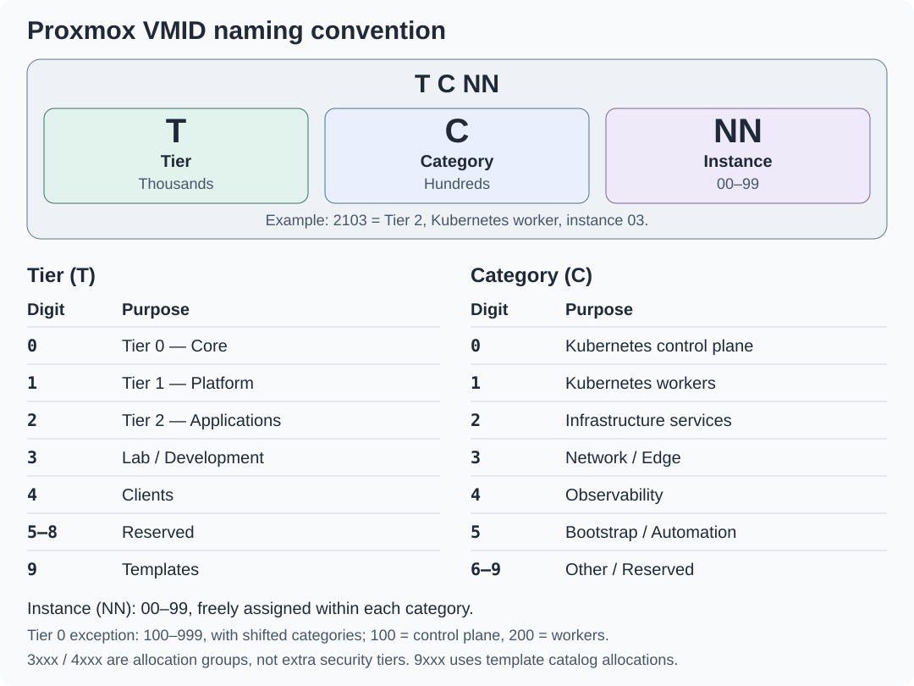

# Proxmox VMID naming convention

VMIDs group guests by tier or allocation purpose, category and instance. The reference
uses **`T C NN`** for four-digit IDs and a shifted category for three-digit Tier 0 IDs.
This is an allocation convention; ownership, networks and access policy remain separate.
The [editable SVG](vmid-convention.svg) is the quick reference; the tables below provide searchable detail.

## Contents

- [Format](#format)
- [Tier and allocation group](#tier-and-allocation-group)
- [Categories and Tier 0 offset](#categories-and-tier-0-offset)
- [Examples](#examples)
- [Allocation and existing installations](#allocation-and-existing-installations)
- [References](#references)

## Format

| Field | Position | Meaning |
| --- | --- | --- |
| `T` | Thousands | Tier for `1` and `2`; reserved allocation group for `3`, `4` and `9` |
| `C` | Hundreds | Guest category, except in the separately allocated template range |
| `NN` | Last two digits | Instance `00-99`, assigned freely within the group/category |

For example, **`2103` = Tier 2, Kubernetes worker, instance 03**.
Instance numbers need not match hostname suffixes, IP addresses or VLAN IDs.

## Tier and allocation group

| Digit | Range | Purpose |
| --- | --- | --- |
| `0`, implicit | `100-999` | Tier 0 — Core; three-digit exception below |
| `1` | `1000-1999` | Tier 1 — Platform |
| `2` | `2000-2999` | Tier 2 — Applications and edge services |
| `3` | `3000-3999` | Lab / development environments |
| `4` | `4000-4999` | Client VMs |
| `5-8` | `5000-8999` | Reserved |
| `9` | `9000-9999` | Templates and dedicated template-conversion builders |

The architecture has **three security tiers**. Lab and ordinary client allocations
remain Tier 2-owned; the template lifecycle remains Tier 0-owned. A development-platform
service belongs to Tier 1, while a disposable development environment uses the lab range.
Privileged administrative clients retain the authority classification of the systems they control.

## Categories and Tier 0 offset

| `C` | Category | Four-digit suffix `CNN` | Tier 0 range |
| --- | --- | --- | --- |
| `0` | Kubernetes control plane | `000-099` | `100-199` |
| `1` | Kubernetes workers | `100-199` | `200-299` |
| `2` | Infrastructure services | `200-299` | `300-399` |
| `3` | Network / Edge | `300-399` | `400-499` |
| `4` | Observability | `400-499` | `500-599` |
| `5` | Bootstrap / Automation | `500-599` | `600-699` |
| `6-9` | Other / Reserved | `600-999` | `700-999`, reserved |

Tier 0 omits the leading zero and shifts the named categories up one hundred:
control-plane category `0` becomes `1NN`, workers become `2NN`, and so on.
Thus `100` is a Tier 0 control plane at instance 00; `200` is a Tier 0 worker at instance 00.
IDs below 100 are reserved by Proxmox. [1]

For the named categories `0-5`, Tier 0 uses `100 × (C + 1) + NN`.
Its remaining `700-999` range is unassigned; category `9` cannot be shifted into another
thousand while still representing Tier 0. Four-digit guest IDs use `1000 × T + 100 × C + NN`.

The `9xxx` template range uses its own catalog allocations: its hundreds digit does
**not** classify the roles of future clones. A generic Linux template can supply any tier
or role. The [published template catalog](../reference/template-catalog.md) records those IDs.

## Examples

| VMID | Interpretation |
| --- | --- |
| `101` | Tier 0 control plane, instance 01 |
| `311` | Tier 0 infrastructure service, instance 11 |
| `501` | Tier 0 protected logging, instance 01 |
| `601` | Tier 0 bootstrap/automation host, instance 01 |
| `1001` | Tier 1 control plane, instance 01 |
| `1401` | Tier 1 observability, instance 01 |
| `2103` | Tier 2 Kubernetes worker, instance 03; illustrative allocation |
| `2311` | Tier 2 network/edge service, instance 11 |
| `3001` | Lab control plane, instance 01; owned by Tier 2 |
| `3201` | Lab infrastructure service, instance 01; owned by Tier 2 |
| `9101` | Template catalog allocation; owned by Tier 0 |

## Allocation and existing installations

VMIDs must be unique across the Proxmox cluster. [2] Reserve them across all repositories,
environments, VMs, containers and templates; separate Terraform states do not isolate the ID space.
Allocate different instance blocks for additional clusters or services in the same category.
One category has 100 instance slots; review the allocation plan before exhausting them.

Tier-local Terraform inputs own exact guest IDs; inventories own logical host names and addresses.
Shared holds approved template references, not a guest inventory or VMID allocator. The
[project standards](../development/project-documentation.md) record local choices and
link this convention, without duplicating individual resource assignments.

Starter IaC examples follow this plan. An update does **not** renumber an existing installation:
retain its local VMIDs and state. Copying a new example ID over a managed guest may propose
replacement. Any deliberate renumbering needs its own reviewed migration, backup and updated
state, HA rules, scoped API permissions and references. Legacy template adoption remains supported.

Implementation: [Tier 0 guests](../../tier-0/terraform/deployments),
[Tier 1 guests](../../tier-1/terraform/deployments),
[Tier 2 guests](../../tier-2/terraform/deployments), and the
[Tier 0 publication catalog](../../tier-0/templates/proxmox.yml.example).
The [ownership model](../architecture/tier-ownership.md) determines authority;
the [network plan](network-plan.md) determines attachments and segmentation.

## References

1. [Proxmox VM configuration: IDs below 100 are reserved](https://github.com/proxmox/pve-docs/blob/master/qm.conf.adoc).
2. [Proxmox VM general settings: unique VM IDs](https://github.com/proxmox/pve-docs/blob/master/qm.adoc#general-settings).
