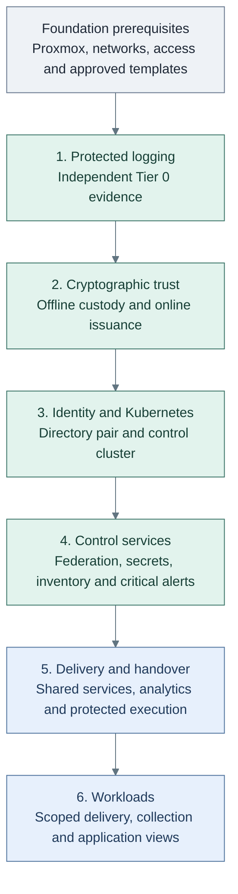

# Deployment

Verify the unnumbered [foundation prerequisites](foundation/README.md), then choose
the capability to deploy and follow its main README from Step 1 onward.
Each stage explains the main path with diagrams, names the capability available at
the end, and links back to the architecture it implements.

## Table of contents

- [Deployment stages](#deployment-stages)
- [IaC capability map](#iac-capability-map)
- [Repository locations](#repository-locations)
- [Follow a stage](#follow-a-stage)
- [Implementation scope](#implementation-scope)

## Deployment stages

| Stage | Capability available | Working repository | Walkthrough |
| --- | --- | --- | --- |
| 1: Protected logging | Independent collection, protected evidence and offline investigation | Tier 0 | [Protected logging](stage-1-logging/README.md) |
| 2: Cryptographic trust | Offline root custody and an online issuing service | Tier 0 | [Trust](stage-2-trust/README.md) |
| 3: Identity and Kubernetes | Dedicated directory pair and the Tier 0 cluster with basic platform services | Tier 0 | [Identity and Kubernetes](stage-3-identity-runtime/README.md) |
| 4: Control services | Federated access, secrets, inventory documentation and independent monitoring | Tier 0 | [Control services](stage-4-control-services/README.md), [monitoring](stage-4-control-services/monitoring.md) |
| 5: Delivery and handover | Source control, artifacts, builds, shared analytics and protected infrastructure execution | Tier 1 platform; Tier 2 edge; Tier 0 execution | [Delivery and handover](stage-5-delivery/README.md), [analytics](stage-5-delivery/analytics.md) |
| 6: Workload provisioning | Approved Tier 2 runtime, applications and scoped collection | Tier 2 definitions; Tier 0 execution | [Workload provisioning](stage-6-workloads/README.md), [collection](stage-6-workloads/telemetry.md) |

For a new installation, follow this order. Existing infrastructure can satisfy a
stage's verified prerequisites; a stage number is not a tier, network or state boundary.

## IaC capability map

Use this map to find what each runnable entry point deploys and when it is used.
Linux entries use `scripts/deploy.sh <setup>`; Kubernetes and template publication
use their dedicated scripts. Every command runs from the named repository root.

| Repository | Entry point | Capability / when | Walkthrough |
| --- | --- | --- | --- |
| Tier 0 | `templates` | Foundation: approved source images | [Publication](../administration/compute/template-lifecycle.md#local-workflow) |
| Tier 0 | `template-refresh` | Foundation or maintenance: Linux image refresh | [Linux templates](foundation/procedures/enterprise-linux-template.md) |
| Tier 0 | `syslog` | Stage 1: independent log hosts | [Protected logging, Steps 1-3](stage-1-logging/README.md) |
| Tier 0 | `foundation` | Stages 2/3: issuer and directory VM resources | [Trust](stage-2-trust/README.md), [directory deployment](stage-3-identity-runtime/procedures/freeipa.md) |
| Tier 0 | `hsm` | Stage 2 option: signing-service host pool | [USB HSM option](stage-2-trust/step-1b-usb-hsm.md) |
| Tier 0 | `kubernetes` | Stage 3: control cluster | [Cluster deployment](stage-3-identity-runtime/procedures/talos-terraform.md) |
| Tier 0 | `vault` | Stage 4 option: dedicated secrets VM | [Vault VM option](stage-4-control-services/step-2b-vault-vm.md) |
| Tier 0 | `immutable-template` | Stage 5 option: image-based Linux builds | [Image-based Linux](stage-5-delivery/step-1d-image-based-linux.md) |
| Tier 1 | `kubernetes` | Stage 5: shared platform cluster | [Platform runtime](stage-5-delivery/procedures/platform-cluster.md) |
| Tier 1 | `development` | Stage 5 option: source-control VM | [Source-control VM](stage-5-delivery/step-1b-source-control-vm.md) |
| Tier 1 | `podman-runner` | Stage 5 option: general build runner | [Build runner](stage-5-delivery/step-1c-podman-runner.md) |
| Tier 1 | `observability` | Stage 5 option: shared analytics VM foundations | [Analytics](stage-5-delivery/analytics.md), [VM recipe](stage-4-control-services/step-2d-telemetry-vm.md) |
| Tier 2 | `cache` | Optional prerequisite: outbound software access | [Cache deployment](foundation/step-3b-outbound-cache.md) |
| Tier 2 | `edge` | Stages 5/6: public service entry | [Edge deployment](stage-5-delivery/procedures/edge-proxy.md) |
| Tier 2 | `kubernetes` | Stage 6: workload cluster | [Workload runtime](stage-6-workloads/README.md#step-2-provision-the-workload-runtime) |
| Tier 2 | `lab` | Stage 6: workload VM/LXC resources | [Workload runtime](stage-6-workloads/README.md#step-2-provision-the-workload-runtime) |

Entry points are not one-to-one with stages: the Tier 0 `foundation` root plans all
selected issuer/directory guests together; service configuration follows its stage.
Stages never rename state roots or authorize removal of earlier resources. Product
integration is distinguished from supplied automation in the [support map](../reference/implementation-support.md).

## Repository locations

`<prefix>` is the collection prefix, `homelab` by default. The upstream source
directory becomes the matching generated repository; paths inside it stay the same.

| Repository | Generated checkout | Upstream source | Responsibility |
| --- | --- | --- | --- |
| Tier 0 | `<prefix>-tier-0/` | [tier-0/](../../tier-0/) | Proxmox, templates, trust, identity, control cluster and privileged execution |
| Tier 1 | `<prefix>-tier-1/` | [tier-1/](../../tier-1/) | Delivery services, general runners and platform cluster |
| Tier 2 | `<prefix>-tier-2/` | [tier-2/](../../tier-2/) | Public edge, ordinary cache, workload cluster and applications |
| Shared | `<prefix>-shared/` | [shared/](../../shared/) | Reusable helpers, baseline roles and stateless platform references; no inventory, resources or state |
| Architecture | `<prefix>-architecture/` | [docs/](../README.md) | Project records and upstream references in `docs/auto-docs/`; not a deployment working directory |

Each guide names its **working repository**. File paths are relative to that
repository unless another owner is named. For example, Tier 0
`terraform/deployments/foundation/` means
`homelab-tier-0/terraform/deployments/foundation/` in the default collection.

Run repository scripts from the owning tier's root, even when their implementation
is in Shared. `scripts/deploy.sh` delegates to Shared but uses the current tier's
inventory, inputs and state. Host consoles and product CLIs run where the procedure
specifies. For exact code responsibilities, use the [code map](../development/code-layout.md).

## Follow a stage

1. Verify foundation readiness, open the named working repository, then read the
   stage's prerequisites and intended result.
2. Follow the numbered steps in the main README. At a decision, select an adjacent
   option such as Trust's `step-1b-usb-hsm.md`, then return to the stated step.
3. Follow each named capability's numbered deployment and diagrams; use linked
   procedures for exact product configuration. Record selected options
   and acceptance evidence in the project's deployment documents.

The [reference platform](../architecture/reference-platform.md) owns the complete
design. Stages realize parts of it; [readiness](readiness.md) records what is verified.

## Implementation scope

The [support map](../reference/implementation-support.md) distinguishes supplied
automation from project integration. A diagram is not a claim that every component
has an installer. Current wrappers call `terraform`; Terraform / OpenTofu is the
design choice, not a claim of a validated OpenTofu drop-in workflow.

Continue with [administration](../administration/README.md) for recurring operation
and [development](../development/README.md) for implementation changes.
Retain [recovery inputs](../administration/recovery.md) independently of hosted
services. Tier 0 recovery and root ceremonies never depend on normal Tier 1 CI.

Refresh updates references without moving infrastructure or replacing project
decisions; see the [refresh contract](../development/generated-repositories.md#refresh-and-local-ownership).

