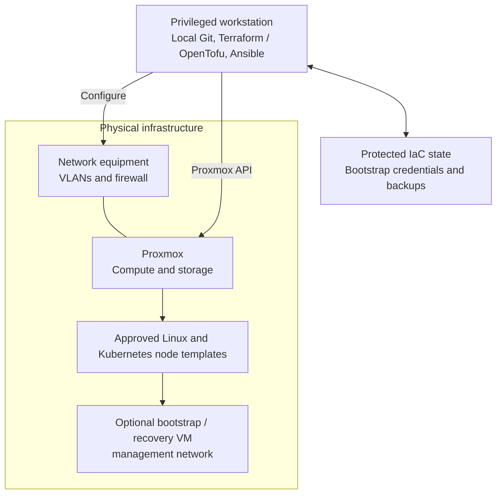

# Foundation and prerequisites

Prepare Proxmox, networks, approved VM templates and independent provisioning/recovery
access before deploying platform capabilities. Existing infrastructure is valid when
it passes these checks. Foundation is not a numbered capability stage.

**Prerequisites:** physical hosts, network equipment, approved installation sources
and a privileged workstation with independent console access.
**Working repository:** `<prefix>-tier-0` (source: `tier-0/`).
The optional cache branch uses `<prefix>-tier-2` instead.
**Design:** [compute](../../architecture/compute/README.md) and
[network boundaries](../../architecture/networking/README.md).

## Preparation checklist

1. [Prepare hosts and networks](#step-1-prepare-hosts-and-networks)
2. [Protect provisioning access and state](#step-2-protect-provisioning-access-and-state)
3. [Publish and test VM templates](#step-3-publish-and-test-vm-templates)

## Step 1: Prepare hosts and networks

Prepare [local tools](../../development/local-setup.md) and bring up the external
network; the [UniFi starting path](procedures/unifi-zones.md#bring-up-the-network)
includes controller adoption and VLAN/port preparation. Install
[Proxmox](procedures/proxmox.md), then configure [host networking](procedures/host-network.md)
and storage. Verify management access, DNS, time and permitted guest networks.

The main path uses bridges and VLANs. **Before important guests**, select
[1b: cluster HA](step-1b-cluster-ha.md) or [1c: SDN guest networks](step-1c-sdn.md)
where required. These options return here after their own checks.

Apply the [firewall policy](procedures/firewall-rollout.md), using the
[UniFi translation](procedures/unifi-zones.md) where applicable. Verify permitted
and denied paths; cluster membership alone is not evidence of HA.

Keep persistent local host logs from first boot and export network-device logs where
supported. Preserve these early records until the Stage 1 collector can receive them;
central collection must not wait for FreeIPA or Kubernetes.

## Step 2: Protect provisioning access and state

Configure [scoped API access](procedures/api-access.md) and protected local state
or an independent backend. Test [backup and restore](../../administration/compute/backup-restore.md).
Keep code, tools and recovery credentials outside the systems being created.

A bootstrap VM is optional. It cannot replace recovery access outside Proxmox.
Software supply must work independently of future platform services; an existing
mirror or approved offline artifacts are valid inputs.

## Step 3: Publish and test VM templates

Follow the [local publication workflow](../../administration/compute/template-lifecycle.md#local-workflow)
for [Linux images](procedures/enterprise-linux-template.md) and the current
[Kubernetes node image](procedures/talos-template.md). Tier 0 publishes templates;
other tiers consume approved references. No hosted CI is required.

Publication code and inputs are in Tier 0's
[terraform/deployments/templates/](../../../tier-0/terraform/deployments/templates/) and
[templates/proxmox.yml.example](../../../tier-0/templates/proxmox.yml.example).
Approved consumer references are in Shared's
[templates/proxmox-catalog.tfvars](../../../shared/templates/proxmox-catalog.tfvars).

Boot disposable clones and verify disks, network and access before creating service
VMs. Optional [3b: outbound cache](step-3b-outbound-cache.md) can be introduced after
its VM prerequisites exist; it remains Tier 2-owned and cannot be its own bootstrap dependency.

Before the later Kubernetes stage starts Flux, provide a reachable approved Git or OCI
source with independent credentials. A local checkout is not itself a reachable Flux source.

## Foundation ready

**Result:** independently recoverable virtualization with tested templates and enforced
network boundaries, realizing the compute portion of the
[reference platform](../../architecture/reference-platform.md#service-placement).

Record template boot, network allow/deny and state-restore evidence. Begin numbered
deployment with [Stage 1: Protected logging](../stage-1-logging/README.md), before PKI,
FreeIPA or Kubernetes. Logging can start as soon as one approved Linux template is ready;
it does not wait for every optional foundation variant.
