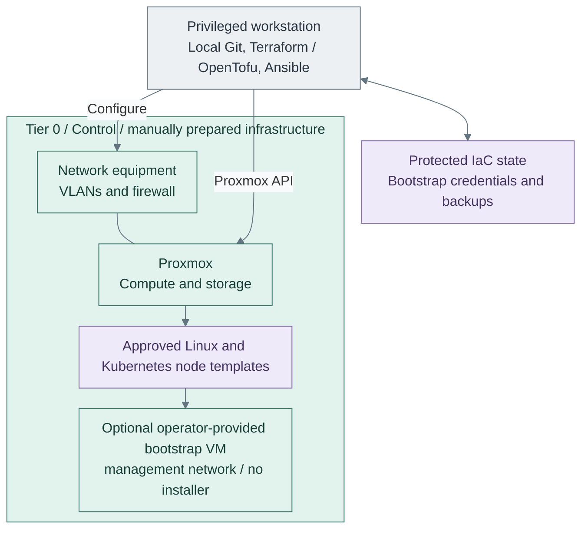

# Foundation and prerequisites

Prepare Proxmox, networks, approved VM templates and independent provisioning/recovery
access before deploying platform capabilities. Existing infrastructure is valid when
it passes these checks. Foundation is not a numbered capability stage.

**Prerequisites:** physical hosts, network equipment, approved installation sources
and a privileged workstation with independent console access.
**Working repository:** `<prefix>-tier-0` (source: `tier-0/`).
**Design:** [compute](../../architecture/compute/README.md) and
[network boundaries](../../architecture/networking/README.md).

## Preparation checklist

| Area | Detailed guides |
| --- | --- |
| Proxmox | [Host setup](proxmox/README.md), [host networking](proxmox/network.md), [API access](proxmox/api-access.md), [VM templates](proxmox/templates.md) |
| Optional host availability | [Cluster/HA](step-1b-cluster-ha.md), [menu settings](../../reference/proxmox-ha.md), [failover example](proxmox/failover.md) |
| Network equipment and policy | [UniFi setup](network/unifi.md), [firewall rollout](network/firewall.md) |
| Storage | [Live storage interfaces and backup destinations](storage/README.md) |

1. [Prepare hosts and networks](#step-1-prepare-hosts-and-networks)
2. [Protect provisioning access and state](#step-2-protect-provisioning-access-and-state)
3. [Publish and test VM templates](#step-3-publish-and-test-vm-templates)

**Manual:** host installation, switches, VLANs, storage and the optional bootstrap VM.
**IaC:** Tier 0 [template publisher](../../../tier-0/scripts/proxmox-templates.sh)
uses [publication inputs](../../../tier-0/templates/proxmox.yml.example) and
[publication resources](../../../tier-0/terraform/deployments/templates/main.tf).
Shared [consumer references](../../../shared/templates/proxmox-catalog.tfvars) select approved templates;
they do not create guests or install the physical foundation.

## Step 1: Prepare hosts and networks

Prepare [local tools](../../development/local-setup.md) and bring up the external
network; the [UniFi starting path](network/unifi.md#bring-up-the-network)
includes controller adoption and VLAN/port preparation. Install
[Proxmox](proxmox/README.md), then configure [host networking](proxmox/network.md)
and storage. Verify management access, DNS, time and permitted guest networks.
Select existing [block, file and object interfaces](../../architecture/compute/runtime.md#storage-interfaces)
deliberately. Use direct NAS file storage where supported; qualify an existing
object endpoint only for consumers that require it. The
[storage prerequisites](storage/README.md) add no gateway service.
Object storage must be available before the first consuming database or application,
not before unrelated early logging or trust deployments.

The main path uses bridges and VLANs. **Before important guests**, select
[1b: cluster HA](step-1b-cluster-ha.md) or [1c: SDN guest networks](step-1c-sdn.md)
where required. These options return here after their own checks.

Apply the [firewall policy](network/firewall.md), using the
[UniFi translation](network/unifi.md) where applicable. Verify permitted
and denied paths; cluster membership alone is not evidence of HA.

Keep persistent local host logs from first boot and export network-device logs where
supported. Preserve these early records until the Stage 2 collector can receive them;
central collection must not wait for FreeIPA or Kubernetes.

## Step 2: Protect provisioning access and state

Configure [scoped API access](proxmox/api-access.md) and protected local state
or an independent backend. Back up local state, inventory and bootstrap inputs now;
test their recovery before provisioning. Prepare the
[backup destination](../../administration/compute/backup-restore.md), using PBS or
a verified existing service. Guest backup/restore follows the first disposable clone in Step 3.
Keep code, tools and recovery credentials outside the systems being created.

A bootstrap VM is optional. It cannot replace recovery access outside Proxmox.
Software supply must work independently of future platform services; an existing
mirror or approved offline artifacts are valid inputs.
Select the [software-intake design](../../architecture/delivery/software-intake.md):
controlled proxy access can serve connected clients in every tier, while retained
mirrors or offline copies provide independent approved content.

## Step 3: Publish and test VM templates

Use the [common image import guide](proxmox/templates.md) for AlmaLinux,
Rocky Linux and Talos, or the [local API publication workflow](../../administration/compute/template-lifecycle.md#local-workflow).
Tier 0 publishes templates;
other tiers consume approved references. No hosted CI is required.

Publication code and inputs are in Tier 0's
[terraform/deployments/templates/](../../../tier-0/terraform/deployments/templates) and
[templates/proxmox.yml.example](../../../tier-0/templates/proxmox.yml.example).
Approved consumer references are in Shared's
[templates/proxmox-catalog.tfvars](../../../shared/templates/proxmox-catalog.tfvars).

Qualify the [Linux guest security profile](proxmox/host-security.md) on the disposable clone.
Each later Linux deployment applies its tier-owned operator/service allowlist before acceptance;
Talos and Proxmox retain their own native security configuration. The generic baseline alone is not hardening.

Boot disposable clones and verify disks, network and access before creating service
VMs. Back up and restore a disposable clone, including every required data disk,
through the [backup procedure](../../administration/compute/backup-restore.md#quick-steps)
before important guests depend on that path.
After its VM prerequisites exist, deploy the separate
[Software intake capability](../stage-1-software-intake/README.md) when controlled update
access is needed. Keep its initial software supply independent of the cache being deployed.

Before the later Kubernetes stage starts Flux, provide a reachable approved Git or OCI
source with independent credentials. A local checkout is not itself a reachable Flux source.

## Foundation ready

**Result:** independently recoverable virtualization with tested templates and enforced
network boundaries, realizing the compute portion of the
[reference platform](../../architecture/reference-platform.md#service-placement).

Record template boot, network allow/deny and state-restore evidence. Begin numbered
deployment with [Stage 1: Software intake](../stage-1-software-intake/README.md),
then [Stage 2: Protected logging](../stage-2-logging/README.md), before PKI,
FreeIPA or Kubernetes. Logging can start as soon as one approved Linux template and supply path are ready;
it does not wait for every optional foundation variant.
