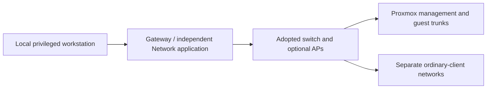

# UniFi zone firewall

**Working repository:** `<prefix>-tier-0` (source: `tier-0/`) for network policy.
Configuration is applied in the network controller, not by a supplied IaC installer.

**Design:** [firewall contracts](../../../architecture/networking/firewall-policy.md).

## Table of contents

- [Prerequisites](#prerequisites)
- [Bring up the network](#bring-up-the-network)
- [Map the architecture](#map-the-architecture)
- [Apply the policy](#apply-the-policy)
- [Verify](#verify)
- [References](#references)

## Prerequisites

Use a gateway/release supporting zone-based firewalling; check the current
official requirements. [1] Keep a local recovery path, configuration backup,
and approved [network plan](../../../architecture/networking/README.md#example-network-plan).

This is a manual translation, not gateway automation. No zone is created just
because a tier repository exists.

A UniFi switch alone is not the zone-firewall gateway. Use a supported UniFi
gateway plus its Network application, or apply equivalent policy on the existing
router/firewall. Keep that control/recovery path available before the future
Kubernetes cluster or hosted identity service exists. [1]

## Bring up the network

1. Commission the gateway and Network application using the selected model's
   procedure. Adopt switches/APs over a working management network before changing
   their VLANs. Retain local recovery access and a configuration export. [3]
2. Create the approved networks from the [network plan](../../../architecture/networking/README.md#example-network-plan):
   VLAN, subnet, gateway and DHCP/static reservations. Start with management, a client
   subnet and the first guest network; add later purpose networks before their consumers.
3. Configure the port path end to end, then apply the [zone policy](#map-the-architecture).
   Move one test port/client first; verify management access before cutting over uplinks. [4]

| Port purpose | Assignment to verify |
| --- | --- |
| Ordinary wired client | Access port with the selected client network as native/untagged; no guest/control trunk |
| Proxmox or switch uplink | Explicit allowed tagged VLANs and a documented native/drop policy matching both ends |
| AP uplink | Required management connectivity plus only selected wireless VLANs; verify the AP-specific native/tagged rules [4] |

Native traffic on an intentional client access port is not the same as an accidental
native VLAN on a server trunk. Do not copy a tagged-only server profile onto the
only current controller or workstation path without a tested cutover.

## Map the architecture

Use the existing DMZ zone and add Services and Control zones as needed.
Assign each network to one zone. [1]

| Layer / purpose | Zone | Example member networks |
| --- | --- | --- |
| Edge | built-in `DMZ` | Tier 2 `external_edge` and separate `client`; Tier 1 `delivery_edge` |
| Application | custom `Services` | `application`, application-only `access`, telemetry |
| Control | custom `Control` | `management`, `identity`, `control_cluster`, `cryptography` |
| Offline custody | none on the connected gateway | isolated ceremony/recovery fabric |

Use a separate `Lab` or other purpose-named zone when its policy differs.
Do not put untrusted labs into a service subnet merely to keep the zone count low.
Host-only cluster/storage fabrics can remain on controlled, non-routed switching.

WAN stays External. Gateway covers the gateway's own traffic, not the Control
layer. VPN membership is not administrative privilege. Review default Internal,
VPN, and same-zone policies; they are not this repository's intended rules. [1]

Keep these as separate VLANs/subnets even when assigned to DMZ. Add explicit
DMZ-to-DMZ rules for named listeners and retain a deny fallback. Client membership
does not publish a WAN listener. Tier 0 jump hosts and bootstrap VMs stay in
Control; a separate remote-access entry requires its own reviewed policy.

## Apply the policy

In the Zone Matrix, select the source row and destination column. Narrow each
allow by endpoint and listener, then keep a deny fallback. Review reverse
traffic; Auto Allow Return Traffic can provide replies. [1]

Example: `apps-to-dns` selects `Services` to `Control`, the approved app
subnet, the DNS server addresses, and TCP/UDP `53`. It does not allow the
whole Services zone to every Control endpoint.

Use the [firewall contracts](../../../architecture/networking/firewall-policy.md#rule-contracts)
for other flows. Preserve necessary gateway DHCP/DNS while restricting its
admin interfaces. [1] Apply equivalent intent to IPv6 and review NAT/VPN paths.

## Verify

Run the [policy tests](../../../architecture/networking/firewall-policy.md#rollout-and-validation),
including same-zone pairs and admin-denial checks. Gateway rules do not replace
local switch/client isolation. [2] Confirm rules and counters, then export the
reviewed configuration into project-owned documentation.

Renaming old tier-prefixed zones does not itself preserve policy. Review their
member networks and scoped rules before combining anything; retain separate
zones whenever access requirements differ.

## References

Sources checked 2026-10-16.

1. [Ubiquiti: Zone-Based Firewalls in UniFi](https://help.ui.com/hc/en-us/articles/115003173168-Zone-Based-Firewalls-in-UniFi)
2. [Ubiquiti: Implementing Network and Client Isolation](https://help.ui.com/hc/en-us/articles/18965560820247-Implementing-Network-and-Client-Isolation-in-UniFi)
3. [Ubiquiti: Device adoption](https://help.ui.com/hc/en-us/articles/360012622613-UniFi-Device-Adoption)
4. [Ubiquiti: Switch port VLAN assignment](https://help.ui.com/hc/en-us/articles/26136855808919-Switch-Port-VLAN-Assignment-Trunk-Access-Ports)
