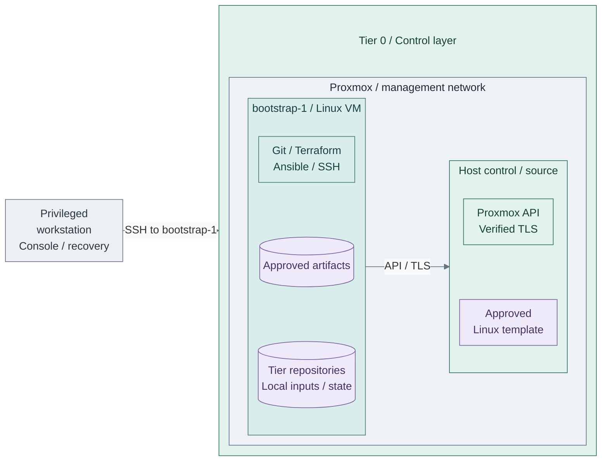

# Bootstrap execution host

Prepare the machine that runs the first infrastructure deployments: stores the
working repositories, stages approved artifacts, trusts the Proxmox API and owns
the initial local inputs/state. It is not a CI runner and needs no hosted GitLab,
FreeIPA, Vault or Kubernetes.

**Working repository:** `<prefix>-tier-0` and sibling repositories after generation.
Step 1 uses the Proxmox GUI and an independent privileged workstation; Steps 2-3
prepare and use the bootstrap VM before any hosted runner exists.
**Prerequisites:** prepared hosts/network/storage, one tested
[manual Linux template](templates.md), and independent console/recovery access.
**Design:** [protected execution](../../../architecture/compute/provisioning.md#execution-contexts).

## Contents

- [Step 1: Clone the bootstrap VM](#step-1-clone-the-bootstrap-vm)
- [Step 2: Prepare tools, repositories and artifacts](#step-2-prepare-tools-repositories-and-artifacts)
- [Step 3: Trust the API and protect local inputs](#step-3-trust-the-api-and-protect-local-inputs)
- [Continue deployment and hand over later](#continue-deployment-and-hand-over-later)

## Step 1: Clone the bootstrap VM

Create a **full clone** of the first approved AlmaLinux/Rocky Linux template in
the Proxmox GUI. Do not use Talos for this general-purpose execution host.
An existing protected Linux workstation can satisfy Steps 2-3 instead; a VM is
the reference path, not a recovery dependency.

| Setting | Reference choice |
| --- | --- |
| VM name | `bootstrap-1`, following the project's `<role>-<n>` convention |
| VMID | Reserve an unused infrastructure ID in the project allocation; never reuse an active VMID |
| Compute | Start with 2 vCPUs / 4 GiB RAM; size for the selected tools and artifact processing |
| Disks | Live Proxmox storage; allow separate capacity for unpacked images and provider upload staging |
| Guest attachment | `management` / Control, example VLAN 10, through the approved bridge/VNet |
| Cloud-Init | Set clone-specific static IP/CIDR, gateway, independent DNS, user `automation` and an approved SSH public key |
| Administration | Verified SSH host key, authorized sudo, working time synchronization and console recovery |

Use the selected [network plan](../../../architecture/networking/README.md) and
[naming conventions](../../../reference/proxmox-conventions.md); these are manual
prerequisite values, not new Terraform defaults. The management attachment can
share the approved host-management subnet; it must not join the Corosync or Ceph
transport networks. Sharing a subnet grants no API or SSH permissions.



**Manual:** this view adds one `bootstrap-1` VM using the profile above, not an IaC
resource. The initial template and host already exist. Its tools operate the
owning tier's [template root](../../../../tier-0/terraform/deployments/templates/main.tf)
and later deployment roots; they do not give Terraform ownership of this bootstrap VM.
Independent encrypted backups/recovery copies remain **outside** this host/storage failure domain.
The network label identifies the shown management interfaces, not the cluster/storage
fabric. The SSH arrow enters `bootstrap-1`; it does not grant host-wide SSH access.

Allow only the required paths, including same-subnet filtering where needed:

| Source -> destination | Required interface |
| --- | --- |
| Privileged workstation → bootstrap VM | SSH TCP 22 and authorized console access; no public port forwarding |
| Bootstrap VM → Proxmox | Verified API HTTPS TCP 8006; host SSH only when a specific procedure needs it |
| Bootstrap VM → approved infrastructure | Independent DNS/time and backup destination |
| Bootstrap VM → approved software sources | Scoped HTTPS, an existing proxy/mirror, or verified offline transfer |
| Bootstrap VM → managed guests/clusters | Add SSH/API paths as each capability is deployed, not blanket access to every subnet |

Apply the [host/gateway policy](../network/firewall.md) before broad provisioning.
Initial software supply must work before Stage 1's cache exists; an approved
temporary acquisition path is not permission for unrestricted Tier 0 Internet access.

## Step 2: Prepare tools, repositories and artifacts

On `bootstrap-1`, install and verify the
[deployment tooling](../../../development/local-setup.md#automation-vm-example).
Use the OS-native package/signature checks and accepted tool versions. Git,
Python/PyYAML and artifact utilities are needed **before** repository generation;
Terraform and Ansible are needed before provisioning/configuration.

For a new workspace, obtain the reviewed kit revision using the approved source.
The public clone example is:

```bash
umask 077
mkdir -p "$HOME/src"
git clone https://github.com/Rexus/homelab.git "$HOME/src/homelab"
```

A private mirror or transferred Git bundle is also valid. If a collection already
exists, restore it **including ignored inputs and original state**, not just tracked
code; do not initialize a replacement environment. For a new collection:

```bash
cd "$HOME/src/homelab"
bash scripts/init-tier-repos.sh --prefix HomeLab
```

This creates `$HOME/src/homelab-iac/`. Use `--root` to select another parent;
reuse that path/prefix during refresh. Keep the kit checkout separate from its
five generated repositories; the collection directory is not a Git repository.
Record choices in `homelab-architecture/docs/naming-conventions.md` and `docs/README.md`.
Read the rendered upstream [Tier 0 checklist](../../../paths/tier-0/README.md) in
the browser while executing commands from the named generated repository.

Create the example artifact directory outside Git:

```bash
sudo install -d -m 0700 -o "$(id -un)" -g "$(id -gn)" /srv/tier0/artifacts
```

Acquire the approved images/checksums and retain their provenance. Copy the first
manually uploaded Linux artifact here too if its file/template will be adopted.
Follow [verify, unpack and upload](templates.md#step-1-verify-unpack-and-upload)
for raw/qcow2 handling; catalog hashes describe the **unpacked** bytes. Retain
provider/tool/collection artifacts outside this VM for independent recovery.

## Step 3: Trust the API and protect local inputs

1. On this VM, complete [Proxmox CA trust](../../../administration/compute/proxmox-tls.md#step-1-trust-the-bootstrap-ca).
   Obtain the public cluster CA through the independent Proxmox console or verified
   SSH channel, compare fingerprints, then install it into this VM's OS trust store.
   Trust installed on the browser workstation is not trust installed here. Check
   the endpoint SAN and TLS without a bypass; FreeIPA/platform PKI is not required.
2. Create the scoped [API identity](api-access.md#create-platform-automation-access)
   on Proxmox, then initialize local template inputs **on the bootstrap VM**:

   ```bash
   cd "$HOME/src/homelab-iac/homelab-tier-0"
   bash scripts/proxmox-templates.sh init
   ```

   Edit `.env.local` with the endpoint, token ID and secret. Use
   `--env-file .env.local` for template commands; no manual exports are required.
   Review Shared's storage-class references and Tier 0's catalog/image staging paths.
3. Before provisioning, protect local files and independent backups: ignored
   `.env.local`, inventories, variables, SSH material and original Terraform state
   do not become safe merely because Git ignores them. Configure and test their
   recovery through [bootstrap backup planning](../../../administration/compute/backup-restore.md).
   Keep a recovery workstation and credentials outside Proxmox and future hosted services.

**Ready:** operator SSH/console, tools, approved artifacts, verified API trust,
scoped credentials and independent recovery work. Return to
[Foundation Step 3](../README.md#step-3-publish-and-test-vm-templates) to adopt
existing templates or publish new candidates, including the Kubernetes node image.
Do not boot the reusable template or capture this credential-bearing VM back into it.

## Continue deployment and hand over later

Keep using this collection for Stages 1-8 and the initial Stage 9 installation.
Create [local private Git history](../../../development/repository-workflow.md#local-history-before-hosted-source-control)
before hosted source control exists. After
GitLab and SSO are accepted, push each repository's reviewed code/history to its
own private remote; never push ignored secrets, state or downloaded images.

The later Tier 0 runner is **`iac-1`**, not another name for `bootstrap-1`.
Follow [bootstrap-to-CI handover](../../stage-9-development/procedures/handover.md)
to restore the original collection/inputs/state, install CA trust on the runner,
move routine credentials to scoped Vault job access and establish **one writer per root**.
Keep independent recovery after handover; a VM on the same Proxmox platform cannot
recover that platform's total loss by itself.
