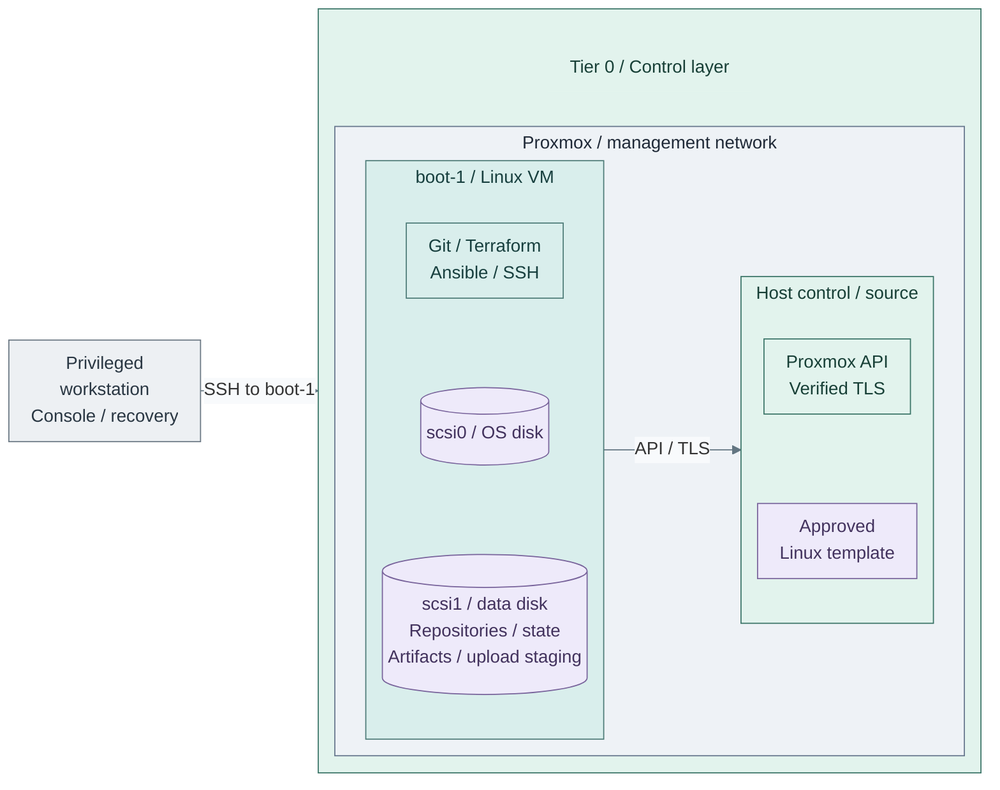

# Bootstrap execution host

Prepare the machine that runs the first infrastructure deployments: stores the
working repositories, stages approved artifacts, trusts the Proxmox API and owns
the initial local inputs/state. It is not a CI runner and needs no hosted GitLab,
FreeIPA, Vault or Kubernetes.

**Working repository:** `<prefix>-tier-0` and sibling repositories after generation.
Step 1 uses the Proxmox GUI and an independent privileged workstation; Steps 2–4
prepare and use the bootstrap VM before any hosted runner exists.
**Prerequisites:** prepared hosts/network/storage, one tested
[manual Linux template](templates.md), and independent console/recovery access.
**Design:** [protected execution](../../../architecture/hosting/provisioning.md#execution-contexts).

## Contents

- [Step 1: Clone the bootstrap VM](#step-1-clone-the-bootstrap-vm)
- [Verify sudo access](#verify-sudo-access)
- [Step 2: Prepare tools, repositories and artifacts](#step-2-prepare-tools-repositories-and-artifacts)
- [Connected: Git, Terraform and Ansible](#2a-install-git-terraform-and-ansible)
- [Offline: prepared bundle](#2b-transfer-a-prepared-bundle--offline-alternative)
- [Step 3: Prepare the execution account's SSH key](#step-3-prepare-the-execution-accounts-ssh-key)
- [Step 4: Configure trust, credentials and platform inputs](#step-4-configure-trust-credentials-and-platform-inputs)
- [Continue deployment and hand over later](#continue-deployment-and-hand-over-later)
- [References](#references)

## Step 1: Clone the bootstrap VM

1. In the Proxmox GUI, select the tested Linux template, then **Clone > Full Clone**.
   A full clone removes the template/base-disk dependency; do not use a linked clone
   for this recovery execution host.
2. Enter the settings below; configure the clone's **Cloud-Init** before starting it.
3. Start the clone. Verify its SSH host key through the console, then log in as
   `automation` and [verify sudo access](#verify-sudo-access) before continuing.

An existing protected Linux workstation can satisfy Steps 2–4 instead. Do not use
Talos as this general-purpose execution host. Export an accepted VM backup with both
disks for the reference layout, or every disk required by the selected LVM layout,
to independent offline storage and qualify its restore on a recovery host;
a full clone running on this platform is not itself an independent recovery copy.

| Setting | Reference choice |
| --- | --- |
| VM name | `boot-1`; prefer a 3–8 character host label including the instance number |
| VMID | `601` in the [VMID convention](../../../conventions/vmid-convention.md); reserve an unused automation ID if already occupied |
| Compute | Start with 2 vCPUs / 4 GiB RAM; size for the selected tools and artifact processing |
| OS disk | Live Proxmox storage, sized for the selected Linux OS and installed tools |
| Workspace capacity | Reference layout: separate attached live-storage disk at `/srv/tier0`, starting at 60 GiB; alternatively expand the existing LVM root disk using storage B below |
| Guest attachment | Current `management` network, example VLAN 10; follow the approved network plan |
| Cloud-Init | Clone-specific static IP/CIDR, gateway and independent DNS; set **User** to `automation` and add each approved workstation's public key to **SSH public key**, one OpenSSH key per line [1] |
| Administration | Verified SSH host key, authorized sudo, working time synchronization and console recovery |

Use the selected [network plan](../../../conventions/network-plan.md) and
[naming conventions](../../../conventions/proxmox-conventions.md); these are manual
prerequisite values, not new Terraform defaults. The management attachment can
share the approved host-management subnet; it must not join the Corosync or Ceph
transport networks. Sharing a subnet grants no API or SSH permissions.

Add one or several approved public keys **on the clone before first boot**. Each
workstation retains its own private key. Check login from each intended workstation;
these keys authorize access to `boot-1`, not automatic access from it to later guests.
Reusable templates retain no operator account or key list.



**Manual:** this view adds one `boot-1` VM with an OS disk and attached data disk, not an IaC
resource. It shows the **separate-filesystem reference layout**; the LVM alternative can instead
expand the existing OS disk. The initial template and host already exist. Its tools operate the
owning tier's [template root](../../../../tier-0/terraform/deployments/templates/main.tf)
and later deployment roots; they do not give Terraform ownership of this bootstrap VM.
Independent encrypted backups/recovery copies remain **outside** this host/storage failure domain.
The network label identifies the shown management interfaces, not the cluster/storage
fabric. The SSH arrow enters `boot-1`; it does not grant host-wide SSH access.

Allow only the required paths, including same-subnet filtering where needed:

| Source -> destination | Required interface |
| --- | --- |
| Privileged workstation → bootstrap VM | SSH TCP 22 and authorized console access; no public port forwarding |
| Bootstrap VM → Proxmox | Verified API HTTPS TCP 8006; host SSH only when a specific procedure needs it |
| Bootstrap VM → approved infrastructure | Independent DNS/time and backup destination |
| Bootstrap VM → approved software sources | Scoped HTTPS, an existing proxy/mirror, or verified offline transfer |
| Bootstrap VM → managed guests/clusters | Add SSH/API paths as each capability is deployed, not blanket access to every subnet |

Apply the [host/gateway policy](../network/firewall.md) before broad provisioning.
Initial software supply must work before Stage 1's cache exists; an approved
temporary acquisition path is not permission for unrestricted Tier 0 Internet access.

### Verify sudo access

Run on `boot-1` as `automation`; this checks sudo without a cached password or an interactive prompt:

```bash
sudo -k -n true
```

**Expected:** no output and exit status `0`. With authorized passwordless sudo, Ansible's
`become: true` works without an account password. Omit `--ask-become-pass` (`-K`); that flag
forces a password prompt even when sudo needs none. SSH-key authentication is separate. [9]

If sudo requires a password, use the independent root recovery console to set a local
password with `passwd automation`, then add `--ask-become-pass` to interactive Ansible runs.
If the account is not allowed to use sudo, correct its authorized sudo access there first.
Do not run the whole deployment as root or store a sudo password in Git.

## Step 2: Prepare tools, repositories and artifacts

**Run on `boot-1` as `automation`.** Prepare storage, then choose **2a** for approved
network access or **2b** for a prepared offline bundle.

<a id="prepare-the-attached-workspace-disk"></a>

### Prepare bootstrap storage

Choose **A** for the separate workspace filesystem shown above, or **B** for an existing Rocky Linux
LVM root. Complete only the selected path before installing tools or copying artifacts.

#### A: Separate workspace filesystem — reference layout

1. In **VM > Hardware > Add > Hard Disk**, add `scsi1` on the selected live-disk
   datastore. Keep its **Backup** option enabled.
2. In the guest, identify the attached disk with `lsblk -f`. Prepare its filesystem
   and persistent mount using the selected OS's storage tools; confirm the device
   before any formatting. Mount at `/srv/tier0` **before copying data there**.
   An existing attached-disk mount is valid; adapt all absolute paths to that mount instead.
   The Enterprise Linux storage manual covers filesystem preparation and UUID-based mounts. [3]
3. Check the mount and free space:

```bash
# Run on boot-1 as automation.
findmnt -T /srv/tier0
df -h / /srv/tier0 /tmp
```

Require the intended data filesystem, not `/` as an accidental fallback. Then create
private workspace, artifact and upload directories on it:

```bash
# Run on boot-1 as automation.
(
  mountpoint -q /srv/tier0 || { echo 'Mount the data filesystem before continuing.' >&2; exit 1; }
  sudo install -d -m 0700 -o "$(id -un)" -g "$(id -gn)" \
    /srv/tier0/src /srv/tier0/artifacts /srv/tier0/offline /srv/tier0/tmp/proxmox-upload
)
```

Budget space for compressed downloads, unpacked images, Python/provider caches and
upload copies together. This disk shares the VM/platform failure domain; back it up
independently and include it in bootstrap VM backup jobs.

**Optional, before installing tools/cloning:** follow [home directories on the data disk](bootstrap-home.md)
to bind `/srv/tier0/home` at `/home`. This puts `.ssh` and user environments on the
same attached disk while preserving the account and artifact paths. Rejoin at **2a/2b**.
For an offline installation, that guide first obtains the bundle's OS tools, then
moves homes before creating Python environments or cloning the kit.

#### B: Expand the existing Rocky Linux root — LVM alternative

Follow [Rocky Linux LVM expansion](bootstrap-lvm.md). Prefer enlarging the existing Proxmox
disk, growing its partition and running `pvresize`, then extending the root LV/filesystem.
That guide also supplies the optional new-disk `pvcreate`/`vgextend` path.

For this layout, `/srv/tier0` is a directory on the expanded root filesystem. Use that guide's
directory/verification steps, then continue at **2a** or **2b** below. The separate-mount check and
home bind-mount option in **A** apply only to its separate-filesystem layout.

<a id="2a-install-through-approved-sources"></a>
<a id="2a-install-os-packages-and-terraform"></a>

### 2a: Install Git, Terraform and Ansible

These commands target a fresh **Rocky Linux / AlmaLinux 10** bootstrap. Run on `boot-1`
as `automation`, using approved OS/vendor repositories. Steps 1–2 install OS packages;
Step 4 selects either the OS-packaged Ansible or the isolated reference runtime.
For a disconnected host, follow **2b** instead; no public repository access is needed there.

#### 1. Install OS tools

Install the base tools and disk/home preparation utilities:

```bash
sudo dnf install -y git bash python3 python3-pip python3-pyyaml \
  openssh-clients ca-certificates curl openssl gnupg2 xz unzip tar /usr/bin/qemu-img \
  dnf-plugins-core rsync policycoreutils-python-utils lvm2 cloud-utils-growpart parted xfsprogs
```

#### 2. Install Terraform

`dnf-plugins-core` supplies `config-manager`; add HashiCorp's official RHEL RPM channel: [4][5]

```bash
sudo dnf config-manager --add-repo https://rpm.releases.hashicorp.com/RHEL/hashicorp.repo
sudo dnf install terraform
```

Review the package/signing-key prompt. Compare the key fingerprint with the current
[HashiCorp package-signing reference](https://www.hashicorp.com/en/trust/security)
before accepting it; retain signature and TLS verification. [6]

<a id="2a-continued-obtain-the-kit-and-generate-the-collection"></a>

#### 3. Obtain the kit

For a new workspace, obtain the reviewed kit revision using the approved source.
The public clone example is:

```bash
# Run on boot-1 as automation.
umask 077
git clone https://github.com/Rexus/homelab.git /srv/tier0/src/homelab
```

A private mirror or transferred Git bundle is also valid. If a collection already
exists, restore it **including ignored inputs and original state**, not just tracked
code; do not initialize a replacement environment.

#### 4. Install Ansible

Choose **4a** for the cache/compatible Linux recipes, or **4b** for the full manifest-based
reference runtime. Installing Ansible does not require a manual venv in every case. [8]

**4a: OS-package path.** On `boot-1`, using the approved OS repositories:

```bash
sudo dnf install -y ansible-core
```

With compatible collections, this is enough to run the cache recipe without the manual Python
setup below. `deploy.sh` prepares the selected setup's collections. Confirm the installed core
and collections support each other; select **4b** if Ansible reports that a collection does not
support its version, or a recipe needs additional Python clients. Continue at **Step 5**.
Template commands prepare their own runtime automatically.

**4b: Isolated reference runtime.** Run from the **upstream kit root** on `boot-1`.
Install `ansible-core` through the declared runtime manifest, separately from DNF. [7][8]

```bash
python3 -m venv "$HOME/.local/share/homelab/venv"
source "$HOME/.local/share/homelab/venv/bin/activate"
python3 -m pip install -r tier-0/ansible/runtime-requirements.txt
```

With that environment active, install the declared module dependencies from the same kit root:

```bash
python3 -m pip install -r tier-0/ansible/requirements.txt -r tier-1/ansible/requirements.txt \
  -r tier-2/ansible/requirements.txt -r scripts/tier-repos/requirements.txt
```

Install the declared collections from the same kit root with that environment active:

```bash
ansible-galaxy collection install -r shared/ansible/requirements.yml
ansible-galaxy collection install -r tier-0/ansible/requirements.yml
ansible-galaxy collection install -r tier-1/ansible/requirements.yml
ansible-galaxy collection install -r tier-2/ansible/requirements.yml
```

For **4b**, keep this environment active for Linux `deploy.sh`; reactivate it in each new shell with
`source "$HOME/.local/share/homelab/venv/bin/activate"`. Template commands select their own
isolated runtime automatically; see [runtime behavior](../../../reference/control-node-tooling.md#automatic-template-runtime).

#### 5. Verify tools and generate the repositories

From the kit root, using the runtime selected in **4a** or **4b**:

```bash
git --version
python3 --version
python3 -c 'import yaml; print(yaml.__version__)'
terraform version
qemu-img --version
ansible-playbook --version
```

Require version output from every command. For **4b**, Ansible must report the executable under
`$HOME/.local/share/homelab/venv/`; **4a** uses the OS-installed executable without activation.
For a new collection, generate the repositories next:

Run from the reviewed upstream kit root on `boot-1`; keep the venv active only when **4b** was selected.

```bash
bash scripts/init-tier-repos.sh
```

This creates `/srv/tier0/src/<prefix>-iac/`. Use `--root` to select another parent;
reuse that path/prefix during refresh. Keep the kit checkout separate from its
five generated repositories; the collection directory is not a Git repository.
Record site choices and completed capabilities:

```text
# Edit in <prefix>-architecture/
platform-standards.md # Actual host names, VMIDs and network allocations.
docs/README.md # Selected paths and deployment/verification progress.
```

Read the rendered upstream [Tier 0 checklist](../../../paths/tier-0/README.md) in
the browser while executing commands from the named generated repository.

Acquire approved images/checksums into `/srv/tier0/artifacts` and retain their provenance. Copy the first
manually uploaded Linux artifact here too if its file/template will be adopted.
Follow [verify, unpack and upload](templates.md#step-1-verify-unpack-and-upload)
for raw/qcow2 handling; catalog hashes describe the **unpacked** bytes. Retain
provider/tool/collection artifacts outside this VM for independent recovery.

The [control-node reference](../../../reference/control-node-tooling.md#automation-vm-example)
lists compatibility and runtime details. Other distributions use their native packages and
the [official Terraform installer](https://developer.hashicorp.com/terraform/install).
Packer and later-stage tools such as Helm, kubectl and talosctl belong to their selected paths.

**Connected path complete:** continue at **Step 3**. The following **2b** is the offline alternative.

### 2b: Transfer a prepared bundle — offline alternative

Follow the [offline bootstrap workflow](bootstrap-offline.md) to prepare on a matching
connected machine, copy with `scp` or approved media, verify, then install without
public package services. It installs Ansible from local wheels and its declared collections.
It lists controller dependencies separately from the artifacts required inside later guests/clusters.
That path also restores the kit and generates the collection: skip **2a** and continue at
**Step 3** after its checks pass.

## Step 3: Prepare the execution account's SSH key

**Run on `boot-1` as `automation`, outside the repositories.** The key used to
log into this VM is not automatically available for connecting from it to new guests.
Linux clone key lists are empty until configured in each consuming tier.

### 3a: Create a key when none exists

Create a dedicated execution-account key. Enter a passphrase when prompted; do not
overwrite an existing key. Keep both files under the account's `.ssh/`, never in Git.

```bash
# Run on boot-1 as automation.
install -d -m 0700 "$HOME/.ssh"
ssh-keygen -t ed25519 -f "$HOME/.ssh/id_ed25519" -C "homelab-bootstrap"
```

Load the private key into a local agent for the deployment session:

```bash
# Run on boot-1 as automation.
eval "$(ssh-agent -s)"
ssh-add "$HOME/.ssh/id_ed25519"
ssh-add -l
```

### 3b: Reuse an approved key or agent

Skip key creation when a usable key/agent already exists. Confirm the matching
public-key file is readable on this host and the private key is available through
the local SSH configuration or approved agent. List agent identities with `ssh-add -l`.
Do not copy an administrator's private workstation key into a repository or template.

**Both paths continue at Step 4.** Print the absolute public-key path for the input below:

Run on `boot-1` as automation.

```bash
realpath "$HOME/.ssh/id_ed25519.pub"
```

Use the actual public-key filename for an existing key. CloudInit receives only the
public key; Ansible uses its matching private key through SSH. See the
[local SSH input contract](../../../reference/platform-inputs.md#local-ssh-access).

<a id="step-3-trust-the-api-and-protect-local-inputs"></a>

## Step 4: Configure trust, credentials and platform inputs

1. Complete [Proxmox CA trust: Step 1](../../../administration/hosts/proxmox-tls.md#step-1-trust-the-bootstrap-ca)
   and its caller-verification gate **on the bootstrap VM**. Obtain the public CA through
   console/verified SSH, compare fingerprints, install it in the OS trust store and verify
   the endpoint name. Browser trust on another workstation is insufficient.
2. Follow [API setup](api-access.md#create-platform-automation-access) on a **Proxmox host**
   to create the scoped roles, group and token. Return here after its token permission checks.
3. Back on **`boot-1`**, initialize Tier 0's local files:

   Run from `<prefix>-tier-0/` on the protected execution host.

   ```bash
   bash scripts/proxmox-templates.sh init
   ```

4. Edit **Tier 0 `.env.local`**. Replace the examples with the verified endpoint, token
   and the absolute public-key path printed in Step 3:

   ```dotenv
   PROXMOX_API_URL=https://pve01.example.internal:8006/
   PROXMOX_API_TOKEN_ID=automation@pve!provision
   PROXMOX_API_TOKEN_SECRET=replace-with-the-issued-secret
   PROXMOX_VE_TMPDIR=/srv/tier0/tmp/proxmox-upload
   TF_VAR_ssh_public_key_files='["/home/automation/.ssh/id_ed25519.pub"]'
   ```

   Set these values in **each consuming tier's own `.env.local`** before its first Linux
   deployment. Tier 2 does not inherit Tier 0's endpoint, credentials or SSH key setting.
   Use a token scoped to that tier's authorized operations. Keep key contents out of
   `.tfvars`, templates and Git. Template commands require `--env-file .env.local`;
   Linux `deploy.sh` loads that file by default. No manual `source`/exports are needed.
   `PROXMOX_VE_TMPDIR` keeps provider upload staging on the prepared data filesystem. [2]
5. Configure common platform references before the first managed guest:

   ```text
   # Edit in <prefix>-shared/
   config/platform.tfvars # Set the initial node, live-disk classes and common network attachment.
   ```

   | Field | Enter |
   | --- | --- |
   | `default_platform_node_name` | Actual initial destination node, for example `"pve01"`, replacing `null` |
   | `proxmox_storage_classes.local.vm_disk` | Real datastore accepting VM disks, for example `"local-zfs"` |
   | `proxmox_storage_classes.shared.vm_disk` | Commissioned shared live-disk datastore; its name does not create shared storage |
   | `proxmox_storage_classes.fast.vm_disk` | Actual fast-disk datastore if used |
   | Class `cloud_init_drive` | Actual datastore accepting VM disks, or omit to inherit that class's `vm_disk` |
   | `shared_network_zones.application` | Prepared application bridge/VNet, VLAN and subnet/gateway, or the selected SDN lookup fields |

   Replace the used `*-change-me` placeholders and retain only classes that represent
   real prepared storage. **`local` is commonly an Import/ISO datastore, not a VM-disk
   datastore.** It is distinct from the logical `local` class, which can map to `local-zfs`.
   Keep template `image_datastore_id` separate. The template source node also does not
   select guest placement. See [platform fields and precedence](../../../reference/platform-inputs.md).
   On a local-storage pilot, select the configured `local` class in each consuming
   setup, including Tier 0's template `all.storage_class`; the starter's `shared`
   selection is valid only after that shared datastore exists.
6. Back up every required bootstrap disk and the selected [recovery set](../../../administration/backups/recovery-set.md)
   independently of this host/storage, including ignored inputs, inventories, `.env.local`, original state
   and required recovery material. Follow [backup planning](../../../administration/backups/virtual-machines.md)
   and test [bootstrap recovery](../../../administration/recovery/bootstrap.md) before relying on this host.
   Keep protecting newer state after later operations; Git ignore rules are not access control or backup.

**Ready:** operator SSH/console, usable outbound SSH key/agent, tools, artifacts,
verified API trust, scoped credentials, configured Shared profile and independent recovery.
Return to
[Foundation Step 3](../README.md#step-3-publish-and-test-vm-templates) to adopt
existing templates or publish new candidates, including the Kubernetes node image.
Do not boot the reusable template or capture this credential-bearing VM back into it.

## Continue deployment and hand over later

Keep using this collection for Stages 1-8 and the initial Stage 9 installation.
After [Stage 1 consumer acceptance](../../stage-1-software-intake/README.md#step-3-connect-and-verify-consumers),
configure `boot-1` to use the approved proxy/internal mirrors too. Remove temporary
acquisition access only after package and tool downloads work through that policy;
retain the offline bundle independently for recovery before the cache/mirrors exist.
Create [local private Git history](../../../development/repository-workflow.md#local-history-before-hosted-source-control)
before hosted source control exists. After
GitLab and SSO are accepted, push each repository's reviewed code/history to its
own private remote; never push ignored secrets, state or downloaded images.

A local checkout is not itself a reachable Flux source. Before Stage 4, provide
the [independent bootstrap Git source](../../stage-4-kubernetes/procedures/flux-sops.md)
and read credentials; later hosted GitLab must not be a bootstrap dependency.

The later Tier 0 runner is **`iac-1`**, not another name for `boot-1`.
Follow [bootstrap-to-CI handover](../../stage-9-development/procedures/handover.md)
to restore the original collection/inputs/state, install CA trust on the runner,
move routine credentials to scoped Vault job access and establish **one writer per root**.
Keep independent recovery after handover; a VM on the same Proxmox platform cannot
recover that platform's total loss by itself.

## References

1. [Proxmox Cloud-Init account and public-key fields](https://github.com/proxmox/pve-docs/blob/master/generated/qm-cloud-init-opts.adoc).
2. [Proxmox provider upload staging and temporary directory](https://github.com/bpg/terraform-provider-proxmox/blob/v0.112.0/docs/index.md).
3. [Enterprise Linux filesystem preparation and persistent mounts](https://docs.redhat.com/en/documentation/red_hat_enterprise_linux/10/html/managing_file_systems/index).
4. [HashiCorp Terraform installation and RPM repository](https://developer.hashicorp.com/terraform/install), checked 2026-11-08.
5. [DNF config-manager repository configuration](https://dnf-plugins-core.readthedocs.io/en/latest/config_manager.html), checked 2026-11-08.
6. [HashiCorp package-signing keys](https://www.hashicorp.com/en/trust/security), checked 2026-11-08.
7. [Python virtual environments](https://docs.python.org/3/library/venv.html), checked 2026-11-08.
8. [Ansible packages, pip installation and verification](https://docs.ansible.com/projects/ansible/latest/installation_guide/intro_installation.html), checked 2026-11-08.
9. [Ansible privilege escalation and optional password prompt](https://docs.ansible.com/projects/ansible/latest/playbook_guide/playbooks_privilege_escalation.html), checked 2026-11-08.
