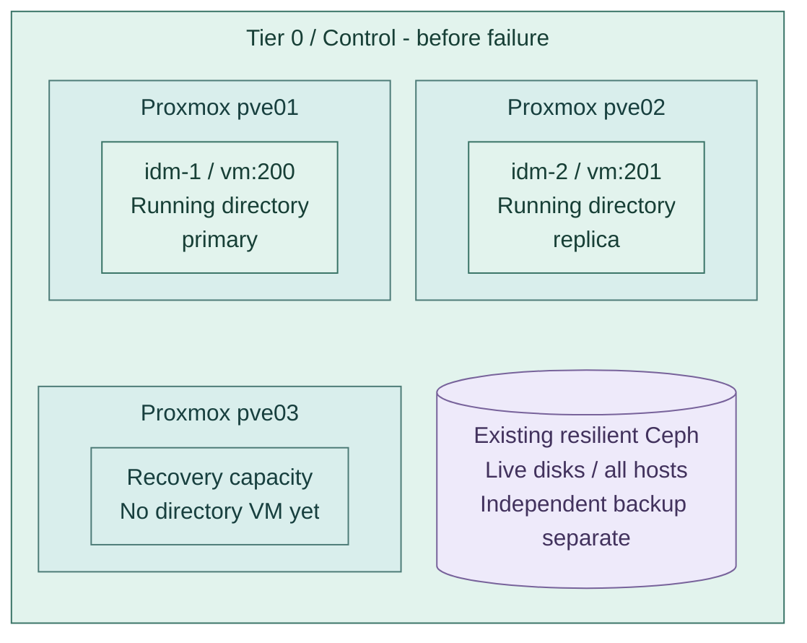
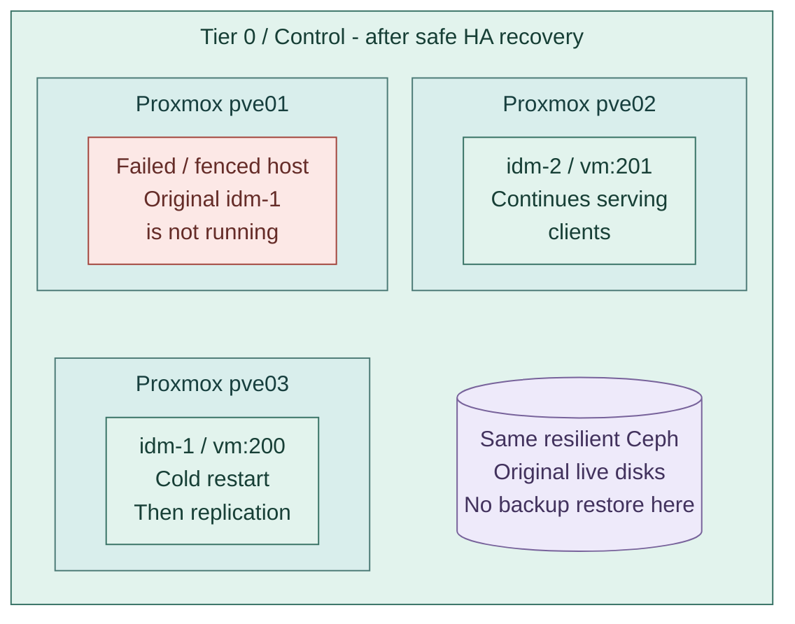

# Proxmox host failure and recovery

**Working repository:** `<prefix>-tier-0` (source: `tier-0/`).
**Prerequisites:** three accepted Proxmox VE 9.2+ hosts, resilient shared live storage,
tested watchdog/fencing, N+1 capacity and independent console/backup access.
Complete [HA configuration](../step-1b-cluster-ha.md) first.

This worked example uses the existing directory pair, not additional VMs. The
host placements and HA rules below are an **operator-selected example**, not created
by Terraform. Prove the behavior with disposable guests before testing identity.

## Contents

- [Selected configuration](#selected-configuration)
- [When pve01 fails](#when-pve01-fails)
- [Verify the result](#verify-the-result)
- [References](#references)

## Selected configuration

| Item | Example selection |
| --- | --- |
| Guests | `idm-1` / VMID `200`, `idm-2` / VMID `201` |
| Initial placement | `idm-1` on `pve01`, `idm-2` on `pve02`; `pve03` has recovery capacity |
| Storage/network | Every guest disk, including EFI, on qualified shared Ceph; identity network on all three hosts |
| HA resources | Both `started`, restart `1`, relocate `1`, failback off, auto-rebalance on |
| Rule | Negative resource affinity between `vm:200` and `vm:201`; no extra node restriction |
| Scheduler | Native dynamic automatic balancing; no ProxLB for these guests |

**Manual:** selected placement for Tier 0's [guest definitions](../../../../tier-0/terraform/deployments/foundation/terraform.tfvars.example)
and [inventory](../../../../tier-0/ansible/inventory/hosts.yml.example). Those inputs supply the exact guest names/VMIDs.
Set initial node overrides in the local definitions; their example does not already spread the pair.
HA enrollment, affinity, hosts and Ceph are manually commissioned prerequisites.
The figure omits the foundation root's unrelated CA guest; it is not another directory member.
This placement-only view shows no implied replication or network route.

## When pve01 fails

1. `idm-1` stops with the failed host. `idm-2` remains available if its own
   dependencies work and clients are configured to use both directory/DNS servers.
2. The surviving quorate cluster waits for safe fencing/ownership recovery.
   A network-isolated host might still write its disks: never start a second copy manually.
3. HA selects an eligible target. Anti-affinity excludes `pve02`, so in this
   configuration `pve03` boots **the same VMID and disks** for `idm-1`.
4. The guest performs crash recovery and rejoins directory replication. Its memory,
   open sessions and in-flight work were not transferred. Measure the interruption. [1]

**Manual:** fault scenario using the same [selected configuration](#selected-configuration), not a second
deployment or Terraform apply. No ProxLB, CI or Kubernetes dependency performs this recovery.
Disk accessibility, quorum and fencing are conditions, not properties proved by this drawing.

| Failure condition | Expected outcome |
| --- | --- |
| One of three hosts lost; remaining Ceph replicas/monitors and networks healthy | Eligible HA guests can restart; application recovery still takes time |
| No cluster quorum or fencing not established | Recovery waits; forcing starts risks split-brain |
| Guest disks inaccessible, lost, or Ceph below safe write availability | No useful restart; repair storage or follow independent backup recovery |
| Only pve02 eligible while it runs idm-2 | Hard anti-affinity blocks idm-1 recovery; do not bypass the rule silently |
| Three strictly separated control planes, one of three hosts lost | Two survive; third waits for another eligible host, even with spare RAM |
| Application frozen but VM process remains running | Hypervisor HA alone may not detect it; application monitoring/remediation is separate |

## Verify the result

Use a reviewed maintenance window, disposable guests and out-of-band control.
Never power-cut real identity or storage hosts as an unreviewed first test.

1. Record healthy quorum, Ceph health, resources/rules and original guest location.
   Test a live migration first, then require a no-unexpected-change Terraform plan.
2. Exercise the approved host-death/fencing test, not merely an orderly reboot.
   Record failure time, fencing/recovery states, selected target, guest boot and client recovery.
3. Confirm exactly one instance of each VMID, intact data, directory replication,
   expected allow/deny paths, critical-log delivery and another clean Terraform plan.
4. Bring back the repaired host only after hardware/storage checks. Confirm no
   premature failback, rule violation or migration churn, then test planned maintenance separately.
5. Record remaining capacity and constrained-recovery cases. Keep an independent
   [backup/restore test](../../../administration/compute/backup-restore.md); HA does not cover lost shared disks.

The repository's mocked plans verify creation/placement contracts only. They do
not qualify host power loss, Ceph behavior, fencing or a recovery-time objective.

## References

1. [Proxmox HA manager: fencing and recovery](https://github.com/proxmox/pve-docs/blob/master/ha-manager.adoc), reviewed 2026-10-27.
