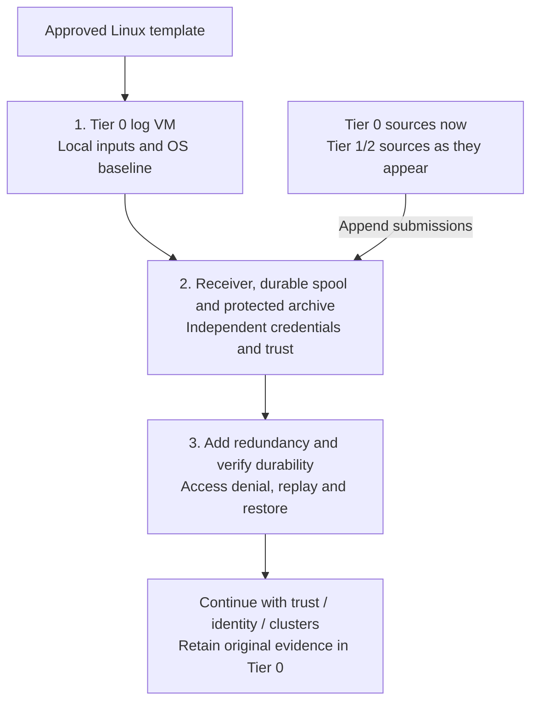

# Foundational syslog and audit intake

**Working repository:** `<prefix>-tier-0` (source: `tier-0/`).
Run repository scripts from this root; Shared is execution code, not an evidence owner.
**Design:** [protected security logging](../../../architecture/operations/security-logging.md).
**Prerequisites:** approved Linux templates, Control networking, local tools/state,
independent bootstrap credentials and protected storage. Kubernetes, FreeIPA,
Keycloak, Vault and Tier 1 analytics are not prerequisites.

## Table of contents

- [1. Provision the bootstrap receiver](#1-provision-the-bootstrap-receiver)
- [2. Integrate protected intake and storage](#2-integrate-protected-intake-and-storage)
- [3. Accept the security-logging contract](#3-accept-the-security-logging-contract)
- [IaC locations](#iac-locations)
- [Continue](#continue)



## 1. Provision the bootstrap receiver

```bash
bash scripts/init-local-files.sh --setup syslog
```

Edit the local files seeded from examples. The starter creates `foundation-log-1`
outside Kubernetes with an OS disk and a separate log-data disk. It does not install
the receiver or format/mount that disk. Size storage from measured rate/retention,
not from the starter's example capacity.

```bash
bash scripts/deploy.sh syslog --plan-only
```

Review the plan, then run the same command without `--plan-only` to provision
and apply the OS baseline. An existing independently operated receiver is also valid.
The single-host bootstrap is not accepted as lossless/HA security logging.

## 2. Integrate protected intake and storage

Implement the selected receiver with project-owned Ansible roles/configuration
in Tier 0. Reuse stateless receiver/agent roles from Shared where several tiers
need the same behavior, but keep inventories, source scopes, credentials and state local.

| Configure | Required result |
| --- | --- |
| Data volume and queues | Protected mount/quota separate from OS capacity; deliberate flush, crash-recovery and archive-commit semantics |
| Receiver and source identities | Authenticated encrypted submission where supported; producer can append only to its assigned stream |
| Bootstrap trust | Independently provisioned/pinned bootstrap trust and local credentials; do not wait for future PKI or disable certificate verification |
| Network policy | Narrow source-to-intake rules from every tier; no producer route to archive query/admin APIs; bounded rate/message size |
| Raw archive | Tier 0 custody, enforced protected retention, independent copies and keys; no producer overwrite/read/delete access |
| Readers | Explicit system-administrator/security-reader roles; queries and exports audited; no general developer access to raw evidence |
| Unsupported sources | Document any UDP or unauthenticated first-hop exception and local relay; do not claim end-to-end zero loss |

Select the product's supported receiver, queue, TLS and retention procedures.
The [design](../../../architecture/operations/security-logging.md#durability-and-availability)
owns acknowledgement and failure requirements; neither TCP nor a VIP proves them.
After PKI is accepted, rotate bootstrap trust under a tested continuity plan.

## 3. Accept the security-logging contract

Enable `foundation-log-2` with matching inventory/IP entries and place receivers
on distinct physical failure domains. Add further capacity as demand requires;
the receiver count does not establish storage redundancy by itself. Configure
supported sender failover/dual submission, durable copies and governed retention.

Before relying on critical evidence, record the declared failure envelope and test:

| Test | Acceptance |
| --- | --- |
| Append and segmented access | Expected source accepted; forged source, cross-namespace reads, overwrite and deletion denied |
| Receiver/process/physical host failure | Accepted event sequence survives the declared loss; source queues replay, duplicates are accounted for |
| Power loss and archive target outage | Flush/commit behavior matches the contract; no upstream release before the required durable protection |
| Peak load and bounded outage | Queue/storage headroom remains within the target; exhaustion triggers independent alerts and the declared backpressure policy |
| Tier 1, control cluster and SSO unavailable | Tier 0 intake, evidence investigation and independent recovery still work |
| Retention and restore | Locked evidence cannot be shortened/deleted early; approved reader and independent copy restore verified |

Prove this with numbered synthetic events and source/receiver/archive counts,
not just an open port or a successful Terraform apply. Record unavoidable source
gaps separately from loss of already accepted records.

## IaC locations

| Repository | Location inside that repository | Supplied behavior |
| --- | --- | --- |
| Tier 0 | [terraform/deployments/syslog/](../../../../tier-0/terraform/deployments/syslog/) | Receiver VM/disk provisioning only; separate `syslog` state |
| Tier 0 | [ansible/inventory/hosts.yml.example](../../../../tier-0/ansible/inventory/hosts.yml.example) and [ansible/group_vars/syslog.yml.example](../../../../tier-0/ansible/group_vars/syslog.yml.example) | `foundation_logging` hosts and shared Terraform/Ansible IP inputs |
| Tier 0 | [ansible/playbooks/deployment/foundation-logging.yml](../../../../tier-0/ansible/playbooks/deployment/foundation-logging.yml) | OS baseline only, not receiver/HA/WORM installation |
| Shared | [scripts/deploy.sh](../../../../shared/scripts/deploy.sh) and [ansible/roles/baseline/](../../../../shared/ansible/roles/baseline/) | Reusable execution and host preparation using Tier 0 inputs |

Existing generated projects preserve owned `.deployment-setups` and local inventory.
After refresh, deliberately register `syslog` and add its new hosts/IPs before
initialization; do not move Tier 1 observability state or reuse a VM under two states.

## Continue

Return to [foundation acceptance](../README.md#capability-available), then establish
[cryptographic trust](../../stage-2-trust/README.md). Add sources as services appear.
Later [observability capabilities](../../stage-4-control-services/procedures/observability.md)
consume approved copies, never replace the protected archive.
