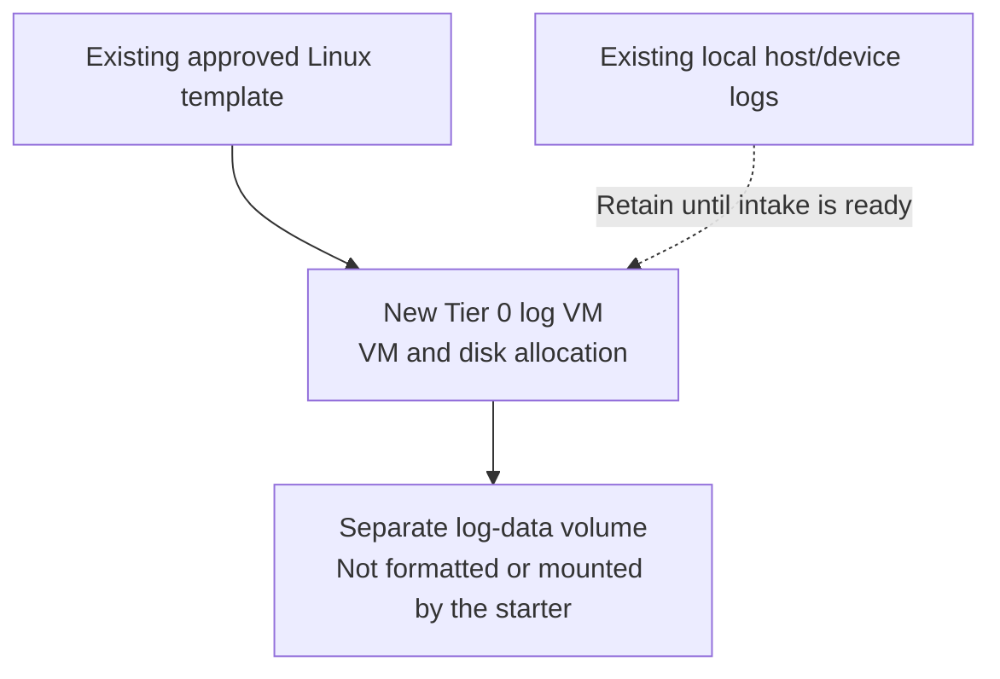
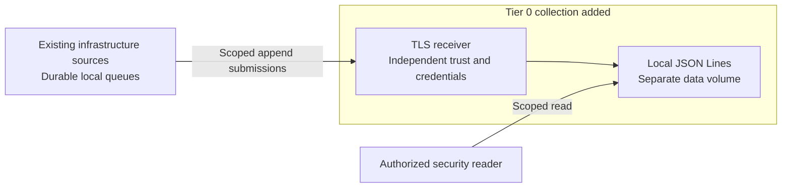
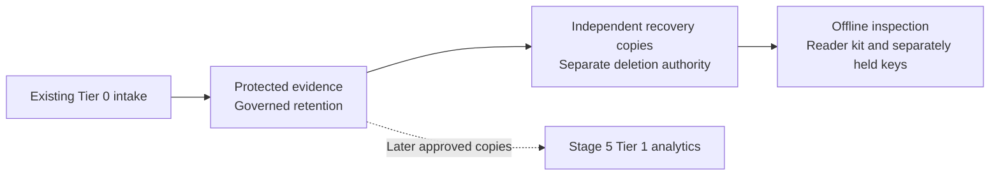

# Stage 1: Protected logging

Deploy independent Tier 0 log intake before PKI, FreeIPA or Kubernetes. This capability
retains security/syslog/audit evidence now; monitoring and searchable copies extend it later.

**Working repository:** `<prefix>-tier-0` (source: `tier-0/`).
Run repository scripts from this root; Shared is execution code, not an evidence owner.
**Design:** [protected security logging](../../architecture/operations/security-logging.md).
**Prerequisites:** verified [foundation](../foundation/README.md): approved Linux templates, Control networking, local tools/state,
independent bootstrap credentials and protected storage. Kubernetes, FreeIPA,
Keycloak, Vault and Tier 1 analytics are not prerequisites.

## Main path

1. [Provision the log host](#step-1-provision-the-log-host)
2. [Enable protected collection](#step-2-enable-protected-collection)
3. [Protect and verify retained evidence](#step-3-protect-and-verify-retained-evidence)

The IaC provisions hosts/disks, applies the OS baseline and installs a dedicated
syslog-ng OSE receiver after storage and TLS preparation. Protected archive
retention and HA are explicit project integration, not results of a successful apply.

<a id="1-provision-the-bootstrap-receiver"></a>

## Step 1: Provision the log host



Before this VM exists, retain persistent local host logs and supported device buffers
from first boot. Preserve and import/export those records when intake is ready, retaining
their original timestamps and source identity. Record any earlier unbuffered gap.

1. Initialize local inputs from the Tier 0 repository root:

   ```bash
   bash scripts/init-local-files.sh --setup syslog
   ```

2. Edit the local inputs; do not edit examples or store secrets in Git:

   | Tier 0 file | Set |
   | --- | --- |
   | `terraform/deployments/syslog/terraform.tfvars` | Hosts, VMIDs, size, placement and data-disk capacity |
   | `ansible/inventory/hosts.yml` | Matching `foundation_logging` hosts |
   | `ansible/group_vars/syslog.yml` | Matching host IPs and selected host settings |
   | `terraform/common.tfvars` | Tier-local management network; verify independent credentials/state separately |

3. Plan, review all VM/disk changes, then deploy:

   ```bash
   bash scripts/deploy.sh syslog --plan-only
   ```

   After review:

   ```bash
   bash scripts/deploy.sh syslog --terraform-only
   ```

Edit the local files seeded from examples. The starter creates `foundation-log-1`
outside Kubernetes with an OS disk and a separate log-data disk. This Terraform-only
step does not configure the receiver or format/mount that disk. Size storage from measured rate/retention,
not from the starter's example capacity.

**Result:** a reachable log host and allocated data disk, not yet a working collector.
An existing independently operated receiver is also valid.
The single-host bootstrap is not accepted as lossless/HA security logging.
Start collecting before PKI and FreeIPA with the independent trust described below;
record the bootstrap failure window rather than delaying intake for later services.

<a id="2-integrate-protected-intake-and-storage"></a>

## Step 2: Enable protected collection



1. Follow [receiver setup, Steps 1-3](receiver.md): prepare the data mount, independent
   certificates and source catalogue, then run the Tier 0 Ansible recipe. It leaves the
   OS logger intact and refuses missing storage or trust inputs.
2. Connect approved sources with durable local forwarding, including the collector's
   own OS logger. Source forwarding is configured separately; a listener alone collects nothing.
3. Submit numbered test events and verify source identity, timestamps and offline-readable
   records. Preserve early local records; configure the remaining controls below before acceptance.

| Configure | Required result |
| --- | --- |
| Data volume and queues | Protected mount/quota separate from OS capacity; deliberate flush, crash-recovery and archive-commit semantics |
| Receiver and source identities | Authenticated encrypted submission where supported; producer can append only to its assigned stream |
| Bootstrap trust | Independently provisioned/pinned bootstrap trust and local credentials; do not wait for future PKI or disable certificate verification |
| Network policy | Narrow source-to-intake rules from every tier; no producer route to archive query/admin APIs; bounded rate/message size |
| Raw archive | Tier 0 custody, enforced protected retention, independent copies and keys; no producer overwrite/read/delete access |
| Offline format | Portable text/JSON Lines, source catalogue and integrity metadata on the data volume; tested reader kit and separately held recovery keys |
| Backups | Include the separate data disk or use a verified archive-level backup; apply the [backup policy](../../administration/compute/backup-restore.md#backup-policy), not only VM snapshots |
| Readers | Explicit system-administrator/security-reader roles; queries and exports audited; no general developer access to raw evidence |
| Unsupported sources | Document any UDP or unauthenticated first-hop exception and local relay; do not claim end-to-end zero loss |

The default receiver writes local JSON Lines and reliable delivery queues; neither
is independently locked retention. An existing rsyslog receiver can satisfy the same
contract instead; do not run two listeners on the same address/port.
The [design](../../architecture/operations/security-logging.md#durability-and-availability)
owns acknowledgement and failure requirements; neither TCP nor a VIP proves them.
After PKI is accepted, rotate bootstrap trust under a tested continuity plan.
Keep independently retained evidence outside the collector VM's destruction lifecycle;
rebuilding a receiver must not delete its archive or all recovery copies.

**Result:** approved sources can append evidence and authorized readers can investigate
it without identity services or a cluster. A single collector still has a declared failure risk.

<a id="3-accept-the-security-logging-contract"></a>

## Step 3: Protect and verify retained evidence



1. Establish retention, independent backups and separate reader/writer/custodian roles.
2. Test offline inspection, restoration and denied access using the matrix below.
3. Record the achieved [readiness](../readiness.md#readiness-levels) and residual gaps.
   Select [3b: redundant intake](step-3b-redundant-intake.md) before claiming HA or the
   accepted-record durability contract; a bootstrap host alone cannot satisfy it.

| Test | Acceptance |
| --- | --- |
| Append and segmented access | Expected source accepted; forged source, cross-namespace reads, overwrite and deletion denied |
| Peak load and bounded outage | Queue/storage headroom remains within the target; exhaustion triggers independent alerts and the declared backpressure policy |
| Tier 1, control cluster and SSO unavailable | Tier 0 intake, evidence investigation and independent recovery still work |
| Only the log-data volume and offline kit survive | Authorized read-only inspection identifies sources and event times without Proxmox, FreeIPA, Vault, PBS or a search backend running |
| Retention and restore | Locked evidence cannot be shortened/deleted early; approved reader and independent copy restore verified |

Prove this with numbered synthetic events and source/receiver/archive counts,
not just an open port or a successful Terraform apply. Record unavoidable source
gaps separately from loss of already accepted records.
Follow the [numbered fault and restore drill](../../administration/logging-drill.md).
It supplies synthetic record reconciliation and a project-owned acceptance record;
real faults, retention denials and independent backup restoration still require the
selected receiver/storage implementation. Offline checker tests do not accept this stage.

## IaC locations

| Repository | Location inside that repository | Supplied behavior |
| --- | --- | --- |
| Tier 0 | [terraform/deployments/syslog/](../../../tier-0/terraform/deployments/syslog/) | Receiver VM/disk provisioning only; separate `syslog` state |
| Tier 0 | [ansible/inventory/hosts.yml.example](../../../tier-0/ansible/inventory/hosts.yml.example) and [ansible/group_vars/syslog.yml.example](../../../tier-0/ansible/group_vars/syslog.yml.example) | `foundation_logging` hosts and shared Terraform/Ansible IP inputs |
| Tier 0 | [ansible/playbooks/deployment/foundation-logging.yml](../../../tier-0/ansible/playbooks/deployment/foundation-logging.yml) and [ansible/roles/syslog_ng/](../../../tier-0/ansible/roles/syslog_ng/) | OS baseline and isolated TLS receiver; no filesystem creation, HA or WORM installation |
| Shared | [scripts/deploy.sh](../../../shared/scripts/deploy.sh) and [ansible/roles/baseline/](../../../shared/ansible/roles/baseline/) | Reusable execution and host preparation using Tier 0 inputs |

Existing generated projects preserve owned `.deployment-setups` and local inventory.
After refresh, deliberately register `syslog` and add its new hosts/IPs before
initialization. Existing baseline-only installations must prepare receiver inputs
before rerunning Ansible; it now fails closed instead of reporting baseline-only success.
Do not move Tier 1 observability state or reuse a VM under two states.

## Capability available

**Result:** protected logging realizes the [evidence design](../../architecture/operations/security-logging.md)
at its recorded readiness, before PKI or identity. Add sources as each tier appears.
Continue with [Stage 2: Cryptographic trust](../stage-2-trust/README.md).
Later [monitoring](../stage-4-control-services/monitoring.md) and
[shared analytics](../stage-5-delivery/analytics.md) extend visibility without replacing the archive.
