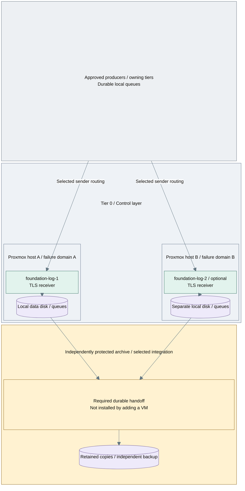

# Step 3b: Redundant protected intake

**Working repository:** `<prefix>-tier-0` (source: `tier-0/`).
**Branch from:** [Step 3](README.md#step-3-protect-and-verify-retained-evidence), when the required failure contract exceeds a single collector.
**Change:** Add independently placed receivers and verify durable handoff, not merely endpoint failover.
**Return:** [Step 3](README.md#step-3-protect-and-verify-retained-evidence) to record the demonstrated failure envelope.
**Design:** [durability and availability](../../architecture/operations/security-logging.md#durability-and-availability).
**Prerequisites:** functioning intake, independent backup/key custody and supported receiver/storage integration.

## 1. Add capacity and failure domains

Enable `foundation-log-2` in Tier 0's local `terraform/deployments/syslog/terraform.tfvars`;
add matching inventory/IP entries. Place receivers on distinct physical failure domains.
Add further capacity as demand requires. Receiver count alone does not establish storage redundancy.

## 2. Review and apply the same state root

Run `bash scripts/deploy.sh syslog --plan-only`, review added hosts/disks, then run
`bash scripts/deploy.sh syslog --terraform-only`. Keep existing hosts and state; no
replacement archive or second Terraform owner is introduced. Prepare each new data
mount and its host-specific UUID/TLS inputs using the [receiver guide](receiver.md),
then run `bash scripts/deploy.sh syslog --ansible-only`. This installs independent
receivers, not replication or an immutable archive.

Configure supported sender failover/dual submission, persistent queues, durable
copies and governed retention in project-owned automation. A VIP does not establish
replication or durable acceptance. Record when senders may release an event.

## 3. Verify the declared failure contract

| Test | Acceptance |
| --- | --- |
| Receiver/process/physical host loss | Accepted event sequence survives; upstream queues replay and duplicates are accounted for |
| Power loss or archive-target outage | Flush/commit behavior matches the contract; no upstream release before required durable protection |
| Partition, bounded outage and peak load | Failure domains, backpressure and headroom match the declared envelope; loss is not hidden |
| Independent restore and key recovery | Retained events remain inspectable without Tier 1, normal SSO or the original collector |

Use numbered events and source/receiver/archive counts. Record remaining source
gaps separately from loss of accepted records; do not claim exactly-once delivery.
Return to [Stage 1 acceptance](README.md#capability-available).
