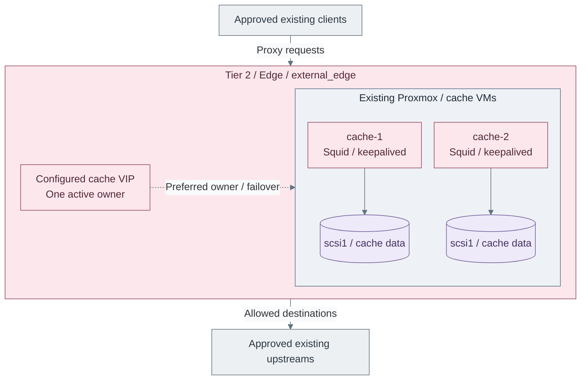

# Stage 1: Software intake

Provide controlled update access before deploying services that need packages or
images. Begin with a policy proxy/cache or verified existing supply; extend the
same capability with retained repositories and OCI artifact services later.

**Prerequisites:** [foundation](../foundation/README.md) hosts, networks, one approved
Linux template and independent bootstrap packages/tools. The cache cannot install itself.
**Working repositories:** `<prefix>-tier-2` for the proxy/cache, each consuming tier
for its local inputs, and `<prefix>-tier-1` for later repository/registry services.
**Automation:** the Squid/keepalived path is supplied. Repository management, Harbor
and automated patch rollout remain separate integrations, not installed by this path.
See [coverage](../../reference/implementation-support.md#stage-coverage).
**Design:** [controlled software intake](../../architecture/delivery/software-intake.md).

## Main path

1. [Deploy the policy proxy and cache](#step-1-deploy-the-policy-proxy-and-cache)
2. [Connect the approved consumers](#step-2-connect-the-approved-consumers)
3. [Accept controlled intake](#step-3-accept-controlled-intake)

Existing approved supply can satisfy the early need without creating another cache.
Deploy this capability after its VM prerequisites exist and before the first package
installation that requires it. Do not wait for identity, Kubernetes or Harbor.
The early path works independently of later hosted repository and OCI services.
See [later extensions](#extend-the-capability-later) for repository management and OCI supply.

## Step 1: Deploy the policy proxy and cache

Run from Tier 2. Follow [proxy configuration and deployment](proxy-cache.md#main-path)
to initialize inputs, review source CIDRs/domains, plan the guests and configure the service.

**IaC:** Tier 2 [cache inputs](../../../tier-2/terraform/deployments/cache/terraform.tfvars.example)
and [cache recipe](../../../tier-2/ansible/playbooks/deployment/outbound-cache.yml).
The pair and attached disks are created; clients, upstreams and physical networking already exist.
The VIP fails over; it does not replicate cache data or balance both VMs concurrently.

## Step 2: Connect the approved consumers

From each consuming tier, configure its own ignored `ansible/group_vars/all.yml`
or selected environment/setup file using the [consumer settings](proxy-cache.md#how-other-paths-use-it).
Shared's [baseline role](../../../shared/ansible/roles/baseline/tasks/repository_proxy.yml)
configures the supported package managers; it owns no consumer inventory or state.

Tier 0 [Proxmox host access](../../administration/compute/update-access.md) has its
own procedure. Kubernetes nodes use the [native image-access inputs](../stage-4-kubernetes/procedures/image-access.md)
in each tier's cluster root; Linux package-manager settings do not configure every workload.
Apply the selected [firewall rules](../../architecture/networking/firewall-policy.md#rule-contracts)
and retain independent bootstrap/recovery supply. No lower-tier service gains Tier 0 update authority.

## Step 3: Accept controlled intake

Follow [proxy validation](proxy-cache.md#validation): verify approved downloads,
denied sources/destinations, denied direct WAN bypass and actual VIP failover.
Record HTTP cache-hit behavior separately from successful HTTPS forwarding.
Retain the accepted source policy and fault/recovery limits in project records.

## Capability available

**Result:** connected consumers have a controlled intake path. This does not prove
that patches are installed, that releases are approved, or that a cache is an offline mirror.
Continue with [Stage 2: Protected logging](../stage-2-logging/README.md).

## Extend the capability later

| Extension | When and ownership | Relation to the early path |
| --- | --- | --- |
| Retained RPM/APT repositories | Tier 1 repository manager or verified existing service; product selection/installer remains open | Synchronize through controlled egress, then retain and approve releases for clients |
| OCI registry | [Stage 7 artifact supply](../stage-7-delivery/procedures/registry.md); Tier 1, Harbor is an example | Store/promote container images and compatible OCI artifacts; does not replace RPM/APT repositories |
| Patch rollout | Tier-owned maintenance automation; not supplied end to end | Use approved content with test/reboot/health gates; content availability alone is not patch compliance |

Repository and registry services can share intake policy and approval records,
but use their own protocols, credentials, persistence and recovery contracts.
Do not create another ordinary proxy merely because Harbor is introduced.
Do not remove retained bootstrap/recovery artifacts when these hosted services become available.
