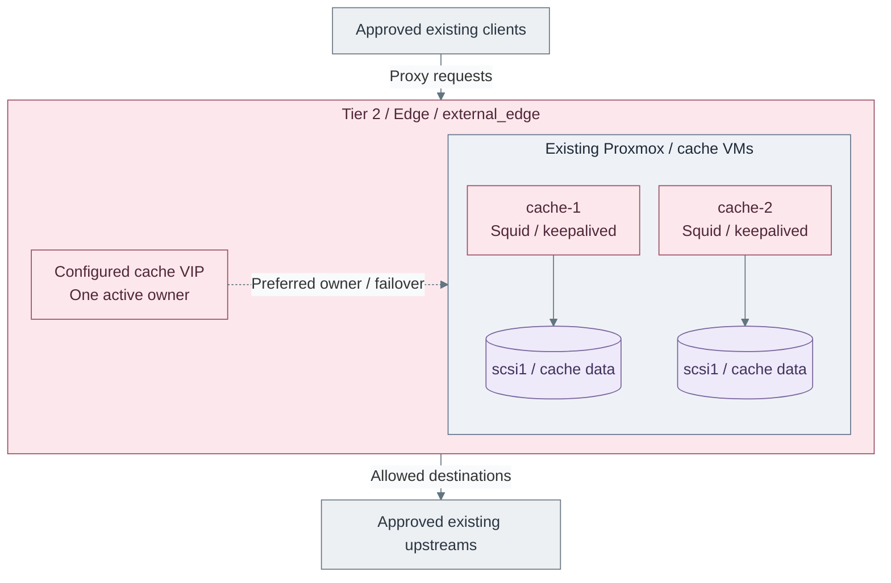

# Stage 1: Software intake

Establish approved update access, then connect the existing bootstrap and Proxmox hosts.
The main path creates a Tier 2 policy proxy/cache; an existing approved proxy or native mirror is also valid.

**Prerequisites:** [foundation](../foundation/README.md), a tested Linux template and independent
bootstrap software access. New cache VMs need an approved initial package source; they cannot install themselves.
**Working repositories:** `<prefix>-tier-2` for cache resources, `<prefix>-tier-0` for existing-host consumers,
and Shared for common platform references.
**Automation:** the Squid/keepalived installer and existing-host proxy configuration are supplied.
This stage is complete without PKI or a hosted registry. Verified publication is selected at
[Stage 3, option 3b](../stage-3-trust/README.md#3b-verified-repository-and-artifact-publication--optional),
after its trust/logging prerequisites exist. Harbor belongs to Stage 7.
See [coverage](../../reference/implementation-support.md#stage-coverage).
**Design:** [controlled software intake](../../architecture/software/software-intake.md).

## Main path

1. [Choose the supply route](#step-1-choose-the-supply-route).
2. [Initialize cache inputs](#step-2-initialize-cache-inputs), for a new cache pair.
3. [Configure the cache deployment](#step-3-configure-the-cache-deployment), for a new cache pair.
4. [Deploy the cache pair](#step-4-deploy-the-cache-pair), then test it.
5. [Test the selected intake path](#step-5-test-the-selected-intake-path), including existing supply.
6. [Connect the bootstrap host](#step-6-connect-the-bootstrap-host).
7. [Connect Proxmox host updates](#step-7-connect-proxmox-host-updates).

**New cache pair:** follow **1a → 2 → 3 → 4 → 5 → 6 → 7**.
**Existing supply:** follow **1b → 5 → 6 → 7**; create no cache resources.

## Step 1: Choose the supply route

### 1a: Create the proxy/cache pair — main path

Use the supplied `cache-1`/`cache-2` installer when controlled outbound access is needed.
Retain independent bootstrap/recovery artifacts. Continue at **Step 2**.

An OS-packaged `ansible-core` with compatible collections can run this cache recipe;
the precheck prepares its collections. Complete [Bootstrap Ansible installation](../foundation/bootstrap/README.md#4-install-ansible)
first; a manual venv is not universally required.

<a id="2b-use-existing-approved-supply--alternative"></a>

### 1b: Use existing approved supply — alternative

Record the existing proxy URL or native repository endpoints, allowed clients and source domains,
availability and recovery arrangements. A fully disconnected route needs retained content and tools;
an empty cache cannot supply offline packages.

Skip **Steps 2–4** and continue at **Step 5**. The main path works independently of later hosted
repository and OCI services.

<a id="step-1-deploy-the-policy-proxy-and-cache"></a>
<a id="step-1-prepare-the-cache-inputs"></a>

## Step 2: Initialize cache inputs

Choose **2a** for a fresh cache deployment or **2b** to update an existing pair.

### 2a: Initialize a new pair — main path

Run from **`<prefix>-tier-2/`** on the prepared bootstrap host:

```bash
bash scripts/init-local-files.sh --setup cache
```

**Expected:** missing ignored local inputs are created; existing configuration is preserved.
This does not create VMs or select deployment-ready values.

### 2b: Adopt an update to an existing pair

Complete [update adoption, Steps 1–4](step-2b-adopt-update.md), preserving live configuration and state.
Return at **Step 5** after reconciling the cache; this branch does not install verified publication.

## Step 3: Configure the cache deployment

Complete each required edit below. The network attachment has two alternatives.
Optional lookup: use the [proxy policy and tuning reference](../../reference/proxy-cache.md)
when choosing settings. The installation steps remain here in this README.

<a id="shared-references-check-once"></a>

### 1. Check Shared references

Edit in **`<prefix>-shared/`**:

| File | Set |
| --- | --- |
| `config/platform.tfvars` | `default_platform_node_name`: an existing destination node, such as `pve01`; `proxmox_storage_classes.local.vm_disk`: VM-image storage, such as `local-zfs`; omit `cloud_init_drive` to inherit it |
| `templates/proxmox-catalog.tfvars` | `default_linux_vm_template_id`: the clone-tested Linux template approved by Tier 0, for example Rocky `9101` |

The logical class `local` is not the datastore named `local`. Import storage and VM-disk storage
have different requirements; retain other valid classes. See [storage mapping](../../reference/platform-inputs.md#vm-disk-storage).

<a id="tier-2-inputs-edit-before-deployment"></a>

### 2. Set Tier 2 credentials and VM inputs

Edit in **`<prefix>-tier-2/`**:

| File | Set |
| --- | --- |
| `.env.local` | Actual `PROXMOX_API_URL`, token ID/secret and `TF_VAR_ssh_public_key_files`; Tier 2 does not inherit Tier 0's credentials |
| `terraform/deployments/cache/terraform.tfvars` | Free VMIDs, selected size/storage and OS/data disks; retain `cache-1`/`cache-2` keys |
| `ansible/group_vars/all.yml` | `platform_domain`, hostname prefix/suffix and `ansible_user` matching the clone's login account |

In **Tier 2 `.env.local`**, uncomment `TF_VAR_ssh_public_key_files` and use the actual absolute
public-key path from [bootstrap SSH setup](../foundation/bootstrap/README.md#step-3-prepare-the-execution-accounts-ssh-key):

```dotenv
TF_VAR_ssh_public_key_files='["/home/automation/.ssh/id_ed25519.pub"]'
```

The matching private key remains on the execution host or agent. Empty clone key inputs
do not inherit the key used to log into the bootstrap VM.

### 3. Select the network attachment

Edit **`<prefix>-tier-2/terraform/common.tfvars`**. Choose one attachment, then continue at action **4**.

**SDN VNet:** replace only `external_edge` inside `network_zones`:

```hcl
external_edge = {
  bridge     = "edge"
  sdn_lookup = true
}
```

Use the actual applied VNet ID. Its subnet supplies prefix/gateway; host IPs come from `cache.yml`.
The token needs scoped `SDN.Use` and `SDN.Audit`; see [API permissions](../foundation/proxmox/api-access.md#2b-existing-sdn-vnet).

**Regular VLAN-aware bridge:** instead retain the explicit `external_edge` bridge, VLAN,
subnet and gateway fields and set them to the prepared network. Do not add a VLAN tag to an SDN VNet.

### 4. Set addresses and access policy

Edit **`<prefix>-tier-2/ansible/group_vars/cache.yml`**. Replace these example addresses
with reserved site values:

```yaml
platform_host_ips:
  cache-1: 10.30.30.20
  cache-2: 10.30.30.21
cache_proxy_vip_cidr: "10.30.30.22/24"
cache_keepalived_virtual_router_id: 40
cache_squid_allowed_cidrs:
  - 10.10.10.0/24
  - 10.30.30.0/24
cache_validation_url: https://mirrors.fedoraproject.org/
```

Include the actual bootstrap and Proxmox management CIDRs. Narrow `cache_squid_allowed_domains`
to the selected repositories, required tools and redirect destinations; an empty list is rejected.
Use exact source hostnames where possible; `.example.com` permits that whole domain and its subdomains.
Select the bootstrap's collection source: public Galaxy needs its API and approved artifact destinations;
prepared collection archives are an alternative. Regional download hosts are not fixed defaults;
see [controller access and existing-cache recovery](../../reference/control-node-tooling.md#galaxy-through-a-policy-proxy).
Keep `cache_validation_denied_url` outside the allowed sources; the default uses a reserved `.invalid` name.
Keep `cache_validation_url` within that policy and `repository_proxy_enabled: false` for cache hosts,
so their initial installation does not depend on their own unfinished VIP.

Keep `cache_squid_data_device` on the dedicated Terraform `scsi1` disk. The reference uses
`/dev/disk/by-id/scsi-0QEMU_QEMU_HARDDISK_drive-scsi1`; Linux `/dev/sda` and `/dev/sdb` order can
differ between clones. Existing deployments must verify that link before switching. Optional
`cache_squid_data_uuid` pins a known filesystem. An OS/partitioned device, foreign use or hidden
files cause the storage guard to stop before Squid is stopped or a filesystem is created.

<a id="step-2-deploy-the-selected-intake-path"></a>
<a id="2a-create-the-proxycache-pair--main-path"></a>

## Step 4: Deploy the cache pair

### 4a: Provision and configure the pair — main path

The selected, verified blank data disk is formatted for rebuildable cache data; an accepted existing
filesystem is reused and mounted by UUID.
Confirm that the target VMs/disks contain no required data.
Review the separate [Proxmox NIC and guest-filtering controls](../foundation/network/firewall.md#proxmox-guest-interfaces);
the NIC Firewall flag and the guest's firewalld policy are separate controls.

CIDR validation uses `ansible.utils` and Python `netaddr` on the bootstrap/controller.
They are declared in Tier 2's [collection](../../../tier-2/ansible/requirements.yml) and
[Python requirements](../../../tier-2/ansible/requirements.txt). The setup precheck verifies both,
even when the collection is already installed: OS-packaged Ansible uses `python3-netaddr`;
an active venv receives its own `netaddr` dependency. Offline `check` mode verifies prepared
dependencies without installing them.

Run from **`<prefix>-tier-2/`**:

```bash
bash scripts/deploy.sh cache
```

Review Terraform's displayed plan and enter `yes` to create the resources and run Ansible,
or `no` to stop. Optional preview: add `--plan-only`. Approved unattended CI can use
`--auto-approve` with prepared tools, credentials and SSH access.



**IaC:** Tier 2 [cache inputs](../../../tier-2/terraform/deployments/cache/terraform.tfvars.example)
and [cache recipe](../../../tier-2/ansible/playbooks/deployment/outbound-cache.yml).
The pair and attached disks are created; clients, upstreams and physical networking already exist.
The VIP fails over; it does not replicate cache data or balance both VMs concurrently.

**Expected:** both hosts accept SSH, Squid responds and exactly one host owns the VIP.
VIP validation requires every member to have completed deployment; it must not stop the working
owner after a peer's configuration failure. A failed takeover is an availability failure, not a pass
because the owner was restarted by cleanup.
Default validation briefly stops keepalived to test takeover from the cache hosts, then restores it.
The deployment host checks the VIP; each node checks its own proxy locally.
If Terraform fails partway through, retain state and follow [partial-apply recovery](../../reference/repository-scripts.md#partial-terraform-apply).
Continue through **4b** if selected, then **Step 5**.

### 4b: Apply the Linux security profile — optional

With SSH and approved package access working on both cache VMs, apply the
[Linux service-VM profile](../../administration/hosts/linux-security.md).
Include the approved client ports, operator sources and VRRP peers before activating its firewall.
Return here for **Step 5** to retest the cache and takeover under the selected policy.

<a id="3a-test-the-intake-path"></a>

## Step 5: Test the selected intake path

Before changing host proxy settings, test from **the bootstrap host** and each intended consumer network.
For a proxy, use the accepted endpoint explicitly:

```bash
read -r -p "Proxy URL (example: http://10.30.30.22:3128): " PROXY_URL
read -r -p "Approved download URL: " APPROVED_URL
curl --fail --noproxy '' --proxy "$PROXY_URL" --output /dev/null "$APPROVED_URL"
```

| Check | Expected result |
| --- | --- |
| Approved source through proxy | Download succeeds |
| Unapproved HTTP destination | HTTP 403; deployment validation checks both nodes and the VIP |
| Unapproved HTTPS CONNECT or forbidden source network | Request is denied; include a real network-boundary check |
| Selected HTTP cacheable object, when HTTP caching is required | A repeated request produces a Squid cache hit; HTTPS CONNECT is not cached |

For native mirrors, test their actual repository/tool retrieval instead.
Stop on failed approved retrieval or policy checks.
Temporary bootstrap acquisition access may still exist here; retire it only after its replacement
works in **Steps 6–7**, then prove direct-WAN bypass is denied.

<a id="3b-configure-the-existing-bootstrap-host"></a>

## Step 6: Connect the bootstrap host

On **`boot-1`**, follow the required [bootstrap consumer actions](step-6-bootstrap-consumer.md) from
**`<prefix>-tier-0/`**. Select proxy or native mirrors, apply the local configuration, open/load
the correct shell environment and verify package/tool access before removing temporary egress.

**Expected:** the bootstrap uses accepted supply, and its direct-WAN bypass is denied.
This configures the existing host; it creates no VM, inventory entry or Terraform state.
Return here and continue at **Step 7**.

<a id="3d-connect-proxmox-host-updates"></a>

## Step 7: Connect Proxmox host updates

From **`<prefix>-tier-0/`**, complete the required [Proxmox host actions](../../administration/hosts/update-access.md#how-are-managed-hosts-configured):
register existing hosts, verify SSH access and apply the Datacenter/APT proxy settings.
For native mirrors instead, verify the equivalent APT configuration without enabling the proxy recipe.

On **each Proxmox host**, verify repository refreshes through the selected source, then retire its
temporary update egress and prove direct-WAN bypass is denied.
The hosts pull content; the Tier 2 cache receives no host credentials or management access.

**Expected:** all selected hosts can retrieve their approved updates through the accepted path.
[Install updates](../../administration/hosts/update-access.md#how-are-proxmox-updates-installed)
in a separate maintenance window, one cluster host at a time with the proxy kept available.
Patch installation is not a prerequisite for completing update-access configuration.

<a id="step-2-connect-the-approved-consumers"></a>
<a id="step-3-accept-controlled-intake"></a>
<a id="step-3-connect-and-verify-consumers"></a>

## Capability available

**Result:** the selected supply works, and existing bootstrap/Proxmox consumers use it with direct-WAN
bypass denied. Keep independent recovery artifacts and record the selected endpoint and checks.
This does not prove that patches are installed, releases are approved or a cache is an offline mirror.
Native package policy rejects incomplete APT refreshes and sets DNF signature/TLS/availability defaults;
repository-specific overrides and publisher keys still need review. See the
[consumer checks](../../reference/proxy-cache.md#consumer-verification-and-failure-behavior).

Continue from **`<prefix>-tier-0/`** at [Stage 2: Protected logging](../stage-2-logging/README.md).

<a id="3c-configure-later-linux-deployments"></a>

## Use the intake path in later deployments

When another tier/setup is initialized, edit **that tier's `ansible/group_vars/all.yml`**.
Reuse the accepted endpoint; do not replace an already accepted host configuration with another example:

```yaml
repository_proxy_enabled: true
repository_proxy_url: "http://10.30.30.22:3128"
```

A hostname is valid when independent DNS already resolves it.
Optional `repository_proxy_fqdn`/`repository_proxy_ip` inputs can supply a temporary hosts entry
before directory DNS exists. Keep the cache setup's own proxy override disabled.

The later deployment's [Shared baseline role](../../../shared/ansible/roles/baseline/tasks/repository_proxy.yml)
applies these defaults when those guests are created. This section deploys no future hosts.
Native mirrors need their own commissioned repository configuration instead.
Kubernetes uses its separate [image-access inputs](../stage-4-kubernetes/procedures/image-access.md).
See the [policy and sizing reference](../../reference/proxy-cache.md) when extending the allowed consumers.

## Extend the capability later

| Extension | When and ownership | Relation to the early path |
| --- | --- | --- |
| Retained RPM/APT repositories and selected files | [Stage 3, option 3b](../stage-3-trust/README.md#3b-verified-repository-and-artifact-publication--optional) | Install after trust/logging, then accept consumer cutover before leaving Stage 3 |
| Wider vulnerability policy | [Design extension](../../architecture/software/artifact-verification.md); OCI/Trivy integration remains separate | Add target-specific gates; ordinary proxy tunnels remain unscanned |
| OCI registry | [Stage 7 artifact supply](../stage-7-delivery/procedures/registry.md); Tier 1, Harbor is an example | Store/promote container images and compatible OCI artifacts; does not replace RPM/APT repositories |
| Patch rollout | Tier-owned maintenance automation; not supplied end to end | Use approved content with test/reboot/health gates; content availability alone is not patch compliance |

Repository and registry services can share intake policy and approval records,
but use their own protocols, credentials, persistence and recovery contracts.
Do not create another ordinary proxy merely because Harbor is introduced.
Do not remove retained bootstrap/recovery artifacts when these hosted services become available.
