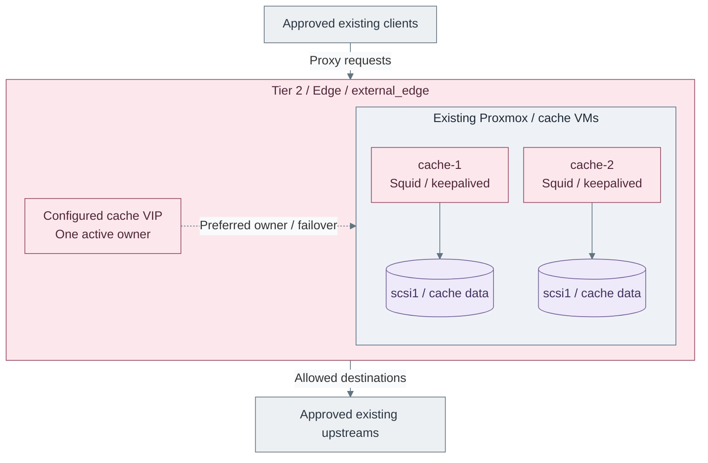

# Stage 1: Software intake

Provide controlled update access before deploying services that need packages or
images. Begin with a policy proxy/cache or verified existing supply; extend the
same capability with retained repositories and OCI artifact services later.

**Prerequisites:** [foundation](../foundation/README.md) hosts, networks, one approved
Linux template and independent bootstrap packages/tools. The cache cannot install itself.
**Working repositories:** `<prefix>-tier-2` for the proxy/cache, each consuming tier
for its local inputs, and `<prefix>-tier-1` for later repository/registry services.
**Automation:** the Squid/keepalived path is supplied. Repository management, Harbor
and automated patch rollout remain separate integrations, not installed by this path.
See [coverage](../../reference/implementation-support.md#stage-coverage).
**Design:** [controlled software intake](../../architecture/software/software-intake.md).

## Main path

1. [Prepare the cache inputs](#step-1-prepare-the-cache-inputs).
2. [Deploy the selected intake path](#step-2-deploy-the-selected-intake-path):
   **2a** creates the cache pair; **2b** uses an existing approved service instead.
3. [Connect and verify consumers](#step-3-connect-and-verify-consumers).

Existing approved supply can satisfy this stage: skip to **2b**, then continue at **3**.
The main path works independently of later hosted repository and OCI services.

<a id="step-1-deploy-the-policy-proxy-and-cache"></a>

## Step 1: Prepare the cache inputs

Initialize the Tier 2 cache inputs on the bootstrap host:

```bash
# Run from <prefix>-tier-2/
bash scripts/init-local-files.sh --setup cache
```

Initialization creates ignored local files without overwriting existing configuration.

### Shared references: check once

Shared references apply to all Linux deployments.

Edit these files:

```text
# Edit in <prefix>-shared/
config/platform.tfvars
# Edit: default_platform_node_name is an existing destination node, such as pve01
# Edit: proxmox_storage_classes.local: vm_disk is VM-image storage, such as local-zfs; omit cloud_init_drive
#       to inherit it. Preserve other storage classes
templates/proxmox-catalog.tfvars
# Edit: default_linux_vm_template_id selects a clone-tested Linux image published by Tier 0; the example
#       Rocky template is 9101
```

The logical class `local` is **not** the datastore named `local`. Import storage may accept
images for upload without supporting VM disks. See [storage mapping](../../reference/platform-inputs.md#vm-disk-storage).

### Tier 2 inputs: edit before deployment

Edit these files:

```text
# Edit in <prefix>-tier-2/
.env.local
# Edit: Actual PROXMOX_API_URL, token ID/secret and TF_VAR_ssh_public_key_files. This file is separate from
#       Tier 0's
terraform/common.tfvars
# Edit: external_edge bridge/VLAN, subnet and gateway, or the SDN alternative below
terraform/deployments/cache/terraform.tfvars
# Edit: Available VMIDs; keep cache-1/cache-2 keys. Review OS disk and each extra scsi1 cache disk
ansible/group_vars/all.yml
# Edit: platform_domain, hostname prefix/suffix and ansible_user matching the clone's login user
ansible/group_vars/cache.yml
# Edit: Both host IPs, VIP/prefix, unique VRRP ID, permitted client CIDRs and approved source domains
# Edit: cache_validation_url reachable through the selected policy; keep repository_proxy_enabled: false for
#       the cache hosts
```

In `.env.local`, uncomment and set the execution account's **public key file path**:

```dotenv
# Edit in <prefix>-tier-2/.env.local
TF_VAR_ssh_public_key_files='["/home/operator/.ssh/id_ed25519.pub"]'
```

Use the existing [bootstrap SSH key](../foundation/proxmox/bootstrap.md); the matching private key stays
on the execution host or agent. Empty clone key inputs do not inherit bootstrap-host access.

For SDN, replace only `external_edge` inside `network_zones` in `terraform/common.tfvars`:

```hcl
# Edit in <prefix>-tier-2/terraform/common.tfvars (inside network_zones).
external_edge = {
  bridge     = "edge"
  sdn_lookup = true
}
```

Use the actual applied VNet ID. Its subnet supplies the prefix/gateway; host IPs still come from
`cache.yml`. The token needs scoped `SDN.Use` **and** `SDN.Audit`; see
[API permissions](../foundation/proxmox/api-access.md#2b-existing-sdn-vnet).
For a regular VLAN-aware bridge, edit the existing explicit VLAN/subnet/gateway fields instead.

In `ansible/group_vars/cache.yml`, replace these values with reserved site addresses:

```yaml
# Edit in <prefix>-tier-2/ansible/group_vars/cache.yml.
platform_host_ips:
  cache-1: 10.30.30.20
  cache-2: 10.30.30.21
cache_proxy_vip_cidr: "10.30.30.22/24"
cache_keepalived_virtual_router_id: 40
cache_squid_allowed_cidrs:
  - 10.30.30.0/24
cache_validation_url: https://mirrors.fedoraproject.org/
```

Add the actual consumer and bootstrap-host CIDRs to the allow-list. Narrow
`cache_squid_allowed_domains` to the required repositories and their redirect destinations.
An empty domain list is rejected; there is no unrestricted fallback.

## Step 2: Deploy the selected intake path

### 2a: Create the proxy/cache pair — main path

The selected data device (`/dev/sdb` by default) is formatted for rebuildable cache data.
Confirm that the cache VMs and their extra disks contain no required data.
The plan enables each Proxmox NIC's Firewall flag; review the separate
[guest-filtering controls](../foundation/network/firewall.md#proxmox-guest-interfaces)
before applying it to existing guests. Ansible's guest `firewalld` settings are independent.

```bash
# Run from <prefix>-tier-2/
bash scripts/deploy.sh cache
```

Review Terraform's displayed plan, then enter `yes` to create the resources and run Ansible.
Enter `no` to stop. Optional preview: add `--plan-only`. An approved pipeline can add
`--auto-approve`; provide credentials, SSH access and installed control-node tools beforehand.



**IaC:** Tier 2 [cache inputs](../../../tier-2/terraform/deployments/cache/terraform.tfvars.example)
and [cache recipe](../../../tier-2/ansible/playbooks/deployment/outbound-cache.yml).
The pair and attached disks are created; clients, upstreams and physical networking already exist.
The VIP fails over; it does not replicate cache data or balance both VMs concurrently.

**Expected:** both hosts accept SSH, Squid responds and exactly one host owns the VIP.
The default validation briefly stops keepalived to test takeover, then restores it.
If Terraform fails partway through, preserve state and follow
[partial-apply recovery](../../reference/repository-scripts.md#partial-terraform-apply) before retrying.
Continue at **3**; **2b** is an alternative.

### 2b: Use existing approved supply — alternative

Create no cache resources. Record the existing proxy URL or internal repository endpoints,
allowed client networks, availability and recovery arrangements in project documentation.
Verify an approved download from the bootstrap host. A proxy can use the consumer inputs
in **3**; a direct internal mirror needs its own repository configuration instead.
Continue at **3**.

<a id="step-2-connect-the-approved-consumers"></a>
<a id="step-3-accept-controlled-intake"></a>

## Step 3: Connect and verify consumers

### 3a: Configure the existing bootstrap host

Follow the [local bootstrap consumer steps](bootstrap-consumer.md) on `boot-1` in the Tier 0
repository. Select proxy or native mirrors, apply the local recipe and verify access before
retiring temporary acquisition egress. This manually created host is not automatically configured
by the cache deployment; no inventory entry or Terraform adoption is required.

### 3b: Configure later Linux deployments

For each later Linux deployment, edit that tier's ignored `ansible/group_vars/all.yml`
after its initialization step. Add or replace these consumer settings:

```yaml
repository_proxy_enabled: true
repository_proxy_fqdn: "cache.{{ platform_domain }}"
repository_proxy_url: "http://{{ repository_proxy_fqdn }}:3128"
repository_proxy_ip: "10.30.30.22"
```

Use the selected VIP; with existing supply, use its actual endpoint instead. The IP supplies
a temporary hosts entry before DNS exists. Leave the cache setup's own proxy override disabled.
The later deployment's Shared [baseline role](../../../shared/ansible/roles/baseline/tasks/repository_proxy.yml)
applies these inputs; this step does not deploy those future hosts.

### 3c: Accept the consumer path

From the bootstrap host and a permitted consumer network, test the selected proxy endpoint
(native-mirror consumers use their commissioned package/tool checks instead):

```bash
# Run on the selected approved consumer host.
read -r -p "Proxy URL (example: http://10.30.30.22:3128): " PROXY_URL
read -r -p "Approved download URL: " APPROVED_URL
curl --fail --noproxy '' --proxy "$PROXY_URL" --output /dev/null "$APPROVED_URL"
```

| Check | Expected result |
| --- | --- |
| Approved source through proxy | Download succeeds |
| Unapproved destination or forbidden source network | Proxy request is denied |
| Consumer direct WAN bypass | Firewall denies it |
| HTTP cacheable object requested twice | Squid records the expected cache hit; HTTPS CONNECT is not cached |

Apply the [firewall rules](../../architecture/networking/firewall-policy.md#rule-contracts) before
removing temporary bootstrap egress. Detailed [validation](proxy-cache.md#validation) and
[policy/storage reference](proxy-cache.md) are available when needed.
Proxmox uses its [host update procedure](../../administration/hosts/update-access.md);
Kubernetes uses separate [image-access inputs](../stage-4-kubernetes/procedures/image-access.md).
The cache does not provide unrestricted internet access or Tier 0 update authority.

## Capability available

**Result:** connected consumers have a controlled intake path. This does not prove
that patches are installed, that releases are approved, or that a cache is an offline mirror.
Return to Tier 0, then follow [Stage 2: Protected logging](../stage-2-logging/README.md):

**Execution context:** `<prefix>-tier-0/`.

## Extend the capability later

| Extension | When and ownership | Relation to the early path |
| --- | --- | --- |
| Retained RPM/APT repositories | Tier 1 repository manager or verified existing service; product selection/installer remains open | Synchronize through controlled egress, then retain and approve releases for clients |
| OCI registry | [Stage 7 artifact supply](../stage-7-delivery/procedures/registry.md); Tier 1, Harbor is an example | Store/promote container images and compatible OCI artifacts; does not replace RPM/APT repositories |
| Patch rollout | Tier-owned maintenance automation; not supplied end to end | Use approved content with test/reboot/health gates; content availability alone is not patch compliance |

Repository and registry services can share intake policy and approval records,
but use their own protocols, credentials, persistence and recovery contracts.
Do not create another ordinary proxy merely because Harbor is introduced.
Do not remove retained bootstrap/recovery artifacts when these hosted services become available.
