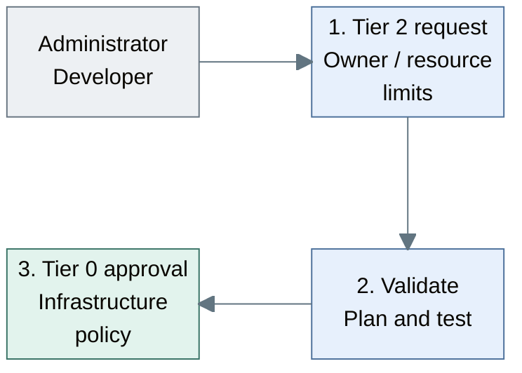
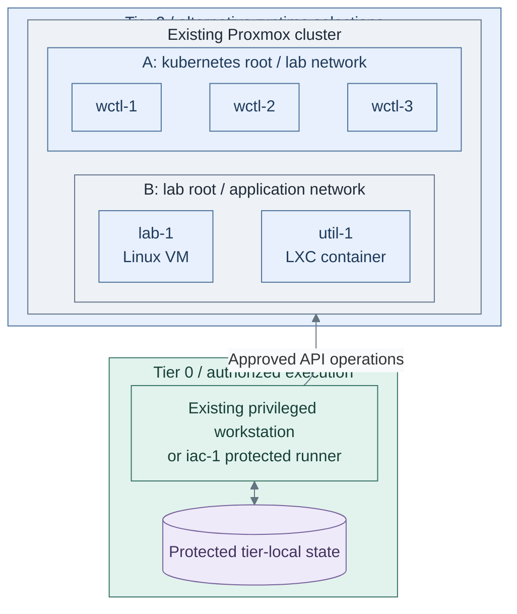
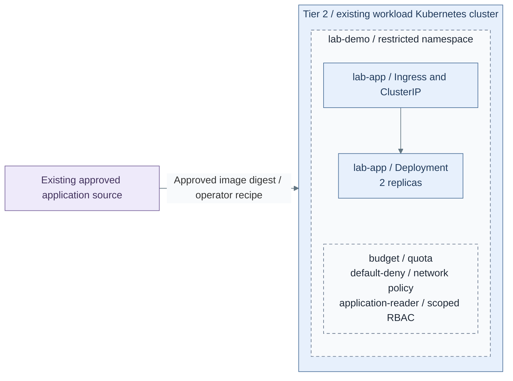

# Stage 10: Lab environments

Create isolated Tier 2 VMs and Kubernetes environments for development, testing
and experiments. Begin with reviewed operator deployments; future self-service
requests use bounded profiles and explicit authorization. Application delivery
remains separate from hypervisor and cluster lifecycle authority.

**Prerequisites:** accepted [Development platform and trusted execution](../stage-9-development/README.md),
accepted [Observability interfaces](../stage-8-observability/README.md), scoped
credentials, protected state and tested recovery.
**Working repositories:** `<prefix>-tier-2` for workload definitions;
`<prefix>-tier-0` for privileged execution (source: matching `tier-N/`).
**Automation:** tier-local guest and cluster lifecycle workflows are supplied;
a bounded application recipe is supplied; the optional protected request controller remains project integration.
See [coverage](../../reference/implementation-support.md#stage-coverage).

## Working repositories

| Work | Repository | IaC location inside that repository |
| --- | --- | --- |
| VM and workload definitions | `<prefix>-tier-2` | [terraform/deployments/lab/](../../../tier-2/terraform/deployments/lab), [ansible/](../../../tier-2/ansible) and [workloads/](../../../tier-2/workloads) |
| Workload cluster | `<prefix>-tier-2` | [terraform/deployments/kubernetes/](../../../tier-2/terraform/deployments/kubernetes) and [clusters/tier2/](../../../tier-2/clusters/tier2) |
| Privileged request execution | `<prefix>-tier-0` | Project integration; no complete request controller is supplied |

Run local operator commands from Tier 2's root. Tier 0 execution does not move
these definitions, inventory or state into Tier 0 or Shared.

**Execution context:** `<prefix>-tier-2/`.

## Main path

1. [Define the approved request](#step-1-define-the-approved-request)
2. [Provision the workload runtime](#step-2-provision-the-workload-runtime)
3. [Deploy and verify applications](#step-3-deploy-and-verify-applications)

## Step 1: Define the approved request

After the development platform, follow [isolated Kubernetes labs](isolated-clusters.md)
to select dedicated/virtual/shared isolation and future bounded profiles.
The current root creates one configured cluster; automatic multi-cluster allocation
and portal integration are not supplied.

Start with reviewed operator-driven jobs. Automatic self-service is an optional
implementation of the same bounded contract, not a reason to give general CI credentials.



**Workflow:** reviewed request handling, not a deployed controller.
Tier 2 [workload inputs](../../../tier-2/terraform/deployments/lab/terraform.tfvars.example)
feed a [Shared plan executor](../../../shared/scripts/deploy.sh); automated Tier 0 authorization remains project integration.

1. Record the workload owner, permitted templates, sizes, networks and quotas in
   the [Tier 2 repository](../../paths/tier-2/README.md).
2. Validate the request and review its plan under the
   [provisioning contract](../../architecture/hosting/provisioning.md).
3. Verify that accepted and rejected requests follow Tier 0 authorization. The
   bounded request interface is a target design, not a shipped controller.

**Result:** only requests inside the selected policy reach privileged execution.
Unimplemented automation is recorded as outstanding work, not treated as available.

## Step 2: Provision the workload runtime

For Linux labs, select the [tier-local application override](../../reference/network-inputs.md#guest-attachment)
before provisioning untrusted guests. The starter `lab-1`/`util-1` definitions
otherwise inherit the shared application subnet; their names do not isolate them.
The Kubernetes example already selects VLAN 420. Record the selected Lab-zone
policy and attachment in the [network plan](../../conventions/network-plan.md#services-zone).

The protected runner creates the approved resources using the owning tier's inputs
and state. Shared supplies reusable helpers, never workload inventory or resources.



**IaC:** Tier 2 [Kubernetes inputs](../../../tier-2/terraform/deployments/kubernetes/terraform.tfvars.example)
and [cluster entry point](../../../tier-2/scripts/kubernetes-cluster.sh), or
[VM/LXC inputs](../../../tier-2/terraform/deployments/lab/terraform.tfvars.example)
and [lab recipe](../../../tier-2/ansible/playbooks/deployment/lab-vms.yml).
A and B are independent roots, not one command that creates both; choose the required runtime.
The [Shared executor](../../../shared/scripts/deploy.sh) consumes Tier 2 inventory/state, never owns them.

Choose **2a: Linux VM/LXC** or **2b: Kubernetes** below; both return to Step 3.
They have independent roots and state. Deploy both only when both runtimes are required.

### Step 2a: Linux VM/LXC labs

Initialize local inputs:

Run from **`<prefix>-tier-2/`**.

```bash
bash scripts/init-local-files.sh --setup lab
```

Edit these files together before deployment:

Edit in **`<prefix>-tier-2/`**.

- `terraform/deployments/lab/terraform.tfvars`: Complete `vm_instances`/`lxc_instances`, unused VMIDs, sizes
  and storage
- `terraform/common.tfvars`: Tier-local application network override for the selected isolated lab subnet
- `ansible/inventory/hosts.yml`: Matching logical host keys and lab groups
- `ansible/group_vars/lab.yml`: Matching `platform_host_ips`
- `.env.local`: This tier's verified API endpoint/token and local SSH public-key paths

Run with independently authorized execution credentials:

Run from **`<prefix>-tier-2/`**.

```bash
bash scripts/deploy.sh lab
```

Review Terraform's plan and enter `yes` only for the intended changes. Add `--plan-only`
for preview only; approved unattended jobs use `--auto-approve`. These are operator
commands; ordinary workload users receive no Proxmox credentials.

### Step 2b: Kubernetes labs

1. From Tier 2, initialize the dedicated cluster inputs:

   Run from **`<prefix>-tier-2/`**.

   ```bash
   bash scripts/kubernetes-cluster.sh init
   ```

2. Complete the [common cluster procedure](../stage-4-kubernetes/procedures/talos-terraform.md):
   edit Tier 2's inventory, `ansible/group_vars/talos.yml` and
   `terraform/deployments/kubernetes/terraform.tfvars`; supply unique addresses/VMIDs,
   approved templates, private endpoint and native provider environment.
3. Use that script's saved-plan sequence: `plan`, review, `apply`, then `credentials`.
   It does not load `.env.local` or use the Linux deployment helper.
4. Install and verify the [basic platform](../stage-4-kubernetes/procedures/basic-platform.md)
   from **Tier 2**, with its kubeconfig and `ansible/group_vars/cluster_platform.yml`.

Before either branch rejoins Step 3, verify isolation, readiness, original-state
locking and independent recovery. No autoscaler or multi-cluster allocator is installed.

**Result:** the [compute runtime](../../architecture/hosting/README.md) is ready within
the workload's allocated scope, without changing Tier 0 ownership.

## Step 3: Deploy and verify applications

For the Kubernetes branch, complete the numbered application path below. The Linux
branch needs application-specific automation; its OS baseline is not an app installer.

Approved application revisions are reconciled inside the owning cluster. Rancher/Fleet
can manage selected Tier 1/2 clusters, never Tier 0 infrastructure.



**IaC:** Tier 2 [application recipe](../../../tier-2/ansible/playbooks/deployment/lab-environment.yml)
and [inputs](../../../tier-2/ansible/group_vars/lab_environment.yml.example) render/apply
the [native resources](../../../tier-2/ansible/roles/lab_environment/templates/environment.yml.j2).
The namespace, quota, policies, reader role, two app replicas and private route are
installed together. The cluster and trusted TLS Secret are explicit prerequisites.
See [application installation](application.md) for commands and acceptance.

1. Install the [bounded application reference](application.md), then select
   [scoped delivery](../../architecture/software/controllers.md) for subsequent revisions.
   This recipe does not install another delivery controller or tenant allocator.
2. Connect [workload collection](telemetry.md), Steps 1–3. Security/audit submissions
   still go directly to protected Tier 0 intake; Tier 1 exposes only approved copies.
3. For a public website, take [3b: public HTTPS](public-https.md), then return here.
   Private applications skip that branch.
4. Exercise an update, rollback and restore, including the behavior when source control
   is unavailable. Source loss pauses new requests; it never authorizes deletion.
5. Hand recurring operations to [administration](../../administration/README.md), retaining
   independent recovery and separately authorized key ceremonies.

**Result:** application delivery works independently of privileged infrastructure
execution, as required by the [service boundaries](../../architecture/service-boundaries.md).

## Capability available

The platform can repeatedly deliver Tier 2 workloads through its approved workflow.
Record policy, recovery and acceptance evidence against
[readiness criteria](../readiness.md). Continue with administration for ongoing operation
and [development](../../development/README.md) for unimplemented automation.
