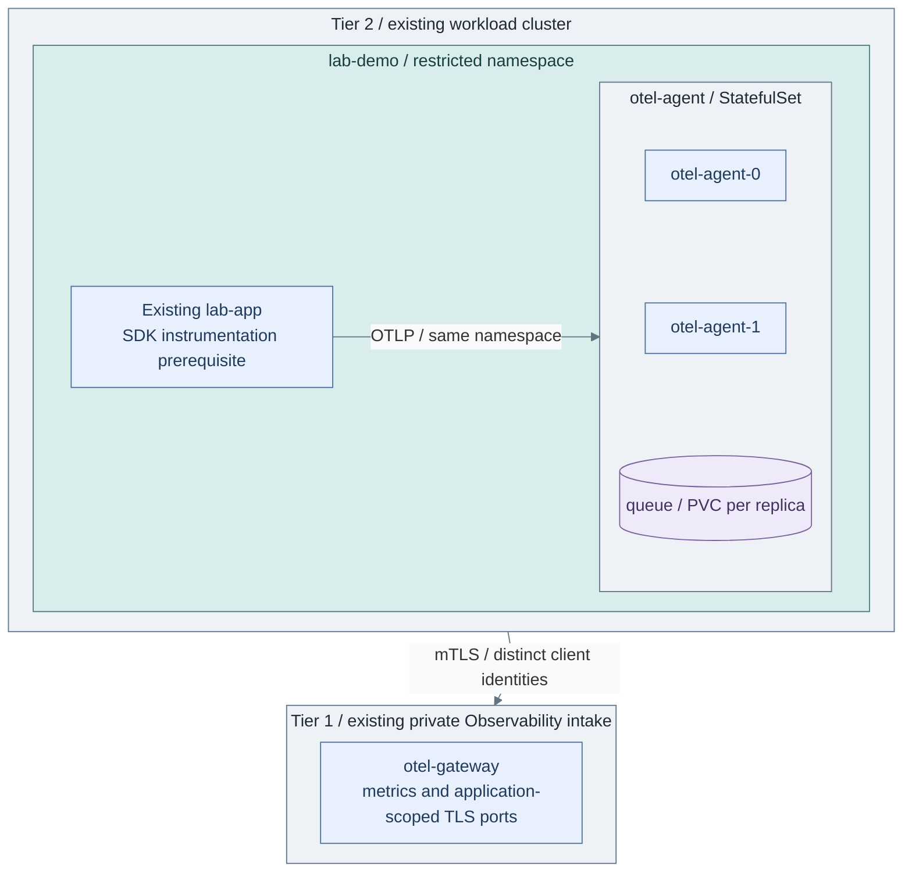

# Scoped workload collection

Connect application logs, metrics and distributed traces to the accepted Tier 1
Observability interfaces. Security/audit evidence continues directly to Tier 0;
this recipe creates neither another syslog server nor an authoritative archive.

**Working repository:** `<prefix>-tier-2` (source: `tier-2/`).
**Prerequisites:** accepted [Observability](../stage-8-observability/README.md),
an existing application namespace, CSI storage and enforced network policies.
Application SDK instrumentation and its receiver configuration are application-owned.
**Design:** [telemetry boundaries](../../architecture/operations/telemetry.md).

## Main path

1. [Prepare the selected sources](#step-1-prepare-the-selected-sources)
2. [Install the scoped Collector](#step-2-install-the-scoped-collector)
3. [Verify buffering and authorization](#step-3-verify-buffering-and-authorization)

## Step 1: Prepare the selected sources

For Linux VMs such as `lab-1`, use the [Linux source recipe](../stage-2-logging/sources.md).
It installs Shared's native sender using Tier 2-owned inventory and source selections.
Cluster OS/API evidence uses the [cluster security-event gate](../stage-4-kubernetes/procedures/kubernetes.md#cluster-foundation),
not the application analytics path below. Register missing sources explicitly.
Application security/audit events must also enter a protected source, such as
captured container stdout or an approved file stream, never only the SDK analytics path.

In Kubernetes, install application instrumentation using the language's supported
OTel SDK. Configure OTLP/gRPC to `otel-agent:4317` in its own namespace. This listener
is plaintext within the same restricted namespace and allowed only by its network
policy; no cross-tier or public plaintext listener is created. Services needing
stronger intra-namespace separation require separate namespaces or authenticated receivers.



**IaC:** Tier 2 [Collector recipe](../../../tier-2/ansible/playbooks/deployment/workload-telemetry.yml),
[inputs](../../../tier-2/ansible/group_vars/workload_telemetry.yml.example) and
[native chart values](../../../tier-2/ansible/roles/workload_telemetry/templates/values.yml.j2).
Scope: two application-namespace Collector replicas, their queue PVCs and network policies.
The application SDK, cluster, CSI class and Tier 1 gateway already exist.

## Step 2: Install the scoped Collector

From Tier 2's root, prepare private inputs in the accepted deployment environment:

```bash
umask 077
cp -n ansible/group_vars/workload_telemetry.yml.example ansible/group_vars/workload_telemetry.yml
python3 -m pip install -r ansible/requirements.txt
ansible-galaxy collection install -r ansible/requirements.yml
```

Set exact compatible chart/image pins, namespace, storage class and private gateway
endpoints. Match the accepted Stage 8 NodePorts, DNS/server certificate names and
gateway node CIDRs; a different cluster's `ClusterIP` is not a reachable endpoint.
Allow only those destinations through network firewalls. Never expose them publicly.

Prepare these existing Secrets in the application namespace, using exactly one
approved secret owner. Each contains `tls.crt`, `tls.key` and `ca.crt`:

| Secret | Scope |
| --- | --- |
| `otel-agent-metrics-client` | Accepted by the Tier 1 metrics receiver |
| `otel-agent-application-client` | Accepted only by this application's log/trace scope |

These are producer credentials, not OpenSearch query, archive or administrator
credentials. Tier 1 maps authenticated intake ports to fixed search scopes;
caller-supplied labels never grant another application's read access.

```bash
ANSIBLE_CONFIG=ansible/ansible.cfg ansible-playbook -i localhost, ansible/playbooks/deployment/workload-telemetry.yml -e @ansible/group_vars/workload_telemetry.yml
```

Review `secrets/workload-telemetry/otel-agent-values.yml` and native manifests.
Set the explicit kubeconfig path, then apply:

```bash
ANSIBLE_CONFIG=ansible/ansible.cfg ansible-playbook -i localhost, ansible/playbooks/deployment/workload-telemetry.yml -e @ansible/group_vars/workload_telemetry.yml -e workload_telemetry_action=apply
```

Shared executes the official pinned chart; Tier 2 owns the namespace, release,
inputs and Secrets. The recipe installs no full metrics/search stack locally.
The [network policies](../../../tier-2/ansible/roles/workload_telemetry/templates/network-policy.yml.j2)
allow application-to-Collector traffic, DNS and specified outbound gateway ports.
They do not grant access to the Tier 0 archive.

## Step 3: Verify buffering and authorization

1. Emit numbered application logs, metrics and traces. Confirm correlation and the
   correct Tier 1 application scope; prove a different application's reader is denied.
2. Stop a Collector and block the gateway briefly. Verify reconnection, retained
   queues, queue pressure and measured replay/loss limits after restoration.
3. Prove application users and Tier 1 search administrators cannot mutate protected
   Tier 0 evidence. Reconcile raw security events through the separate logging path.

Persistent queues protect selected exporter state, not every SDK buffer or failed
disk. Two replicas do not replicate their queues, remove storage failure or guarantee
zero loss. SDK retry, PVC recovery, capacity and outage limits require live tests. [2]

Return to [Stage 10, Step 3](README.md#step-3-deploy-and-verify-applications).

## References

1. [Official Collector Helm deployment](https://opentelemetry.io/docs/platforms/kubernetes/helm/collector/).
2. [Collector queues and resilience limits](https://opentelemetry.io/docs/collector/resiliency/).
