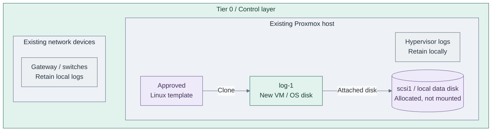
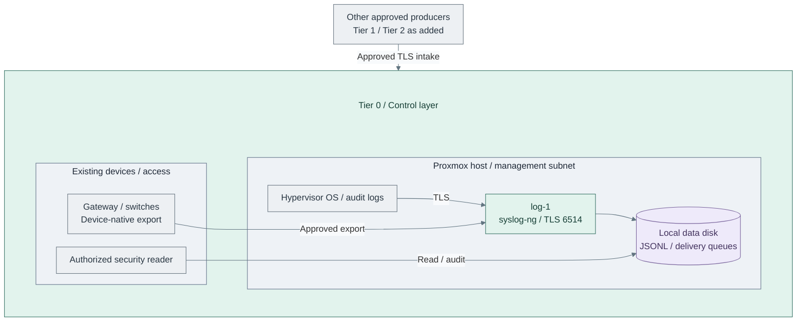
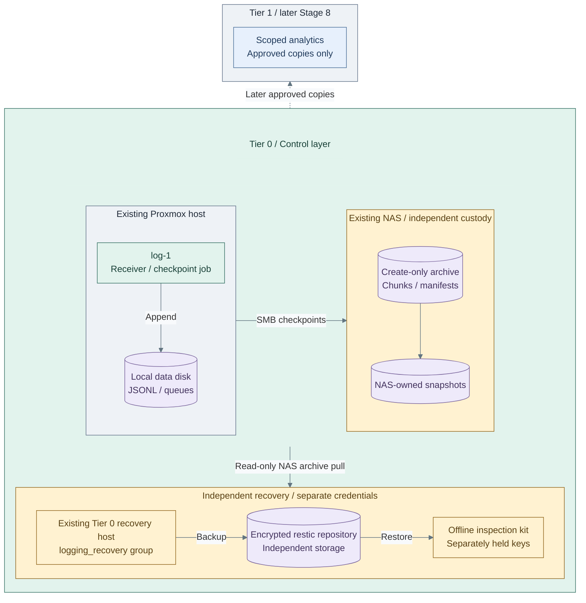

# Stage 2: Protected logging

Deploy independent Tier 0 log intake before PKI, FreeIPA or Kubernetes. This capability
provides **Security Logging and Audit** for traceability and recovery. Later
[Observability](../stage-8-observability/README.md) adds operational diagnosis, not evidence custody.

**Working repository:** `<prefix>-tier-0` (source: `tier-0/`).
Run repository scripts from this root; Shared is execution code, not an evidence owner.
**Design:** [protected security logging](../../architecture/operations/security-logging.md).
**Prerequisites:** verified [foundation](../foundation/README.md): approved Linux templates, Control networking, local tools/state,
independent bootstrap credentials and protected storage. Kubernetes, FreeIPA,
Keycloak, Vault and Tier 1 analytics are not prerequisites.
**Automation:** guest data-volume preparation and the Linux/NAS main-path mechanisms are supplied;
NAS custody and live acceptance remain required. See [coverage](../../reference/implementation-support.md#stage-coverage).

## Main path

| Step / option | Detailed path | Rejoin |
| --- | --- | --- |
| 1: first receiver VM/disks | Provision below; no platform PKI or cluster required | Step 2 |
| 2: trust, receiver, then producers | [Independent signing](producer-trust.md), [receiver](receiver.md), then [sources](sources.md) | Step 3 after authorized test events arrive |
| 3a: single collector, main | Retain the first collector's explicit failure limits | Select storage 3c or 3d |
| 3b: extra receiver, optional | [Redundant intake](step-3b-redundant-intake.md) | Select storage 3c or 3d for the resulting topology |
| 3c: NAS retention, main | [NAS checkpoints and independent backup](step-3c-nas-archive.md) | Final fault/restore acceptance below |
| 3d: locked retention instead or in addition | [Retention-locked storage integration](step-3d-retention-lock.md); requires a qualified existing endpoint | Final fault/restore acceptance below |

1. [Provision the log host](#step-1-provision-the-log-host)
2. [Install the receiver, then connect and test sources](#step-2-enable-protected-collection)
3. [Install NAS retention and verify recovery](#step-3-protect-and-verify-retained-evidence)

**Execution context:** `<prefix>-tier-0/`.

The required receiver, source and NAS instructions below are parts of this stage.
Complete them in order, returning here at the end of each task. Redundant intake adds capacity;
NAS and locked retention are storage choices with separate acceptance gates.

The IaC provisions hosts/disks, installs the isolated receiver, configures supported
Linux producers and publishes NAS checkpoints with independent encrypted backups.
Guarded Ansible prepares the local filesystem and UUID mount. NAS-owned snapshots
and live acceptance remain explicit gates;
this asynchronous main path has declared durability limits, not lossless HA.
At Step 3, use [NAS-backed retention](step-3c-nas-archive.md) for a trusted-admin
homelab or [retention locks](step-3d-retention-lock.md) for protection from privileged
deletion. These are alternatives, not mandatory consecutive deployments.

<a id="1-provision-the-bootstrap-receiver"></a>

## Step 1: Provision the log host



**IaC:** Tier 0 [VM/disk definitions](../../../tier-0/terraform/deployments/syslog/terraform.tfvars.example)
and [inventory](../../../tier-0/ansible/inventory/hosts.yml.example).
Proxmox, network devices and the approved template already exist; this step does not create them.

Tier 0 is the ownership boundary; **Stage 2** is the deployment capability, not Tier 1.
The main path adds one VM. The [redundant-intake option](step-3b-redundant-intake.md)
adds `log-2` on a different physical host; it does not automatically provide HA.

Before this VM exists, retain persistent local host logs and supported device buffers
from first boot. Preserve and import/export those records when intake is ready, retaining
their original timestamps and source identity. Record any earlier unbuffered gap.

1. Initialize local inputs from the Tier 0 repository root:

   Run from **`<prefix>-tier-0/`**.

   ```bash
   bash scripts/init-local-files.sh --setup syslog
   ```

2. Edit the local inputs; do not edit examples or store secrets in Git:

   | Tier 0 file | Set |
   | --- | --- |
   | `.env.local` | This tier's real `PROXMOX_API_URL`, token ID/secret and `TF_VAR_ssh_public_key_files`; use the matching private key through SSH configuration or an agent |
   | Shared: `config/platform.tfvars` | Actual `default_platform_node_name` and `proxmox_storage_classes`; `local.vm_disk` must name storage accepting VM images, such as `local-zfs` |
   | Shared: `templates/proxmox-catalog.tfvars` | `default_linux_vm_template_id` selects the approved Linux template, not the Talos image |
   | `terraform/common.tfvars` | `network_zones.management` must match the intended private attachment, prefix and gateway, or applied SDN lookup |
   | `terraform/deployments/syslog/terraform.tfvars` | Keep `log-1`; set its unused `vm_id`, size, `storage_class`, `disk_size_gb` and `extra_disks` capacity |
   | `ansible/inventory/hosts.yml` | Include `log-1` under `foundation_logging`; retain existing groups/hosts |
   | `ansible/group_vars/syslog.yml` | Set `platform_host_ips.log-1` to its reserved address; complete receiver fields in Step 2 below |

3. Provision the VM and disks. Review Terraform's displayed plan; enter `yes` only
   for the intended changes:

   Run from **`<prefix>-tier-0/`**.

   ```bash
   bash scripts/deploy.sh syslog --terraform-only
   ```

   Optional preview: add `--plan-only`. An approved unattended provisioning job
   can add `--auto-approve`; this does not prepare the data mount or receiver trust.
4. Check SSH from the execution host, using the address set above:

   Run from **`<prefix>-tier-0/`**.

   ```bash
   read -r -p 'Reserved log-1 IP: ' LOG_HOST_IP
   ssh "automation@$LOG_HOST_IP"
   ```

   Use the configured SSH account if different. Step 2 prepares storage through Ansible;
   return to the Tier 0 execution shell for repository commands.

Edit the local files seeded from examples. The starter creates `log-1`
outside Kubernetes with an OS disk and a separate log-data disk. This Terraform-only
step does not configure the receiver or format/mount that disk. Size storage from measured rate/retention,
not from the starter's example capacity.

Existing installations retain their current logical host keys, credentials and archive
identities on refresh; see the [guest identity contract](../../reference/syslog-receiver.md#guest-identity).

**Result:** a reachable log host and allocated data disk, not yet a working collector.
An existing independently operated receiver is also valid.
The single-host bootstrap is not accepted as lossless/HA security logging.
Start collecting before PKI and FreeIPA with the independent trust described below;
record the bootstrap failure window rather than delaying intake for later services.

<a id="2-integrate-protected-intake-and-storage"></a>

## Step 2: Enable protected collection



**IaC:** Tier 0 [receiver recipe](../../../tier-0/ansible/playbooks/deployment/foundation-logging.yml)
and [producer recipe](../../../tier-0/ansible/playbooks/deployment/logging-producers.yml).
The reusable sender implementation is [Shared's `log_forwarder`](../../../shared/ansible/roles/log_forwarder/tasks/main.yml);
each tier retains its own inventory and source selections.

Both actions below are required. The first includes preparing `log-1`'s producer CSR before listener
installation; it does not require an already-running receiver to generate that request.

<a id="step-2a-install-the-receiver"></a>

### 1. Install and test the receiver

Complete [receiver Steps 1-3](receiver.md). Select the local data device, issue its
independent TLS identity and run the receiver installation, including filesystem/mount preparation.
These are required steps, not optional background reading. The recipe refuses unsafe storage or missing trust.

Return here after `log-1-os` reaches protected intake, then continue with action 2.

<a id="step-2b-connect-the-first-producers"></a>

### 2. Connect the other producers

Receiver setup enrolls `log-1`'s own OS stream first. Extend coverage by completing
[source Steps 1-2](sources.md) for each supported Proxmox host and additional
approved stream. Prepare host keys/CSRs, approve them through [producer trust](producer-trust.md#3-approve-producer-requests),
register each identity in Tier 0 and install forwarding. Add appliance exports using
[source Step 3](sources.md#3-extend-coverage).

Send the numbered test event shown there and locate it in the Tier 0 records.
A working listener without enrolled producers is not a completed collection path.
Continue with Step 3 after each required source's delivery passes. Preserve early local records until then.

| Configure | Required result |
| --- | --- |
| Data volume and queues | Protected mount/quota separate from OS capacity; deliberate flush, crash-recovery and archive-commit semantics |
| Receiver and source identities | Authenticated encrypted submission where supported; producer can append only to its assigned stream |
| Bootstrap trust | Independently provisioned/pinned bootstrap trust and local credentials; do not wait for future PKI or disable certificate verification |
| Network policy | Narrow source-to-intake rules from every tier; no producer route to archive query/admin APIs; bounded rate/message size |
| Raw archive | Tier 0 custody, selected NAS/locked-retention model, independent copies and keys; no producer overwrite/read/delete access |
| Offline format | Portable text/JSON Lines, source catalogue and integrity metadata on the data volume; tested reader kit and separately held recovery keys |
| Backups | Include the separate data disk or use a verified archive-level backup; apply the [backup policy](../../administration/backups/virtual-machines.md#backup-policy), not only VM snapshots |
| Readers | Explicit system-administrator/security-reader roles; queries and exports audited; no general developer access to raw evidence |
| Unsupported sources | Document any UDP or unauthenticated first-hop exception and local relay; do not claim end-to-end zero loss |

The default receiver writes local JSON Lines and reliable delivery queues; neither
is independently locked retention. An existing rsyslog receiver can satisfy the same
contract instead; do not run two listeners on the same address/port.
The [design](../../architecture/operations/security-logging.md#durability-and-availability)
owns acknowledgement and failure requirements; neither TCP nor a VIP proves them.
The [software PKI policy](../stage-3-trust/procedures/software-pki.md#decisions-and-recovery-kit)
issues TLS-server certificates only, not producer client-auth certificates. Retain
the independent producer authority until a suitable client-auth profile and renewal
path are qualified. Rotate trust only under a tested continuity plan; Stage 3
completion alone does not replace producer trust.
Keep independently retained evidence outside the collector VM's destruction lifecycle;
rebuilding a receiver must not delete its archive or all recovery copies.

**Result:** approved sources can append evidence and authorized readers can investigate
it without identity services or a cluster. A single collector still has a declared failure risk.

<a id="3-accept-the-security-logging-contract"></a>

## Step 3: Protect and verify retained evidence



**IaC:** Tier 0 [archive recipe](../../../tier-0/ansible/playbooks/deployment/logging-archive.yml)
and [backup recipe](../../../tier-0/ansible/playbooks/deployment/logging-backup.yml) configure existing hosts.
NAS accounts/snapshots and the independent recovery host are existing prerequisites.
The backup recipe prepares its explicitly selected attached disk, or adopts a commissioned mount.
Tier 1 analytics is a later capability, not installed by these recipes.

The view expands the NAS main path: the NAS is not the receiver's live data disk,
and recovery storage is outside the NAS/collector failure domain. The recovery host
is Tier 0-owned but has independent credentials; its read-only pull carries archive
data into the recovery boundary. That group remains inside the Tier 0 ownership
box, not inside the receiver's runtime or NAS custody. Choice B replaces or supplements
the NAS custody boundary with qualified retention-locked storage.

1. Choose **3a** (one collector) or complete
   [3b: redundant intake](step-3b-redundant-intake.md) now, including its separate sender/storage integration.
   Return here before archive configuration; two receivers do not convert asynchronous delivery into lossless HA.
2. **Main path 3c:** complete [NAS archive Steps 1-3](step-3c-nas-archive.md), including
   the archive installation and independent backup recipe. A trusted homelab operator
   may hold the separate credentials; record that custody assumption.
   **Alternative:** [locked retention](step-3d-retention-lock.md) replaces or supplements
   NAS snapshots when privileged deletion must be prevented. Return here afterward.
3. Complete the [numbered fault/restore drill](../../administration/logging-drill.md)
   and acceptance matrix below for the selected topology. Keep live results with the project records.
4. Record [readiness](../readiness.md#readiness-levels), checkpoint/snapshot/backup lag
   and the transport-release limit before proceeding to Stage 3.

| Test | Acceptance |
| --- | --- |
| Append and segmented access | Expected source accepted; forged source, cross-namespace reads, overwrite and deletion denied |
| Peak load and bounded outage | Queue/storage headroom remains within the target; exhaustion triggers independent alerts and the declared backpressure policy |
| Tier 1, control cluster and SSO unavailable | Tier 0 intake, evidence investigation and independent recovery still work |
| Only the log-data volume and offline kit survive | Authorized read-only inspection identifies sources and event times without Proxmox, FreeIPA, Vault, PBS or a search backend running |
| Retention and restore | A: writer cannot administer recovery snapshots/backups, trusted-admin risk and checkpoint lag recorded; B: protected versions cannot be deleted or shortened early; independent restore verified in both |

Prove this with numbered synthetic events and source/receiver/archive counts,
not just an open port or a successful Terraform apply. Record unavoidable source
gaps separately from loss of already accepted records.
Follow the [numbered fault and restore drill](../../administration/logging-drill.md).
It supplies synthetic record reconciliation and a project-owned acceptance record;
real faults, retention denials and independent backup restoration still require the
selected receiver/storage implementation. Offline checker tests do not accept this stage.

## IaC locations

| Repository | Location inside that repository | Supplied behavior |
| --- | --- | --- |
| Tier 0 | [terraform/deployments/syslog/](../../../tier-0/terraform/deployments/syslog) | Receiver VM/disk provisioning only; separate `syslog` state |
| Tier 0 | [ansible/inventory/hosts.yml.example](../../../tier-0/ansible/inventory/hosts.yml.example) and [ansible/group_vars/syslog.yml.example](../../../tier-0/ansible/group_vars/syslog.yml.example) | `foundation_logging` hosts and shared Terraform/Ansible IP inputs |
| Tier 0 | [ansible/playbooks/deployment/foundation-logging.yml](../../../tier-0/ansible/playbooks/deployment/foundation-logging.yml) and [ansible/roles/syslog_ng/](../../../tier-0/ansible/roles/syslog_ng) | OS baseline and isolated TLS receiver; no filesystem creation, HA or WORM installation |
| Shared | [scripts/deploy.sh](../../../shared/scripts/deploy.sh) and [ansible/roles/baseline/](../../../shared/ansible/roles/baseline) | Reusable execution and host preparation using Tier 0 inputs |

The [pipeline map](../../reference/logging-pipeline.md#ownership-and-entry-points)
lists the tier-owned authority/archive/backup recipes and Shared forwarding implementation.

Existing generated projects preserve owned `.deployment-setups` and local inventory.
After refresh, deliberately register `syslog` and add its new hosts/IPs before
initialization. Existing baseline-only installations must prepare receiver inputs
before rerunning Ansible; it now fails closed instead of reporting baseline-only success.
Do not move Tier 1 observability state or reuse a VM under two states.

## Capability available

**Result:** protected logging realizes the [evidence design](../../architecture/operations/security-logging.md)
at its recorded readiness, before PKI or identity. Add sources as each tier appears.
Continue with [Stage 3: Cryptographic trust](../stage-3-trust/README.md).
Later [monitoring](../stage-6-secrets/monitoring.md) and
[Observability](../stage-8-observability/README.md) extend visibility without replacing the archive.
