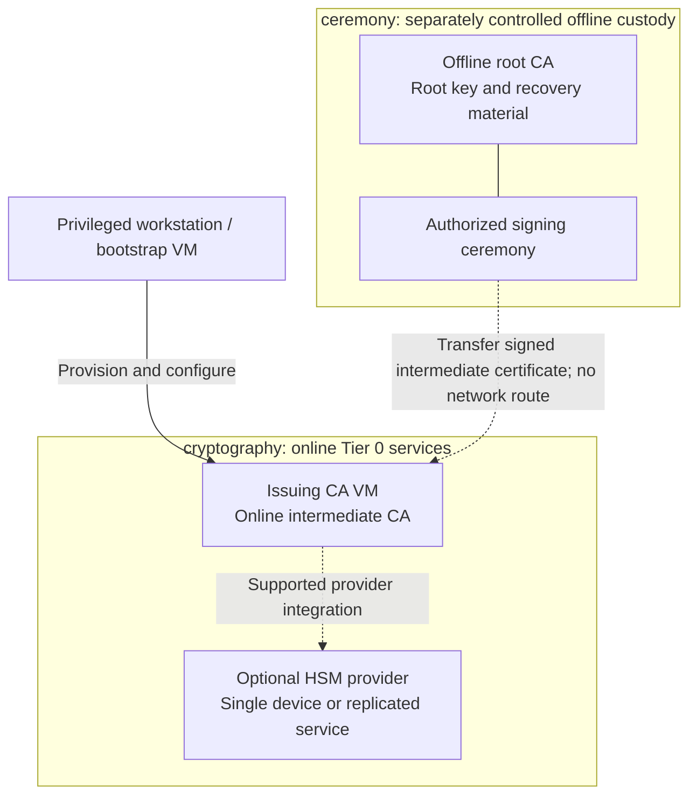

# Stage 2: Cryptographic trust

Establish an offline root and an online issuing CA. Normal issuance and renewal use
the intermediate CA, never an online root. Hardware protection changes key custody;
it is an optional branch, not a prerequisite for the rest of the platform.

**Prerequisites:** accepted [compute foundation](../stage-1-foundation/README.md),
selected CA software, protected recovery storage and authorized custodians.
**Owner:** Tier 0. **Design:** [certificate trust](../../architecture/reference-platform.md#certificate-trust).

## Main path

1. [Prepare issuer and key custody](#step-1-prepare-issuer-and-key-custody)
2. [Establish the certificate hierarchy](#step-2-establish-the-certificate-hierarchy)
3. [Enable and verify routine issuance](#step-3-enable-and-verify-routine-issuance)

## Step 1: Prepare issuer and key custody

Follow [issuer setup](procedures/issuer.md): select the CA implementation, certificate
policy and custodians, then prepare its host and key store. The main path uses
[protected software custody](procedures/local-key-custody.md).

**Before creating keys**, select a hardware branch when required:
[1b: replicated USB gateways](step-1b-usb-hsm.md), [1c: network HSM](step-1c-network-hsm.md)
or [1d: single USB device](step-1d-single-usb.md). Root custody and online issuer
protection are independent choices. Each branch returns to the hierarchy step.

A single device with an independently tested backup can satisfy initial custody
requirements. Size the replicated service for consumer traffic and availability,
not merely because Vault or a registry has been installed.
The HSM path remains Tier 0-owned and independently deployable in either form.

The Tier 0 `foundation` root can provision the issuer host, but CA installation is
operator integration. An existing independent issuer is also valid.

## Step 2: Establish the certificate hierarchy

Perform the authorized root/intermediate ceremony using the selected CA procedure.
Transfer the signed intermediate certificate and public chain, then return root
custody offline. Configure the issuing service without giving it the root key.

A ceremony VLAN or disconnected VM alone does not isolate root keys from a connected
hypervisor administrator. Follow the [custody boundary](../../architecture/reference-platform.md#service-placement).
If Vault will later become the issuer, retain this bootstrap issuer until migration
and recovery of the replacement have been tested.

## Step 3: Enable and verify routine issuance

Configure authorized consumers, distribute public trust material and test issuance,
renewal, revocation, denied requests and recovery with the root offline.
For hardware variants, verify the selected device/host failure and backup behavior.

Root signing, key initialization and sensitive replication remain separately
authorized ceremonies. Routine CI may maintain approved hosts and software later;
it must not acquire ceremony authority.

## Capability available

**Result:** certificate trust and online issuance are operational according to the
[cryptography design](../../architecture/cryptography/README.md), independently of the
future cluster. Record recovery evidence and continue with
[Stage 3: Identity and Kubernetes](../stage-3-identity-runtime/README.md).
