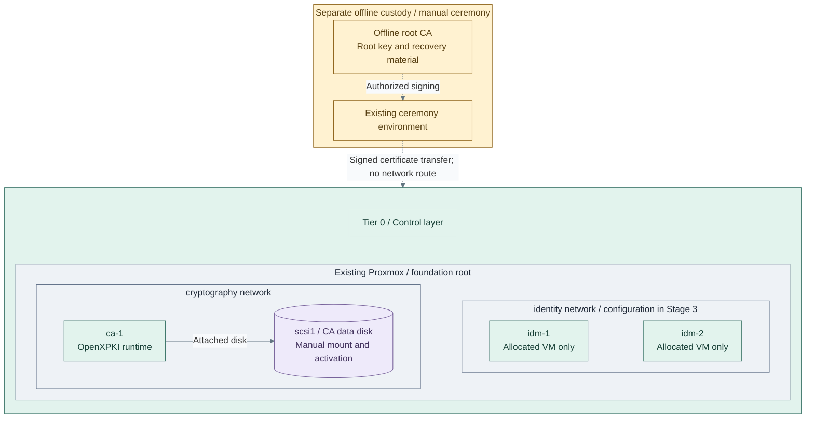

# Stage 2: Cryptographic trust

Establish an offline root and an online issuing CA. Normal issuance and renewal use
the intermediate CA, never an online root. Hardware protection changes key custody;
it is an optional branch, not a prerequisite for the rest of the platform.

**Prerequisites:** verified [foundation](../foundation/README.md) and accepted
[protected logging](../stage-1-logging/README.md),
protected recovery storage and authorized custodians. The reference selects OpenXPKI
Community as the permanent infrastructure issuer and clca for offline root operations;
existing qualified authorities remain valid. The runtime installer does not perform root ceremonies or token activation.
**Working repository:** `<prefix>-tier-0` (source: `tier-0/`).
**Design:** [certificate authority](../../architecture/cryptography/certificate-authority.md).

## Main path

1. [Prepare issuer and key custody](#step-1-prepare-issuer-and-key-custody)
2. [Establish the certificate hierarchy](#step-2-establish-the-certificate-hierarchy)
3. [Enable and verify routine issuance](#step-3-enable-and-verify-routine-issuance)

**IaC:** Tier 0 [foundation guest definitions](../../../tier-0/terraform/deployments/foundation/terraform.tfvars.example)
and [issuer recipe](../../../tier-0/ansible/playbooks/deployment/openxpki.yml).
The unchanged starter root allocates all three VMs; directory configuration follows in Stage 3.
The root ceremony, data mount and CA activation require the linked procedures.
Hardware options replace software key custody; they are not additional default VMs.

## Step 1: Prepare issuer and key custody

For a fresh software-backed root, issuer and FreeIPA domain, start with the
[complete software PKI path](procedures/software-pki.md). It joins the policy
builder, explicit fresh-key recipe, offline ceremony, native activation and recovery
gates. Choose [algorithms](../../architecture/cryptography/algorithm-selection.md)
before creating keys; hardware remains an independent migration decision.

Follow [issuer setup](procedures/issuer.md): approve the package/OS exception, certificate
policy and custodians, then prepare `ca-1` and its key store. The main path uses
[protected software custody](procedures/local-key-custody.md).

**Before creating keys**, select a hardware branch when required:
[1b: replicated USB gateways](step-1b-usb-hsm.md), [1c: network HSM](step-1c-network-hsm.md)
or [1d: single USB device](step-1d-single-usb.md). Root custody and online issuer
protection are independent choices. Each branch returns to the hierarchy step.

A single device with an independently tested backup can satisfy initial custody
requirements. Size the replicated service for consumer traffic and availability,
not merely because Vault or a registry has been installed.
The HSM path remains Tier 0-owned and independently deployable in either form.

Tier 0's [terraform/deployments/foundation/](../../../tier-0/terraform/deployments/foundation/)
provisions the issuer host. Its Tier 0 OpenXPKI recipe installs the native runtime
from approved packages/configuration; signing ceremonies, token import and acceptance
remain controlled operations. An existing independent issuer is also valid.
This Terraform root also contains the selected directory guests. Review the whole
plan; do not remove existing resources to make its contents match a stage number.

## Step 2: Establish the certificate hierarchy

Follow the [offline root procedure](procedures/offline-root.md) for the authorized
root/intermediate ceremony. The root signs the infrastructure issuer and, during Stage 3,
the separate FreeIPA CA as sibling authorities.
Transfer the signed intermediate certificate and public chain, then return root
custody offline. Configure the issuing service without giving it the root key.

A ceremony VLAN or disconnected VM alone does not isolate root keys from a connected
hypervisor administrator. Follow the [custody boundary](../../architecture/reference-platform.md#service-placement).
OpenXPKI remains the long-term infrastructure issuer; Vault's later deployment does
not imply a CA migration or become a prerequisite for this service.

## Step 3: Enable and verify routine issuance

Configure authorized consumers, distribute public trust material and test issuance,
renewal, revocation, denied requests and recovery with the root offline.
For hardware variants, verify the selected device/host failure and backup behavior.
Use the [CA acceptance matrix](../../administration/cryptography/certificate-authority.md#acceptance-evidence).
The Community ACME adapter is a separate qualification gate, not an installed cert-manager integration.

If the selected policy replaces Proxmox API certificates, complete the
[API PKI transition](../../administration/compute/proxmox-tls.md#step-2-adopt-the-platform-pki)
and verify every caller. Retaining the independently trusted Proxmox CA is also valid;
neither path retains an API verification bypass.

Root signing, key initialization and sensitive replication remain separately
authorized ceremonies. Routine CI may maintain approved hosts and software later;
it must not acquire ceremony authority.

## Capability available

**Result:** certificate trust and online issuance are operational according to the
[cryptography design](../../architecture/cryptography/README.md), independently of the
future cluster. Record recovery evidence and continue with
[Stage 3: Identity and Kubernetes](../stage-3-identity-runtime/README.md).
