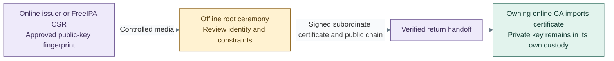

# Establish offline root custody

Use a separately controlled offline system for the root, not an online issuer VM
with its NIC disconnected. The reference tool is clca Community; software, USB and
network key-provider choices retain their own custody/recovery requirements.

**Working repository:** `<prefix>-tier-0` (source: `tier-0/`) stores policy and public
handoff records only. Ceremony execution and authoritative root state stay offline.
**Design:** [certificate hierarchy](../../../architecture/cryptography/certificate-authority.md#trust-hierarchy).
**Prerequisites:** authorized custodians, approved ceremony environment/media, verified
tool/provider artifacts and independent recovery storage. No root installer or signing
automation is supplied; use the selected revision's [clca procedure][1].

## Contents

- [Step 1: Prepare and rehearse custody](#step-1-prepare-and-rehearse-custody)
- [Step 2: Authorize subordinate signing](#step-2-authorize-subordinate-signing)
- [Step 3: Publish and close the ceremony](#step-3-publish-and-close-the-ceremony)
- [References](#references)

## Step 1: Prepare and rehearse custody

For the selected software-first deployment, use the
[concrete clca ceremony](offline-software-root.md) and native configuration examples.

1. Verify the offline system, tools and update media outside the ceremony boundary.
   Rehearse the selected software key or OpenSSL engine/provider path using disposable
   material. clca supports these key interfaces; device compatibility remains a test. [1]
2. Approve root identity, algorithms, validity, CA constraints, subordinate profiles,
   publication URLs, CRL schedule and recovery policy. Existing root state is restored
   and verified, never replaced because a file or HSM cannot be found.
3. Under explicit initial-creation approval, follow clca's initialization procedure in
   a protected CA-instance directory. Preserve the root key/provider reference, CA
   database, issued-certificate/CRL records and configuration together. Serialize all
   operations on that instance; clca does not support concurrent writers. [1]

Keep `root_ca` empty in the connected inventory. It is no longer a child of
`foundation`, and no connected root VM is supplied in the current guest example.
An older generated inventory must be reviewed before adopting the new recipes.
A ceremony VLAN does not protect keys from a connected
hypervisor's administrators. Reproducible boot images contain tools/templates, never
the only copy of authoritative CA state.

## Step 2: Authorize subordinate signing

**Workflow:** authorized offline CSR/signature handoff, not a routed connection or VM installer.
Tier 0 [offline ceremony templates](../../../../tier-0/templates/) provide supporting material;
the custody environment, approval and physical transfer remain manual.

1. Receive and inspect the infrastructure issuer CSR. Verify its approved public key,
   identity, requested scope and provider ownership through an independent record.
2. Issue only the approved subordinate profile/constraints with the selected clca
   revision. Verify the resulting chain, key match and permitted CA scope before export.
   This procedure does not approve arbitrary client-submitted CA extensions.
3. Later repeat a separate authorized handoff for FreeIPA's CA CSR; these are sibling
   issuers, not two independent roots or one CA per directory server. Keep root keys,
   passphrases, database and HSM recovery material out of the return package.

## Step 3: Publish and close the ceremony

1. Generate the required root CRL and transfer only signed public trust objects to the
   approved publication endpoint. Record fingerprints, serials, validity, next CRL due
   date, requests, approvals and media handling. Revocation enforcement is tested at clients.
2. Back up the complete CA instance after each change. clca's archive backup is not by
   itself encryption, independent custody or HSM-key recovery. [1] Apply the
   [backup policy](../../../administration/compute/backup-restore.md#backup-policy)
   and preserve recovery material under separate authorization.
3. Verify the offline recovery copy and close the ceremony: disconnect/secure devices
   and media, remove temporary transfer material under policy and confirm no online
   system has root-key access. Continue [issuer activation](issuer.md#step-3-activate-and-accept-issuance).

## References

Source checked 2026-10-17.

[1]: https://github.com/openxpki/clca/blob/master/README.md

1. [clca key interfaces, CA instances, lifecycle and backup][1]
