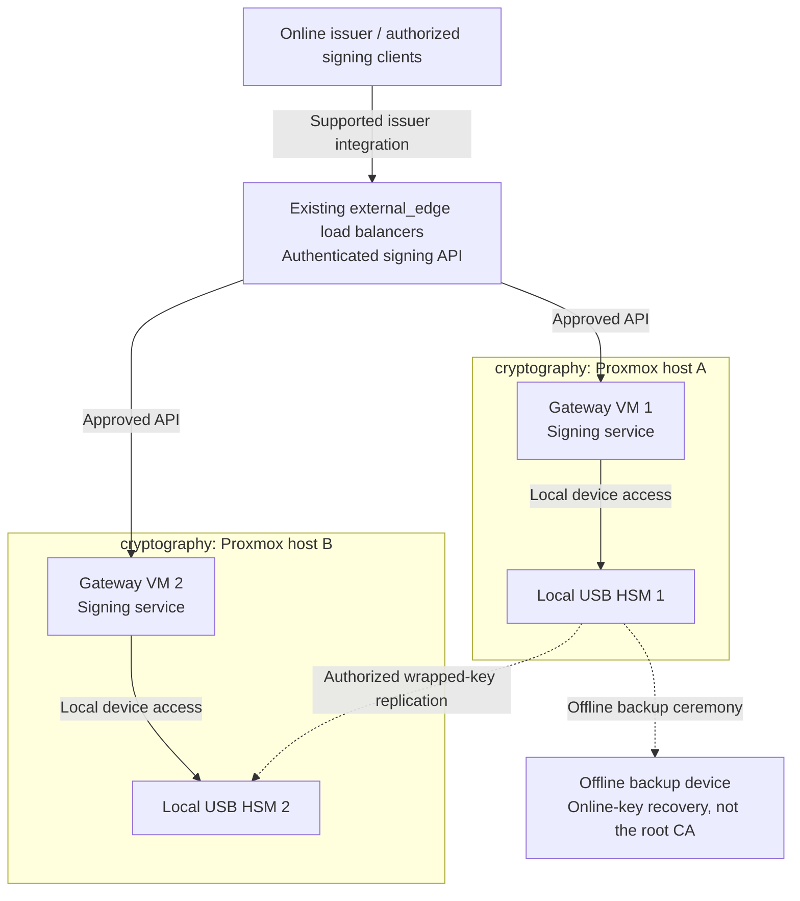

# Step 1b: Replicated USB HSM gateways

<a id="usb-hsm-active-active-deployment-guide"></a>

**Branch from:** [Step 1](README.md#step-1-prepare-issuer-and-key-custody), before creating production issuer keys.
**Change:** Replace software-only issuer custody with independent hardware-backed gateway replicas.
**Return:** [Step 2](README.md#step-2-establish-the-certificate-hierarchy) for intermediate signing and issuer verification.

**Design:** [replicated USB gateways (option C)](../../architecture/cryptography/usb-hsm.md).

## Table of contents

- [Purpose](#purpose)
- [Prerequisite](#prerequisite)
- [Default deployment](#default-deployment)
- [Configuration](#configuration)
- [IaC used for this](#iac-used-for-this)
- [How to shape the deployment](#how-to-shape-the-deployment)
- [How to maintain it](#how-to-maintain-it)
- [References](#references)

## Purpose

This branch implements the replicated-gateway custody design within
[Trust Step 1](README.md#step-1-prepare-issuer-and-key-custody). Hardware-backed signing can be added later;
it is not required to build the identity or Kubernetes platform.

Classify the service by the authority of its keys: domain-wide signing belongs
in Tier 0; a narrowly scoped platform service may belong in Tier 1. Connected
Tier 0 gateways use protected Control networks. Offline root-key custody is a
separate deployment and must never become a live edge backend. See
[setup ownership](../../development/generated-repositories.md#setup-ownership).

The shipped `hsm` setup provisions hosts and applies the OS baseline only.
Device configuration, gateway software, authorization, and ingress integration
remain operator work; this is not a complete HSM service deployment.

The current reference implementation is `Pico HSM`. The same topology can use
`SoftHSM` for software-only rehearsal, or be adapted to other USB-backed PKCS#11
devices such as `YubiHSM 2` [1][2][3][4][5].

## Prerequisite

Prerequisites:

- the shared-service edge load-balancer set is already deployed in
  `external_edge`
- the deployment machine already has `ansible-core` and `terraform`
- the edge load-balancer hosts exist in their owning repo's inventory
- the edge owner has approved the specific gateway endpoint contract; gateway
  administration is not exposed through it
- the ingress example needs integration before it can publish a service; it
  only renders a backend snippet, not a frontend, validation, or reload

For the load-balancer prerequisite, start with
[Edge proxy path](../stage-5-delivery/procedures/edge-proxy.md). If it is not available,
defer this optional published-gateway pattern or validate an internal issuer
path. The initial PKI foundation must not depend on a future Tier 1 service.
Authorize signing at the gateway independently of the proxy; routing alone
does not grant key use.

## Default deployment



The replicas are independent devices, not a native HSM cluster. Key replication
does not imply synchronized sessions or all vendor metadata. The offline root
remains separate. A remote PKCS#11 gateway is not automatically a Vault PKI backend;
validate the selected issuer/device integration before creating production keys.

Select the [gateway topology and device mode](../../architecture/cryptography/usb-hsm.md)
before configuring hosts. This guide implements that option; it does not define
a separate network or ownership model.

<a id="what-you-configure"></a>

## Configuration

Complete these inputs before deployment.

### Network zones

These are logical `network_zones` attachment keys, not firewall-zone names. Use
[Network architecture](../../architecture/networking/README.md).

The gateway deployment uses:

| Network key | Use in this guide |
| --- | --- |
| `cryptography` | active gateway hosts and optional issuing CA placement |
| `ceremony` | optional helper, recovery VM, or root-CA path for a separate ceremony network |

These existing networks are only references here:

| Network key | Why it still matters here |
| --- | --- |
| `external_edge` | already deployed edge load balancer or load-balancer set reaches the cryptography hosts |
| `management` | admin access, automation, and metrics reach the HSM hosts |
| `application` | shared internal callers may reach the cryptography hosts when internal exposure is enabled |
| `identity` | identity or PKI dependencies may still need controlled reachability to issuing services on the cryptography network |

The linked source examples belong to Tier 0, including connected gateways
whose keys carry Tier 0 authority. Edit the owning tier's Terraform inputs.
A separate, lower-impact deployment needs its own host keys, VMIDs, IPs, and
state; do not move root-trust authority into Tier 1 merely to make it reachable.

- [`terraform/common.tfvars.example`](../../../tier-0/terraform/common.tfvars.example)
  for tier-local guest networks and optional overrides; common storage and
  local SSH-key inputs follow the [platform input contract](../../reference/platform-inputs.md)
- [`terraform/deployments/hsm/terraform.tfvars.example`](../../../tier-0/terraform/deployments/hsm/terraform.tfvars.example)
  for the gateway and helper layer

Set the values the environment needs for `cryptography` and optional
`ceremony`, such as bridge, VLAN, subnet, gateway, and addressing conventions.
Use the site network plan for `external_edge`, `management`, `identity`, and
`application`. Do not copy another tier's entire inventory or state to publish
an endpoint.

### Firewall openings

Scope these candidate rules to named hosts and approved listeners, not entire
networks. The keys below identify networks; use their actual zone assignments
from the site plan. Ports alone do not authorize signing operations.

| Source network / host | Destination network / host | Default port or protocol | Purpose |
| --- | --- | --- | --- |
| `external_edge` | `cryptography` | `8443/TCP` | deployed edge load balancer to gateway service |
| approved Tier 0 admin host in `management` | `cryptography` | `22/TCP` | SSH, Ansible, and troubleshooting |
| custody-local admin host | `ceremony` | `22/TCP` if required | local administration without a connected-network route |
| `application` | `cryptography` | `8443/TCP` optional | internal callers using the same gateway service endpoint |
| offline `ceremony` | connected `cryptography` | none | approved offline transfer only |

Keep these boundaries:

- the default gateway backend port in this repo is `8443/TCP` through
  `hsm_proxy_ingress_backend_port` in `ansible/inventory/hosts.yml`, with the
  same default in `roles/hsm_proxy_ingress`
- the default Ansible SSH port in this repo is `22/TCP`
- when changing the gateway service port from `8443`, update both the firewall
  rule and `hsm_proxy_ingress_backend_port`
- do not open extra metrics or observability ports unless explicitly
  configured and required
- do not expose raw USB devices or generic PKCS#11 endpoints over the network
- keep USB or token access host-local on each gateway
- an offline helper does not create a route between `ceremony` and connected networks

### VM layout

Edit the `vm_instances` maps to match the required deployment shape.

| Component | Terraform default | Inventory action | Current example range | Edit here |
| --- | --- | --- | --- | --- |
| gateway VMs | `hsm-1`, `hsm-2` active | `hsm-1`, `hsm-2` present by default | `1-8` | `terraform/deployments/hsm/terraform.tfvars` |
| helper VMs | `crypto-admin-1` commented, default `0` | uncomment `crypto-admin-1` when enabled | `0-2+` as needed | `terraform/deployments/hsm/terraform.tfvars` |

The deployed edge load balancer stays in the shared-service layer. Start here with
the gateway and helper hosts.

The Tier 0 inventory examples include `hsm-1` and `hsm-2`. When adding or
removing HSM hosts, update both the Terraform `vm_instances` map and the Ansible
IP map in their owning repo. Use distinct allocations for additional instances.

### HSM mode

Select the [hardware or rehearsal mode](../../architecture/cryptography/usb-hsm.md#hsm-mode)
before rollout. Device and runtime integration remain operator work.

## IaC used for this

These source paths provide the reusable host pattern. Inputs are Tier 0-owned
by default; connectivity does not change that ownership:

| IaC path | Used for here | Local configuration |
| --- | --- | --- |
| [`terraform/common.tfvars.example`](../../../tier-0/terraform/common.tfvars.example) | tier guest networks and optional overrides; see [platform inputs](../../reference/platform-inputs.md) | the local `terraform/common.tfvars` |
| [`terraform/deployments/hsm/terraform.tfvars.example`](../../../tier-0/terraform/deployments/hsm/terraform.tfvars.example) | deploys the gateway VMs and optional helper VMs | `terraform/deployments/hsm/terraform.tfvars` based on `.example` |
| [`ansible/inventory/hosts.yml.example`](../../../tier-0/ansible/inventory/hosts.yml.example) | stable HSM host keys and inventory groups | the local `ansible/inventory/hosts.yml` |
| [`ansible/group_vars/all.yml.example`](../../../tier-0/ansible/group_vars/all.yml.example) | shared Ansible defaults and the default environment | the local `ansible/group_vars/all.yml` |
| [`ansible/group_vars/all.env.yml.example`](../../../tier-0/ansible/group_vars/all.env.yml.example) | environment-specific hostname decoration and domain | the local `ansible/group_vars/all.<env>.yml` |
| [`ansible/group_vars/hsm.yml.example`](../../../tier-0/ansible/group_vars/hsm.yml.example) | Tier 0 HSM host IPs; edge hosts stay in their own repo | the local `ansible/group_vars/hsm.yml` |
| [`ansible/playbooks/hsm.yml`](../../../tier-0/ansible/playbooks/hsm.yml) | reruns baseline OS preparation on the HSM hosts | inventory and host variables |
| [`ansible/playbooks/ingress.yml`](../../../tier-1/ansible/playbooks/ingress.yml) | renders an HAProxy backend snippet from the supplied `hsm_gateways` inventory group | endpoint references and edge configuration in the edge-owning repo |
| [`scripts/deploy.sh`](../../../tier-0/scripts/deploy.sh) | repository wrapper for the mapped precheck, Terraform, and Ansible flow | choose the `hsm` setup when ready for deployment |

The `hsm` wrapper runs only the HSM baseline; it never configures edge ingress.
The Tier 1 ingress example reads `hsm_gateways` from the supplied inventory;
it does not discover another tier's endpoints or state. The edge owner must
maintain approved endpoint references and integrate the snippet into HAProxy,
including listener policy, validation, and reload. Gateway lifecycle and
credentials remain in the gateway-owning repo.

Use the shared ownership rule from
[Infrastructure automation layout](../../development/code-layout.md):
Ansible inventory owns stable logical host keys and service groups. Ansible
`all` group vars own hostname decoration and domain. HSM group vars own the
HSM rollout IP map, while the HSM Terraform environment owns hardware
placement and Proxmox tags.

## How to shape the deployment

Shape the HSM deployment around one stable service pattern and then change the size by
data only.

- keep the edge load balancer in the shared-service layer and treat it as a
  prerequisite here
- keep the default `2` gateway hosts unless measurements justify changing
  the count
- grow or shrink gateway and helper counts only through `vm_instances`
- keep active gateways in `cryptography`
- enable `ceremony` only for a required helper, recovery, or root-CA
  adjacency path
- keep lifecycle inventory aligned with ownership: `hsm_gateways` and optional
  `crypto_admin` in the gateway repo; `edge_load_balancers` in the edge repo
- keep one local token or software token per gateway host
- keep the live traffic path and the ceremony path separate even when they use
  the same HSM product family

To deploy the setup, use the repository deployment wrapper with
the `hsm` setup. Keep the exact execution flow in the wrapper rather than
repeating it in this guide. That wrapper also checks the required local config
files for the setup before it runs.

After the wrapper run:

- attach the intended USB HSM device to each gateway host, or initialize one
  software token per host when using `SoftHSM` [1]
- validate host-local PKCS#11 access on every gateway host before sending any
  traffic through the edge load balancer
- initialize one device as the source of truth, create the intended keys, and
  replicate only the approved wrapped objects to the other active device and
  the offline backup [2][3][4][5]
- test gateway health, device loss, host loss, and restore from the offline
  backup before treating the setup as production-ready

Useful local checks:

```bash
opensc-tool -l
pkcs11-tool --list-slots
pkcs11-tool --list-objects --pin <PIN>
openssl x509 -in cert.pem -text -noout
```

## How to maintain it

<a id="health-checks"></a>
<a id="device-identity"></a>
<a id="replica-updates"></a>
<a id="routine-checks"></a>

Use the [gateway maintenance guide](../../administration/cryptography/usb-hsm.md)
for health checks, device identity, replica updates and restore verification.

## References

1. [SoftHSM](https://www.softhsm.org/) (accessed 2026-09-19)
2. [PicoKeys Documentation: Capability map](https://docs.picokeys.com/picohsm/features/) (accessed 2026-09-19)
3. [PicoKeys Documentation: Backup and restore](https://docs.picokeys.com/picohsm/backup-restore/) (accessed 2026-09-19)
4. [Yubico: YubiHSM PKCS#11 Module](https://developers.yubico.com/yubihsm-shell/yubihsm-pkcs11.html) (accessed 2026-09-19)
5. [Yubico: yubihsm-connector](https://developers.yubico.com/yubihsm-connector/) (accessed 2026-09-19)
