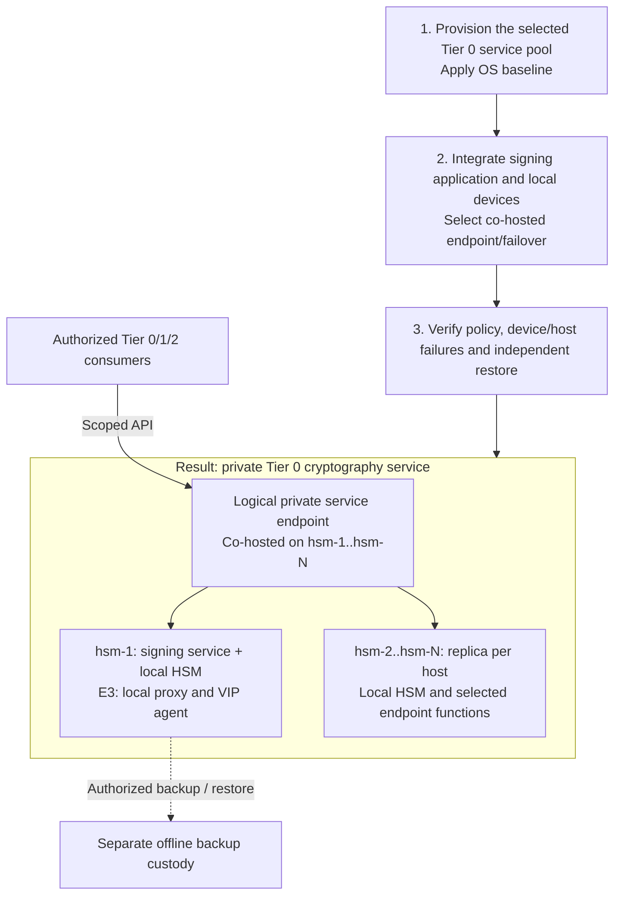

# Step 1b: Replicated USB HSM services

**Working repository:** `<prefix>-tier-0` (source: `tier-0/`).
Run repository scripts from this root; Shared contributes only the named reusable primitives.

<a id="usb-hsm-active-active-deployment-guide"></a>

**Branch from:** [Step 1](README.md#step-1-prepare-issuer-and-key-custody), before creating production issuer keys.
**Change:** Use a capacity-sized Tier 0 service pool, one local HSM per host, with co-hosted endpoint functions.
**Return:** [Step 2](README.md#step-2-establish-the-certificate-hierarchy) for intermediate signing and issuer verification.

**Design:** [replicated USB services and endpoint variants](../../architecture/cryptography/usb-hsm.md).

## Table of contents

- [Purpose](#purpose)
- [Prerequisite](#prerequisite)
- [Default deployment](#default-deployment)
- [Configuration](#configuration)
- [IaC used for this](#iac-used-for-this)
- [How to shape the deployment](#how-to-shape-the-deployment)
- [Acceptance](#acceptance)
- [How to maintain it](#how-to-maintain-it)
- [References](#references)

## Purpose

Deploy custody option C without making Tier 0 depend on public Tier 2 ingress
or Tier 1 Kubernetes. The private endpoint is a function on `hsm-1` through `hsm-N`,
not a separate load-balancer pair. Offline root custody remains disconnected.

The shipped `hsm` setup provisions VMs and applies the OS baseline only.
The selected application, USB/device integration, key replication, VIP/proxy
runtime and service acceptance are operator work, not installed capabilities.

## Prerequisite

| Required decision | Evidence before production use |
| --- | --- |
| Signing/issuer application | Supported local provider and HA model; state, authorization and session behavior defined |
| Endpoint E1/E2/E3 | Select [client failover, private VIP, or co-hosted VIP/proxies](../../architecture/cryptography/usb-hsm.md#endpoint-variants); E3 requires supported concurrent replicas |
| Hosts and devices | Approved templates, selected failure domains, stable USB identity and private cryptography addresses for every replica |
| Capacity | Size the pool for [measured demand and failure headroom](../../architecture/cryptography/usb-hsm.md#capacity-and-replica-count), including frontend capacity |
| Recovery | Independent key/application backups, wrapping material and startup credentials; no sealed-service dependency cycle |
| Tooling | Protected Tier 0 execution environment with the [deployment tooling](../../development/local-setup.md) |

Neither the public `edge` setup nor a Tier 1 cluster is a prerequisite.
Tier 1/2 clients can consume explicitly authorized APIs after acceptance.

An existing [single-device deployment](step-1d-single-usb.md) is a valid starting
point. Add service hosts/devices and the co-hosted endpoint when consumer traffic
and availability require them. Two enabled hosts are the starter, not a limit.
Review permitted key transfer,
application state and backup recovery before changing the existing key/provider path.

## Default deployment



Only the first step is supplied as a VM/baseline workflow. The completed design
requires the remaining integration and acceptance work. An issuer replica may
use its local HSM directly when that removes an unnecessary generic gateway.
These are independently managed replicas, not a native HSM cluster.

<a id="what-you-configure"></a>

## Configuration

<a id="network-zones"></a>
<a id="firewall-openings"></a>
<a id="vm-layout"></a>
<a id="hsm-mode"></a>

| Input | Configuration |
| --- | --- |
| `terraform/common.tfvars` | Approved `cryptography` attachment; optional separate `ceremony` only when needed |
| `terraform/deployments/hsm/terraform.tfvars` | One `vm_instances` entry per selected host, with unique VMID, size, storage and initial `proxmox_node_name` |
| `ansible/inventory/hosts.yml` | Every service host in `hsm_gateways`; no separate frontend group or duplicate host records |
| `ansible/group_vars/all.yml` and environment overlay | Hostname/domain, local connection and baseline settings |
| `ansible/group_vars/hsm.yml` and environment overlay | Complete host IP map and selected service integration inputs |
| Optional `ingress.yml` scaffold | Explicit opt-in, validated application HA, readiness configuration and co-hosted backend addresses |

Keep USB affinity explicit. The VM code does not configure device passthrough,
host pinning or Proxmox HA restrictions. Initial placement alone is not a runtime
affinity guarantee; review [cluster mobility](../stage-1-foundation/step-1b-cluster-ha.md#terraform-against-the-cluster)
before permitting a device-facing VM to move. A single-host rehearsal is not host HA.

Scope firewall rules to hosts and actual listeners, following the
[network contracts](../../architecture/networking/firewall-policy.md).

| Source | Destination | Required transport / boundary |
| --- | --- | --- |
| Approved consumers | Private service DNS/VIP or E1 host addresses | Selected authenticated, policy-scoped API; no custody administration |
| Co-hosted proxies, for E3 | Approved private backends in the pool | Selected backend listener; reference port `8443/TCP` |
| Selected VIP agents, for E2/E3 | Required peers on the private network | Selected VRRP transport and address-advertisement support, not general peer access [1] |
| Tier 0 administration | Named service hosts | Approved SSH/management listener; reference SSH `22/TCP` |
| Custody-local operator | Offline ceremony environment | Local approved operations only; no connected route |

Separate the VIP/frontend listener from backend listeners to avoid proxy loops
or bind conflicts. Protect health listeners and do not expose raw USB or generic
PKCS#11/device connectors as a public signing API.

## IaC used for this

| Repository | Source inside that repository | Responsibility |
| --- | --- | --- |
| Tier 0 | [HSM VM inputs](../../../tier-0/terraform/deployments/hsm/terraform.tfvars.example) | Capacity-sized service pool; two enabled hosts and a third-host example; offline helper is separate |
| Tier 0 | [Inventory](../../../tier-0/ansible/inventory/hosts.yml.example) and [HSM vars](../../../tier-0/ansible/group_vars/hsm.yml.example) | One host/IP source consumed by Terraform and Ansible |
| Tier 0 | [HSM deployment recipe](../../../tier-0/ansible/playbooks/deployment/hsm-gateways.yml) | OS baseline only |
| Tier 0 | [Private backend scaffold](../../../tier-0/ansible/playbooks/ingress.yml) | Opt-in snippet on those same hosts; no package, frontend, VIP, reload or readiness installer |
| Shared | [Keepalived primitive](../../../shared/ansible/roles/shared/tasks/keepalived.yml) | Reusable configuration building block for reviewed endpoint integration, not an HSM HA recipe |

The scaffold is skipped unless `hsm_proxy_ingress_enabled` is explicitly enabled.
It then requires `hsm_proxy_ingress_application_ha_validated`,
`hsm_proxy_ingress_readiness_validated`, TCP mode, at least two static inventoried backends
and nonempty application-specific backend configuration. Acknowledgements record
operator prerequisites; they do not prove runtime health or validate HAProxy syntax.
Basic `check` options alone prove only TCP reachability. [2]

## How to shape the deployment

### 1. Prepare the service hosts

From the Tier 0 repository root, initialize local inputs:

```bash
bash scripts/init-local-files.sh --setup hsm
```

Choose the replica count before planning. For each additional host, add matching
entries to `vm_instances`, `hsm_gateways` and the complete `platform_host_ips` map.
The source examples include commented `hsm-3` entries; larger pools use the same
mechanism. No replica count flag, automatic key replication or autoscaler is implied.

Edit the files above, then review the host plan:

```bash
bash scripts/deploy.sh hsm --plan-only
```

Apply only the reviewed plan through the normal [deployment workflow](../../reference/repository-scripts.md).
Attach the intended local USB device to each VM, or initialize a software token
for rehearsal. Validate the expected token identity and supported provider on each host.

### 2. Integrate the application and endpoint

1. Install the selected signing/issuer application and its supported provider.
   Configure compatible keys, application state, consumer identities and operation policy.
2. Perform authorized key initialization/replication and offline backup using the
   selected device's supported process. Duplicate keys do not replicate CA records. [3][4]
3. Implement E1, E2 or E3 on the existing hosts. For E3, integrate TLS passthrough,
   separate frontend/backend listeners and application/device/key readiness.
   Configure safe reconnection/retry behavior; a device session is not a stateless API. [5]
4. If using the optional snippet renderer, supply the same inventory and ordered
   vars as the [direct Ansible workflow](../../reference/repository-scripts.md).
   Integrate and validate the full configuration before reloading either host.

### 3. Verify the complete service

Run the acceptance cases below with authorized operators and retained recovery
material. Do not declare HA from VM count, slot discovery or a listening TCP port.

## Acceptance

| Test | Required result |
| --- | --- |
| Authorized and denied operations | Permitted identities/keys succeed; unauthorized requests and administration fail |
| Tier 1 and Tier 2 services unavailable | Tier 0 signing and recovery continue without their clusters, edge or proxies |
| Consumer/secret service unavailable | Provider starts and recovers without credentials held only by the service it unlocks |
| One service VM or physical host lost | Surviving capacity serves the allowed operations within the selected failover contract |
| Peak load with the selected failures/maintenance drain | Surviving devices, application and frontend meet the accepted throughput, latency and error targets |
| USB device lost while VM and port remain up | That replica becomes unready and leaves routing; surviving service remains usable |
| VIP owner lost / peer partition, for E2/E3 | Measured ownership and split-brain behavior match policy; clients reconnect as designed [1] |
| Application/session state during failover | No unsupported session sharing, duplicate issuance or unsafe replay/retry behavior |
| Independent restore | Approved keys, application state, policy and startup credentials restore without online replicas |

Record evidence in project-owned deployment records. Re-run relevant cases after
key rotation, application upgrades or network/placement changes.

## How to maintain it

<a id="health-checks"></a>
<a id="device-identity"></a>
<a id="replica-updates"></a>
<a id="routine-checks"></a>

Use [USB HSM maintenance](../../administration/cryptography/usb-hsm.md) for recurring
health, device identity, rotation and restoration checks. Key ceremonies remain
separately authorized operations, not routine CI jobs.

## References

Sources checked 2026-10-14.

1. [Keepalived configuration](https://www.keepalived.org/documentation/keepalived-conf/)
2. [HAProxy health checks](https://www.haproxy.com/documentation/haproxy-configuration-tutorials/reliability/health-checks/)
3. [Pico HSM backup and restore](https://docs.picokeys.com/picohsm/backup-restore/)
4. [YubiHSM PKCS#11 module](https://developers.yubico.com/yubihsm-shell/yubihsm-pkcs11.html)
5. [YubiHSM quick start and authenticated sessions](https://docs.yubico.com/hardware/yubihsm-2/hsm-2-user-guide/hsm2-quick-start.html)
