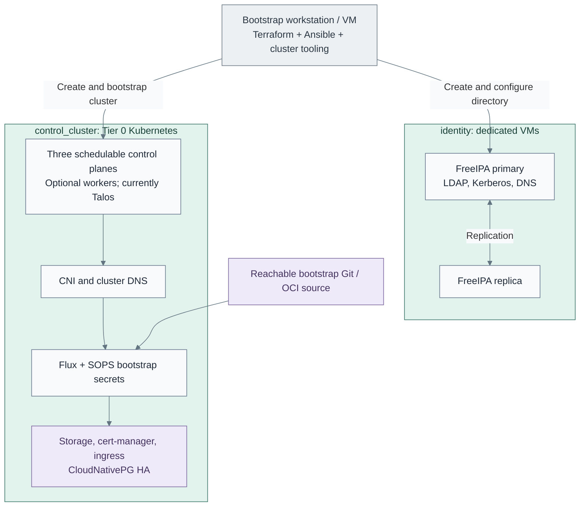

# Stage 3: Identity and Kubernetes

Provide the dedicated directory pair and the Tier 0 Kubernetes foundation. Ansible
configures FreeIPA on VMs; cluster tooling establishes Kubernetes, then Flux and basic
platform services. Keycloak and operational applications arrive in the next stage.

**Prerequisites:** approved compute, templates, certificate trust, software supply,
a reachable bootstrap source and independent credentials.
**Working repository:** `<prefix>-tier-0` (source: `tier-0/`).
**Design:** [identity authority](../../architecture/identity/README.md) and
[cluster runtime](../../architecture/compute/README.md).

## Main path

1. [Deploy the directory pair](#step-1-deploy-the-directory-pair)
2. [Create the Kubernetes cluster](#step-2-create-the-kubernetes-cluster)
3. [Establish the basic platform](#step-3-establish-the-basic-platform)

## Step 1: Deploy the directory pair

Follow the [FreeIPA procedure](procedures/freeipa.md). Add the identity VMs to the
Tier 0 [foundation root](../../../tier-0/terraform/deployments/foundation/)
and [inventory](../../../tier-0/ansible/inventory/hosts.yml.example)
without removing the existing issuer definition.
For the sibling FreeIPA CA, the [external-signing integration gate](procedures/freeipa.md#external-ca-integration-gate)
selects the CSR/pause and certificate/completion phases now implemented by the recipe.
Offline signing remains a separate authorized operation.
Verify the primary before joining the replica; test DNS and replication before
replacing temporary bootstrap dependencies.

FreeIPA stays outside Kubernetes. Directory and cluster setup can proceed independently
once their prerequisites exist. Preserve independent administrative credentials.

## Step 2: Create the Kubernetes cluster

Follow the [common cluster procedure](procedures/kubernetes.md), then the current
[Talos Terraform implementation](procedures/talos-terraform.md). Set the tier-local
inventory, endpoint and state in Tier 0's
[terraform/deployments/kubernetes/](../../../tier-0/terraform/deployments/kubernetes/),
review the plan, and bootstrap the cluster.

**Alternative:** [2b: manual bootstrap](step-2b-manual-cluster.md) replaces that lifecycle;
it does not create a second state owner. Another OS requires its own implementation.
New-cluster inputs provide three schedulable control planes and no workers.
Additional workers are an explicit capacity choice; existing clusters retain their local nodes.

## Step 3: Establish the basic platform

Follow the [foundation checklist](procedures/kubernetes.md#cluster-foundation) in
dependency order: networking, Flux, SOPS/bootstrap secrets, storage, certificates/ingress
and database readiness. Connect certificate automation to the existing issuer through
a supported integration.
For the OpenXPKI Community reference, the [ACME adapter qualification](../stage-2-trust/procedures/issuer.md#step-3-activate-and-accept-issuance)
is explicit; installing cert-manager does not supply that adapter or authorize enrollment.

Tier 0's [clusters/tier0/](../../../tier-0/clusters/tier0/) add-on folders are starters.
Supply reviewed manifests, verify reconciliation,
decryption, persistence, TLS and database health, and start backups as state appears.
Flux requires a reachable source with independent credentials, not merely a local checkout.

## Capability available

**Result:** replicated directory services and a Kubernetes runtime ready for the
control applications in the [reference platform](../../architecture/reference-platform.md#service-placement).
Neither bootstrap nor recovery requires Keycloak, Vault, GitLab or Harbor.

Record directory, cluster and backup checks. Continue with
[Stage 4: Control services](../stage-4-control-services/README.md).
