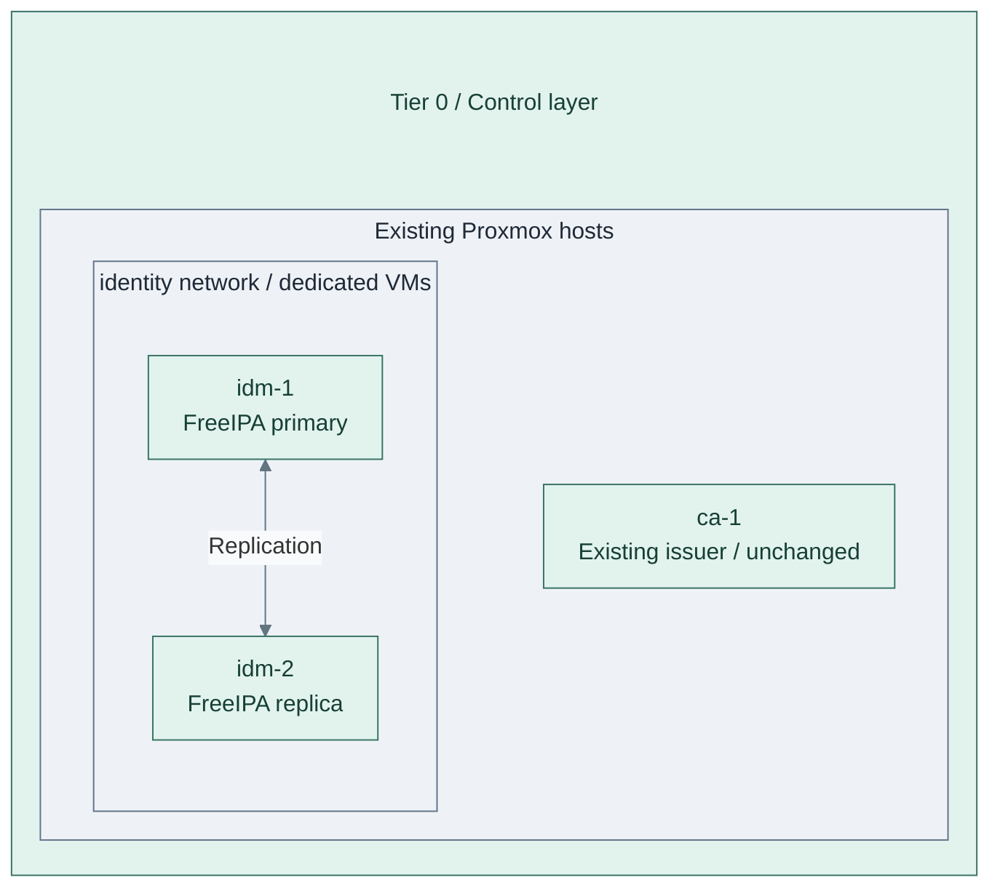
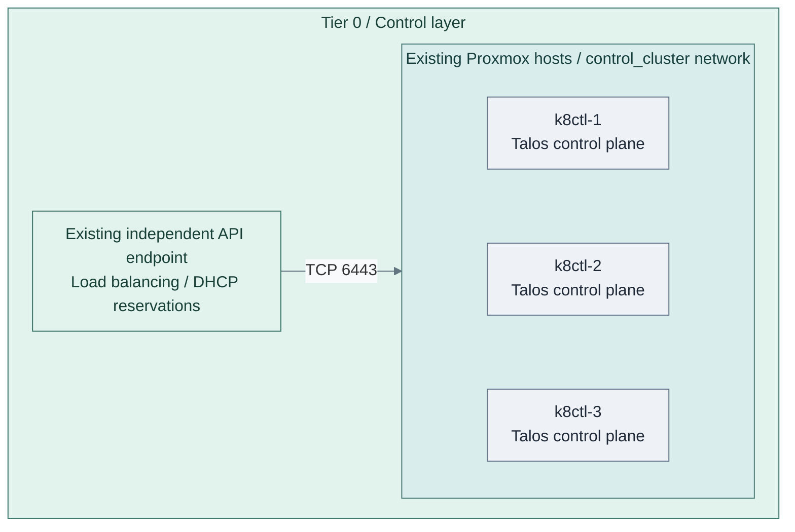
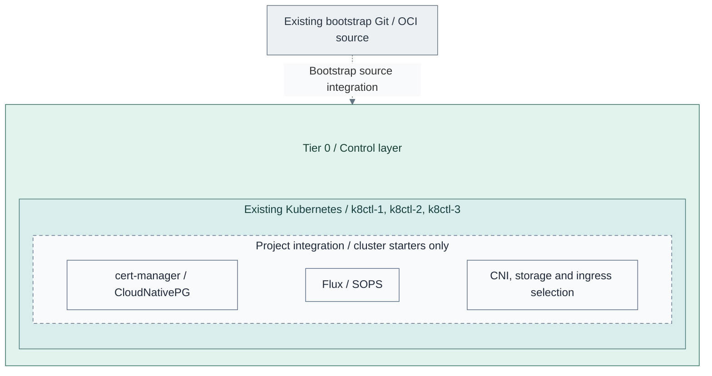
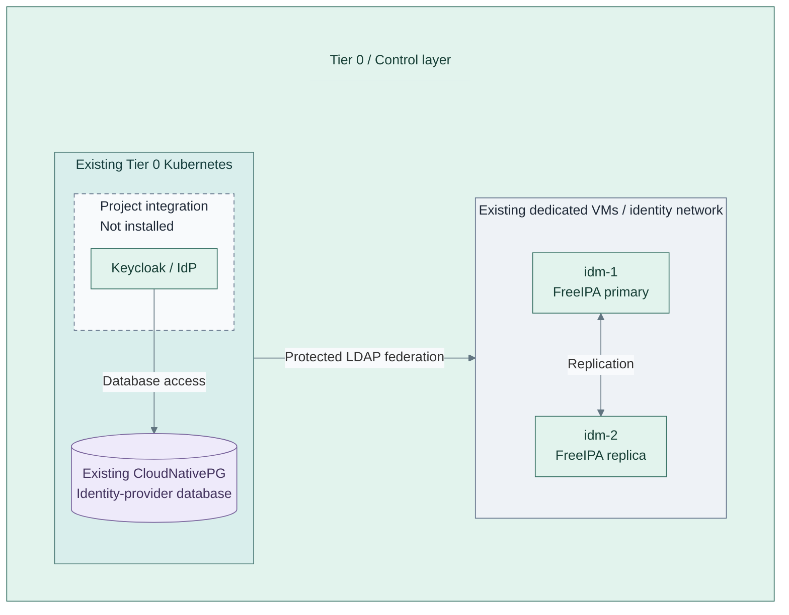

# Stage 3: Identity

Establish directory authority and federated service authentication. Ansible configures
FreeIPA on dedicated VMs; the Tier 0 Kubernetes foundation hosts the identity provider.
Cluster bootstrap and basic services precede the Keycloak/OIDC integration.

**Prerequisites:** approved compute, templates, certificate trust, software supply,
a reachable bootstrap source and independent credentials.
**Working repository:** `<prefix>-tier-0` (source: `tier-0/`).
**Design:** [identity authority](../../architecture/identity/README.md) and
[cluster runtime](../../architecture/compute/README.md).

## Main path

1. [Deploy the directory pair](#step-1-deploy-the-directory-pair)
2. [Create the Kubernetes cluster](#step-2-create-the-kubernetes-cluster)
3. [Establish the basic platform](#step-3-establish-the-basic-platform)
4. [Deploy identity federation](#step-4-deploy-identity-federation)

## Step 1: Deploy the directory pair

**IaC:** Tier 0 [foundation inputs](../../../tier-0/terraform/deployments/foundation/terraform.tfvars.example) and
[directory recipe](../../../tier-0/ansible/playbooks/deployment/identity-freeipa.yml).
Directory VMs may already be allocated by Stage 2; retain the existing CA and all state.

Follow the [FreeIPA procedure](procedures/freeipa.md). Add the identity VMs to the
Tier 0 [foundation root](../../../tier-0/terraform/deployments/foundation/)
and [inventory](../../../tier-0/ansible/inventory/hosts.yml.example)
without removing the existing issuer definition.
For the sibling FreeIPA CA, the [external-signing integration gate](procedures/freeipa.md#external-ca-integration-gate)
selects the CSR/pause and certificate/completion phases now implemented by the recipe.
Offline signing remains a separate authorized operation.
Verify the primary before joining the replica; test DNS and replication before
replacing temporary bootstrap dependencies.

FreeIPA stays outside Kubernetes. Directory and cluster setup can proceed independently
once their prerequisites exist. Preserve independent administrative credentials.

## Step 2: Create the Kubernetes cluster

**IaC:** Tier 0 [Kubernetes inputs](../../../tier-0/terraform/deployments/kubernetes/terraform.tfvars.example)
and [cluster entry point](../../../tier-0/scripts/kubernetes-cluster.sh) create these three VMs and bootstrap Kubernetes.
The API endpoint, DHCP reservations and approved node template already exist.
No workers are active in this starter; application and add-on manifests are separate inputs.

Follow the [common cluster procedure](procedures/kubernetes.md), then the current
[Talos Terraform implementation](procedures/talos-terraform.md). Set the tier-local
inventory, endpoint and state in Tier 0's
[terraform/deployments/kubernetes/](../../../tier-0/terraform/deployments/kubernetes/),
review the plan, and bootstrap the cluster.

**Alternative:** [2b: manual bootstrap](step-2b-manual-cluster.md) replaces that lifecycle;
it does not create a second state owner. Another OS requires its own implementation.
New-cluster inputs provide three schedulable control planes and no workers.
Additional workers are an explicit capacity choice; existing clusters retain their local nodes.

## Step 3: Establish the basic platform

**Integration:** Tier 0 [cluster starters](../../../tier-0/clusters/tier0/kustomization.yaml)
contain no installer for the dashed add-on group. Supply reviewed manifests and bootstrap Flux explicitly.
The Kubernetes root retains its configured node-OS network defaults until the selected CNI is deliberately integrated.

Follow the [foundation checklist](procedures/kubernetes.md#cluster-foundation) in
dependency order: networking, Flux, SOPS/bootstrap secrets, storage, certificates/ingress
and database readiness. Connect certificate automation to the existing issuer through
a supported integration.
For the OpenXPKI Community reference, the [ACME adapter qualification](../stage-2-trust/procedures/issuer.md#step-3-activate-and-accept-issuance)
is explicit; installing cert-manager does not supply that adapter or authorize enrollment.

Tier 0's [clusters/tier0/](../../../tier-0/clusters/tier0/) add-on folders are starters.
Supply reviewed manifests, verify reconciliation,
decryption, persistence, TLS and database health, and start backups as state appears.
Flux requires a reachable source with independent credentials, not merely a local checkout.

## Step 4: Deploy identity federation

**Integration:** Tier 0 [Keycloak manifests](../../../tier-0/clusters/tier0/applications/keycloak/kustomization.yaml)
are an empty starter, not an installer. The existing directory comes from the
[FreeIPA recipe](../../../tier-0/ansible/playbooks/deployment/identity-freeipa.yml);
the database must pass [Step 3 readiness](#step-3-establish-the-basic-platform) first.

Add reviewed Keycloak manifests with its database, TLS and FreeIPA federation.
Configure OIDC clients, group mappings and scoped service roles; verify permitted
and denied logins before granting administrative access. Each consumer retains
its own authorization. The directory remains independent of the IdP.

Retain bootstrap credentials and test recovery without normal directory or IdP login.
Later stages register their service-specific clients against this identity provider;
they do not deploy another provider. Service manifests and integration remain project
work; see the [support map](../../reference/implementation-support.md).

## Capability available

**Result:** replicated directory services, a federated identity provider and the
supporting Kubernetes platform realize the
[identity design](../../architecture/identity/README.md). Bootstrap and recovery
remain independent of normal Keycloak login, Vault, GitLab and Harbor.

Record directory, federation, cluster and backup checks. Continue with
[Stage 4: Secrets](../stage-4-secrets/README.md).
