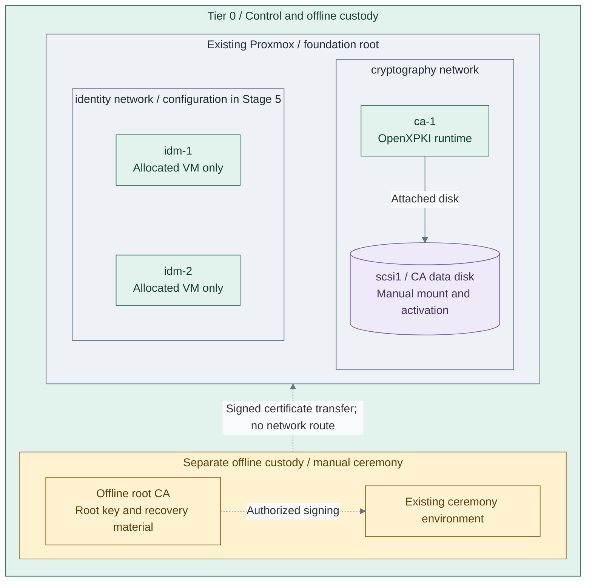

# Stage 3: Cryptographic trust

Establish an offline root and an online issuing CA. Normal issuance and renewal use
the intermediate CA, never an online root. Hardware protection changes key custody;
it is an optional branch, not a prerequisite for the rest of the platform.

**Prerequisites:** verified [foundation](../foundation/README.md) and accepted
[protected logging](../stage-2-logging/README.md),
protected recovery storage and authorized custodians. The reference selects OpenXPKI
Community as the permanent infrastructure issuer and clca for offline root operations;
existing qualified authorities remain valid. The runtime installer does not perform root ceremonies or token activation.
**Working repository:** `<prefix>-tier-0` (source: `tier-0/`).
**Automation:** software issuer/key/policy and recovery mechanisms are supplied;
ceremonies, token activation and acceptance remain controlled operations. Hardware and
ACME variants need integration; see [coverage](../../reference/implementation-support.md#stage-coverage).
**Design:** [certificate authority](../../architecture/cryptography/certificate-authority.md).

## Main path

1. [Prepare issuer and key custody](#step-1-prepare-issuer-and-key-custody)
2. [Establish the certificate hierarchy](#step-2-establish-the-certificate-hierarchy)
3. [Enable and verify routine issuance](#step-3-enable-and-verify-routine-issuance)

Remain in the Tier 0 repository after Stage 2. Complete the numbered tasks below;
the linked issuer, policy and ceremony pages are required parts of the selected path.
The software path is the reference. Hardware pages replace key custody at Step 1,
then return to this same hierarchy and acceptance sequence.

**IaC:** Tier 0 [foundation guest definitions](../../../tier-0/terraform/deployments/foundation/terraform.tfvars.example)
and [issuer recipe](../../../tier-0/ansible/playbooks/deployment/openxpki.yml).
The unchanged starter root allocates all three VMs; directory configuration follows in Stage 5.
The issuer is configured first and drawn to the right; the FreeIPA CA remains its
sibling under the offline root, not a subordinate of the infrastructure issuer.
The root ceremony, data mount and CA activation require the linked procedures.
Hardware options replace software key custody; they are not additional default VMs.

## Step 1: Prepare issuer and key custody

1. **Choose custody before creating keys.** Approve
   [algorithms](../../architecture/cryptography/algorithm-selection.md), custodians,
   recovery recipients and trust scope. Select one path:

   | Step | Selected path | Required work and return |
   | --- | --- | --- |
   | 1a: main path | [Software-backed PKI](procedures/software-pki.md) | Follow Steps 1-3 there to build the policy, prepare the issuer and create its encrypted key/CSR; return here for Step 2 |
   | 1b | [Replicated USB gateways](step-1b-usb-hsm.md) | Qualify hardware/provider integration, then return to issuer installation and Step 2 |
   | 1c | [Network HSM](step-1c-network-hsm.md) | Qualify the device/provider and issuer binding, then return to Step 2 |
   | 1d | [Single USB device](step-1d-single-usb.md) | Commission device/independent backup and issuer binding, then return to Step 2 |

2. Follow only the selected custody path. **Software:** Steps 1–3 above already include issuer
   host/runtime installation; do not repeat it. **Hardware:** commission the selected provider,
   supply its qualified production configuration and complete
   [issuer host/runtime Steps 1–2](procedures/issuer.md#step-1-provision-the-host), then prepare the
   issuer key/CSR with that provider. HSM host provisioning alone supplies none of those integrations.
   **Do not run the identity recipe in Stage 3**, initialize a second database or create another state owner.
3. Stop with a prepared issuer key/CSR, reviewed policy bundle and independent
   recovery copies. The offline signing operation is next; a running VM is not an active CA.

A single device with an independently tested backup can satisfy initial custody
requirements. Size the replicated service for consumer traffic and availability,
not merely because Vault or a registry has been installed.
The HSM path remains Tier 0-owned and independently deployable in either form.

Tier 0's [terraform/deployments/foundation/](../../../tier-0/terraform/deployments/foundation)
provisions the issuer host. Its Tier 0 OpenXPKI recipe installs the native runtime
from approved packages/configuration; signing ceremonies, token import and acceptance
remain controlled operations. An existing independent issuer is also valid.
This Terraform root also contains the selected directory guests. Review the whole
plan; do not remove existing resources to make its contents match a stage number.

## Step 2: Establish the certificate hierarchy

1. Verify the prepared CSR and perform the authorized offline root signing ceremony.
   Software custody follows [software PKI Step 4](procedures/software-pki.md#sign-and-activate);
   hardware custody uses the [offline root procedure](procedures/offline-root.md) with its qualified provider.
   The ceremony is never a CI job. Return only signed public certificates/CRLs, never root keys or state.
2. Back up the changed root instance and close offline custody as directed by that ceremony.
   Retain its recovery kit for the **separate** FreeIPA CA ceremony in Stage 5; that CA is a sibling,
   not a subordinate of OpenXPKI.
3. On `ca-1`, verify the public chain/fingerprints and activate the prepared backend/token **once**.
   For software custody, finish software PKI Step 4 and its [token procedure](procedures/issuer-token.md).
   If that path already activated the token, do not import it again. Hardware keys require their
   qualified native provider/token procedure; the software-key commands are not an HSM installer.
   Starting a daemon alone does not activate a signing token.

A ceremony VLAN or disconnected VM alone does not isolate root keys from a connected
hypervisor administrator. Follow the [custody boundary](../../architecture/reference-platform.md#service-placement).
OpenXPKI remains the long-term infrastructure issuer; Vault's later deployment does
not imply a CA migration or become a prerequisite for this service.

## Step 3: Enable and verify routine issuance

1. Run the [CA acceptance matrix](../../administration/cryptography/certificate-authority.md#acceptance-evidence):
   permitted and denied requests, renewal, revocation, publication and independent
   restore, with the root offline. Hardware paths also test device/host loss and backup.
2. Distribute only the approved public trust material to authorized consumers;
   record enrollment, renewal and recovery ownership.
3. Complete [software PKI acceptance](procedures/software-pki.md#accept-the-issuer-and-continue)
   or the selected hardware path's equivalent, then record evidence before Stage 4.
The Community ACME adapter is a separate qualification gate, not an installed cert-manager integration.

If the selected policy replaces Proxmox API certificates, complete the
[API PKI transition](../../administration/hosts/proxmox-tls.md#step-2-adopt-the-platform-pki)
and verify every caller. Retaining the independently trusted Proxmox CA is also valid;
neither path retains an API verification bypass.

Root signing, key initialization and sensitive replication remain separately
authorized ceremonies. Routine CI may maintain approved hosts and software later;
it must not acquire ceremony authority.

## Capability available

**Result:** after acceptance, certificate trust and online issuance are operational according to the
[cryptography design](../../architecture/cryptography/README.md), independently of the
future cluster. Record recovery evidence and continue with
[Stage 4: Kubernetes](../stage-4-kubernetes/README.md).

If selected, the [Stage 1 verified-intake extension](../stage-1-software-intake/verified-intake.md)
can now use this issuer's HTTPS identity and Stage 2's protected decision logging. It remains a
separate Tier 1 software-supply option, not part of the CA or a Kubernetes prerequisite.
