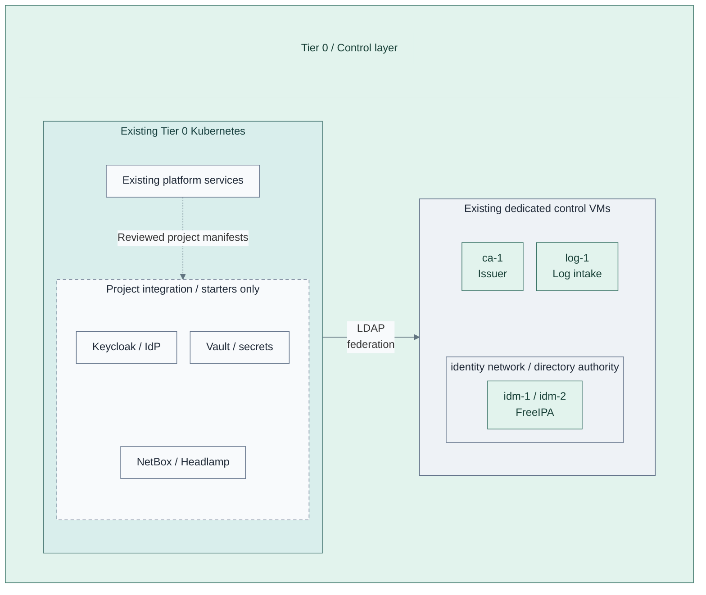

# Stage 4: Control services

Deploy the Tier 0 operational applications into the accepted Kubernetes platform.
FreeIPA and the issuing CA remain dedicated external services; Flux adds the identity
provider (IdP), secrets, inventory documentation and operational tools.

**Prerequisites:** accepted [identity and runtime](../stage-3-identity-runtime/README.md),
service storage/backups and independent recovery inputs.
**Working repository:** `<prefix>-tier-0` (source: `tier-0/`).
The dedicated observability VM alternative uses `<prefix>-tier-1` instead.
**Design:** [identity](../../architecture/identity/README.md),
[secrets](../../architecture/cryptography/README.md) and [operations](../../architecture/operations/README.md).

## Main path

1. [Deploy identity federation](#step-1-deploy-identity-federation)
2. [Deploy operational services](#step-2-deploy-operational-services)
3. [Integrate access and recovery](#step-3-integrate-access-and-recovery)
4. [Establish independent monitoring](#step-4-establish-independent-monitoring)

**Integration:** Tier 0 [application starters](../../../tier-0/clusters/tier0/applications/kustomization.yaml)
are project-owned placeholders, not installers for the dashed group.
Supply and review the manifests before Flux can reconcile these applications.
The [Vault VM alternative](step-2b-vault-vm.md) replaces, rather than duplicates, the cluster Vault instance.
Independent monitoring is a separate [selected integration](monitoring.md), not an installed workload here.

| Existing interface | New consumer |
| --- | --- |
| FreeIPA directory | Keycloak federation |
| CloudNativePG | Keycloak and NetBox databases |
| Issuing CA | cert-manager requests; Vault integration only through a supported provider |
| Cluster API | Headlamp with scoped RBAC |

## Step 1: Deploy identity federation

Add reviewed Keycloak manifests in Tier 0's
[clusters/tier0/applications/keycloak/](../../../tier-0/clusters/tier0/applications/keycloak/).
Configure its database,
TLS and FreeIPA federation; verify group mappings before granting administrative
roles. The directory remains independent of the IdP.

The source folders are editable starters, not complete application installers.
Service manifests and integration remain project work; see the
[support map](../../reference/implementation-support.md).

## Step 2: Deploy operational services

Keep control-service manifests in Tier 0's
[clusters/tier0/applications/](../../../tier-0/clusters/tier0/applications/),
not in Shared. These paths are starters for project integration.

Deploy Vault with its own persistent storage, initialization, audit and protected
unseal/recovery material. It does not use CloudNativePG as its storage backend.
**Alternative:** [2b: dedicated Vault VM](step-2b-vault-vm.md) replaces the cluster instance.
[2c: seal integration](step-2c-seal-integration.md) changes unseal/recovery, not PKI signing.

Add NetBox with its database/cache dependencies and Headlamp with scoped permissions.
The optional [2d: dedicated observability VMs](step-2d-telemetry-vm.md) prepares separate
gateway, metrics and search hosts instead of the normal Tier 1 Kubernetes workloads.
It does not supply independent Tier 0 monitoring or install the observability products.

NetBox documents inventory. It never supplies the inventory needed to bootstrap
its own platform. Test backups and restoration before other tiers depend on these services.

## Step 3: Integrate access and recovery

Configure OIDC clients and service roles where supported. Test permitted and denied
access, then rehearse privileged recovery without normal directory or IdP login.

Optional [3b: hardware-backed authentication](step-3b-hardware-authentication.md)
adds stronger operator login after recovery is working. Restrict routine bootstrap
credentials only after independent break-glass access and recovery custody are verified.

## Step 4: Establish independent monitoring

Follow the [monitoring deployment](monitoring.md): prepare its independent runtime,
add critical history/diagnostics, then enable and test external alerts. Each step
shows what is added to the existing Tier 0 logging foundation.

Required cluster-loss detection stays outside the observed cluster. Observability
is a separate [Stage 5 capability](../stage-5-delivery/analytics.md), not a prerequisite
for Tier 0 investigation or alerting.

## Capability available

**Result:** the control services in the
[reference platform](../../architecture/reference-platform.md#service-placement)
provide federated access, secrets, inventory documentation and visibility.
Record access, backup/restore and external failure-detection evidence.

Continue with [Stage 5: Delivery and handover](../stage-5-delivery/README.md).
