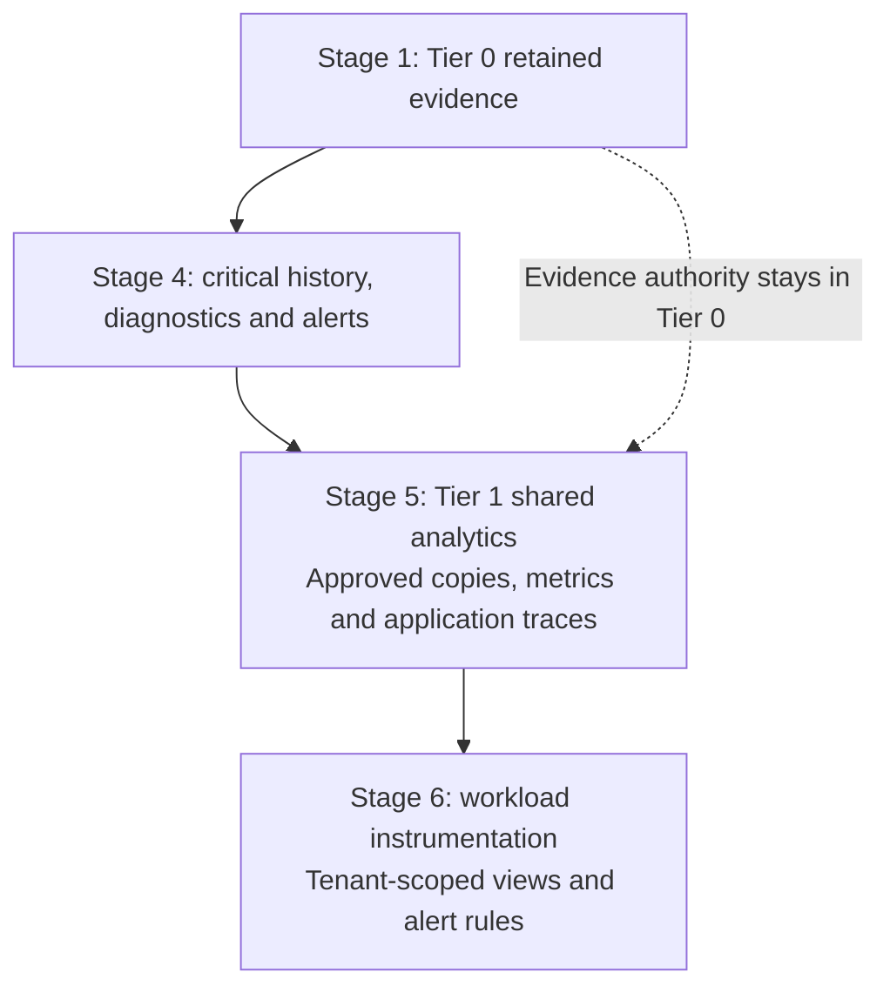

# Extend observability capabilities

**Working repositories:** `<prefix>-tier-0` for protected logging/critical monitoring;
`<prefix>-tier-1` for shared analytics; `<prefix>-tier-2` for workload collection.
Source directories match the tier names. Run commands from the selected tier root.
**Design:** [telemetry composition](../../../architecture/operations/telemetry.md).
**Prerequisites:** accepted [foundational logging](../../stage-1-foundation/procedures/syslog.md),
approved runtime/storage, scoped ingestion identities and independent recovery inputs.

## Table of contents

- [1. Add independent foundation monitoring](#1-add-independent-foundation-monitoring)
- [2. Add the shared investigation platform](#2-add-the-shared-investigation-platform)
- [3. Connect scoped workload telemetry](#3-connect-scoped-workload-telemetry)
- [IaC locations and acceptance](#iac-locations-and-acceptance)

These are capability additions, not prerequisites that make Tier 0 wait for
Tier 1. Earlier deployment is valid when the required runtime already exists.
Retain [logging administration](../../../administration/security-logging.md) throughout.

## 1. Add independent foundation monitoring

In Tier 0, select a small critical dataset: host/storage/network health, receiver
queues, evidence writes, replication, certificate expiry and cluster/API availability.
Integrate supported Netdata agents/parent, VictoriaMetrics, vmalert and Alertmanager
or approved equivalent components. These can be grouped; no VM per logical function is required.

Keep required cluster-outage detection and notifications outside that cluster.
Reusing the logging VM for small monitoring functions is a capacity/failure choice,
not isolation from its own failure. Test an external heartbeat/watchdog and retain
local credentials/configuration without hosted Git, normal SSO or sealed-secret dependencies.
Netdata streaming is configured separately from OpenTelemetry pipelines.

## 2. Add the shared investigation platform

In Tier 1, use the accepted platform cluster and its selected delivery controller.
Keep Tier 0 on Flux. Pin supported OpenSearch/Dashboards, ingestion/Data Prepper,
metrics, evaluator and notification releases; use the products' supported installation
procedures. The repository does not supply these product installers.

| Configure | Verify |
| --- | --- |
| OpenSearch HA and storage | Independent node placement, quorum, replica allocation, capacity and snapshot/restore; pod count alone is not HA |
| Ingestion | Supported log/trace schemas and persistent queues; metrics route to the selected metrics backend |
| Evidence projections | Tier 0 publishes only approved searchable copies; Tier 1 downtime never blocks the protected intake/archive |
| Segmented reads | Separate infrastructure/security and per-application indexes/scopes; redaction before developer publication; API-level negative tests |
| Identity | Keycloak federation where supported, least-privilege service roles and separately tested break-glass access |
| Alert ownership | Platform/application rules in Tier 1; foundation rules remain Tier 0-local; explicit duplicate suppression/notification ownership |

Use the [VM alternative](../step-2d-telemetry-vm.md) or existing services when selected.
Do not deploy a second Netdata parent or SigNoZ/ClickHouse automatically.
An app owner receives an application-log view, not raw Tier 0 archive access.

## 3. Connect scoped workload telemetry

In each owning tier, configure supported host agents, Kubernetes collectors and
application instrumentation. Tier 2 sends security/audit records to protected
Tier 0 intake and ordinary application telemetry to approved Tier 1 interfaces.
Trust labels from authenticated routing, not arbitrary producer-supplied tenant fields.

Set buffer capacity, disk permissions, retry limits, source credentials and loss
alarms. Test downstream outage, collector restart and source impersonation.
For ordinary workloads, accept that Tier 1 outage may stop dashboards and alerting
while collection buffers. Critical workloads explicitly add local retention and
evaluation; buffered collection alone is not autonomous monitoring.

## IaC locations and acceptance

| Repository | Path inside that repository | Coverage |
| --- | --- | --- |
| Tier 0 | [terraform/deployments/syslog/](../../../../tier-0/terraform/deployments/syslog/) | Independent receiver VMs/disks and baseline only |
| Tier 0 | [clusters/tier0/](../../../../tier-0/clusters/tier0/) | Project manifests for selected control-cluster monitoring; no monitoring installer |
| Tier 1 | [clusters/tier1/platform/observability/](../../../../tier-1/clusters/tier1/platform/observability/) | Shared-platform starter; empty until reviewed product manifests are supplied |
| Tier 1 | [terraform/deployments/observability/](../../../../tier-1/terraform/deployments/observability/) | Explicit VM alternative; no automatic collector/backend installation |
| Tier 2 | [clusters/tier2/](../../../../tier-2/clusters/tier2/) | Workload-owned collector/instrumentation integration |
| Shared | [ansible/roles/baseline/](../../../../shared/ansible/roles/baseline/) | Reusable host preparation, not inventory or evidence custody |

Record representative signals, scoped query denials, Tier 1/SSO outages, critical
notification delivery, queue replay and protected archive restoration. A successful
collector rollout does not prove the [logging durability contract](../../../architecture/operations/security-logging.md#durability-and-availability).
