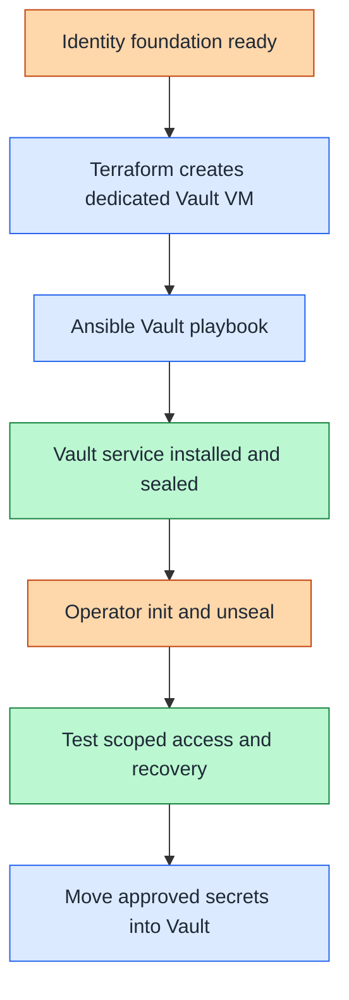

# Step 2b: Vault on a dedicated VM

**Working repository:** `<prefix>-tier-0` (source: `tier-0/`).
Run repository scripts from this root; paths below are repository-relative.

<a id="vault-foundation-deployment"></a>

**Branch from:** [Step 2](README.md#step-2-deploy-operational-services), instead of deploying the cluster instance.
**Change:** Use the supplied VM-based secret-service deployment.
**Return:** [Step 2](README.md#step-2-deploy-operational-services) to continue with the remaining control services and access checks.

**Design:** [secret-service responsibilities](../../architecture/cryptography/README.md).

## Table of contents

- [Purpose](#purpose)
- [Prerequisites](#prerequisites)
- [Configuration](#configuration)
- [IaC used for this](#iac-used-for-this)
- [Plan and deploy](#plan-and-deploy)
- [Operator bootstrap](#operator-bootstrap)
- [After deployment](#after-deployment)
- [Later hardening](#later-hardening)
- [Read more](#read-more)
- [References](#references)

## Purpose

Use this guide after identity, DNS, and PKI are available to
deploy Vault as the shared secret-platform service.



Figure: Vault is deployed after the identity and PKI layer exists and
becomes the handoff point from first-run secrets to the long-term secret
platform.

<a id="before-you-start"></a>

## Prerequisites

- identity, DNS, and the first PKI path already exist from this repo or from
  an existing environment
- the deployment machine already has `ansible-core` and `terraform`
- naming and the first TLS path for Vault already exist
- one dedicated Vault VM, or more when needed, is defined in the Vault
  environment
- each Vault host exists in the `vault` inventory group
- local copies of the example files exist before editing
- the current Vault role does not generate the first Vault certificate, key, or
  CA file automatically

<a id="what-you-configure"></a>

## Configuration

Initialize missing local files from Tier 0:

```bash
bash scripts/init-local-files.sh --setup vault
```

Edit these local files before running the Vault foundation deployment:

| Repository | Path inside that repository | Configuration |
| --- | --- | --- |
| Tier 0 | [`terraform/common.tfvars.example`](../../../tier-0/terraform/common.tfvars.example) | tier guest networks and optional platform overrides; shared storage and local SSH paths follow [platform inputs](../../reference/platform-inputs.md) |
| Tier 0 | [`terraform/deployments/vault/terraform.tfvars.example`](../../../tier-0/terraform/deployments/vault/terraform.tfvars.example) | Vault VM definitions in `vm_instances` |
| Tier 0 | [`ansible/inventory/hosts.yml.example`](../../../tier-0/ansible/inventory/hosts.yml.example) | stable Vault host key and inventory group |
| Tier 0 | [`ansible/group_vars/all.env.yml.example`](../../../tier-0/ansible/group_vars/all.env.yml.example) | environment-specific hostname decoration and domain when using `--env` |
| Tier 0 | [`ansible/group_vars/vault.yml.example`](../../../tier-0/ansible/group_vars/vault.yml.example) | Vault host IPs, `vault_api_addr`, `vault_cluster_addr`, `vault_node_id`, TLS source paths, and listener settings |

<a id="how-to-shape-the-deployment"></a>

### Deployment shape

The Vault environment can deploy one or more Vault nodes through
`vm_instances`, but this guide uses the default single-node path.

Use this default matrix:

| Component | Terraform default | Inventory action | Network / zone | Purpose |
| --- | --- | --- | --- | --- |
| Vault host | `vault-1` active | `vault-1` present by default | `cryptography` / Control | first dedicated Vault node |
| additional Vault hosts | not present, default `0` | add matching inventory and IP entries when added | `cryptography` / Control | optional multi-node Raft expansion |
| LXC helpers | `lxc_instances = {}` | not used | n/a | no helper containers by default |

The Terraform example for this path lives in
`terraform/deployments/vault/terraform.tfvars.example`. The Tier 0 Ansible
inventory includes `vault-1` because it matches the active Terraform default.
The foundation run does not touch it because the foundation playbook targets
only the foundation groups.

The starter places privileged secrets at `10.20.21.21` on the cryptography
network, not on the application subnet. Existing deployments keep their local
inputs during refresh; moving a live Vault service requires a separate reviewed
network, DNS, TLS, firewall, and recovery plan.

Use these first-node settings:

- keep `vault_raft_retry_join` empty for the first single-node deployment
- keep `vault_seal_hcl` empty for the first deployment
- keep TLS enabled from the first startup
- keep the Vault host dedicated to Vault

## IaC used for this

The inputs above stay in Tier 0. Follow these entry points to their implementation:

| Repository | Code path inside that repository | Responsibility |
| --- | --- | --- |
| Tier 0 | [terraform/deployments/vault/main.tf](../../../tier-0/terraform/deployments/vault/main.tf) | Dedicated Vault VMs through tier-local modules |
| Tier 0 | [ansible/playbooks/deployment/vault-vm.yml](../../../tier-0/ansible/playbooks/deployment/vault-vm.yml) and [ansible/roles/vault/](../../../tier-0/ansible/roles/vault/) | Vault host preparation and installation |
| Tier 0 | [scripts/deploy.sh](../../../tier-0/scripts/deploy.sh) | Tier entry point; select `vault` |
| Shared | [scripts/deploy.sh](../../../shared/scripts/deploy.sh) | Reusable execution implementation, using Tier 0 inputs/state |
| Shared | [ansible/roles/baseline/](../../../shared/ansible/roles/baseline/) | Common host preparation, reused by the Tier 0 recipe |

This deployment flow installs Vault and prepares the first node. Operator
initialization, unseal handling, and secret handoff stay manual.

Use the shared ownership rule from
[Infrastructure automation layout](../../development/code-layout.md):
Ansible inventory owns stable logical host keys and service groups. Ansible
`all` group vars own hostname decoration and domain. Vault group vars own the
Vault IP map, while the Vault Terraform environment owns hardware placement
and Proxmox tags.

## Plan and deploy

Prepare the TLS files and local inputs above, then plan:

```bash
bash scripts/deploy.sh vault --plan-only
```

Review VM/disk changes and certificate sources before deploying:

```bash
bash scripts/deploy.sh vault
```

**Result:** a new Vault service is installed, running and sealed; the wrapper does not initialize or unseal it.

## Operator bootstrap

Use a trusted operator terminal, not CI logs. Configure the CLI with the actual
HTTPS endpoint and local CA bundle from the chosen TLS configuration. [1]

```bash
read -r -p "Vault HTTPS URL from vault_api_addr: " VAULT_ADDR
read -r -p "Absolute path to the trusted Vault CA bundle: " VAULT_CACERT
export VAULT_ADDR VAULT_CACERT
vault status
```

A sealed server returns exit code 2 from `vault status`; inspect its `Initialized`
and `Sealed` fields. Initialize only a new, uninitialized service. Recovery of an
existing service uses its original data and keys, never another initialization. [2]
Prepare protected share/root-token custody first; PGP output encryption is supported. [3]
For the selected three-share/two-custodian Shamir example:

```bash
vault operator init -key-shares=3 -key-threshold=2
```

Retain the resulting material under the selected custody policy. Enter two distinct
shares interactively, then authenticate before configuring the audit device: [2][4]

```bash
vault operator unseal
vault operator unseal
vault login
vault audit enable file file_path=/var/log/vault/audit.log
```

The login uses the protected initial root token at the prompt; do not put it in a
command argument. Configure and test normal scoped administrative access before
revoking bootstrap authority. Forward audit records to protected logging before
storing important secrets; the local audit file alone is not the retained evidence archive.

## After deployment

After Vault is initialized:

- move shared service credentials and long-lived tokens into Vault
- keep root tokens and unseal material out of the repository and out of normal
  automation
- keep local Ansible Vault files as a fallback path, not the primary system of
  record
- continue the broader deployment only after Vault is reachable and audited

## Later hardening

Use this guide only for the first Vault shared-service deployment after the
identity and PKI layer exists.

For later hardening, higher availability, and future HSM-related paths, continue
with the security docs instead of extending this deployment guide:

- [Vault HSM hardening options](../../architecture/cryptography/vault-seal.md)
- [HSM getting started](../../architecture/cryptography/hsm-selection.md)
- [USB HSM active-active blueprint](../stage-2-trust/step-1b-usb-hsm.md)

## Read more

- [Identity foundation path](../stage-3-identity-runtime/procedures/freeipa.md)
- [Shared services model](../../architecture/service-boundaries.md)
- [Windows and AD support](../../architecture/identity/windows-integration.md)
- [Deployment readiness](../readiness.md)
- [Secret strategy](../../administration/secret-handling/strategy.md)
- [Ansible Vault bootstrap fallback](../../administration/secret-handling/ansible-vault.md)

## References

Operator command guidance checked 2026-10-16; use the installed release's documentation.

1. [Vault CLI address and CA configuration](https://developer.hashicorp.com/vault/docs/commands)
2. [Vault status and sealed exit code](https://developer.hashicorp.com/vault/docs/commands/status)
3. [Vault initialization and PGP protection](https://developer.hashicorp.com/vault/docs/commands/operator/init)
4. [Vault interactive authentication](https://developer.hashicorp.com/vault/docs/commands/login)
