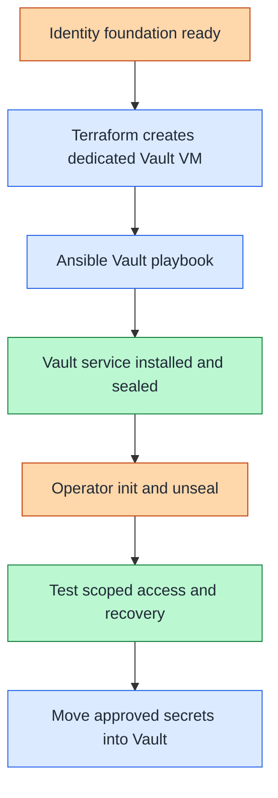

# Step 2b: Vault on a dedicated VM

<a id="vault-foundation-deployment"></a>

**Branch from:** [Step 2](README.md#step-2-deploy-operational-services), instead of deploying the cluster instance.
**Change:** Use the supplied VM-based secret-service deployment.
**Return:** [Step 2](README.md#step-2-deploy-operational-services) to continue with the remaining control services and access checks.

**Design:** [secret-service responsibilities](../../architecture/cryptography/README.md).

## Table of contents

- [Purpose](#purpose)
- [Prerequisites](#prerequisites)
- [Configuration](#configuration)
- [IaC used for this](#iac-used-for-this)
- [How to shape the deployment](#how-to-shape-the-deployment)
- [After deployment](#after-deployment)
- [Later hardening](#later-hardening)
- [Read more](#read-more)

## Purpose

Use this guide after identity, DNS, and PKI are available to
deploy Vault as the shared secret-platform service.

Run deployment commands from the Tier 0 root: `tier-0/` in a private
source checkout or `<prefix>-tier-0/` after generation. File paths below
are tier-relative unless marked as shared code.



Figure: Vault is deployed after the identity and PKI layer exists and
becomes the handoff point from first-run secrets to the long-term secret
platform.

<a id="before-you-start"></a>

## Prerequisites

- identity, DNS, and the first PKI path already exist from this repo or from
  an existing environment
- the deployment machine already has `ansible-core` and `terraform`
- naming and the first TLS path for Vault already exist
- one dedicated Vault VM, or more when needed, is defined in the Vault
  environment
- each Vault host exists in the `vault` inventory group
- local copies of the example files exist before editing
- the current Vault role does not generate the first Vault certificate, key, or
  CA file automatically

<a id="what-you-configure"></a>

## Configuration

Edit these local files before running the Vault foundation deployment:

| Path | Configuration |
| --- | --- |
| [`terraform/common.tfvars.example`](../../../tier-0/terraform/common.tfvars.example) | tier guest networks and optional platform overrides; shared storage and local SSH paths follow [platform inputs](../../reference/platform-inputs.md) |
| [`terraform/deployments/vault/terraform.tfvars.example`](../../../tier-0/terraform/deployments/vault/terraform.tfvars.example) | Vault VM definitions in `vm_instances` |
| [`ansible/inventory/hosts.yml.example`](../../../tier-0/ansible/inventory/hosts.yml.example) | stable Vault host key and inventory group |
| [`ansible/group_vars/all.env.yml.example`](../../../tier-0/ansible/group_vars/all.env.yml.example) | environment-specific hostname decoration and domain when using `--env` |
| [`ansible/group_vars/vault.yml.example`](../../../tier-0/ansible/group_vars/vault.yml.example) | Vault host IPs, `vault_api_addr`, `vault_cluster_addr`, `vault_node_id`, TLS source paths, and listener settings |

### Deployment shape

The Vault environment can deploy one or more Vault nodes through
`vm_instances`, but this guide uses the default single-node path.

Use this default matrix:

| Component | Terraform default | Inventory action | Network / zone | Purpose |
| --- | --- | --- | --- | --- |
| Vault host | `vault-1` active | `vault-1` present by default | `cryptography` / Control | first dedicated Vault node |
| additional Vault hosts | not present, default `0` | add matching inventory and IP entries when added | `cryptography` / Control | optional multi-node Raft expansion |
| LXC helpers | `lxc_instances = {}` | not used | n/a | no helper containers by default |

The Terraform example for this path lives in
`terraform/deployments/vault/terraform.tfvars.example`. The Tier 0 Ansible
inventory includes `vault-1` because it matches the active Terraform default.
The foundation run does not touch it because the foundation playbook targets
only the foundation groups.

The starter places privileged secrets at `10.20.21.21` on the cryptography
network, not on the application subnet. Existing deployments keep their local
inputs during refresh; moving a live Vault service requires a separate reviewed
network, DNS, TLS, firewall, and recovery plan.

Use this rule:

- keep `1` dedicated Vault VM for the default deployment flow
- add more Vault VMs in `vm_instances` only when intentionally starting
  with a multi-node Raft deployment
- add every Vault node to the Ansible `vault` inventory group

Use these first-node settings:

- keep `vault_raft_retry_join` empty for the first single-node deployment
- keep `vault_seal_hcl` empty for the first deployment
- keep TLS enabled from the first startup
- keep the Vault host dedicated to Vault

## IaC used for this

Use these repo paths for the Vault foundation deployment:

| IaC path | Used for here | Local configuration |
| --- | --- | --- |
| [`terraform/common.tfvars.example`](../../../tier-0/terraform/common.tfvars.example) | tier guest networks and optional platform overrides | the local `terraform/common.tfvars` |
| [`terraform/deployments/vault/terraform.tfvars.example`](../../../tier-0/terraform/deployments/vault/terraform.tfvars.example) | provisions one or more dedicated Vault VMs | `terraform/deployments/vault/terraform.tfvars` based on `.example` |
| [`ansible/inventory/hosts.yml.example`](../../../tier-0/ansible/inventory/hosts.yml.example) | starting point for the `vault` inventory group | the local `ansible/inventory/hosts.yml` |
| [`ansible/group_vars/all.env.yml.example`](../../../tier-0/ansible/group_vars/all.env.yml.example) | starting point for environment-specific hostname decoration and domain | the local `ansible/group_vars/all.<env>.yml` |
| [`ansible/group_vars/vault.yml.example`](../../../tier-0/ansible/group_vars/vault.yml.example) | starting point for Vault IPs, listener, TLS, and node settings | the local `ansible/group_vars/vault.yml` |
| [`ansible/playbooks/vault.yml`](../../../tier-0/ansible/playbooks/vault.yml) | baseline host preparation and Vault installation on hosts in the `vault` group | inventory and Vault group variables |
| [`scripts/deploy.sh`](../../../tier-0/scripts/deploy.sh) | repository wrapper for the mapped precheck, Terraform, and Ansible flow | choose the `vault` setup when ready for deployment |

This deployment flow installs Vault and prepares the first node. Operator
initialization, unseal handling, and secret handoff stay manual.

Use the shared ownership rule from
[Infrastructure automation layout](../../development/code-layout.md):
Ansible inventory owns stable logical host keys and service groups. Ansible
`all` group vars own hostname decoration and domain. Vault group vars own the
Vault IP map, while the Vault Terraform environment owns hardware placement
and Proxmox tags.

## How to shape the deployment

Use the Vault environment as a dedicated service layer, not as a mixed-use VM.

- keep the default path at `1` dedicated Vault VM
- add more Vault nodes in `vm_instances` only when intentionally deploying a
  multi-node Raft design from the start
- keep every Vault VM in the Ansible `vault` inventory group
- keep TLS enabled from the first startup and prepare the certificate inputs
  before the run
- leave `vault_raft_retry_join` empty for the first single-node deployment
- leave `vault_seal_hcl` empty for the first deployment and add seal changes
  later through the hardening path
- keep Vault on dedicated hosts instead of combining it with identity, PKI, or
  application roles

To deploy the setup, use the repository deployment wrapper with
the `vault` setup. Keep the exact execution flow in the wrapper rather than
repeating it in this guide. That wrapper also checks the required local config
files for the setup before it runs.

After the wrapper run:

- verify the Vault service is running but still sealed
- initialize Vault with an operator-reviewed command, for example:

```bash
vault operator init -key-shares=3 -key-threshold=2
```

- unseal the first node and enable an audit device before storing shared
  secrets:

```bash
vault operator unseal
vault operator unseal
vault audit enable file file_path=/var/log/vault/audit.log
```

For stronger operator handling, use PGP encryption for unseal shares and the
initial root token during `vault operator init`.

## After deployment

After Vault is initialized:

- move shared service credentials and long-lived tokens into Vault
- keep root tokens and unseal material out of the repository and out of normal
  automation
- keep local Ansible Vault files as a fallback path, not the primary system of
  record
- continue the broader deployment only after Vault is reachable and audited

## Later hardening

Use this guide only for the first Vault shared-service deployment after the
identity and PKI layer exists.

For later hardening, higher availability, and future HSM-related paths, continue
with the security docs instead of extending this deployment guide:

- [Vault HSM hardening options](../../architecture/cryptography/vault-seal.md)
- [HSM getting started](../../architecture/cryptography/hsm-selection.md)
- [USB HSM active-active blueprint](../stage-2-trust/step-1b-usb-hsm.md)

## Read more

- [Identity foundation path](../stage-3-identity-runtime/procedures/freeipa.md)
- [Shared services model](../../architecture/service-boundaries.md)
- [Windows and AD support](../../architecture/identity/windows-integration.md)
- [Deployment readiness](../readiness.md)
- [Secret strategy](../../administration/secret-handling/strategy.md)
- [Ansible Vault bootstrap fallback](../../administration/secret-handling/ansible-vault.md)
