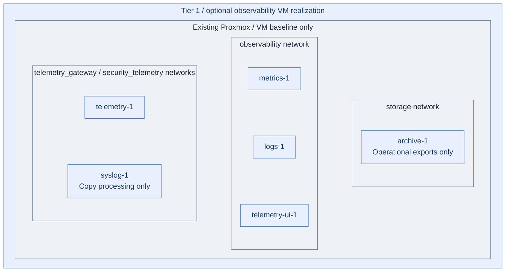

# Step 2d: Telemetry VMs

**Working repository:** `<prefix>-tier-1` (source: `tier-1/`).
Run repository scripts from this root; paths below are repository-relative.

<a id="deploy-the-telemetry-host-variant"></a>

**Branch from:** [Step 2](README.md#step-2-deploy-operational-services), only when preparing the Tier 1 analytics VM alternative early.
**Change:** Use dedicated telemetry hosts in their owning tier.
**Return:** [Step 2](README.md#step-2-deploy-operational-services) for Tier 0 services; the same VM recipe can be used later from Stage 5 analytics.

**Design:** [telemetry options A-C](../../architecture/operations/telemetry.md).
**Prerequisites:** selected collector/backend roles, network policy, retention,
software supply and recovery targets. Run the supplied VM workflow from Tier 1.
Protected security logging is already established in
[Tier 0](../stage-1-logging/README.md); these VMs do not take its custody.
**Not another protected receiver:** `syslog-1` is a Tier 1 processing-host example
for approved copies and operational logs. `log-1` and optional `log-2` remain the
Tier 0 security/audit receivers. The six-VM starter installs no telemetry products;
an existing ingestion service can replace this processing role. Select only the
needed hosts before the first apply; existing deployments need a deliberate migration.
The main later path is the [shared observability platform](../stage-5-delivery/analytics.md),
not a mandatory VM for every logical component.

## Table of contents

- [Procedure](#procedure)
- [IaC defaults](#iac-defaults)
- [Acceptance](#acceptance)

## Procedure

1. Record A (dedicated VMs), B (cluster services) or C (existing service) and the
   shared/isolated boundary in project architecture.
2. For A, initialize the observability setup, select hosts and sizes in Terraform,
   and align their tier-local inventory and IP maps. The shared deployment wrapper
   provisions hosts and applies baseline only.

   ```bash
   bash scripts/init-local-files.sh --setup observability
   ```

   After editing local Terraform/inventory inputs:

   ```bash
   bash scripts/deploy.sh observability --plan-only
   ```

   Review the plan, then run `bash scripts/deploy.sh observability` to provision
   and baseline the selected VMs. This does not install the backend products.
3. Install selected collectors, backends and dashboards with project-owned service
   automation. B uses cluster manifests; C verifies existing endpoints instead.
4. Configure approved source-to-collector and collector-to-backend routes, TLS,
   authentication, retention, archives and scoped dashboard access.
5. Verify every required signal before connecting dependent consumers.

## IaC defaults



**IaC:** Tier 1 [VM inputs](../../../tier-1/terraform/deployments/observability/terraform.tfvars.example)
and [host recipe](../../../tier-1/ansible/playbooks/deployment/telemetry-hosts.yml).
All six active VMs receive baseline only. No arrows imply an installed ingestion pipeline;
product setup and further replicas remain project integration. Tier 0 evidence stays outside this deployment.

| Repository | IaC location inside that repository | Supplied behavior |
| --- | --- | --- |
| Tier 1 | [terraform/deployments/observability/](../../../tier-1/terraform/deployments/observability/) | Creates the VM foundations |
| Tier 1 | [ansible/playbooks/deployment/telemetry-hosts.yml](../../../tier-1/ansible/playbooks/deployment/telemetry-hosts.yml) | Applies the shared host baseline |
| Tier 1 | [ansible/group_vars/observability.yml.example](../../../tier-1/ansible/group_vars/observability.yml.example) | Tier-local host/IP inputs |
| Shared | [ansible/roles/baseline/](../../../shared/ansible/roles/baseline/) | Common OS preparation, not collector/backend installation |
Neither installs collectors, backends, dashboards, or their integrations.
Add service automation in Tier 1 before treating the stack as operational.
High-availability expansion is represented as commented Terraform instances
and matching commented inventory/IP examples.

Use this matrix for the default Terraform shape:

| Component | Terraform default | Inventory action | Network key |
| --- | --- | --- | --- |
| telemetry gateway | `telemetry-1` active, `telemetry-2` commented | `telemetry-1` present by default | `telemetry_gateway` |
| syslog processing | `syslog-1` active, `syslog-2` commented | Tier 1 processing only; authoritative evidence stays in Tier 0 | `security_telemetry` |
| metrics store | `metrics-1` active | `metrics-1` present by default | `observability` |
| log/trace analytics | `logs-1` active, `logs-2` and `logs-3` commented | Single active VM is not OpenSearch HA; enable reviewed replicas before HA acceptance | `observability` |
| dashboard entry | `telemetry-ui-1` active | `telemetry-ui-1` present by default | `observability` |
| operational export writer | `archive-1` active | Not the authoritative Tier 0 security archive | `storage` |

`health-1` is a commented optional lower-tier parent; `apm-1` is a commented
legacy SigNoZ/ClickHouse alternative. Neither is enabled by the reference.
Existing live inputs/state are preserved; retire or migrate a deployed service
deliberately, never by replacing its desired-state file with a new example.

Commented Terraform `vm_instances` are default `0` and should stay commented
until the matching Ansible inventory group and IP entry are enabled.


<a id="reference-stack"></a>
<a id="target-shape"></a>
<a id="network-placement"></a>
<a id="traffic-model"></a>
<a id="vm-roles"></a>
<a id="starting-shape"></a>
<a id="data-routing"></a>
<a id="shared-or-isolated"></a>
<a id="operations-model"></a>
<a id="purpose"></a>

## Acceptance

| Check | Expected result |
| --- | --- |
| Representative metric, trace, log and audit source | Arrives at the selected backend with owner/environment attributes |
| Unauthorized producer or dashboard user | Rejected by the selected policy |
| Collector/backend interruption | Buffered or lost data behavior matches the approved requirement |
| Retention and archive | Expiry, backup and restore are tested with non-sensitive sample records |
| Loss of the control cluster | Independent monitoring still detects the failure |
| Duplicate alerts | Notification routing has an explicit owner and hierarchy |

Adding VM instances alone does not install HA services. Record recurring health,
retention and restore procedures under project administration. Return to
[Step 2](README.md#step-2-deploy-operational-services).
