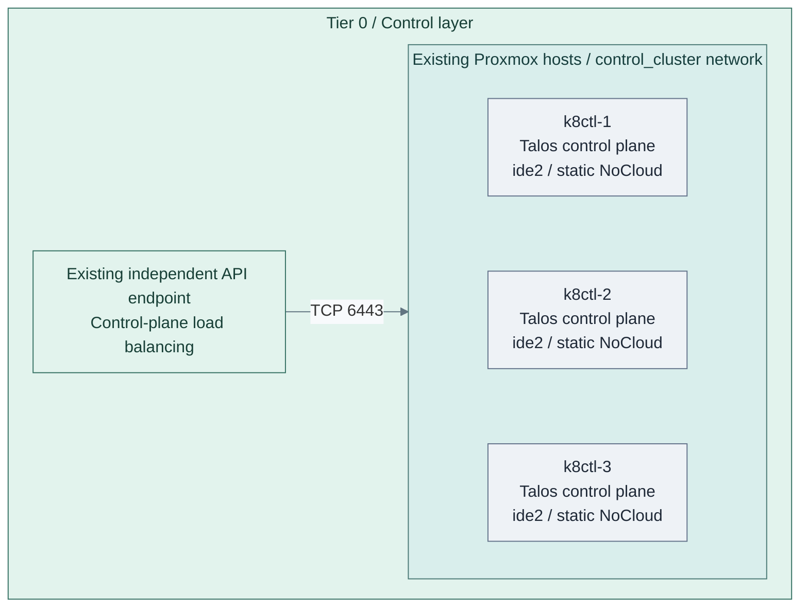
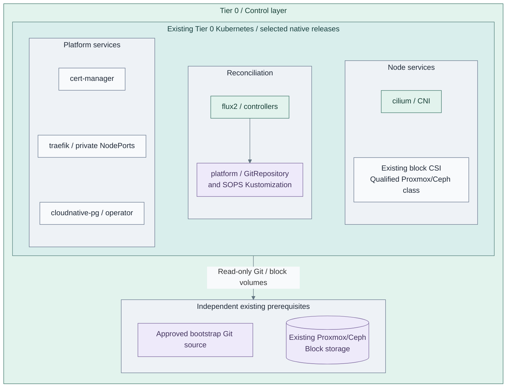
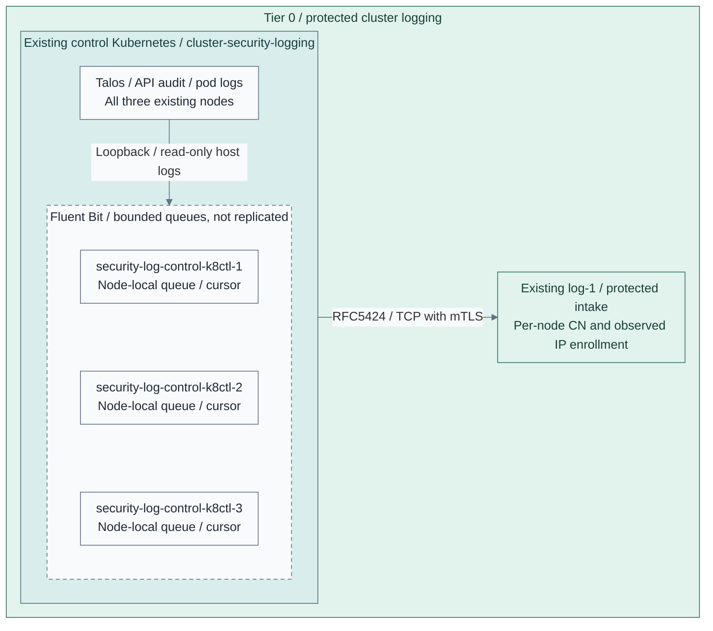

# Stage 4: Kubernetes

Create the Tier 0 control cluster, then establish the basic platform before
deploying identity federation, secrets or other control applications. Kubernetes
is the capability; Talos is the supplied node-OS implementation.

**Prerequisites:** accepted software intake, protected logging and cryptographic
trust; approved node images, independent DNS/time, reserved static node IPs and a private
API endpoint outside this cluster. Retain bootstrap tools, images and credentials
without depending on FreeIPA, Keycloak or later Tier 1 delivery services.
**Working repository:** `<prefix>-tier-0` (source: `tier-0/`).
**Automation:** tier-local Terraform provisions nodes and bootstraps Kubernetes.
Prepare the [private endpoint](procedures/api-endpoint.md) before cluster bootstrap;
a qualified existing endpoint is also valid. Tier-local Ansible inputs select reusable
platform and protected cluster-source collection roles in Shared.
See [coverage](../../reference/implementation-support.md#stage-coverage).
**Design:** [Kubernetes runtime](../../architecture/compute/kubernetes.md).

## Main path

1. [Create the Kubernetes cluster](#step-1-create-the-kubernetes-cluster)
2. [Establish the basic platform](#step-2-establish-the-basic-platform)
3. [Verify operation and recovery](#step-3-verify-operation-and-recovery)

## Step 1: Create the Kubernetes cluster



**IaC:** Tier 0 [Kubernetes inputs](../../../tier-0/terraform/deployments/kubernetes/terraform.tfvars.example)
and [cluster entry point](../../../tier-0/scripts/kubernetes-cluster.sh) create these three VMs and bootstrap Kubernetes.
The API endpoint, IP allocations and approved node template already exist.
Each VM receives a network-only NoCloud drive at `ide2`, plus its live boot/EFI disks;
the Talos API applies machine configuration. DHCP bootstrap remains an explicit legacy option.
No workers are active in this starter; application and add-on manifests are separate inputs.

From Tier 0, initialize the local inputs:

```bash
bash scripts/kubernetes-cluster.sh init
```

Before bootstrap, prepare the [Talos CNI/proxy patches](procedures/basic-platform.md#prepare-talos)
and [node/API logging patches](procedures/security-logging.md#prepare-talos).
The latter can be rendered without a live cluster; install its collectors after CNI is ready.
Configure [inventory, node hardware, endpoint and pinned images](procedures/talos-terraform.md#configure)
in Tier 0's [Kubernetes root](../../../tier-0/terraform/deployments/kubernetes).
Verify the independent endpoint and static IP/gateway selections before planning:

```bash
bash scripts/kubernetes-cluster.sh plan
```

Review allocations, storage, network attachments and generated configuration.
Apply only that accepted saved plan, then export the private client files:

```bash
bash scripts/kubernetes-cluster.sh apply
bash scripts/kubernetes-cluster.sh credentials
```

The [implementation guide](procedures/talos-terraform.md#plan-and-deploy) owns the
command side effects and state contract. The [common cluster procedure](procedures/kubernetes.md)
applies to all three tiers, not a second Terraform owner.

**Alternative:** [1b: manual bootstrap](step-1b-manual-cluster.md) replaces that lifecycle;
it does not create a second state owner. Another OS requires its own implementation.
New-cluster inputs provide three schedulable control planes and no workers.
Additional workers are an explicit capacity choice; existing clusters retain their local nodes.

## Step 2: Establish the basic platform



**IaC:** Tier 0's [platform playbook](../../../tier-0/ansible/playbooks/deployment/cluster-platform.yml)
owns the selected pinned releases; reusable execution roles install them
on the existing cluster. Follow the [basic platform procedure](procedures/basic-platform.md)
to configure inputs, render privately and apply with readiness gates.
Scope: the five chart releases in the Tier 0 example, their Flux source/decryption
objects and the accepted existing block CSI prerequisite. Application databases
are created later by their owning recipes, not implied by the operator box.
NFS CSI for later backup/shared-file claims and Barman Cloud for object/WAL
backups are separate selections, not installed by this pictured main path.

| Capability | Supplied installation | Explicit prerequisite or remaining acceptance |
| --- | --- | --- |
| Networking | Talos-compatible Cilium | CNI/proxy preparation before bootstrap; cross-node traffic and DNS tests |
| Persistence | Accepted existing Proxmox/Ceph-backed block CSI; optional separate NFS CSI for file claims | Qualified live disk and backup destinations; persistence and restore tests |
| Certificates | cert-manager, optional ClusterIssuer and issuance probe | Qualified existing issuer, trust and enrollment credentials |
| Ingress | Traefik with explicit NodePorts and ingress class | Private DNS, routing/firewall and end-to-end TLS tests |
| PostgreSQL | CloudNativePG operator and optional probe database; Barman Cloud only for the object/WAL option | Qualified block CSI/image; application connection, selected backup and restore tests |
| Reconciliation/secrets | Flux controllers, pinned Git source, SOPS age decryption | Independent source/keys and encrypted acceptance canary |

The installer applies networking, storage, certificates, ingress, database and Flux
in that order, waiting between products. Components can be selected independently;
install ingress first when an enabled certificate probe uses HTTP-01.
The [foundation checklist](procedures/kubernetes.md#cluster-foundation) defines acceptance,
including the dependencies a selected-component run must already satisfy.
Connect certificate automation to the existing issuer through a supported integration.
For the OpenXPKI Community reference, the [ACME adapter qualification](../stage-3-trust/procedures/issuer.md#step-3-activate-and-accept-issuance)
is explicit; installing cert-manager does not supply that adapter or authorize enrollment.

Tier 0's [clusters/tier0/](../../../tier-0/clusters/tier0) folders remain GitOps starters;
the installer does not populate them or transfer Helm ownership to Flux.
Prepare the [Flux source and canary](procedures/flux-sops.md), verify reconciliation,
decryption, persistence, TLS and database health, and start backups as state appears.
Flux requires a reachable source with independent credentials, not merely a local checkout.
Install and qualify [protected cluster-source collection](procedures/security-logging.md)
before acceptance. It has a separate recipe from the add-on subset above; neither
the VM/bootstrap root nor installing a logging pod alone accepts that complete path.

## Step 3: Verify operation and recovery



**IaC:** the Tier 0 [collection playbook](../../../tier-0/ansible/playbooks/deployment/cluster-security-logging.yml)
and [node inputs](../../../tier-0/ansible/group_vars/cluster_security_logging.yml.example)
select these three releases from the [Shared role](../../../shared/ansible/roles/cluster_security_logging).
Scope: cluster sources and bounded local queues; the receiver and its archive are existing Stage 2 services.

Follow the [collection procedure](procedures/security-logging.md) to enroll distinct
client leaves, install collectors and test source-to-intake delivery. No signing
authority enters Kubernetes. A lost node, full queue or unavailable first-hop
listener can lose records; protected intake is not an application-acknowledged replica.

Run the [implementation checks](procedures/talos-terraform.md#verify-and-hand-over) and accept
every selected [cluster-foundation gate](procedures/kubernetes.md#cluster-foundation).
Empty manifests, three VMs or a successful bootstrap do not accept the platform.

| Check | Required evidence |
| --- | --- |
| Nodes and endpoint | Expected inventory nodes, private API access and selected failure behavior; no public-edge dependency |
| Platform services | Networking, reconciliation, decryption, persistence, certificates/ingress and database checks pass before consumers |
| Security records | Node and API audit events reach protected Tier 0 intake under approved identities |
| Recovery | Original machine secrets, state, etcd and required persistent data have protected copies and a selected restore procedure |
| Independence | Bootstrap/recovery access still works without directory/IdP login, Vault or hosted delivery |

Record results in Tier 0's project deployment and administration records. Restore
is not a fresh-cluster bootstrap; live failure and clean-target recovery evidence
remain required for the selected availability/recovery contract.

## Capability available

**Result:** the accepted Tier 0 Kubernetes runtime can host control applications.
The cluster owns no directory authority and does not imply that Keycloak, Vault
or other application starters are installed.
Continue with [Stage 5: Identity](../stage-5-identity/README.md).

Tier 1 and Tier 2 reuse the [common cluster procedure](procedures/kubernetes.md)
from their later stages, with their own inventory, resources, state and delivery
choice. They do not inherit Tier 0 credentials or Flux automatically.
