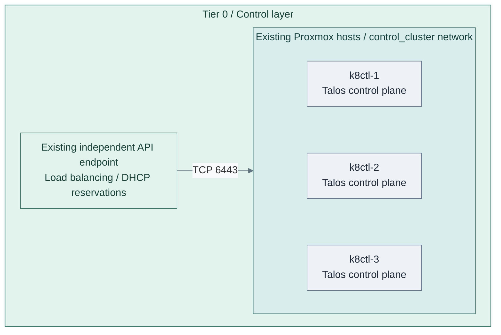
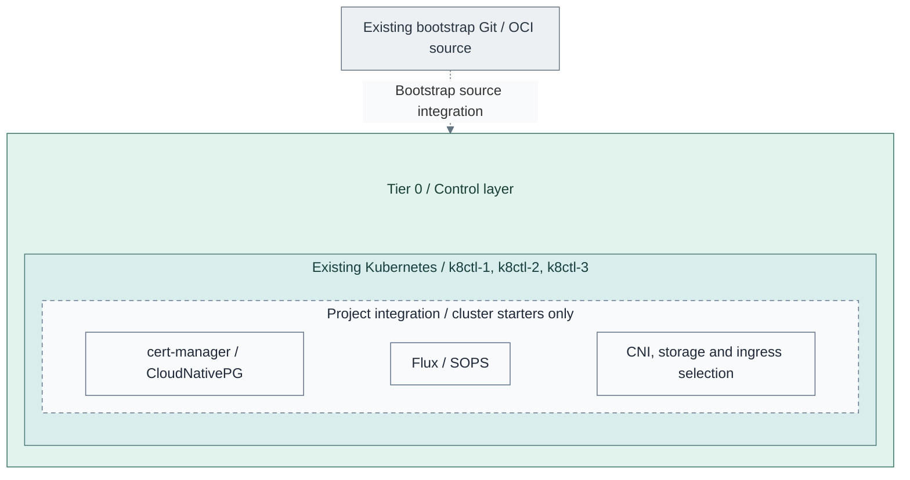

# Stage 4: Kubernetes

Create the Tier 0 control cluster, then establish the basic platform before
deploying identity federation, secrets or other control applications. Kubernetes
is the capability; Talos is the supplied node-OS implementation.

**Prerequisites:** accepted software intake, protected logging and cryptographic
trust; approved node images, independent DNS/time, DHCP reservations and a private
API endpoint outside this cluster. Retain bootstrap tools, images and credentials
without depending on FreeIPA, Keycloak or later Tier 1 delivery services.
**Working repository:** `<prefix>-tier-0` (source: `tier-0/`).
**Automation:** tier-local Terraform provisions nodes and bootstraps Kubernetes.
The API endpoint must already exist; add-ons and node/API audit forwarding require
project integration. See [coverage](../../reference/implementation-support.md#stage-coverage).
**Design:** [Kubernetes runtime](../../architecture/compute/kubernetes.md).

## Main path

1. [Create the Kubernetes cluster](#step-1-create-the-kubernetes-cluster)
2. [Establish the basic platform](#step-2-establish-the-basic-platform)
3. [Verify operation and recovery](#step-3-verify-operation-and-recovery)

## Step 1: Create the Kubernetes cluster



**IaC:** Tier 0 [Kubernetes inputs](../../../tier-0/terraform/deployments/kubernetes/terraform.tfvars.example)
and [cluster entry point](../../../tier-0/scripts/kubernetes-cluster.sh) create these three VMs and bootstrap Kubernetes.
The API endpoint, DHCP reservations and approved node template already exist.
No workers are active in this starter; application and add-on manifests are separate inputs.

From Tier 0, initialize the local inputs:

```bash
bash scripts/kubernetes-cluster.sh init
```

Configure [inventory, node hardware, endpoint and pinned images](procedures/talos-terraform.md#configure)
in Tier 0's [Kubernetes root](../../../tier-0/terraform/deployments/kubernetes/).
Verify the independent endpoint and DHCP reservations before planning:

```bash
bash scripts/kubernetes-cluster.sh plan
```

Review allocations, storage, network attachments and generated configuration.
Apply only that accepted saved plan, then export the private client files:

```bash
bash scripts/kubernetes-cluster.sh apply
bash scripts/kubernetes-cluster.sh credentials
```

The [implementation guide](procedures/talos-terraform.md#plan-and-deploy) owns the
command side effects and state contract. The [common cluster procedure](procedures/kubernetes.md)
applies to all three tiers, not a second Terraform owner.

**Alternative:** [1b: manual bootstrap](step-1b-manual-cluster.md) replaces that lifecycle;
it does not create a second state owner. Another OS requires its own implementation.
New-cluster inputs provide three schedulable control planes and no workers.
Additional workers are an explicit capacity choice; existing clusters retain their local nodes.

## Step 2: Establish the basic platform



**Integration:** Tier 0 [cluster starters](../../../tier-0/clusters/tier0/kustomization.yaml)
contain no installer for the dashed add-on group. Supply reviewed manifests and bootstrap Flux explicitly.
The Kubernetes root retains its configured node-OS network defaults until the selected CNI is deliberately integrated.

Follow the [foundation checklist](procedures/kubernetes.md#cluster-foundation) in
dependency order: networking, Flux, SOPS/bootstrap secrets, storage, certificates/ingress
and database readiness. Connect certificate automation to the existing issuer through
a supported integration.
For the OpenXPKI Community reference, the [ACME adapter qualification](../stage-3-trust/procedures/issuer.md#step-3-activate-and-accept-issuance)
is explicit; installing cert-manager does not supply that adapter or authorize enrollment.

Tier 0's [clusters/tier0/](../../../tier-0/clusters/tier0/) add-on folders are starters.
Supply reviewed manifests, verify reconciliation,
decryption, persistence, TLS and database health, and start backups as state appears.
Flux requires a reachable source with independent credentials, not merely a local checkout.
Also qualify node and API audit forwarding to Tier 0 before acceptance; the
[security-event gate](procedures/kubernetes.md#cluster-foundation) is separate from
the add-on subset drawn above and is not installed by the cluster Terraform root.

## Step 3: Verify operation and recovery

Run the [implementation checks](procedures/talos-terraform.md#verify-and-hand-over) and accept
every selected [cluster-foundation gate](procedures/kubernetes.md#cluster-foundation).
Empty manifests, three VMs or a successful bootstrap do not accept the platform.

| Check | Required evidence |
| --- | --- |
| Nodes and endpoint | Expected inventory nodes, private API access and selected failure behavior; no public-edge dependency |
| Platform services | Networking, reconciliation, decryption, persistence, certificates/ingress and database checks pass before consumers |
| Security records | Node and API audit events reach protected Tier 0 intake under approved identities |
| Recovery | Original machine secrets, state, etcd and required persistent data have protected copies and a selected restore procedure |
| Independence | Bootstrap/recovery access still works without directory/IdP login, Vault or hosted delivery |

Record results in Tier 0's project deployment and administration records. Restore
is not a fresh-cluster bootstrap; live failure and clean-target recovery evidence
remain required for the selected availability/recovery contract.

## Capability available

**Result:** the accepted Tier 0 Kubernetes runtime can host control applications.
The cluster owns no directory authority and does not imply that Keycloak, Vault
or other application starters are installed.
Continue with [Stage 5: Identity](../stage-5-identity/README.md).

Tier 1 and Tier 2 reuse the [common cluster procedure](procedures/kubernetes.md)
from their later stages, with their own inventory, resources, state and delivery
choice. They do not inherit Tier 0 credentials or Flux automatically.
