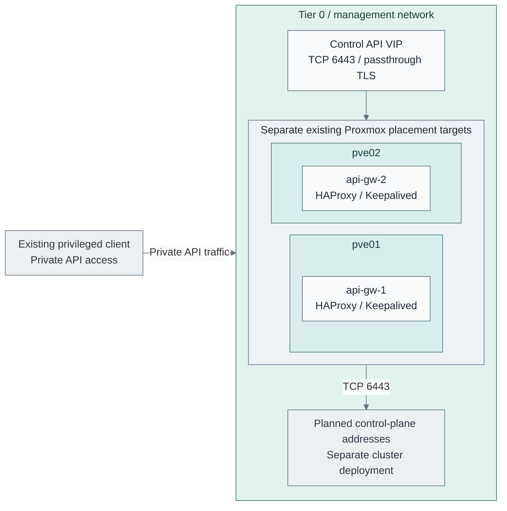

# Private Kubernetes API endpoint

**Working repository:** `<prefix>-tier-0` (source: `tier-0/`). Configure this
endpoint before bootstrapping its consuming cluster. An existing independent
private TCP load balancer is also valid when it meets the same gates.

The supplied `cluster-endpoint` setup provisions two independent Tier 0 Linux
VMs and installs distribution HAProxy and Keepalived outside Kubernetes. Each configured
cluster gets a private VIP forwarding TCP 6443 to its control-plane addresses.
TLS passes through to Kubernetes; the gateways hold no cluster certificates,
Talos credentials or higher-tier state. TCP checks remove unreachable backends;
they do not prove API readiness or etcd quorum. [1][2]

## Contents

- [Prerequisites and site gates](#prerequisites-and-site-gates)
- [Configure local inputs](#configure-local-inputs)
- [Install the endpoint](#install-the-endpoint)
- [Verify and hand over](#verify-and-hand-over)
- [Maintenance and recovery](#maintenance-and-recovery)
- [References](#references)

## Prerequisites and site gates



**IaC:** [gateway VM inputs](../../../../tier-0/terraform/deployments/cluster-endpoint/terraform.tfvars.example)
create `api-gw-1` and `api-gw-2`; [endpoint inputs](../../../../tier-0/ansible/group_vars/cluster_endpoint.yml.example)
and the [recipe](../../../../tier-0/ansible/playbooks/deployment/cluster-endpoint.yml) install the two native proxies
and one selected VIP. Existing hypervisors and planned cluster addresses are context, not created
by the endpoint role. Only one gateway owns this VIP at a time; both run HAProxy. Its VM pair does
not establish fencing, storage independence or a healthy Kubernetes quorum.

Prepare two physical placement targets, an approved Enterprise Linux template,
storage, Proxmox API access and a private subnet before running the setup. The
reference provisions `api-gw-1` and `api-gw-2` on separate Proxmox hosts with fixed
addresses `10.10.10.60` and `10.10.10.61`; the control-cluster VIP is `10.10.10.62`.
These addresses are separate from the supplied logging and runner examples.
Replace them with reviewed site reservations. Retain the pair's original Tier 0
provisioning inputs and independent state for recovery.

An approved existing pair remains an alternative: run the Ansible recipe directly
and keep its original resource/state owner. Do not create a new Terraform state
for existing VMs without a deliberate adoption plan.

| Gate | Required before setting the approval inputs |
| --- | --- |
| Fault domains | Place gateways on different physical hosts; qualify storage, power and switch dependencies. Record real failure domains and maintain anti-affinity after Proxmox HA moves. Two VM names alone do not establish independence. |
| Private subnet | Reserve VIPs outside DHCP, including one unique VRID per endpoint on that L2 segment. Verify the configured interface exists on both hosts. Unicast VRRP does not make a VIP portable across routed subnets. |
| VRRP and VIP movement | Permit IP protocol **112**, not TCP/UDP port 112, between only the two gateway IPs. Permit VIP address use and gratuitous ARP on guests, hypervisors and switches. Test for duplicate ownership under link/peer failure. [3] |
| Client access | Permit only the selected cluster's nodes and authorized administrators/automation to its VIP on TCP 6443. Deny WAN, public edge and other tiers' access by default. Each tier has a separate VIP and ACL. |
| Backend access | Permit both gateway source IPs to the declared control-plane IPs on TCP 6443, including return routes. HAProxy opens backend connections as the gateway; Kubernetes sees that source address, while API authentication remains end to end. |
| OS policy | Use an approved Enterprise Linux image with systemd. The role enables the native `haproxy_connect_any` SELinux boolean when SELinux is enabled; keep enforcement enabled. This domain-wide permission does not replace narrowly scoped host/gateway rules for clients, peers and backends. [8] |
| Bootstrap/recovery | Keep DNS, package access, time, SSH/sudo and the execution host available without any Kubernetes cluster, hosted SSO, Vault, Tier 1 or Tier 2 service. Use approved offline packages or independent intake where needed. |

An isolated gateway can retain its service process while losing a client or
backend route. The supplied process check does not detect every asymmetric
network failure. Qualify that failure envelope and any shared storage/network
dependencies before accepting availability. VRRP peer partition can produce two
VIP owners; this pair is not a quorum or fencing implementation.

Install the common and Tier 0 Ansible requirements as described in
[local tooling](../../../development/local-setup.md). This role uses the existing
`ansible.posix` collection for sysctl, and `ansible.utils` with controller-side
`netaddr` for address validation. [4]

## Configure local inputs

| Owned input or implementation | Action |
| --- | --- |
| [Tier 0 inventory](../../../../tier-0/ansible/inventory/hosts.yml.example) | Keep exactly two approved gateway hosts in `cluster_endpoint`; keep them in `guests` for baseline operations. Never place Talos nodes in this group. |
| [Endpoint inputs](../../../../tier-0/ansible/group_vars/cluster_endpoint.yml.example) | Copy to `ansible/group_vars/cluster_endpoint.yml`; replace host IPs, interface, failure-domain labels, VIPs and backend addresses. |
| [Gateway hardware](../../../../tier-0/terraform/deployments/cluster-endpoint/terraform.tfvars.example) | Copy to `terraform/deployments/cluster-endpoint/terraform.tfvars`; select distinct initial hosts, unused VMIDs, sizing, storage and the private attachment. |
| [Terraform root](../../../../tier-0/terraform/deployments/cluster-endpoint/) | Composes Tier 0 `environment_guests` and `vm` modules using native inventory/IP inputs; owns only the two gateway VMs. |
| `ansible/group_vars/all.yml` | Use the existing Tier 0 environment identity and SSH settings. |
| [Endpoint role](../../../../tier-0/ansible/roles/cluster_endpoint/) | Owns the TCP proxy and input gates; calls Shared package, sysctl and Keepalived fragments. |
| [Deployment recipe](../../../../tier-0/ansible/playbooks/deployment/cluster-endpoint.yml) | Validates both hosts, then applies the baseline and endpoint serially. |

Set `cluster_endpoint_fault_domains_validated: true` and
`cluster_endpoint_network_gates_validated: true` only after satisfying the site
gates. These are operator attestations, not probes of physical placement or ACLs.
The role rejects duplicate gateway addresses/failure domains, invalid or public
VIPs/backends, colliding VIPs/VRIDs, and extra endpoint configuration fields.

Start with the `control` endpoint, `tier: 0`, using the reserved Tier 0
control-plane IPs. Set an independently resolvable DNS record such as
`kubernetes.control.example.com` to this VIP. Set the consuming cluster's
`cluster.endpoint` to `https://kubernetes.control.example.com:6443`; keep the
certificate SANs and kubeconfig server name consistent with it. [1]

Later, the same Tier 0 gateway pair may serve `tier: 1` or `tier: 2` endpoints.
Add one entry per tier with a distinct name, VIP and VRID, and that cluster's
approved control-plane address map. Obtain those addresses from reviewed local
inputs or an approved exported address list. Keep them under `control_planes`,
not Tier 0's `platform_host_ips`; no cross-tier inventory or remote-state import
is required. Approve each new tier's network rules before applying. A higher-tier
cluster being absent or unhealthy must not affect the Tier 0 endpoint.

Do not use the public Tier 2 edge role, an in-cluster Service, ingress, GitOps or
a later hosted service for this endpoint. There is **no Talos API TCP 50000 VIP**:
keep direct node addresses in `talosconfig` for bootstrap and recovery.

## Install the endpoint

For an existing collection, first review/register the new `cluster-endpoint`
setup under the [setup ownership contract](../../../development/generated-repositories.md#setup-ownership).

From the generated Tier 0 repository root, initialize the local files:

```bash
bash scripts/init-local-files.sh --setup cluster-endpoint
```

Review the inputs above, `.env.local`, `terraform/common.tfvars` and the approved
shared platform/image catalogs. The default hardware uses VMIDs 270/271, local
storage and the Tier 0 `management` attachment. Initial placement on separate
hosts is enforced; Proxmox owns subsequent moves, so qualify ongoing anti-affinity
and shared storage/power dependencies separately.

```bash
bash scripts/deploy.sh cluster-endpoint --plan-only
```

Review the saved plan, which must create only the gateway pair, then apply that
exact plan and configure the hosts:

```bash
bash scripts/deploy.sh cluster-endpoint
```

The helper selects this root's isolated state at
`.terraform/state/cluster-endpoint/prod/terraform.tfstate` for the base environment.
Retain that state and the original inputs outside the clusters. The root requires
exact correspondence with the Tier 0 `cluster_endpoint` inventory group, static
addresses on one selected network, and distinct explicit initial Proxmox hosts.
It has no cross-tier state or cluster-provider dependency.

For an approved **existing** pair, use only Ansible with its original provisioning
owner and state:

```bash
export ANSIBLE_CONFIG="$PWD/ansible/ansible.cfg"
ansible-playbook -i ansible/inventory/hosts.yml \
  ansible/playbooks/deployment/cluster-endpoint.yml \
  -e @ansible/group_vars/all.yml -e @ansible/group_vars/cluster_endpoint.yml
```

Supply environment overlays last with additional `-e @...` arguments when used;
the setup helper accepts the normal `--env` option for newly provisioned pairs.
The playbook validates inputs before baseline changes, installs HAProxy and
Keepalived, permits nonlocal IPv4 binding on the standby, and configures one
unicast VRRP instance per VIP. Both peers start as BACKUP; Shared assigns distinct
priorities. Keepalived withdraws VIP ownership after repeated HAProxy service
failures. [3]

HAProxy's native `-c -f` check validates its candidate before replacement.
Scoped Ansible `module_defaults` adds Keepalived's native `--config-test -f`
validation to Shared's existing template task. Failed candidate validation
prevents replacement and service notification. Only changed configurations
reload HAProxy or restart Keepalived. [5][6][7]

Before Kubernetes starts, the proxy can have no healthy backends. This is an
expected bootstrap state, not permission to bypass the independent endpoint.
Proceed to [cluster installation](talos-terraform.md#configure) once both gateways,
VIP ownership, DNS and network gates are ready. API readiness is a post-bootstrap
acceptance check.

## Verify and hand over

Run parser checks on both gateways after installation:

```bash
sudo haproxy -c -f /etc/haproxy/haproxy.cfg
sudo keepalived --config-test -f /etc/keepalived/keepalived.conf
```

After bootstrapping the cluster, from its authorized administration host using
the owning tier's protected kubeconfig:

```bash
kubectl get --raw='/readyz?verbose'
kubectl get nodes -o wide
```

| Acceptance exercise | Required result |
| --- | --- |
| Normal operation | DNS resolves independently to the intended VIP; exactly one peer owns each VIP; authenticated API access succeeds with TLS verification. |
| Gateway service loss | Stop HAProxy on the active peer during an approved test; VIP moves to the other peer and new authenticated requests recover. Restore HAProxy afterward. |
| Gateway/physical host loss | Remove the active gateway or its physical host; measure request recovery, VIP ownership and unaffected peer capacity. Established TCP sessions may break; clients must reconnect. |
| Backend loss | Stop one control-plane API; TCP checks remove it, remaining healthy control planes serve requests, and quorum/application readiness is verified separately. |
| Isolation | Prove denied access from unauthorized networks, including attempts to another tier's VIP. Keep Talos 50000 access direct and separately restricted. |
| Independence | Make Tier 1 and Tier 2 services unavailable; Tier 0 DNS, gateway administration, endpoint and recovery path still work. Test each configured endpoint separately. |
| Repeat convergence | Re-run the recipe with unchanged approved inputs; configuration tasks report no changes. Record exact OS package versions and approved repository snapshot with the result. |

Offline regression checks run from this upstream root:

```bash
python3 -B -m unittest discover -s tests -p 'test_tier_cluster_endpoint.py' -v
```

Native tests require Linux/WSL with Ansible and the existing collections. Optional
`HOMELAB_HAPROXY` and `HOMELAB_KEEPALIVED` select approved validator binaries;
otherwise tests use tools on PATH and explicitly skip missing validators. These
tests cover deterministic configuration and input rejection, not live failover.
Use the [release evidence boundary](../../../development/testing.md#evidence-boundary)
and retain actual fault, denied-access and recovery results separately.

## Maintenance and recovery

Back up reviewed inventory, endpoint inputs, package/repository snapshot and
the pair's provisioning inputs outside the clusters. Rebuild one gateway at a
time, retain the VIP/DNS contract, and verify the other peer before maintenance.
Changing `control_planes` requires review against the owning tier's current
reserved addresses; no discovery or automatic synchronization is supplied.

Removing an endpoint removes its VIP and listener on subsequent convergence.
Move consuming clients first. Review this choice when adding a cluster tier,
changing networks or failure domains, or requiring failure detection beyond a
local HAProxy process check. A native Talos VIP is a separate topology choice;
it does not implement this recipe's independent gateway contract. Adopt it only
with a separately reviewed bootstrap and recovery procedure.

## References

Official documentation checked 2026-10-26.

1. [Kubernetes API load-balancer contract](https://kubernetes.io/docs/setup/production-environment/tools/kubeadm/high-availability/).
2. [HAProxy TCP mode](https://www.haproxy.com/documentation/haproxy-configuration-tutorials/protocol-support/tcp/)
   and [TCP health checks](https://www.haproxy.com/documentation/haproxy-configuration-tutorials/reliability/health-checks/).
3. [Keepalived configuration: unicast VRRP, tracking scripts and VIPs](https://www.keepalived.org/documentation/keepalived-conf/).
4. [Ansible address filters and controller requirements](https://docs.ansible.com/projects/ansible/latest/collections/ansible/utils/docsite/filters_ipaddr.html).
5. [Ansible template validation](https://docs.ansible.com/projects/ansible/latest/collections/ansible/builtin/template_module.html).
6. [Ansible module defaults and included roles](https://docs.ansible.com/projects/ansible/latest/playbook_guide/playbooks_module_defaults.html).
7. [Keepalived command-line configuration test](https://github.com/acassen/keepalived/blob/master/doc/man/man8/keepalived.8.in)
   and [HAProxy configuration checks](https://www.haproxy.com/documentation/haproxy-configuration-manual/new/latest/management/).
8. [Red Hat HAProxy SELinux configuration](https://docs.redhat.com/en/documentation/red_hat_satellite/6.18/html/configuring_capsules_with_a_load_balancer/installing-and-configuring-the-load-balancer)
   and [Ansible persistent SELinux booleans](https://docs.ansible.com/projects/ansible/latest/collections/ansible/posix/seboolean_module.html).
