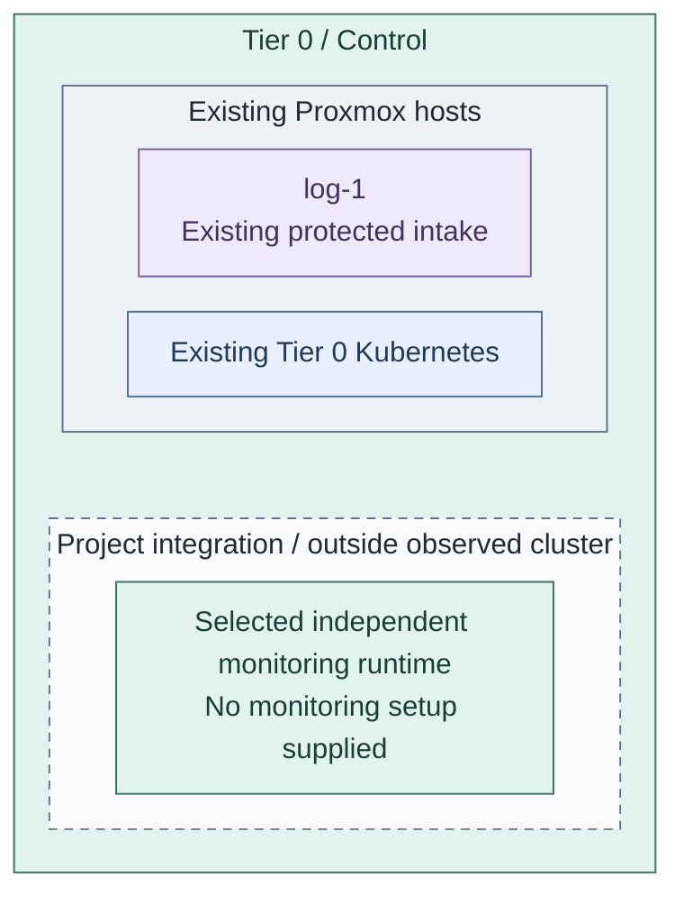
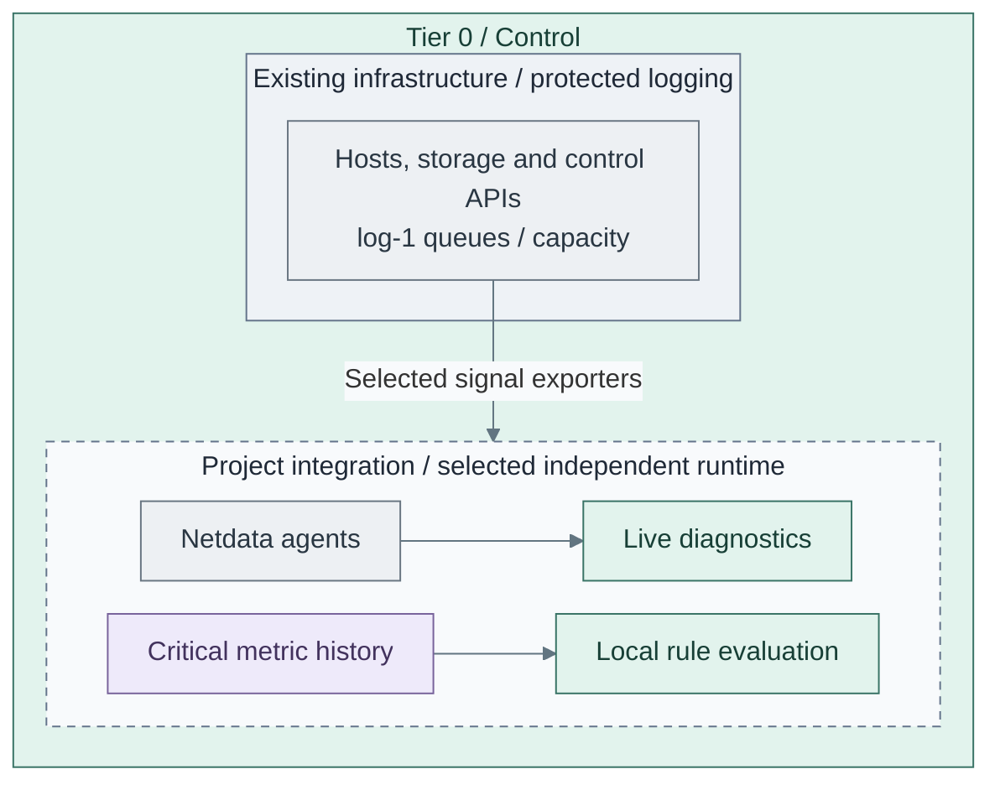
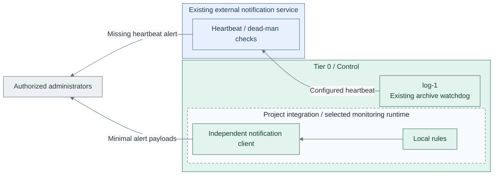

# Independent foundation monitoring

Add critical health history, diagnostics, rule evaluation and alerts to the existing
protected logging capability. This is the monitoring deployment in Stage 4, not a
prerequisite for the earlier collector.

**Working repository:** `<prefix>-tier-0` (source: `tier-0/`).
**Prerequisites:** accepted [protected logging](../stage-1-logging/README.md), approved
runtime/storage and independent recovery inputs. Tier 1 Observability is not required.
**Design:** [telemetry composition](../../architecture/operations/telemetry.md).

## Main path

1. [Prepare the monitoring runtime](#step-1-prepare-the-monitoring-runtime)
2. [Add critical health and history](#step-2-add-critical-health-and-history)
3. [Enable and verify independent alerts](#step-3-enable-and-verify-independent-alerts)

The repository supplies VM foundations and cluster starters, not a monitoring-stack
installer. Product configuration/manifests and their execution recipe remain project-owned.

## Step 1: Prepare the monitoring runtime

**Integration:** Tier 0 [existing log-host inputs](../../../tier-0/terraform/deployments/syslog/terraform.tfvars.example)
and [cluster starters](../../../tier-0/clusters/tier0/kustomization.yaml) provide context only.
No additional monitoring VM or product is created by these entry points; select and implement its runtime.

1. Select an existing independent host or provision reviewed Tier 0 capacity.
   Reuse the log VM only after evaluating capacity and the shared failure domain;
   it does not independently detect its own complete host loss.
2. Keep required cluster-outage detection outside that cluster. Cluster manifests
   may add internal monitoring, but cannot replace the external detector.
3. Record placement, local access, storage/backups and signal ownership. If changing
   existing `syslog` VM capacity, review `bash scripts/deploy.sh syslog --plan-only`
   before applying; there is no separate supplied `monitoring` setup.

**Result:** a selected runtime that remains available during the required cluster outage.

## Step 2: Add critical health and history

**Integration:** Tier 0 [cluster starters](../../../tier-0/clusters/tier0/kustomization.yaml)
contain no installer for the dashed agents, diagnostics or metric services.
Supply project roles/manifests for the selected independent runtime; the existing receiver recipe installs none of them.

1. Select a small dataset: host/storage/network health, source coverage, receiver queues,
   evidence writes/replication, capacity, certificate expiry and cluster/API availability.
2. Add supported agents and the selected metric/history/evaluation components using
   project-owned automation. Reference examples are Netdata, VictoriaMetrics and vmalert.
   These functions may share a host; no VM per function is required.
3. Verify sample signals, local reader scopes and retained history. Netdata streaming
   is a separate integration from OpenTelemetry pipelines; do not imply automatic forwarding.

**Result:** foundation diagnostics and critical history are usable without Tier 1 search.

## Step 3: Enable and verify independent alerts

**Integration:** implement monitoring rules/routing separately.
The existing Tier 0 [archive job](../../../tier-0/ansible/playbooks/deployment/logging-archive.yml)
can call its configured external watchdog, but does not install that external service or the dashed rule engine.
The protected runtime stays on the right; heartbeat and alert traffic travels left
through the external service to administrators outside that service boundary.

1. Configure local evaluation and notification routing, such as Alertmanager, with
   independent credentials and an approved external notification path. Keep alert payloads
   minimal; notifications do not grant external access to sensitive raw logs.
2. Test cluster/API failure, missing source, stalled evidence writes, capacity thresholds
   and loss of the monitoring host. The external heartbeat detects failure of the local detector.
3. Repeat required checks without Tier 1, hosted source control, normal SSO or secret services.
   Record delivery, silence/acknowledgement authority, recovery and remaining blind spots.

**Result:** required foundation failures produce independently delivered alerts.

## IaC locations

| Repository | Path inside that repository | Coverage |
| --- | --- | --- |
| Tier 0 | [terraform/deployments/syslog/](../../../tier-0/terraform/deployments/syslog/) | Existing independent log-host resources; reuse does not install monitoring |
| Tier 0 | [clusters/tier0/](../../../tier-0/clusters/tier0/) | Project cluster manifests; no monitoring installer |
| Tier 0 | [ansible/playbooks/deployment/foundation-logging.yml](../../../tier-0/ansible/playbooks/deployment/foundation-logging.yml) | Existing baseline and log receiver; monitoring product roles/recipes must be added explicitly |
| Shared | [ansible/roles/baseline/](../../../shared/ansible/roles/baseline/) | Common OS preparation, not inventory, state or alert authority |

Return to [Stage 4 acceptance](README.md#capability-available). Later
[Tier 1 Observability](../stage-6-observability/README.md) adds shared diagnosis without
taking ownership of foundation alerts or protected evidence.
