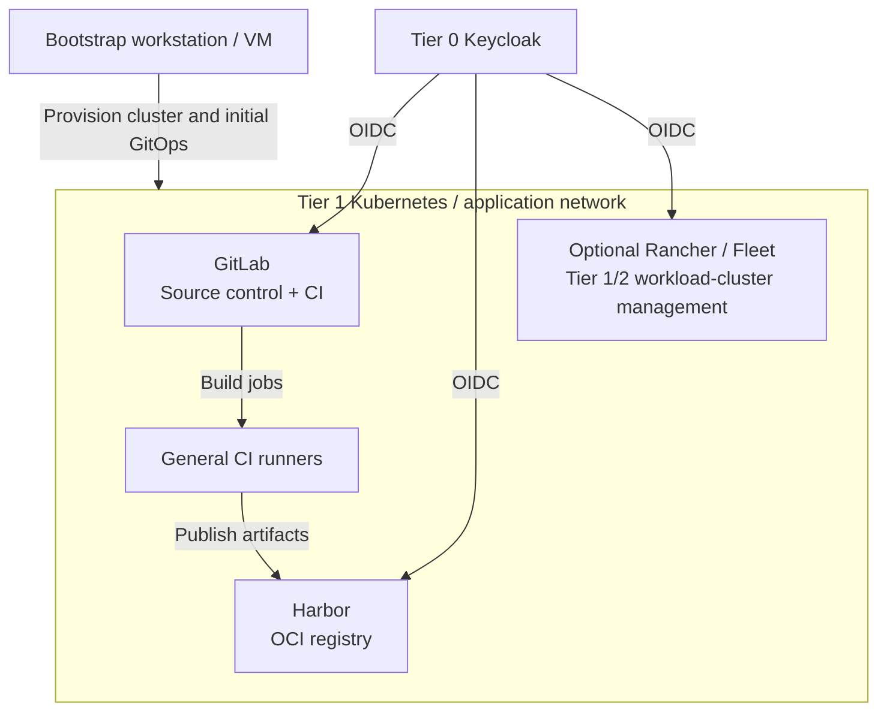
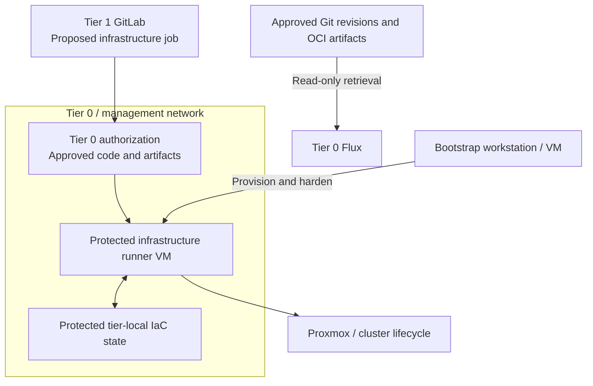

# Stage 5: Delivery and handover

Provide shared source control, artifact supply and build execution, then hand routine
infrastructure work to a separate protected Tier 0 runner. Delivery coordinates changes;
it does not gain authority over Tier 0 merely by hosting the repositories.

**Prerequisites:** accepted [control services](../stage-4-control-services/README.md),
approved templates, tier-local inputs and an independent bootstrap/recovery environment.
**Owners:** Tier 1 delivery services; Tier 0 privileged infrastructure execution.

## Main path

1. [Deploy shared delivery services](#step-1-deploy-shared-delivery-services)
2. [Enable protected execution](#step-2-enable-protected-execution)

## Step 1: Deploy shared delivery services

The bootstrap environment creates the Tier 1 Kubernetes cluster. Its GitOps controller
deploys source control, a registry, general runners and optional workload-cluster management.

1. Create the [Tier 1 runtime](procedures/platform-cluster.md), reusing the common
   Kubernetes procedure with Tier 1 inventory, credentials and state.
2. Deploy GitLab, [Harbor or another registry](procedures/registry.md), general runners
   and Rancher/Fleet where needed. Product manifests and integration remain project work.
3. Configure Keycloak OIDC, scoped roles and [approved edge access](procedures/edge-proxy.md).
   Test repository retrieval, artifact publication/pulls and general CI jobs.

**Alternatives:** [1b: source-control VM](step-1b-source-control-vm.md),
[1c: Podman build runner](step-1c-podman-runner.md) and
[1d: image-based Linux](step-1d-image-based-linux.md) change the selected runtime.
Existing delivery services are valid when they meet the same interfaces.

**Result:** the [delivery interfaces](../../architecture/delivery/README.md) supply code,
artifacts and normal builds. General runners still have no Tier 0 credentials.

## Step 2: Enable protected execution

Provision a hardened infrastructure runner as a Tier 0 management VM, outside the
Tier 1 cluster. The bootstrap workstation remains available for independent recovery.

1. Implement the [protected execution policy](../../architecture/compute/provisioning.md)
   and scope credentials to approved operations. General-runner automation is not a
   protected-runner installer. A protected GitLab branch is not sufficient authorization.
2. Test an authorized change and a rejected job. Keep one writer per state root;
   explicitly migrate and test recovery if the state backend changes.
3. Transfer routine execution and approved GitOps source consumption. Retain independent
   copies of code, images, state and recovery credentials; verify recovery while GitLab,
   Harbor and normal identity login are unavailable.

**Result:** routine infrastructure changes use the protected runner under Tier 0 authority.
Source control coordinates them, while GitOps separately reconciles approved applications.

## Capability available

The delivery and execution portions of the
[reference platform](../../architecture/reference-platform.md#access-and-automation)
are operational. Execution has moved from the workstation; resource and state ownership
have not moved between tiers. Continue with
[Stage 6: Workload provisioning](../stage-6-workloads/README.md).
