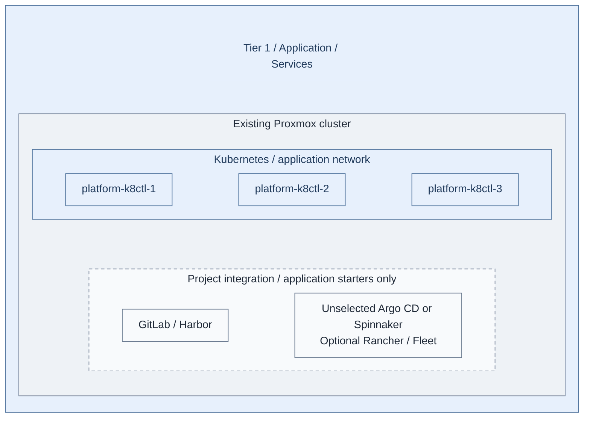
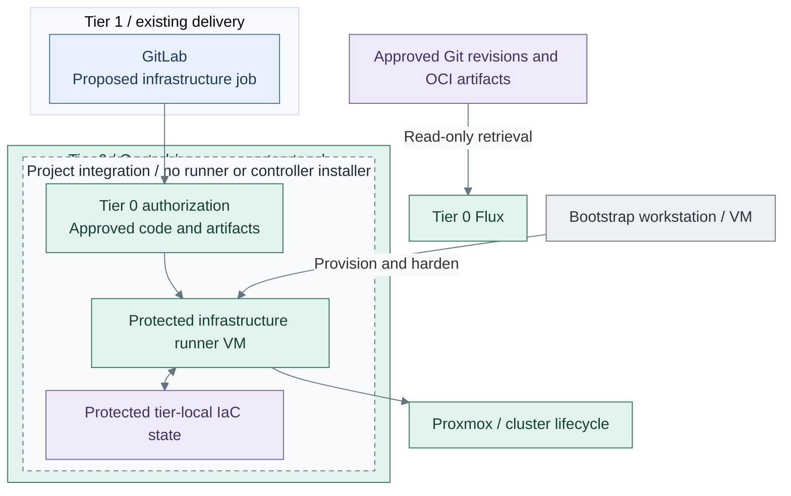

# Stage 5: Delivery and handover

Provide shared source control, artifact supply and build execution, then hand routine
infrastructure work to a separate protected Tier 0 runner. Delivery coordinates changes;
it does not gain authority over Tier 0 merely by hosting the repositories.

**Prerequisites:** accepted [control services](../stage-4-control-services/README.md),
approved templates, tier-local inputs and an independent bootstrap/recovery environment.
**Owners:** Tier 1 delivery services; Tier 2 public edge; Tier 0 privileged infrastructure execution.

## Working repositories

| Work | Repository | IaC location inside that repository |
| --- | --- | --- |
| Platform cluster and applications | `<prefix>-tier-1` | [terraform/deployments/kubernetes/](../../../tier-1/terraform/deployments/kubernetes/) and [clusters/tier1/](../../../tier-1/clusters/tier1/) |
| Source-control VM and general runners | `<prefix>-tier-1` | [terraform/deployments/](../../../tier-1/terraform/deployments/) and [ansible/playbooks/deployment/](../../../tier-1/ansible/playbooks/deployment/) |
| Public edge | `<prefix>-tier-2` | [terraform/deployments/edge/](../../../tier-2/terraform/deployments/edge/) and [ansible/playbooks/deployment/edge-proxy.yml](../../../tier-2/ansible/playbooks/deployment/edge-proxy.yml) |
| Image builders | `<prefix>-tier-0` | [terraform/deployments/immutable-template/](../../../tier-0/terraform/deployments/immutable-template/) |
| Protected runner and authorization | `<prefix>-tier-0` | Project integration; no complete runner/controller installer is supplied |

Run each procedure from its named repository root. Shared supplies reusable execution
code, not delivery-service inventory or infrastructure state; see [repository locations](../README.md#repository-locations).

## Main path

1. [Deploy shared delivery services](#step-1-deploy-shared-delivery-services)
2. [Enable protected execution](#step-2-enable-protected-execution)
3. [Deploy shared investigation](#step-3-deploy-shared-investigation)

## Step 1: Deploy shared delivery services

The bootstrap environment creates the independent Tier 1 Kubernetes cluster.
The selected delivery platform deploys shared applications; Tier 0 remains on Flux.
Choose Argo CD application GitOps or Spinnaker release pipelines before enabling delivery.

**IaC:** Tier 1 [cluster inputs](../../../tier-1/terraform/deployments/kubernetes/terraform.tfvars.example)
and [cluster entry point](../../../tier-1/scripts/kubernetes-cluster.sh).
The [Tier 1 application starters](../../../tier-1/clusters/tier1/platform/kustomization.yaml)
do not install the dashed group. General runners and mirrors require a selected option or project implementation.
The [Tier 2 edge view](procedures/edge-proxy.md#default-deployment) shows the separate public-entry deployment.

1. Create the [Tier 1 runtime](procedures/platform-cluster.md), using
   `bash scripts/kubernetes-cluster.sh init` from its root. Review its own inventory,
   credentials and state. Select the [delivery option](procedures/platform-cluster.md#delivery-selection)
   and retain independent bootstrap sources before hosted source control exists.
2. Deploy GitLab, [Harbor or another registry](procedures/registry.md), general runners
   and Rancher/Fleet where needed. Product manifests and integration remain project work.
3. Configure Keycloak OIDC, scoped roles and [Tier 2 edge access](procedures/edge-proxy.md).
   Test repository retrieval, artifact publication/pulls and general CI jobs.

**Alternatives:** [1b: source-control VM](step-1b-source-control-vm.md),
[1c: Podman build runner](step-1c-podman-runner.md) and
[1d: image-based Linux](step-1d-image-based-linux.md) change the selected runtime.
Existing delivery services are valid when they meet the same interfaces.

**Result:** the [delivery interfaces](../../architecture/delivery/README.md) supply code,
artifacts and normal builds. General runners still have no Tier 0 credentials.

## Step 2: Enable protected execution

Provision a hardened infrastructure runner as a Tier 0 management VM, outside the
Tier 1 cluster. The bootstrap workstation remains available for independent recovery.

**Integration:** implement the Tier 0 [protected execution contract](../../architecture/compute/provisioning.md).
The existing [Shared executor](../../../shared/scripts/deploy.sh) runs reviewed tier-local code;
it does not deploy the dashed runner/controller group or its authorization policy.

1. Implement the [protected execution policy](../../architecture/compute/provisioning.md)
   and scope credentials to approved operations. General-runner automation is not a
   protected-runner installer. A protected GitLab branch is not sufficient authorization.
2. Test an authorized change and a rejected job. Keep one writer per state root;
   explicitly migrate and test recovery if the state backend changes.
3. Transfer routine execution and approved GitOps source consumption. Retain independent
   copies of code, images, state and recovery credentials; verify recovery while GitLab,
   Harbor and normal identity login are unavailable.

**Result:** routine infrastructure changes use the protected runner under Tier 0 authority.
Source control coordinates them, while GitOps separately reconciles approved applications.

## Step 3: Deploy shared investigation

Follow the [analytics deployment](analytics.md): prepare the selected runtime,
deploy scoped ingestion/backends, then publish and verify read-only views.
Its diagrams show how Tier 1 adds searchable copies and shared metric history
without taking custody of Tier 0 evidence or foundation alerts.

This capability can be deployed once the Step 1 platform is ready; it does not
have to wait for protected-runner handover when those dependencies are already verified.

## Capability available

The delivery and execution portions of the
[reference platform](../../architecture/reference-platform.md#access-and-automation)
are operational. Execution has moved from the workstation; resource and state ownership
have not moved between tiers. Continue with
[Stage 6: Workload provisioning](../stage-6-workloads/README.md).
