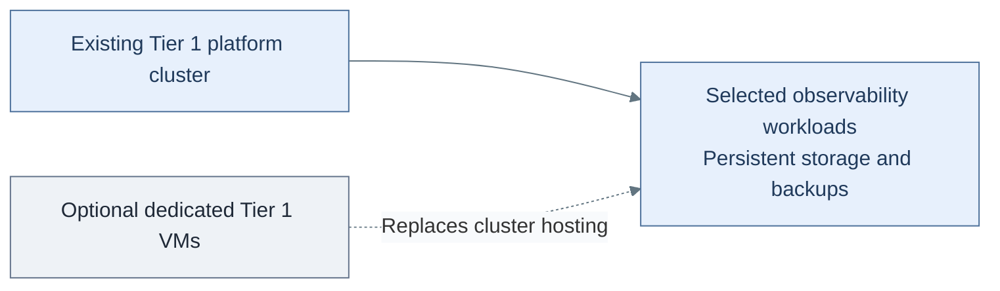
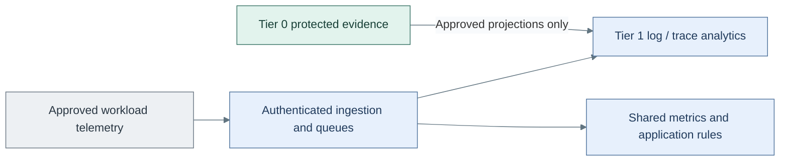
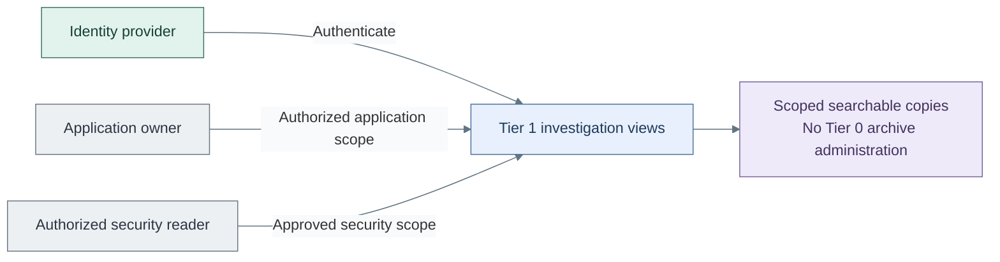

# Shared observability and investigation

Add Tier 1 search, dashboards, shared metric history and application investigation.
Tier 0 evidence and critical alerts already work independently; this deployment
publishes approved copies rather than moving their authority.

**Working repository:** `<prefix>-tier-1` (source: `tier-1/`).
**Prerequisites:** accepted platform runtime, [protected logging](../stage-1-logging/README.md),
scoped ingestion identities, storage/backups and a selected delivery controller.
**Design:** [telemetry composition](../../architecture/operations/telemetry.md).

## Main path

1. [Prepare the investigation runtime](#step-1-prepare-the-investigation-runtime)
2. [Deploy scoped ingestion and backends](#step-2-deploy-scoped-ingestion-and-backends)
3. [Publish and verify read-only views](#step-3-publish-and-verify-read-only-views)

## Step 1: Prepare the investigation runtime

1. Reuse the [platform cluster](procedures/platform-cluster.md) and its selected delivery
   controller. Tier 0 remains on Flux; Tier 1 does not inherit it automatically.
2. Select cluster services, the [VM alternative](../stage-4-control-services/step-2d-telemetry-vm.md)
   or verified existing services. Do not create duplicate resources or state for an existing host.
3. Record placement, capacity, protected storage and restore procedures. Select supported
   releases before adding project manifests; these folders are starters, not installed products.

**Result:** the selected runtime is ready; no backend is installed merely by provisioning VMs.

## Step 2: Deploy scoped ingestion and backends

1. Deploy the selected backend/ingestion components through reviewed project manifests
   or product roles. The reference uses OpenSearch/Dashboards, supported Data Prepper
   log/trace pipelines and a separate metrics backend/evaluator.
2. Verify independent placement, quorum/replicas, supported schemas, persistent queues,
   capacity and snapshot/restore. A pod count or VM count alone does not establish HA.
3. Configure authenticated ownership routing and approved/redacted Tier 0 projections.
   Tier 1 downtime must never block Tier 0 intake. Keep platform/application alert ownership
   explicit, including duplicate suppression and notification routing.

**Result:** approved telemetry reaches searchable copies and the selected shared backends.

## Step 3: Publish and verify read-only views

1. Configure federation, separately tested break-glass access, per-application and
   security scopes, and redaction before developer publication. Data permissions enforce
   isolation; dashboard tenant/saved-object settings alone are insufficient.
2. Deny direct update/delete, delete-by-query, index-management, retention and backup
   administration to query roles. Test forged labels, cross-application reads and direct APIs.
3. Test Tier 1/SSO outage, queue replay, backend restore and rebuilding approved copies
   without modifying Tier 0 originals. Record gaps and accepted operating limits.

An app owner receives an application-log view, not raw Tier 0 archive access.

## IaC locations

| Repository | Path inside that repository | Coverage |
| --- | --- | --- |
| Tier 1 | [clusters/tier1/platform/observability/](../../../tier-1/clusters/tier1/platform/observability/) | Empty starter until reviewed product manifests are supplied |
| Tier 1 | [terraform/deployments/observability/](../../../tier-1/terraform/deployments/observability/) | Optional VM resources, not backend/collector installers |
| Tier 1 | [ansible/playbooks/deployment/telemetry-hosts.yml](../../../tier-1/ansible/playbooks/deployment/telemetry-hosts.yml) | VM baseline only |

Do not automatically add a second Netdata parent or SigNoZ/ClickHouse stack.
Return to [Stage 5 acceptance](README.md#capability-available); connect each workload through
the [collection deployment](../stage-6-workloads/telemetry.md) as it appears.
