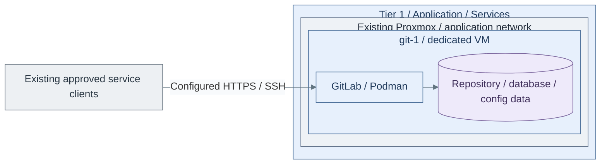

# Step 1b: Source control on a VM

**Working repository:** `<prefix>-tier-1` (source: `tier-1/`).
Run repository scripts from this root; paths below are repository-relative.

<a id="development-platform-path"></a>

**Branch from:** [Step 1](README.md#step-1-deploy-shared-delivery-services), instead of deploying source control in the Tier 1 cluster.
**Change:** Use the VM service deployment without changing runner authority.
**Return:** [Step 1](README.md#step-1-deploy-shared-delivery-services) to continue with delivery integration and runner handover.

**Design:** [delivery service variants](../../architecture/delivery/README.md).

## Table of contents

- [Purpose](#purpose)
- [Prerequisites](#prerequisites)
- [What this deploys](#what-this-deploys)
- [IaC used for this](#iac-used-for-this)
- [Configure the deployment](#configure-the-deployment)
- [Ports and DNS](#ports-and-dns)
- [Operations](#operations)
- [High availability direction](#high-availability-direction)
- [Read more](#read-more)
- [References](#references)

## Purpose

Use this path when the private cloud needs source control, CI/CD coordination,
and a starting point for internal software projects.

The reference implementation is GitLab on one dedicated Podman VM. This keeps
the first deployment simple and movable. Dedicated runners, Harbor, bootc image
builds, and Kubernetes build on top of this path later.

<a id="before-you-start"></a>

## Prerequisites

Have these in place first:

| Requirement | Why it matters |
| --- | --- |
| Identity foundation | GitLab should use the shared private-domain DNS name and later consume central identity. |
| PKI certificate | The default deployment expects HTTPS with a certificate from the shared PKI. |
| Linux template | Terraform clones the normal Linux cloud-init template. |
| Backup target | Repository and database data live on the VM and must be backed up before the platform matters. |

## What this deploys



**IaC:** Tier 1 [VM inputs](../../../tier-1/terraform/deployments/development/terraform.tfvars.example)
and [source-control recipe](../../../tier-1/ansible/playbooks/deployment/source-control-vm.yml).
This creates one service VM; runners, registry alternatives and public edge are separate deployments.

Default deployment:

| Role | Default host | Default count | Notes |
| --- | --- | --- | --- |
| development platform | `git-1` | `1` | Podman host running the GitLab container |

Default VM shape:

| Setting | Default |
| --- | --- |
| size | `xl` |
| disk | `200 GB` |
| storage class | `shared` |
| network zone | `application` |

This path does not deploy runners by default. Use the
[Podman image runner guide](step-1c-podman-runner.md) when build jobs should run away
from the GitLab host.

## IaC used for this

| Repository | Layer | Path inside that repository |
| --- | --- | --- |
| Tier 1 | Terraform setup | [terraform/deployments/development/](../../../tier-1/terraform/deployments/development/); local `terraform.tfvars` |
| Tier 1 | Ansible inventory | `ansible/inventory/hosts.yml` |
| Tier 1 | Ansible environment vars | `ansible/group_vars/all.yml` or `all.<env>.yml` |
| Tier 1 | Ansible setup vars | `ansible/group_vars/development.yml` |
| Tier 1 | Deployment recipe | [ansible/playbooks/deployment/source-control-vm.yml](../../../tier-1/ansible/playbooks/deployment/source-control-vm.yml) |
| Tier 1 | Service role | [ansible/roles/gitlab_container/](../../../tier-1/ansible/roles/gitlab_container/) |
| Shared | Host baseline | [ansible/roles/baseline/](../../../shared/ansible/roles/baseline/) |
| Shared | Execution helper | [scripts/deploy.sh](../../../shared/scripts/deploy.sh); called by Tier 1's `scripts/deploy.sh` |

## Configure the deployment

Initialize the selected test context from Tier 1:

```bash
bash scripts/init-local-files.sh --setup development --env test
```

Complete [environment isolation](../../reference/repository-scripts.md#environment-isolation)
before planning. Test and production require different VMIDs, IPs and service allocations.

For these `--env test` commands, create
`terraform/deployments/development/terraform.test.tfvars` from the initialized
`terraform.tfvars`, then set unused test VMIDs and the complete desired guest map.
The initializer does not create this Terraform overlay. Keep production allocations
in the base file; an overlay replaces a complete map rather than merging guest fields.

| Value | What to choose |
| --- | --- |
| `vm_instances.git-1.size` | keep `xl` unless this is a small test deployment |
| `vm_instances.git-1.disk_size_gb` | increase before storing important repositories |
| `vm_instances.git-1.storage_class` | use storage that matches the backup and restore plan |
| `vm_instances.git-1.network_zone_key` | normally `application` |

Edit `ansible/group_vars/development.test.yml`, including its `platform_host_ips`
and the settings below. The initializer copies the complete example into this test
file, which overrides `development.yml`; editing the base file alone does not change
those test values.

| Value | What to choose |
| --- | --- |
| `gitlab_container_image` | pin a GitLab image tag before production use |
| `gitlab_hostname` | the DNS name GitLab should present to users |
| `gitlab_external_url` | the final HTTPS URL for GitLab |
| `gitlab_tls_cert_src` | approved service certificate/chain on the deployment machine |
| `gitlab_tls_key_src` | matching service private key on the deployment machine, never a CA key |
| `gitlab_ssh_host_port` | host port used for Git over SSH, default `2222` |

Deploy a test environment first:

```bash
bash scripts/deploy.sh development --env test --plan-only
```

After reviewing the plan:

```bash
bash scripts/deploy.sh development --env test
```

For production, configure the base files with their own allocations, plan without
`--env`, then apply after review:

```bash
bash scripts/deploy.sh development --plan-only
```

Use `bash scripts/deploy.sh development` only after that review; omitting `--env`
selects production, not a promotion of the test state.

## Ports and DNS

Publish these ports to users or to the edge proxy, depending on the network
design:

| Port | Purpose |
| --- | --- |
| `80/tcp` | HTTP redirect and GitLab internal web handling |
| `443/tcp` | HTTPS web UI and Git over HTTPS |
| `2222/tcp` | Git over SSH, mapped to container port `22` |

Use the DNS name from `gitlab_external_url`. Do not use `localhost` as the
GitLab hostname.

## Operations

Persistent data is mounted under `gitlab_home`, default `/srv/gitlab`:

| Host path | Container path | Purpose |
| --- | --- | --- |
| `/srv/gitlab/config` | `/etc/gitlab` | GitLab configuration and TLS files |
| `/srv/gitlab/logs` | `/var/log/gitlab` | GitLab logs |
| `/srv/gitlab/data` | `/var/opt/gitlab` | repositories, database, uploads, and runtime data |

Maintenance notes:

- Back up `/srv/gitlab` before upgrades.
- Pin the GitLab image tag before production use.
- Keep runners on separate hosts when build workloads become noisy.
- Route logs and metrics into the system-control path when observability exists.

For the first login, retrieve the initial root password from the container:

```bash
sudo podman exec -it gitlab grep 'Password:' /etc/gitlab/initial_root_password
```

Store the new admin credential in the chosen secret-management path after
login. The initial password file is temporary.

## High availability direction

The first deployment is a single GitLab VM. Treat it as simple, early, and easy
to back up.

The HA direction is Kubernetes. Move there when the platform needs stronger
separation, dedicated scaling, and Kubernetes-native operations. Use the
GitLab Helm chart or operator path there instead of running the Docker image as
a single container.

Do not scale this by starting several independent GitLab containers. The later
Kubernetes path needs shared stateful services and the GitLab cloud-native
deployment model.

## Read more

- [Delivery stage](README.md#step-1-deploy-shared-delivery-services)
- [Podman image runner guide](step-1c-podman-runner.md)
- [Container registry path](procedures/registry.md)
- [Kubernetes platform path](procedures/platform-cluster.md)
- [Shared services model](../../architecture/service-boundaries.md)
- [Infrastructure automation layout](../../development/code-layout.md)
- [Repository scripts](../../reference/repository-scripts.md)

## References

1. [GitLab Docker installation](https://docs.gitlab.com/install/docker/installation/)
2. [GitLab Docker configuration](https://docs.gitlab.com/ee/install/docker/configuration.html)
3. [GitLab SSL configuration](https://docs.gitlab.com/omnibus/settings/ssl/)
4. [GitLab Helm chart installation](https://docs.gitlab.com/charts/installation/)
