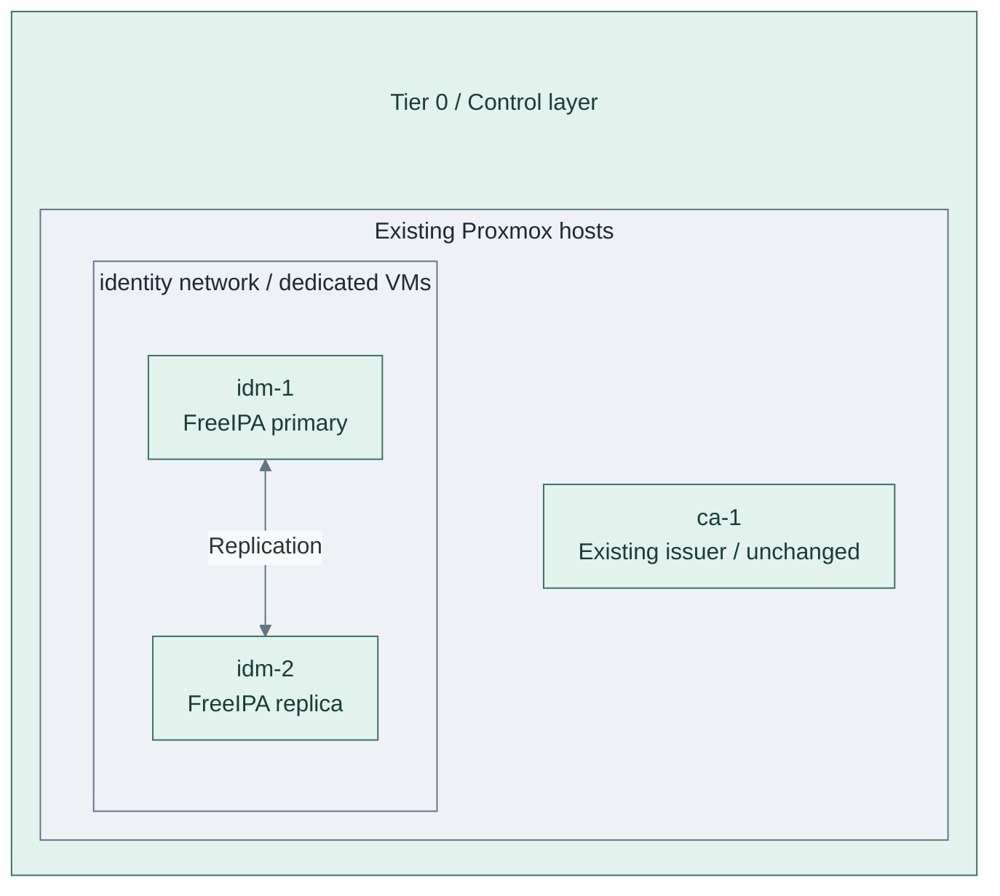
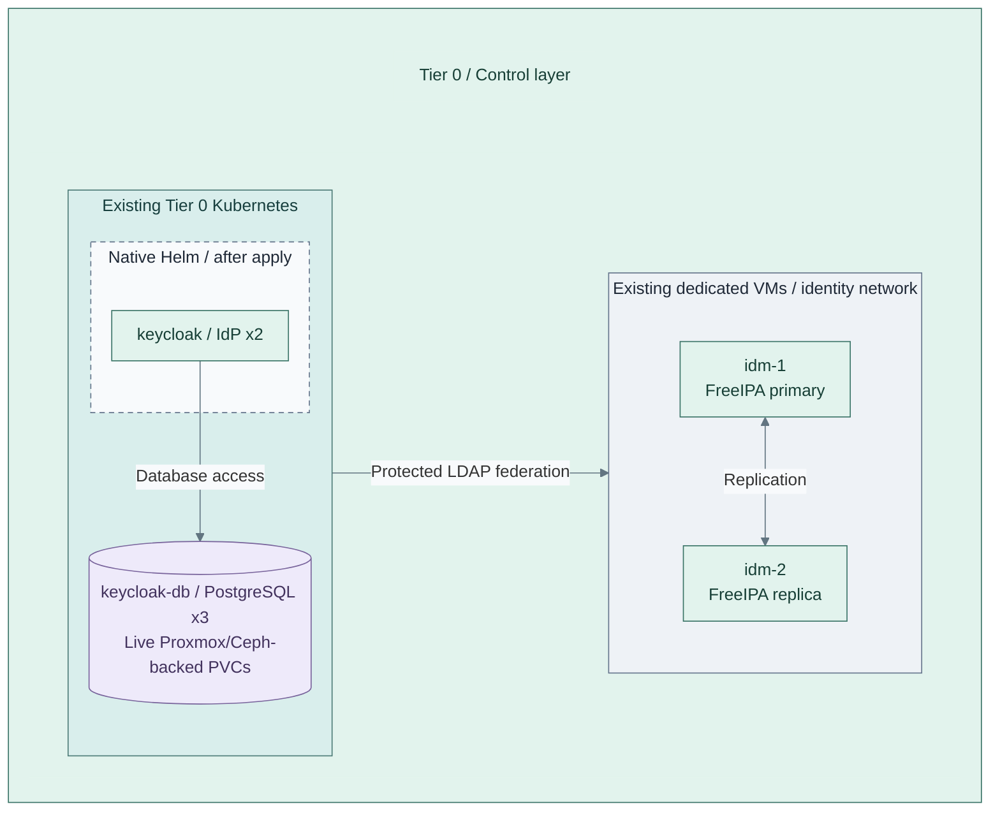

# Stage 5: Identity

Establish directory authority and federated service authentication. Ansible configures
FreeIPA on dedicated VMs; the accepted Tier 0 Kubernetes platform hosts the identity provider.

**Prerequisites:** accepted [Kubernetes platform](../stage-4-kubernetes/README.md),
approved compute/templates, certificate trust, software supply and independent credentials.
**Working repository:** `<prefix>-tier-0` (source: `tier-0/`).
**Automation:** the dedicated FreeIPA recipe and
[native Keycloak installer](procedures/keycloak.md) are supplied. Render, apply and
service acceptance are separate operations.
See [stage coverage](../../reference/implementation-support.md#stage-coverage) for
prerequisites, optional variants and live acceptance.
**Design:** [identity authority](../../architecture/identity/README.md) and
[cluster runtime](../../architecture/hosting/README.md).

The supplied API SSO rollout uses the **Terraform-owned Talos 1.13.x** reference from Stage 4.
A manual cluster needs its own qualified native SSO/recovery integration; the plan-based recipe
does not adopt it. Talos 1.14 remains outside this complete reference path until separately qualified.

## Main path

| Step | Detailed path | Rejoin |
| --- | --- | --- |
| 1: directory | [FreeIPA](procedures/freeipa.md), including its separate CA-signing pause | Step 2 after primary/replica acceptance |
| 2: federation | [Keycloak](procedures/keycloak.md), including database/backup preparation | Step 3 after federation works |
| 3: human access | [Kubernetes SSO](procedures/kubernetes-sso.md) and [service SSO contracts](procedures/service-sso.md) | Accept current identity clients; each later service connects SSO during its own installation |

1. [Deploy the directory pair](#step-1-deploy-the-directory-pair)
2. [Deploy identity federation](#step-2-deploy-identity-federation)
3. [Accept identity and human SSO](#step-3-accept-identity-and-human-sso)

Remain in the Tier 0 repository after Stage 4. The FreeIPA and Keycloak pages below
are the required installation steps, not optional variants. They use the existing
foundation state and control cluster; no new state or inventory owner is introduced.

## Step 1: Deploy the directory pair

**IaC:** Tier 0 [foundation inputs](../../../tier-0/terraform/deployments/foundation/terraform.tfvars.example) and
[directory recipe](../../../tier-0/ansible/playbooks/deployment/identity-freeipa.yml).
Directory VMs may already be allocated by Stage 3; retain the existing CA and all state.

1. Complete [FreeIPA Step 1](procedures/freeipa.md#step-1-configure-and-provision-the-pair):
   edit the existing foundation guest map, inventory and IPs, retain `ca-1`, and
   provision any missing directory VMs. Unchanged Stage 3 allocations remain in place.
2. Complete [FreeIPA Step 2](procedures/freeipa.md#step-2-generate-and-sign-the-identity-ca-request):
   select `external` / `csr`, supply the protected passwords, run the directory recipe
   and sign the public CSR in the separate authorized root ceremony.
3. Complete [FreeIPA Step 3](procedures/freeipa.md#step-3-complete-the-primary-and-replica):
   select `complete`, supply the approved certificate/chain paths and rerun the recipe.
   Verify both hosts' directory/DNS/CA replication before replacing bootstrap dependencies.

FreeIPA stays outside Kubernetes. Directory and cluster setup can proceed independently
once their prerequisites exist. Preserve independent administrative credentials.

## Step 2: Deploy identity federation

**IaC:** Tier 0 [control-application recipe](../../../tier-0/ansible/playbooks/deployment/control-applications.yml),
[product role](../../../tier-0/ansible/roles/control_applications) and
[example inputs](../../../tier-0/ansible/group_vars/control_applications.yml.example).
Scope: identity runtimes and directory authority, not the separate backup jobs/storage.
The picture shows configured placement, not a verified live installation.
The existing directory comes from the [FreeIPA recipe](../../../tier-0/ansible/playbooks/deployment/identity-freeipa.yml).
CNPG must be available before database creation. Backup destinations are separate
from its live volumes; the Barman plugin is required only for the object/WAL option.
The [backup realization](../../administration/backups/postgresql.md) identifies the
scheduled file jobs and NAS destinations omitted from this runtime view.

1. Complete [Keycloak Steps 1-2](procedures/keycloak.md#configure-and-install): copy the
   local inputs, edit the IdP/LDAPS/storage fields and supply the private certificates
   and credentials. Create the restricted FreeIPA LDAPS reader and qualify its TLS path first;
   the Keycloak recipe does not create that directory account. These inputs must not depend on later Vault.
2. Complete [Keycloak Step 3](procedures/keycloak.md#step-3-prepare-the-database-and-backup):
   prepare its database, then commission the selected backup destination. Live database
   volumes stay on the qualified Proxmox/Ceph block class; NAS is backup storage only.
3. Complete [Keycloak Step 4](procedures/keycloak.md#step-4-install-keycloak-and-federation):
   render, inspect and install Keycloak with FreeIPA federation, then return here for acceptance.

## Step 3: Accept identity and human SSO

Retain bootstrap credentials and test recovery without normal directory or IdP login.
1. Complete [Keycloak acceptance](procedures/keycloak.md#accept-and-recover), including
   permitted/denied logins, group removal, event delivery and independent restore.
2. Before enabling Headlamp, complete [Kubernetes API human SSO](procedures/kubernetes-sso.md)
   using its supported schema and serial rollout. Preserve X509/Talos recovery and
   prove certificate access during an issuer outage. Unsupported schemas require
   qualification; do not silently apply the 1.13 patch to 1.14. Accept the API using an independently
   prepared OIDC client for the `headlamp` audience; Headlamp's UI is installed and tested in Stage 6.
   If that client/token path is unavailable, record the API acceptance gap and keep Headlamp blocked;
   a healthy Keycloak alone does not satisfy its installation gate.
3. Apply the [service SSO gate](procedures/service-sso.md) to supported later consumers;
   register their OIDC clients with exact callbacks, scoped roles and independent emergency access.

Later stages register their service-specific clients against this identity provider;
they do not deploy another provider. The empty Flux application starter is not a
second reconciliation owner for the supplied Helm installation.

## Capability available

Review early administrative logins. Human SSO never replaces workload
identity, application authorization or independent recovery credentials.

**Result:** after the selected integrations and acceptance checks, replicated directory services,
a federated identity provider and the
existing Kubernetes platform realize the
[identity design](../../architecture/identity/README.md). Bootstrap and recovery
remain independent of normal Keycloak login, Vault, GitLab and Harbor.

Record directory, federation and backup checks. Continue with
[Stage 6: Secrets](../stage-6-secrets/README.md).
