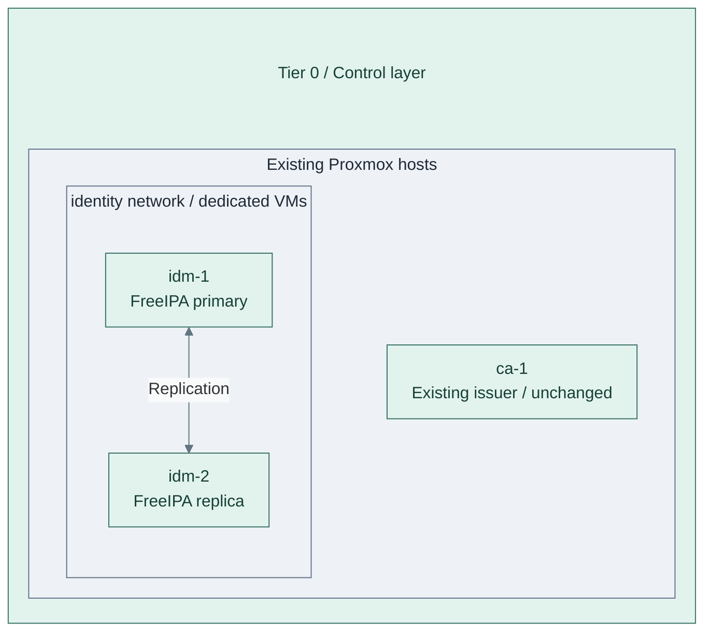
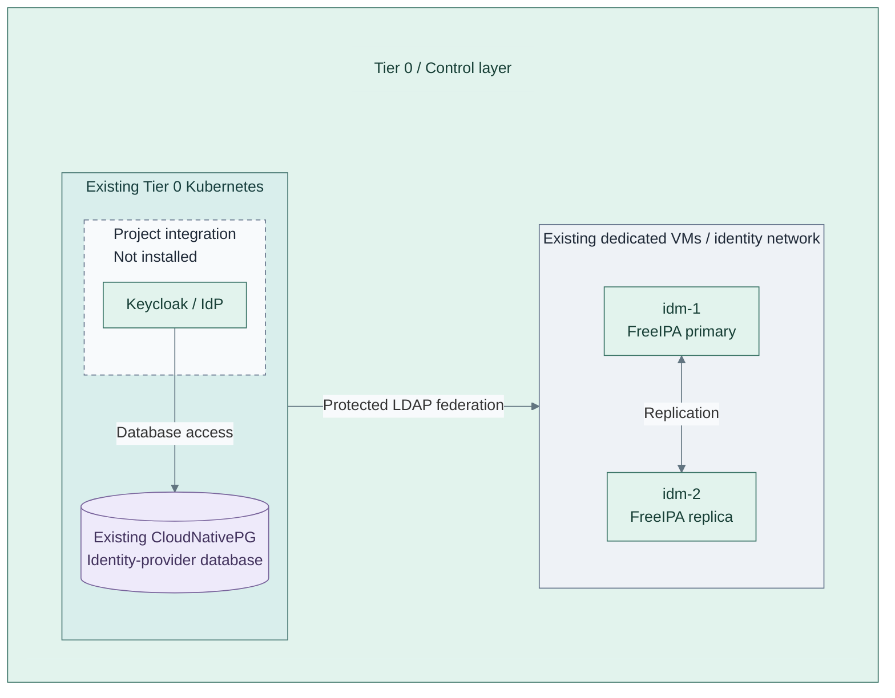

# Stage 5: Identity

Establish directory authority and federated service authentication. Ansible configures
FreeIPA on dedicated VMs; the accepted Tier 0 Kubernetes platform hosts the identity provider.

**Prerequisites:** accepted [Kubernetes platform](../stage-4-kubernetes/README.md),
approved compute/templates, certificate trust, software supply and independent credentials.
**Working repository:** `<prefix>-tier-0` (source: `tier-0/`).
**Automation:** the dedicated FreeIPA recipe is supplied; Keycloak is an application
starter, not an installed service. See [coverage](../../reference/implementation-support.md#stage-coverage).
**Design:** [identity authority](../../architecture/identity/README.md) and
[cluster runtime](../../architecture/compute/README.md).

## Main path

1. [Deploy the directory pair](#step-1-deploy-the-directory-pair)
2. [Deploy identity federation](#step-2-deploy-identity-federation)

## Step 1: Deploy the directory pair

**IaC:** Tier 0 [foundation inputs](../../../tier-0/terraform/deployments/foundation/terraform.tfvars.example) and
[directory recipe](../../../tier-0/ansible/playbooks/deployment/identity-freeipa.yml).
Directory VMs may already be allocated by Stage 3; retain the existing CA and all state.

Follow the [FreeIPA procedure](procedures/freeipa.md). Add the identity VMs to the
Tier 0 [foundation root](../../../tier-0/terraform/deployments/foundation/)
and [inventory](../../../tier-0/ansible/inventory/hosts.yml.example)
without removing the existing issuer definition.
For the sibling FreeIPA CA, the [external-signing integration gate](procedures/freeipa.md#external-ca-integration-gate)
selects the CSR/pause and certificate/completion phases now implemented by the recipe.
Offline signing remains a separate authorized operation.
Verify the primary before joining the replica; test DNS and replication before
replacing temporary bootstrap dependencies.

FreeIPA stays outside Kubernetes. Directory and cluster setup can proceed independently
once their prerequisites exist. Preserve independent administrative credentials.

## Step 2: Deploy identity federation

**Integration:** Tier 0 [Keycloak manifests](../../../tier-0/clusters/tier0/applications/keycloak/kustomization.yaml)
are an empty starter, not an installer. The existing directory comes from the
[FreeIPA recipe](../../../tier-0/ansible/playbooks/deployment/identity-freeipa.yml);
the database must pass [Kubernetes platform readiness](../stage-4-kubernetes/README.md#step-2-establish-the-basic-platform) first.

Add reviewed Keycloak manifests with its database, TLS and FreeIPA federation.
Configure OIDC clients, group mappings and scoped service roles; verify permitted
and denied logins before granting administrative access. Each consumer retains
its own authorization. The directory remains independent of the IdP.

Retain bootstrap credentials and test recovery without normal directory or IdP login.
Later stages register their service-specific clients against this identity provider;
they do not deploy another provider. Service manifests and integration remain project
work; see the [support map](../../reference/implementation-support.md).

## Capability available

**Result:** after the selected integrations and acceptance checks, replicated directory services,
a federated identity provider and the
existing Kubernetes platform realize the
[identity design](../../architecture/identity/README.md). Bootstrap and recovery
remain independent of normal Keycloak login, Vault, GitLab and Harbor.

Record directory, federation and backup checks. Continue with
[Stage 6: Secrets](../stage-6-secrets/README.md).
