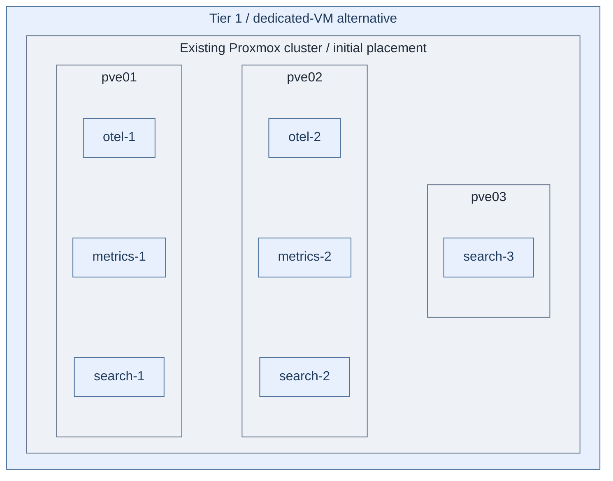

# Step 1b: Dedicated observability VMs

**Normal path:** [Observability in Tier 1 Kubernetes](README.md).
**Change:** use dedicated VMs instead of the Kubernetes workloads.
It separates resource profiles; it does not combine all products into identical VMs.

**Working repository:** `<prefix>-tier-1` (source: `tier-1/`).
**Branch from:** [Step 1](README.md#step-1-prepare-the-runtime) when choosing the runtime.
**Return:** [Step 2](README.md#step-2-deploy-the-signal-pipelines) to integrate the services.
**Design:** [signals, scaling and availability](../../architecture/operations/telemetry.md).
**Coverage:** VM creation and OS baseline only; no product or HA-runtime installer.

## Table of contents

- [Step 1: Configure the hosts](#step-1-configure-the-hosts)
- [Step 2: Provision the baseline](#step-2-provision-the-baseline)
- [Step 3: Integrate and accept the services](#step-3-integrate-and-accept-the-services)
- [Existing installations](#existing-installations)

<a id="deploy-the-telemetry-host-variant"></a>
<a id="iac-defaults"></a>

## Step 1: Configure the hosts



**IaC:** Tier 1 [VM inputs](../../../tier-1/terraform/deployments/observability/terraform.tfvars.example),
[inventory](../../../tier-1/ansible/inventory/hosts.yml.example) and
[IP map](../../../tier-1/ansible/group_vars/observability.yml.example).
All seven VMs receive OS baseline only, with local disks on the illustrated initial hosts.
This is not an installed or accepted HA service.

| Role | Starter hosts | Responsibility |
| --- | --- | --- |
| Telemetry gateways | `otel-1`, `otel-2` | Collector pipelines and bounded buffers |
| Metrics backend | `metrics-1`, `metrics-2` | Independent VictoriaMetrics copies |
| Search backend | `search-1`, `search-2`, `search-3` | OpenSearch cluster members, not syslog receivers |

`otel` is the recognized OpenTelemetry project abbreviation; `metrics` and
`search` name backend roles. Dashboards, query routing and processing are services,
not an implied extra VM per box. Their runtime/resources must be selected explicitly.

From the Tier 1 repository root:

```bash
bash scripts/init-local-files.sh --setup observability
```

Edit the local copies of the linked files and `terraform/common.tfvars`.
The Linux alternative uses the `observability` attachment; it needs no separate
security-syslog subnet or archive VM. The Kubernetes root uses its own network inputs.

Select capacity from measured demand. The example sizes/disks are not performance
guarantees. Verify three independent physical hosts for the search quorum and
surviving capacity; three VMs on one or two hosts do not satisfy that failure contract.

## Step 2: Provision the baseline

Review the plan before applying:

```bash
bash scripts/deploy.sh observability --plan-only
```

After approval:

```bash
bash scripts/deploy.sh observability
```

The [baseline recipe](../../../tier-1/ansible/playbooks/deployment/telemetry-hosts.yml)
reuses Shared's baseline role against Tier 1 inventory. No Collector, metric store,
search service, UI or private failover endpoint is installed by that command.
Proxmox placement is creation-only, not persistent anti-affinity; preserve failure
separation through the selected [cluster policy](../foundation/step-1b-cluster-ha.md#terraform-against-the-cluster).

## Step 3: Integrate and accept the services

Follow [Observability, Steps 2-4](README.md#step-2-deploy-the-signal-pipelines)
with project-owned service automation for these hosts instead of cluster workloads.

1. Install independently sized gateways, replicated metrics and the search cluster.
   Configure UI/processing placement without silently co-locating resource-heavy backends.
   Select explicit Netdata parent capacity and tier-local agents using the
   [infrastructure-monitoring guide](infrastructure-monitoring.md); these seven VM
   definitions do not allocate or install a separate diagnostics runtime.
2. Verify endpoint failover, metric write replication, search quorum/shard copies,
   source authentication, queues, backups and independent restoration.
3. Test scoped reads and deny mutations of Tier 0 evidence. Record accepted loss and
   recovery limits during a complete physical-host failure, not just a process restart.

Original security/audit logs remain in Tier 0 `log-1` and optional `log-2`.
This setup has **no Tier 1 syslog receiver or authoritative security archive**.
Return to the selected main path after runtime acceptance.

## Existing installations

Do not overwrite live `terraform.tfvars`, inventory, IP maps or state with the new
example. Old `telemetry-1`, `syslog-1`, `logs-1`, `telemetry-ui-1` and
`archive-1` selections remain project-owned until explicitly retired or migrated.

New keys and reused VMIDs/IPs can conflict with existing guests or propose destruction.
Keep old desired state during migration; review a saved plan and use tested state/resource
migration where appropriate. Generator refresh does not migrate existing live hosts.
Retain any locally required networks even though unused starter attachments were removed.
