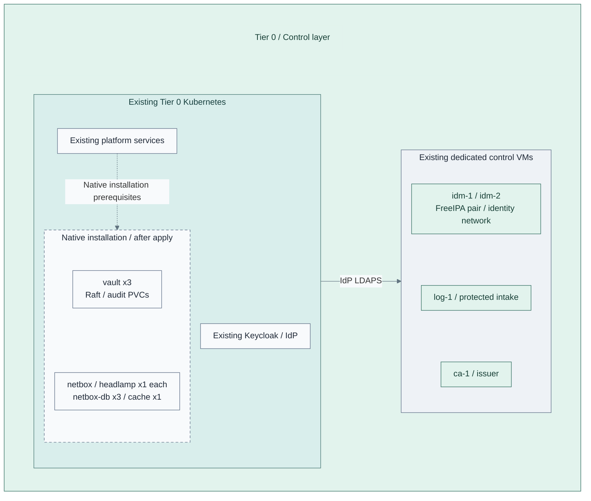

# Stage 6: Secrets

Establish the Tier 0 secret service, its audit trail and independent recovery custody.
Then add the inventory and administration tools that support platform operation.
FreeIPA, the issuer and the identity provider already exist.

**Prerequisites:** accepted [Identity](../stage-5-identity/README.md),
service storage/backups and independent recovery inputs.
**Working repository:** `<prefix>-tier-0` (source: `tier-0/`).
**Execution context:** `<prefix>-tier-0/`.

**Automation:** native installation supplies Vault, NetBox and Headlamp. Initialization/unseal and
recovery acceptance remain operator tasks; see [coverage](../../reference/implementation-support.md#stage-coverage).
**Design:** [identity](../../architecture/identity/README.md),
[secrets](../../architecture/cryptography/README.md) and [operations](../../architecture/operations/README.md).

<a id="step-1-deploy-identity-federation"></a>

Identity federation and the OIDC provider are established in
[Identity, Step 2](../stage-5-identity/README.md#step-2-deploy-identity-federation).
This stage integrates secret-service and operator access with that provider.

## Main path

1. [Deploy the secret service](#step-1-deploy-the-secret-service)
2. [Add operational tools](#step-2-add-operational-tools)
3. [Integrate access and recovery](#step-3-integrate-access-and-recovery)
4. [Establish independent monitoring](#step-4-establish-independent-monitoring)



**IaC:** Tier 0 [control-application recipe](../../../tier-0/ansible/playbooks/deployment/control-applications.yml),
[product role](../../../tier-0/ansible/roles/control_applications) and
[example inputs](../../../tier-0/ansible/group_vars/control_applications.yml.example)
install the added group after explicit prerequisite gates. The picture shows configured
placement, not a verified live service. Empty Flux application starters are not a
second reconciliation owner for these Helm releases.
The [Vault VM alternative](step-1b-vault-vm.md) replaces, rather than duplicates, the cluster Vault instance.
Independent monitoring is a separate [selected integration](monitoring.md), not an installed workload here.

| Existing interface | New consumer |
| --- | --- |
| Existing Keycloak / OIDC | Secret-service and operator-tool access where supported |
| CloudNativePG | NetBox database |
| Issuing CA | cert-manager requests; Vault integration only through a supported provider |
| Cluster API | Headlamp with scoped RBAC |

<a id="step-2-deploy-operational-services"></a>

## Step 1: Deploy the secret service

1. Choose **1a: Kubernetes Vault** (main path) or
   [1b: dedicated Vault VM](step-1b-vault-vm.md). Install only one realization.
   [1c: seal integration](step-1c-seal-integration.md) is an additional explicit seal choice.
2. For 1a, create the local application inputs without overwriting Stage 5 settings:

   ```bash
   # Run from <prefix>-tier-0/
   cp -n ansible/group_vars/control_applications.yml.example ansible/group_vars/control_applications.yml
   ```

   Edit these files using the fields below:

   ```text
   # Edit in <prefix>-tier-0/
   ansible/group_vars/control_applications.yml
   # Edit: Component selection, cluster context, TLS/SSO, database and backup-phase inputs.
   ```

3. Edit `ansible/group_vars/control_applications.yml`:

   | Field | Set before installation |
   | --- | --- |
   | `control_applications_components` | `[vault]` |
   | `control_applications_vault_phase` | `install` initially |
   | `control_applications_kubeconfig`, `control_applications_context` | Existing Tier 0 cluster only |
   | `control_applications_hosts.vault` | Approved private Vault DNS name |
   | `control_applications_storage_class` | Accepted live block storage for Raft/audit PVCs |

4. Prepare TLS and the accepted Secret owner using
   [application Steps 1–2](procedures/control-applications.md#configure-inputs), then render:

   ```bash
   # Run from <prefix>-tier-0/
   ANSIBLE_CONFIG=ansible/ansible.cfg ansible-playbook -i localhost, ansible/playbooks/deployment/control-applications.yml
   ```

   Review the private output, then install the sealed service:

   ```bash
   # Run from <prefix>-tier-0/
   ANSIBLE_CONFIG=ansible/ansible.cfg ansible-playbook -i localhost, ansible/playbooks/deployment/control-applications.yml -e control_applications_action=apply
   ```

   These commands assume pre-existing Secrets. For encrypted bootstrap inputs, add
   `-e @secrets/control-applications.yml --ask-vault-pass` to both, as described in the input procedure.
5. Complete [Vault ceremony and acceptance](procedures/vault-kubernetes.md#operator-ceremony).
   The first install leaves Vault sealed. Keep recovery shares outside Vault and Git.

**Continue only after:** verified TLS, scoped access, protected audit delivery and a clean-target restore.

## Step 2: Add operational tools

1. In `ansible/group_vars/control_applications.yml`, change
   `control_applications_components` to `[netbox, headlamp]`; retain the accepted Vault configuration.
2. Complete [application installation](procedures/control-applications.md), Steps 1–3,
   with NetBox database/media storage, NAS backup commissioning and the existing IdP clients.
3. Install [NetBox change-audit collection](procedures/netbox-audit.md), Steps 1–3,
   before accepting inventory changes as audited.

The recipe creates/gates the CNPG database and backup resources before NetBox Helm,
supplies a persistent TLS cache, and binds only selected human groups to namespace
view access in Headlamp. Complete the native
[Stage 5 API OIDC integration](../stage-5-identity/procedures/kubernetes-sso.md),
including certificate access during issuer outage, before accepting Headlamp access.

NetBox documents inventory. It never supplies the inventory needed to bootstrap
its own platform. Test backups and restoration before other tiers depend on these services.
Ordinary application logging does not preserve NetBox's complete change ledger.

## Step 3: Integrate access and recovery

1. Apply the [service SSO checks](../stage-5-identity/procedures/service-sso.md) to each installed service.
2. Test permitted/denied roles and privileged recovery without directory or IdP login.
3. Record independent recovery custody before restricting bootstrap credentials.

Optional [3b: hardware-backed authentication](step-3b-hardware-authentication.md)
adds stronger operator login after recovery is working. Restrict routine bootstrap
credentials only after independent break-glass access and recovery custody are verified.

## Step 4: Establish independent monitoring

Complete [independent monitoring](monitoring.md), Steps 1–3: select the existing host,
edit collector/alert inputs, install and test external alerts. This is part of the main path;
the recipe creates no monitoring VM and cannot use `log-1` or `log-2` as its target.

Required cluster-loss detection stays outside the observed cluster. Observability
is a separate [Stage 8 capability](../stage-8-observability/README.md), not a prerequisite
for Tier 0 investigation or alerting.

## Capability available

Apply the [service SSO gate](../stage-5-identity/procedures/service-sso.md) to human
access; preserve tested independent recovery before retiring bootstrap logins.

**Result:** after service installation and acceptance, the secret service in the
[reference platform](../../architecture/reference-platform.md#service-placement)
provides scoped secret access, auditing and independent unseal/recovery.
Supporting inventory, administration and monitoring integrations are recorded separately.
Record access, backup/restore and external failure-detection evidence.

Continue with [Stage 7: Delivery](../stage-7-delivery/README.md).
