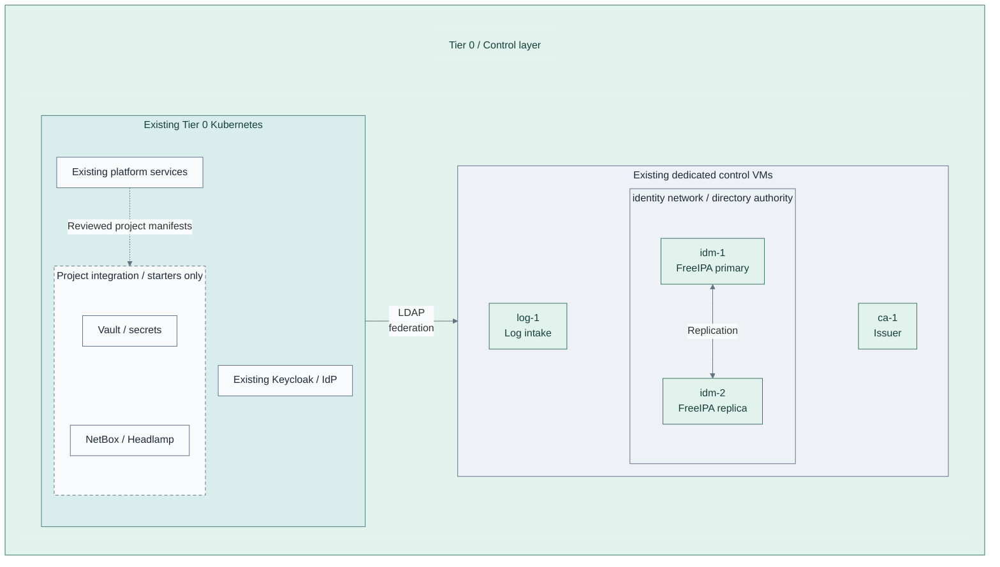

# Stage 6: Secrets

Establish the Tier 0 secret service, its audit trail and independent recovery custody.
Then add the inventory and administration tools that support platform operation.
FreeIPA, the issuer and the identity provider already exist.

**Prerequisites:** accepted [Identity](../stage-5-identity/README.md),
service storage/backups and independent recovery inputs.
**Working repository:** `<prefix>-tier-0` (source: `tier-0/`).
**Automation:** cluster Vault, NetBox and Headlamp are empty application starters;
independent monitoring also needs integration. The Vault VM alternative supplies a
service recipe. See [coverage](../../reference/implementation-support.md#stage-coverage).
**Design:** [identity](../../architecture/identity/README.md),
[secrets](../../architecture/cryptography/README.md) and [operations](../../architecture/operations/README.md).

Identity federation and the OIDC provider are established in
[Identity, Step 2](../stage-5-identity/README.md#step-2-deploy-identity-federation).
This stage integrates secret-service and operator access with that provider.

## Main path

1. [Deploy the secret service](#step-1-deploy-the-secret-service)
2. [Add operational tools](#step-2-add-operational-tools)
3. [Integrate access and recovery](#step-3-integrate-access-and-recovery)
4. [Establish independent monitoring](#step-4-establish-independent-monitoring)

**Integration:** Tier 0 [application starters](../../../tier-0/clusters/tier0/applications/kustomization.yaml)
are project-owned placeholders, not installers for the dashed group.
Supply and review the manifests before Flux can reconcile these applications.
The [Vault VM alternative](step-1b-vault-vm.md) replaces, rather than duplicates, the cluster Vault instance.
Independent monitoring is a separate [selected integration](monitoring.md), not an installed workload here.

| Existing interface | New consumer |
| --- | --- |
| Existing Keycloak / OIDC | Secret-service and operator-tool access where supported |
| CloudNativePG | NetBox database |
| Issuing CA | cert-manager requests; Vault integration only through a supported provider |
| Cluster API | Headlamp with scoped RBAC |

## Step 1: Deploy the secret service

Keep control-service manifests in Tier 0's
[clusters/tier0/applications/](../../../tier-0/clusters/tier0/applications/),
not in Shared. These paths are starters for project integration,
not complete application installers; see the [support map](../../reference/implementation-support.md).

Deploy Vault with its own persistent storage, initialization, audit and protected
unseal/recovery material. It does not use CloudNativePG as its storage backend.
**Alternative:** [1b: dedicated Vault VM](step-1b-vault-vm.md) replaces the cluster instance.
[1c: seal integration](step-1c-seal-integration.md) changes unseal/recovery, not PKI signing.

Verify TLS, initialization, scoped access, protected audit forwarding and restore
before storing service credentials. Keep unseal/recovery material outside Vault.

## Step 2: Add operational tools

Add NetBox with its database/cache dependencies and Headlamp with scoped permissions.

NetBox documents inventory. It never supplies the inventory needed to bootstrap
its own platform. Test backups and restoration before other tiers depend on these services.

## Step 3: Integrate access and recovery

Configure OIDC clients and service roles where supported. Test permitted and denied
access, then rehearse privileged recovery without normal directory or IdP login.

Optional [3b: hardware-backed authentication](step-3b-hardware-authentication.md)
adds stronger operator login after recovery is working. Restrict routine bootstrap
credentials only after independent break-glass access and recovery custody are verified.

## Step 4: Establish independent monitoring

Follow the [monitoring deployment](monitoring.md): prepare its independent runtime,
add critical history/diagnostics, then enable and test external alerts. Each step
shows what is added to the existing Tier 0 logging foundation.

Required cluster-loss detection stays outside the observed cluster. Observability
is a separate [Stage 8 capability](../stage-8-observability/README.md), not a prerequisite
for Tier 0 investigation or alerting.

## Capability available

**Result:** after service installation and acceptance, the secret service in the
[reference platform](../../architecture/reference-platform.md#service-placement)
provides scoped secret access, auditing and independent unseal/recovery.
Supporting inventory, administration and monitoring integrations are recorded separately.
Record access, backup/restore and external failure-detection evidence.

Continue with [Stage 7: Delivery and handover](../stage-7-delivery/README.md).
