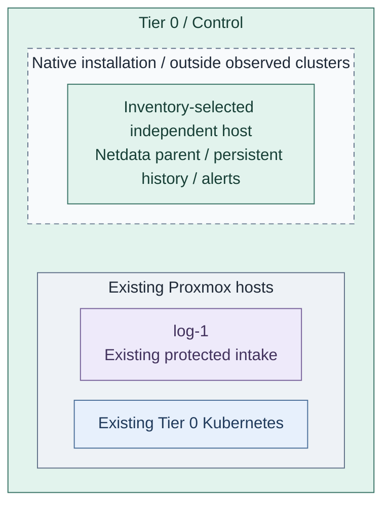
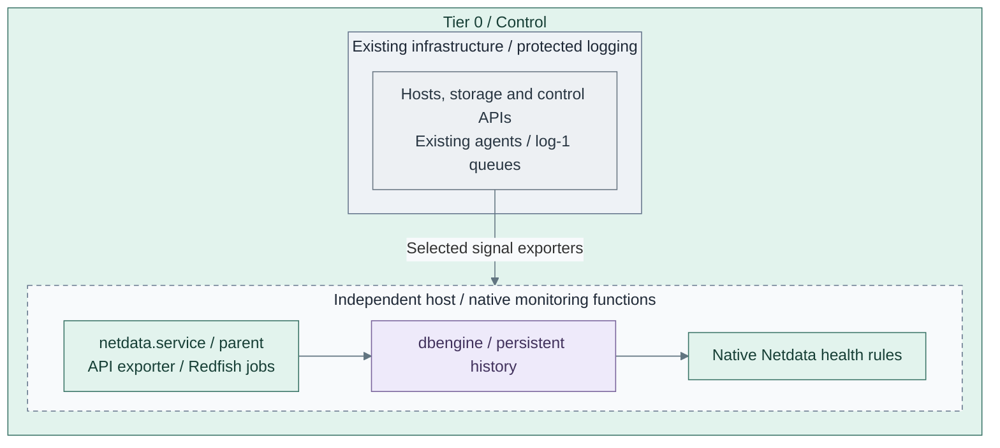
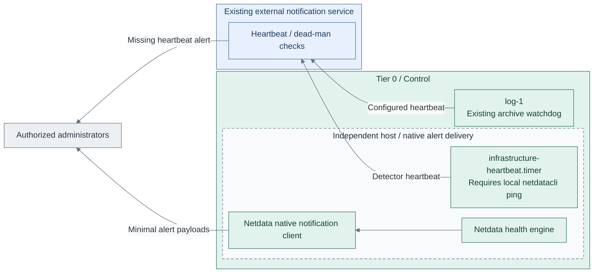

# Independent foundation monitoring

Add critical health history, diagnostics, rule evaluation and alerts to the existing
protected logging capability. This is the monitoring deployment in Stage 6, not a
prerequisite for the earlier collector.

**Working repository:** `<prefix>-tier-0` (source: `tier-0/`).
**Prerequisites:** accepted [protected logging](../stage-2-logging/README.md), approved
runtime/storage and independent recovery inputs. Tier 1 Observability is not required.
**Design:** [telemetry composition](../../architecture/operations/telemetry.md).

## Main path

1. [Prepare the monitoring runtime](#step-1-prepare-the-monitoring-runtime)
2. [Add critical health and history](#step-2-add-critical-health-and-history)
3. [Enable and verify independent alerts](#step-3-enable-and-verify-independent-alerts)

The [dedicated recipe](../../../tier-0/ansible/playbooks/deployment/infrastructure-monitoring.yml)
installs native Netdata on an approved existing RedHat-family host, with persistent
history, local health rules and independent notifications. Redfish jobs and a local Proxmox
API exporter keep management credentials in Tier 0. Optional metric export is strictly allowlisted.
It creates no VM and does not install agents on hypervisors.

Prepare ignored local copies of the
[settings](../../../tier-0/ansible/group_vars/infrastructure_monitoring.yml.example) and
[private inputs](../../../tier-0/ansible/group_vars/infrastructure_monitoring_secrets.yml.example).
Run from the Tier 0 `ansible/` directory:

```bash
ansible-playbook playbooks/deployment/infrastructure-monitoring.yml \
  -e @group_vars/infrastructure_monitoring.yml \
  -e @group_vars/infrastructure_monitoring_secrets.yml
```

The default `render` action writes private native configurations on the controller and
does not connect to the target. Add the existing host to the `infrastructure_monitoring`
inventory group. Explicit `-e infrastructure_monitoring_action=apply` installs the services;
it requires independently verified placement and read-only polling identities.
Protected `log-1` and optional `log-2` are rejected as monitoring targets by this recipe.

## Step 1: Prepare the monitoring runtime



**IaC:** Tier 0's [role](../../../tier-0/ansible/roles/infrastructure_monitoring),
[recipe](../../../tier-0/ansible/playbooks/deployment/infrastructure-monitoring.yml) and local
inputs own the installation on an existing host. The log-host Terraform and cluster starters
provide context only. No additional VM is provisioned; host placement remains a prerequisite.

1. Select an existing independent host or provision reviewed Tier 0 capacity.
   This recipe deliberately uses a different host from the protected logging receivers.
   A monitor does not independently detect its own complete host loss.
2. Keep required cluster-outage detection outside that cluster. Cluster manifests
   may add internal monitoring, but cannot replace the external detector.
3. Record placement, local access, storage/backups and signal ownership. If changing
   host capacity, review its owning provisioning inputs before applying. There is no
   separate Terraform `monitoring` setup; this Ansible recipe consumes existing capacity.

**Result:** a selected runtime that remains available during the required cluster outage.

## Step 2: Add critical health and history



**IaC:** the [native configuration templates](../../../tier-0/ansible/roles/infrastructure_monitoring/templates)
configure the parent, dbengine history, source jobs and metric bridge. The three monitoring
functions share one Netdata service; they are not three extra VMs or backends.
The existing receiver and cluster recipes do not install these services.

1. Select a small dataset: host/storage/network health, source coverage, receiver queues,
   evidence writes/replication, capacity, certificate expiry and cluster/API availability.
2. Pin the native Netdata and go.d RPM builds from the approved signed repository.
   Add Redfish jobs with file-based credentials and validated TLS. The native Podman module
   creates a loopback-only, digest-pinned Proxmox API exporter. Host-level Proxmox diagnostics
   need separately reviewed host agents. No VictoriaMetrics, vmalert or Alertmanager service
   is installed in this Tier 0 profile. [1][2][3]
3. Verify sample signals, local reader scopes and retained history. Netdata streaming
   is a separate integration from OpenTelemetry pipelines; do not imply automatic forwarding.

**Result:** foundation diagnostics and critical history are usable without Tier 1 search.

## Step 3: Enable and verify independent alerts



**IaC:** the [native heartbeat recipe](../../../tier-0/ansible/roles/infrastructure_monitoring/tasks/heartbeat.yml)
installs the timer; the role also configures health rules and private `health_alarm_notify.conf`.
The independent heartbeat runs only while `netdatacli ping`
succeeds; it detects monitor loss, not the health of every source. Device/source freshness
rules and delivery tests are required inputs, using the actual observed chart names.
The existing Tier 0 [archive job](../../../tier-0/ansible/playbooks/deployment/logging-archive.yml)
can call its configured external watchdog; neither recipe installs that external service.
The protected runtime stays on the right; heartbeat and alert traffic travels left
through the external service to administrators outside that service boundary.

1. Configure native Netdata rules and notification routing with independent credentials
   and an approved external notification path. Keep alert payloads
   minimal; notifications do not grant external access to sensitive raw logs.
2. Test cluster/API failure, missing source, stalled evidence writes, capacity thresholds
   and loss of the monitoring host. The external heartbeat detects failure of the local detector.
3. Repeat required checks without Tier 1, hosted source control, normal SSO or secret services.
   Record delivery, silence/acknowledgement authority, recovery and remaining blind spots.

**Result:** required foundation failures produce independently delivered alerts.

## IaC locations

| Repository | Path inside that repository | Coverage |
| --- | --- | --- |
| Tier 0 | [ansible/roles/infrastructure_monitoring/](../../../tier-0/ansible/roles/infrastructure_monitoring) | Native parent, rules, jobs, external heartbeat and optional approved metric bridge |
| Tier 0 | [deployment playbook](../../../tier-0/ansible/playbooks/deployment/infrastructure-monitoring.yml) | Existing host only; default private rendering, explicit apply |
| Tier 0 | [terraform/deployments/syslog/](../../../tier-0/terraform/deployments/syslog) | Protected logging resources remain separate |
| Tier 0 | [clusters/tier0/](../../../tier-0/clusters/tier0) | Project cluster manifests; no monitoring installer |
| Tier 0 | [ansible/playbooks/deployment/foundation-logging.yml](../../../tier-0/ansible/playbooks/deployment/foundation-logging.yml) | Existing protected log receiver; unchanged by monitoring |
| Shared | [ansible/roles/baseline/](../../../shared/ansible/roles/baseline) | Common OS preparation, not inventory, state or alert authority |

Return to [Stage 6 acceptance](README.md#capability-available). Later
[Tier 1 Observability](../stage-8-observability/README.md) adds shared diagnosis without
taking ownership of foundation alerts or protected evidence. Its
[infrastructure-monitoring step](../stage-8-observability/infrastructure-monitoring.md)
expands Netdata diagnostics and Proxmox/BMC coverage; Tier 0 retains local collection,
credentials and critical alerts when Tier 1 is unavailable.

## Input and Runtime Gates

| Input / prerequisite | Required contract |
| --- | --- |
| Existing host | RedHat family, approved signed Netdata repository, local recovery access; outside all observed clusters and protected receiver hosts |
| `infrastructure_monitoring_private_files` | Native TLS files, per-BMC passwords, notification config, external heartbeat curl config; kept under `/etc/netdata/private/` |
| Proxmox identities | Fixed targets and read-only `PVEMonitor`-equivalent access; no guest/host power, configuration or mutation privileges |
| BMC identities | Read-only sensor privileges, trusted HTTPS certificates; qualify vendor coverage explicitly |
| Optional export | Exact metric names and approved labels; gRPC to the private Tier 1 metrics NodePort with a metrics-only client certificate |
| Source health rules | Tested missing/stale-source, quorum, storage and capacity alerts; unsupported sensors remain unknown |
| External notification/watchdog | Existing service independent of Tier 1, SSO, Vault and this host; private credentials and tested delivery |
| Dependencies | Ansible `containers.podman` with native Quadlet support, Podman/systemd on the host |

Only the metric bridge's CA/client certificate/key are mounted into its container. BMC and
Proxmox credentials are not bridge inputs. The exporter binds loopback, so Tier 1 cannot
request arbitrary management targets. Export filtering happens before OTLP transfer.
See [infrastructure monitoring](../stage-8-observability/infrastructure-monitoring.md) for
coverage and [private intake](../stage-8-observability/configuration.md#private-cross-cluster-intake)
for the endpoint/firewall contract. Protected search-copy export is a separate prerequisite.

Rendering and source tests do not establish live alert delivery, package/OS compatibility,
vendor sensor completeness, physical isolation or recovery. Record those acceptance results.

## References

Primary sources checked 2026-10-26.

1. [Netdata Redfish jobs and private credential files](https://learn.netdata.cloud/docs/collecting-metrics/collectors/hardware-and-sensors/redfish)
2. [Proxmox VE Prometheus exporter](https://github.com/prometheus-pve/prometheus-pve-exporter)
3. [Native Podman Quadlet module API](https://docs.ansible.com/projects/ansible/latest/collections/containers/podman/podman_container_module.html)
