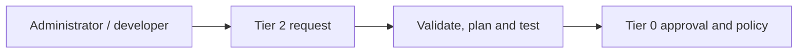
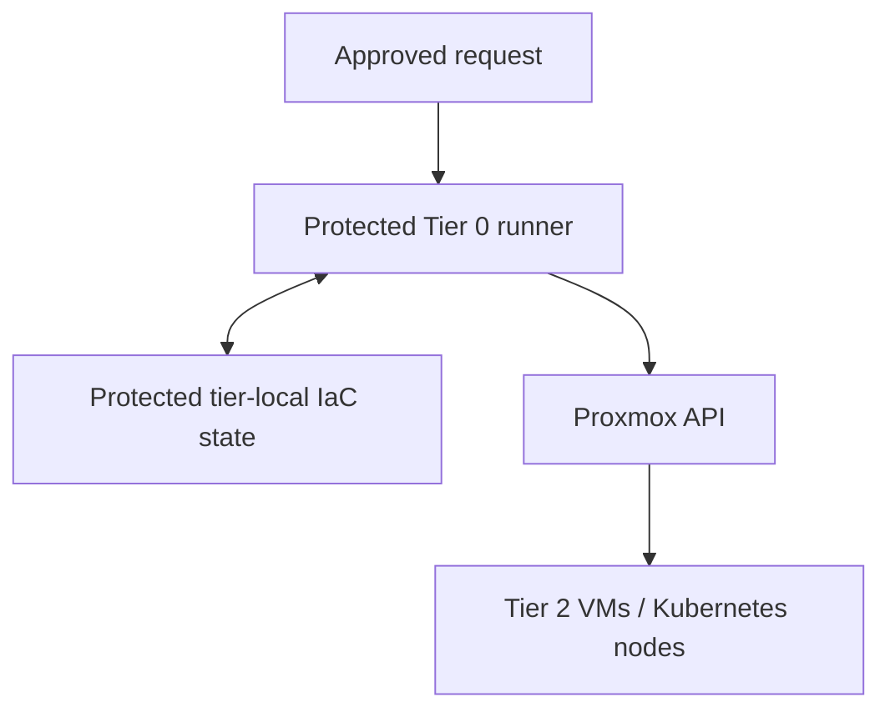
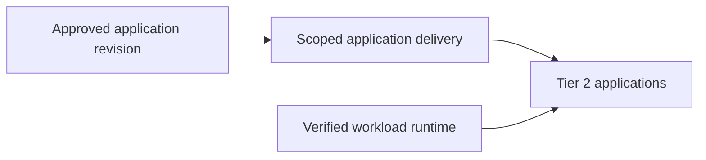

# Stage 6: Workload provisioning

Provide a repeatable, approved workflow for Tier 2 VMs and applications. Requests are
validated and authorized before infrastructure execution; workload GitOps remains
separate from hypervisor and cluster lifecycle authority.

**Prerequisites:** accepted [delivery and protected execution](../stage-5-delivery/README.md),
scoped credentials, protected state and tested recovery.
**Owners:** Tier 2 workload definitions; Tier 0 privileged execution.

## Working repositories

| Work | Repository | IaC location inside that repository |
| --- | --- | --- |
| VM and workload definitions | `<prefix>-tier-2` | [terraform/deployments/lab/](../../../tier-2/terraform/deployments/lab/), [ansible/](../../../tier-2/ansible/) and [workloads/](../../../tier-2/workloads/) |
| Workload cluster | `<prefix>-tier-2` | [terraform/deployments/kubernetes/](../../../tier-2/terraform/deployments/kubernetes/) and [clusters/tier2/](../../../tier-2/clusters/tier2/) |
| Privileged request execution | `<prefix>-tier-0` | Project integration; no complete request controller is supplied |

Run local operator commands from Tier 2's root. Tier 0 execution does not move
these definitions, inventory or state into Tier 0 or Shared.

## Main path

1. [Define the approved request](#step-1-define-the-approved-request)
2. [Provision the workload runtime](#step-2-provision-the-workload-runtime)
3. [Deploy and verify applications](#step-3-deploy-and-verify-applications)

## Step 1: Define the approved request

Start with reviewed operator-driven jobs. Automatic self-service is an optional
implementation of the same bounded contract, not a reason to give general CI credentials.



1. Record the workload owner, permitted templates, sizes, networks and quotas in
   the [Tier 2 repository](../../paths/tier-2/README.md).
2. Validate the request and review its plan under the
   [provisioning contract](../../architecture/compute/provisioning.md).
3. Verify that accepted and rejected requests follow Tier 0 authorization. The
   bounded request interface is a target design, not a shipped controller.

**Result:** only requests inside the selected policy reach privileged execution.
Unimplemented automation is recorded as outstanding work, not treated as available.

## Step 2: Provision the workload runtime

The protected runner creates the approved resources using the owning tier's inputs
and state. Shared supplies reusable helpers, never workload inventory or resources.



1. Execute the reviewed tier-local definition and verify the intended network boundaries.
2. For a workload cluster, reuse the [common Kubernetes procedure](../stage-3-identity-runtime/procedures/kubernetes.md)
   with the tier-local `terraform/deployments/kubernetes/` root and
   `bash scripts/kubernetes-cluster.sh init`. The current installer uses Talos;
   it does not deploy applications, policies or an autoscaler.
3. Verify runtime readiness, state locking and independent restoration before workloads.

For the operator-driven VM/LXC path, initialize from the Tier 2 repository root:

```bash
bash scripts/init-local-files.sh --setup lab
```

Edit local `terraform/deployments/lab/terraform.tfvars`, inventory and
`ansible/group_vars/lab.yml` together. With authorized execution credentials, plan:

```bash
bash scripts/deploy.sh lab --plan-only
```

Review the complete resource plan before `bash scripts/deploy.sh lab`. These are
operator commands, not a command path that grants ordinary workload users Proxmox access.

**Result:** the [compute runtime](../../architecture/compute/README.md) is ready within
the workload's allocated scope, without changing Tier 0 ownership.

## Step 3: Deploy and verify applications

Follow the [workload collection deployment](telemetry.md), Steps 1-3:
security/audit submissions go to protected Tier 0 intake; developer views expose
only approved application logs in Tier 1. Local buffering does not imply local alerting.

Approved application revisions are reconciled inside the owning cluster. Rancher/Fleet
can manage selected Tier 1/2 clusters, never Tier 0 infrastructure.



1. Select [scoped delivery](../../architecture/delivery/controllers.md) from Tier 1
   or an independently owned local controller. Deploy application manifests with
   workload-scoped permissions, namespaces, quotas, policies and service dependencies.
2. Exercise an update, rollback and restore, including the behavior when source control
   is unavailable. Source loss pauses new requests; it never authorizes deletion.
3. Hand recurring operations to [administration](../../administration/README.md), retaining
   independent recovery and separately authorized key ceremonies.

**Result:** application delivery works independently of privileged infrastructure
execution, as required by the [service boundaries](../../architecture/service-boundaries.md).

## Capability available

The platform can repeatedly deliver Tier 2 workloads through its approved workflow.
Record policy, recovery and acceptance evidence against
[readiness criteria](../readiness.md). Continue with administration for ongoing operation
and [development](../../development/README.md) for unimplemented automation.
