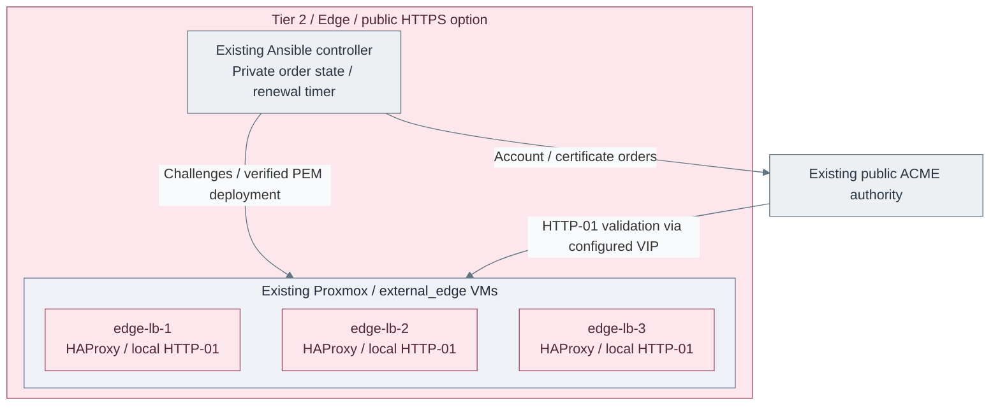

# Publish a website with verified HTTPS

Use Let's Encrypt for browser-facing trust and the private PKI for verified
proxy-to-origin TLS. The public edge holds no CA signing or root key.
This optional path uses the existing Tier 2 HAProxy/keepalived pool.

**Working repository:** `<prefix>-tier-2` (source: `tier-2/`).
**Prerequisites:** prepared Enterprise Linux edge hosts/VIP, Linux Ansible controller
with OpenSSL and system CA trust, community.crypto, valid origin certificates,
accepted audit forwarding and authorized public DNS/firewall access.
If the edge pool does not exist, follow the
[edge provisioning path](../stage-5-delivery/procedures/edge-proxy.md#configuration),
then return here before publishing a website.

## Contents

- [Prepare inputs and reachability](#prepare-inputs-and-reachability)
- [Rehearse then enable production](#rehearse-then-enable-production)
- [Schedule renewal](#schedule-renewal)
- [Accept and operate](#accept-and-operate)
- [References](#references)

## Prepare inputs and reachability

Start with Tier 2's [public HTTPS example](../../../tier-2/ansible/group_vars/public-https.yml.example).
Merge it into the private edge override, preserving existing host addresses,
VIP/interface and keepalived settings. These inputs own ports 80/443 and replace
the generic raw frontend list. Use a dedicated edge: the role owns nginx's main
configuration for loopback-only HTTP-01 serving.

| Input | Selection |
| --- | --- |
| `edge_acme_domains` | Exact public DNS names, no wildcard; all must resolve/reach this edge |
| `edge_acme_email`, `edge_acme_terms_agreed` | Monitored contact and explicit subscriber agreement |
| `edge_acme_state_directory` | Private persistent Tier 2 controller directory outside Git |
| `edge_acme_production` | False for rehearsal; true only after staging succeeds |
| `edge_backend_trust_files` | Independently verified private CA chain; controller source and safe destination name |
| Backend server `tls`, `verify_hostname`, `ca_file` | TLS required; exact expected DNS SAN and trusted origin chain |
| `edge_public_request_rate` | Per-source requests per ten seconds; default 100, tune for shared NAT |
| `edge_acme_remaining_days` | Renewal threshold; default five days; review against actual certificate lifetime |

1. Point every public A/AAAA record at a reachable edge address. Remove an AAAA
   record if IPv6 is not actually served. Allow inbound TCP 80/443 to the VIP,
   outbound HTTPS to ACME and edge-to-approved-origin TLS only. Do not expose the
   loopback challenge listener, HAProxy admin socket, CA portal or origin directly.
2. If CAA is used, authorize `letsencrypt.org`; restrict account/challenge
   parameters only after testing the actual configuration. Protect registrar/DNS
   administration with MFA and scoped credentials. HTTP-01 requires port 80 and
   does not issue wildcard certificates. [1][2]
3. Verify the origin chain/SAN independently. This path requires both CA validation
   and hostname verification; encryption with `verify none` is not acceptable.

## Rehearse then enable production



**IaC:** Tier 2 [public HTTPS inputs](../../../tier-2/ansible/group_vars/public-https.yml.example),
[certificate recipe](../../../tier-2/ansible/playbooks/maintenance/public-certificates.yml) and
[controller timer recipe](../../../tier-2/ansible/playbooks/deployment/public-certificate-schedule.yml).
These configure existing edge hosts/controller, not new VMs, DNS, origins or a public CA.
The [edge deployment view](../stage-5-delivery/procedures/edge-proxy.md#default-deployment) owns the guest resources.

From the Tier 2 repository, reconcile the HTTP bootstrap edge:

```bash
bash scripts/deploy.sh edge --ansible-only --playbook deployment/edge-proxy.yml \
  --ansible-vars /absolute/private/public-https.yml
```

Before a production certificate exists, only HTTP-01 is served; other HTTP
requests return 503 and there is no public TLS listener. With
`edge_acme_production: false` and the subscriber terms accepted:

```bash
bash scripts/deploy.sh edge --recipe maintenance --playbook maintenance/public-certificates.yml \
  --ansible-vars /absolute/private/public-https.yml
```

Staging/account state is separate from production; staging certificates are never
installed on the public listener. Confirm authorization on every named domain,
then set production true and rerun that same command.

The native module creates account/leaf keys and fulfills HTTP-01 on every edge
node before finalization. The role checks chain, SAN set, key match and validity,
then installs a private PEM and validates HAProxy before reloading.
It does not opt into a short-lived ACME profile. Do not assume a fixed 90-day
Let's Encrypt lifetime; profile lifetimes and compatibility evolve. [3]

## Schedule renewal

Keep unattended Tier 2 SSH/become access narrowly scoped to this edge.
Back up the private controller account/key/state and inputs encrypted and off-host.
Run only one order process per state directory; serialize manual runs against the
same `renew.lock` used by the scheduler. A failed order may require a new
authorization on retry; preserve diagnostics without printing private keys.

The controller-local
[schedule recipe](../../../tier-2/ansible/playbooks/deployment/public-certificate-schedule.yml)
installs a systemd timer, not a daemon on each edge. Supply a private vars file:

| Scheduler input | Value |
| --- | --- |
| `public_certificate_schedule_enabled` | true, explicit opt-in |
| `public_certificate_schedule_user` | Existing non-root automation user |
| `public_certificate_schedule_repository` | Absolute Tier 2 repository root |
| `public_certificate_schedule_inputs` | Absolute private production override, mode 0600, owned by that user |
| `public_certificate_schedule_state` | Same private state directory, mode 0700, owned by that user |

```bash
ANSIBLE_CONFIG=ansible/ansible.cfg \
  ansible-playbook --ask-become-pass -i localhost, ansible/playbooks/deployment/public-certificate-schedule.yml \
  -e @/absolute/private/renewal-schedule.yml
sudo systemctl start public-certificate-renewal.service
sudo systemctl status public-certificate-renewal.timer
```

The timer runs twice daily with jitter and a native lock. Alert on failed jobs,
missed successful runs and externally observed expiry. A timer is not an alert
delivery system; test notifications while the controller is unavailable.

## Accept and operate

| Test | Required result |
| --- | --- |
| Public browser/OpenSSL check | Trusted public chain, exact hostname, supported TLS; no insecure verification flags |
| Wrong origin CA or SAN | Request fails closed; never fall back to cleartext or disabled verification |
| VIP move during HTTP-01 | Every eligible owner serves the challenge; validation/renewal completes |
| Unrecognized Host/SNI | Rejected; only intended website routes exist |
| Renewal/reload | New valid PEM on every edge; live connection test after reload |
| ACME/controller failure | Existing valid service remains; independent failure/expiry alerts arrive |
| Traffic spike | Measured rate-limit behavior; shared-NAT impact acceptable; upstream DDoS plan tested |
| Controller loss | Account/key state restored privately; renewal resumes without exposing CA credentials |

HSTS is enabled for the served hostname, without preload or includeSubDomains.
Keep port 80's challenge exception when redirecting. Complete the
[security controls](../../administration/cryptography/security-controls.md)
before treating this path as production-ready.

## References

Sources checked 2026-10-18.

1. [Let's Encrypt HTTP-01 requirements](https://letsencrypt.org/docs/challenge-types/)
2. [Let's Encrypt CAA configuration](https://letsencrypt.org/docs/caa/)
3. [Let's Encrypt certificate profiles](https://letsencrypt.org/docs/profiles/)
4. [Native Ansible ACME two-phase operation](https://docs.ansible.com/projects/ansible/latest/collections/community/crypto/acme_certificate_module.html)
