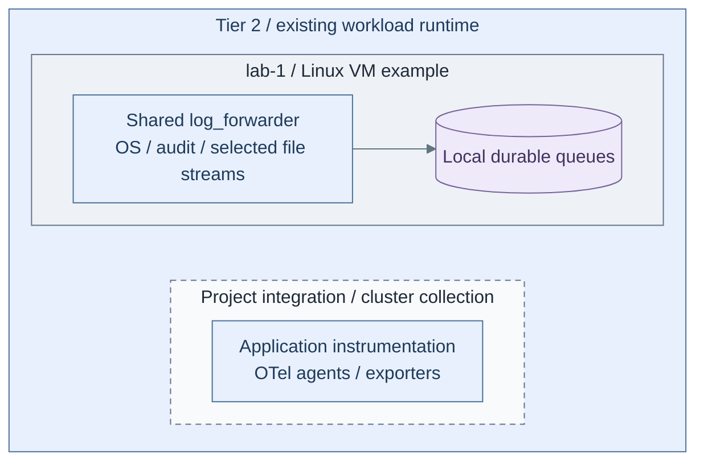
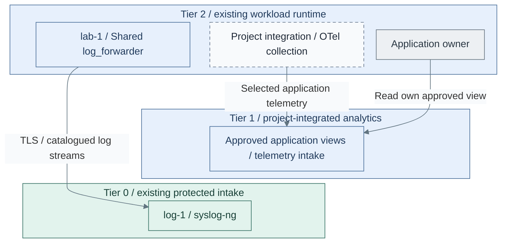
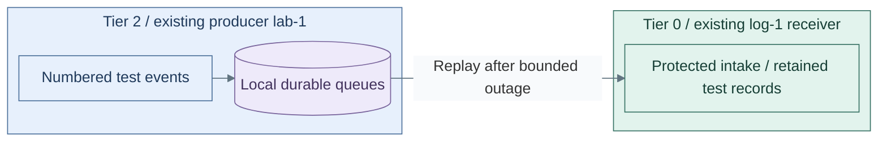

# Scoped workload collection

Connect workload signals to the existing evidence and analytics capabilities.
This adds lightweight collection, not another full observability stack per cluster.

**Working repository:** `<prefix>-tier-2` (source: `tier-2/`).
Other tiers apply the same routing contract using their own inventories and credentials.
**Prerequisites:** approved runtime, [Tier 0 intake](../stage-1-logging/README.md) and the
selected [Tier 1 telemetry interfaces](../stage-5-delivery/analytics.md).
**Design:** [telemetry boundaries](../../architecture/operations/telemetry.md).

## Main path

1. [Prepare local collection](#step-1-prepare-local-collection)
2. [Connect the authorized destinations](#step-2-connect-the-authorized-destinations)
3. [Verify buffering and reader isolation](#step-3-verify-buffering-and-reader-isolation)

## Step 1: Prepare local collection

**IaC:** Tier 2 [producer recipe](../../../tier-2/ansible/playbooks/deployment/logging-producers.yml)
executes Shared's [native sender](../../../shared/ansible/roles/log_forwarder/tasks/main.yml)
on selected existing Linux hosts, such as `lab-1`; it creates no VM.
The [cluster starter](../../../tier-2/clusters/tier2/kustomization.yaml) does not install the dashed OTel/instrumentation group.

1. Identify source owners and required security, application, metric and trace streams.
2. Use the [Linux source recipe](../stage-1-logging/sources.md) for protected log submission.
   Add project roles/manifests for other agents and cluster collectors. Set source credentials,
   disk permissions, buffer capacity and retry limits.
3. Verify local collection, source identity and missing-source detection. Supplied
   VM/cluster provisioning does not install these products automatically.

## Step 2: Connect the authorized destinations

**IaC:** the Tier 2 [producer recipe](../../../tier-2/ansible/playbooks/deployment/logging-producers.yml)
and [local source selections](../../../tier-2/ansible/group_vars/logging_producers.yml.example)
target existing Tier 0 intake. OTel-to-Tier-1 routing and analytics views remain project integration,
not behavior of the Linux sender recipe.

1. Route security/audit events to scoped Tier 0 intake and ordinary application
   telemetry to the approved Tier 1 interfaces.
2. Configure trusted ownership from authenticated routing, not arbitrary labels.
   Producers receive no raw-archive query or administration credentials.
3. Submit sample events and verify the matching application view and protected evidence.

## Step 3: Verify buffering and reader isolation

**Workflow:** verify the installed [Linux sender](../../../shared/ansible/roles/log_forwarder/tasks/main.yml)
against the [Tier 0 receiver](../../../tier-0/ansible/roles/syslog_ng/tasks/main.yml), using the
[fault drill](../../administration/logging-drill.md). Repeat the corresponding tests for project-integrated Tier 1 collectors;
this verification view creates no new service or host.

1. Interrupt Tier 1 connectivity and restart collectors. Verify replay, duplicate/gap
   accounting and capacity/loss alarms against the declared outage window.
2. Test source impersonation, forged ownership and cross-application reads; deny destructive
   query operations and access to Tier 0 originals.
3. Record failure behavior. Tier 2 normally retains collection during Tier 1 outages,
   not independent querying or alerts. Critical workloads explicitly select local retention/evaluation.

## IaC locations

| Repository | Path inside that repository | Coverage |
| --- | --- | --- |
| Tier 2 | [clusters/tier2/](../../../tier-2/clusters/tier2/) | Project collector/instrumentation manifests; no supplied collector installer |
| Tier 2 | [ansible/](../../../tier-2/ansible/) | Tier-local inventory and project host-agent recipes |
| Shared | [ansible/roles/baseline/](../../../shared/ansible/roles/baseline/) | Reusable host preparation only |

**Result:** approved signals reach their scoped destinations without granting workload
users evidence deletion authority. Return to [Stage 6 acceptance](README.md#capability-available).
