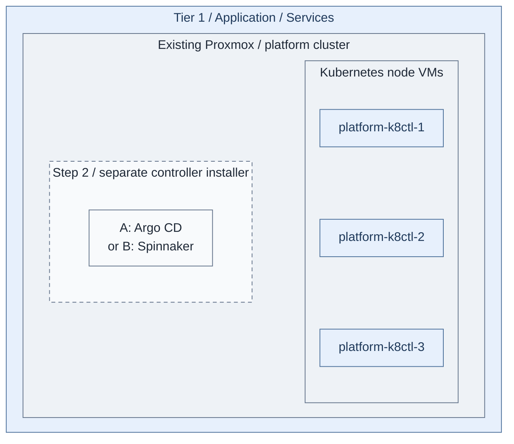

# Stage 7: Delivery

Establish Tier 1 application delivery. Tier 0 already uses Flux from
[Stage 4](../stage-4-kubernetes/README.md); select **A: Argo CD** or **B: Spinnaker**
for Tier 1. GitLab and CI handover belong to [Stage 9](../stage-9-development/README.md).

**Prerequisites:** accepted Secrets, approved images, independent bootstrap Git/OCI
sources and [cluster-foundation gates](../stage-4-kubernetes/procedures/kubernetes.md#cluster-foundation).
The temporary source must work before GitLab exists.
**Working repositories:** `<prefix>-tier-1` for delivery and registry;
`<prefix>-tier-2` for optional public edge. Tier 0 owns its existing Flux.
**Automation:** cluster lifecycle, edge, native pinned Harbor/Argo CD Helm installation
and a reviewed Spinnaker Kustomize executor are supplied. Follow the
[native installer](procedures/delivery-installer.md); Spinnaker still requires a complete
site-reviewed overlay and product configuration before installation.
See the [stage coverage](../../reference/implementation-support.md#stage-coverage)
for prerequisites, integration boundaries and live acceptance requirements.
**Design:** [controller patterns](../../architecture/delivery/controllers.md).

## Main path

1. [Create the platform runtime](#step-1-create-the-platform-runtime)
2. [Select and qualify delivery](#step-2-select-and-qualify-delivery)
3. [Connect approved artifact supply](#step-3-connect-approved-artifact-supply)

<a id="step-1-deploy-shared-delivery-services"></a>

## Step 1: Create the platform runtime

Follow the [Tier 1 cluster procedure](procedures/platform-cluster.md). From Tier 1:

```bash
bash scripts/kubernetes-cluster.sh init
```

Review allocations, image access and the private endpoint before planning/applying.
Keep original cluster secrets and state.



**IaC:** Tier 1 [node inputs](../../../tier-1/terraform/deployments/kubernetes/terraform.tfvars.example)
and [cluster command](../../../tier-1/scripts/kubernetes-cluster.sh) create the three
starter VMs. The dashed controller is installed separately in Step 2 through the
[delivery recipe](../../../tier-1/ansible/playbooks/deployment/delivery-platform.yml).

**Result:** an accepted Tier 1 runtime, before application delivery is enabled.

## Step 2: Select and qualify delivery

| Selection | Procedure | Authority |
| --- | --- | --- |
| Tier 0 Flux | [Verify existing control GitOps](../stage-4-kubernetes/procedures/kubernetes.md#cluster-foundation) | Tier 0 only |
| A: Argo CD | [Application GitOps](step-2a-argocd.md) | Approved Tier 1 applications; additional targets require a separate reviewed account |
| B: Spinnaker | [Release pipelines](step-2b-spinnaker.md) | Approved releases and selected destinations |

Choose one owner for each object; these are alternatives, not two controllers
for the same resources. Apply the [service SSO gate](../stage-5-identity/procedures/service-sso.md).
Use the [Tier 1 native application recipe](procedures/delivery-installer.md),
with an explicit controller selection, pinned versions and private local inputs.
Test delivery, rejected destinations, rollback and independent recovery.
Retain the bootstrap source until later GitLab source migration is accepted.
Neither Tier 1 controller receives Tier 0 Kubernetes or Proxmox credentials.

**Result:** one selected controller with scoped destinations, SSO and recovery.

## Step 3: Connect approved artifact supply

Follow [registry integration](procedures/registry.md). Harbor extends
[early software intake](../stage-1-software-intake/README.md#extend-the-capability-later)
without another ordinary proxy. Qualify storage, pulls, promotion and backups.
Use [Tier 2 edge](procedures/edge-proxy.md) only for approved published endpoints.
Private controller APIs do not require public publication.
Existing accepted registries are valid; an empty directory is not an installer.

**Result:** verified artifact interfaces extend software intake without a bootstrap dependency.

## Capability available

Tier 1 has a selected delivery path and accepted artifact interfaces.
Continue with [Stage 8: Observability](../stage-8-observability/README.md), then
[Stage 9: Development platform](../stage-9-development/README.md).

<a id="step-2-enable-protected-execution"></a>

Runner installation and bootstrap handover now belong to
[Stage 9, Step 4](../stage-9-development/README.md#step-4-hand-over-infrastructure-execution),
after GitLab and Vault CI authentication exist. This stage does not transfer Tier 0 execution.

<a id="step-3-deploy-shared-investigation"></a>
<a id="step-3-deploy-observability"></a>
